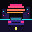
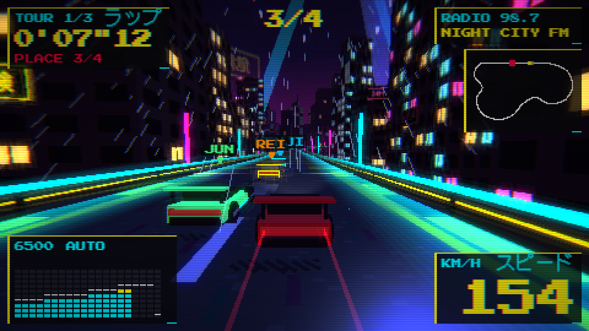

<p align="center"></p>

<h1 align="center">Ville à plein régime</h1>
<p align="center"><b>夜間タイムアタック</b> · <i>Night time attack — an arcade racer for the browser</i></p>

<p align="center"></p>

A pixel-art 3D arcade racing game built with [three.js](https://threejs.org). Single player, up to four players on one screen, or online peer-to-peer. It is a static site: no build step, no install, no server of its own.

<p align="center"></p>

## Features

- **12 tracks**, each with its own layout, car, radio stations, scenery and HUD: a neon highway city, a mountain pass, a bay expressway, Paris at dawn, a Los Angeles canal at sunset, an indoor arena, a snowy pass, a dirt-road rally stage, a Persian bazaar, a dam, a lost jungle city and a beach.
- **Game modes**: time attack (ghost medals: bronze, silver, gold), drift, race against three AI rivals, elimination and a full-night **Tour** with points and a trophy.
- **Up to 4 players** on one screen (gamepads, Joy-Cons or shared keyboard), or **online** with a 4-letter room code over WebRTC.
- **Driving model** inspired by a real Japanese GT: automatic or manual gearbox, handbrake slides, nitro, slipstream, destructible scenery.
- **Live-synthesised soundtrack**: 3+ radio stations per track (darksynth, eurobeat, g-funk, rumba…) that react to how you drive.
- **Demo mode**: leave the pad alone and the game plays itself, track after track.
- Challenge links: send a lap to a friend as a URL, they race your ghost.

<p align="center"></p>

## Play

Open `index.html` in a modern browser, or serve the folder with any static server. For development, use the bundled server, which disables caching and serves the tools too:

```bash
python outils/capture.py 8123   # then open http://localhost:8123/
```

Pick the track with `?carte=<id>` (`ville`, `touge`, `wangan`, `paris`, `canal`, `stade`, `givre`, `terre`, `perse`, `barrage`, `chapada`, `plage`).

## Repository layout

```
index.html        the game (entry point)
src/moteur/       physics (sim.js), rendering and game loop (game.js), network, input
src/donnees/      track data (cartes.js), gold ghost traces
src/audio/        procedural audio engine, samples, instruments
src/rendu/        shared texture / shape / scenery catalogues
src/cartes/<id>/  per-track textures, shapes and scenery placement
pages/            web tools: sound bench, music editor, gamepad diagnostic
assets/           fonts, samples, icon, shared CSS
vendor/           three.js r187, PeerJS
tests/            Node tests (physics, tracks, i18n, input, session)
outils/           benchmarks, screenshot tools, generators, git hook
docs/             documentation (see docs/INDEX.md)
```

## Development

Requires Node 22.12+ (the tests `require` three.js as an ES module).

```bash
sh outils/verifie.sh                        # run all tests
git config core.hooksPath outils/hooks      # run them before each commit
node outils/banc-rapide.js [track]          # performance budget check
node outils/plan.js <track> <plan>          # screenshot a spot on a track
```

The code, comments and developer documentation are written in French. Start with [docs/INDEX.md](docs/INDEX.md); the developer guide is [docs/DEVELOPPEUR.md](docs/DEVELOPPEUR.md) (see "Où régler quoi" to find a setting). A French player-facing README is in [docs/README.fr.md](docs/README.fr.md). Contribution notes: [CONTRIBUTING.md](CONTRIBUTING.md).

## Credits

- [three.js](https://threejs.org) r187 (MIT), [PeerJS](https://peerjs.com) 1.5.4 (MIT).
- Fonts Press Start 2P and DotGothic16 (SIL Open Font License).
- Drum samples: Roland TR-808 recordings by Michael Fischer (Technopolis, 1994), freely distributed by their author without a formal license; see `assets/samples/TR808.TXT`.
- Instruments: FluidR3_GM (CC BY 3.0) and AKWF waveforms (CC0).
- Cars have invented names; their specs are inspired by real cars. Tracks, scenery, station names and music are original.

## License

[MIT](LICENSE) for the game code. Third-party components keep their own licenses (see Credits); the TR-808 samples have no formal license.
