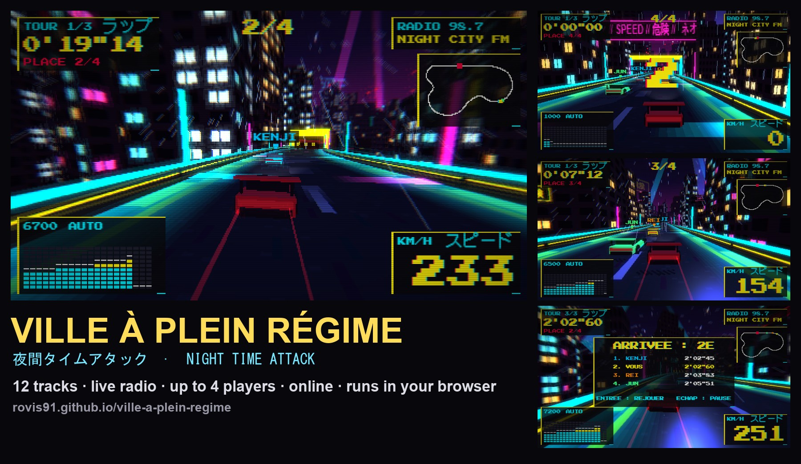
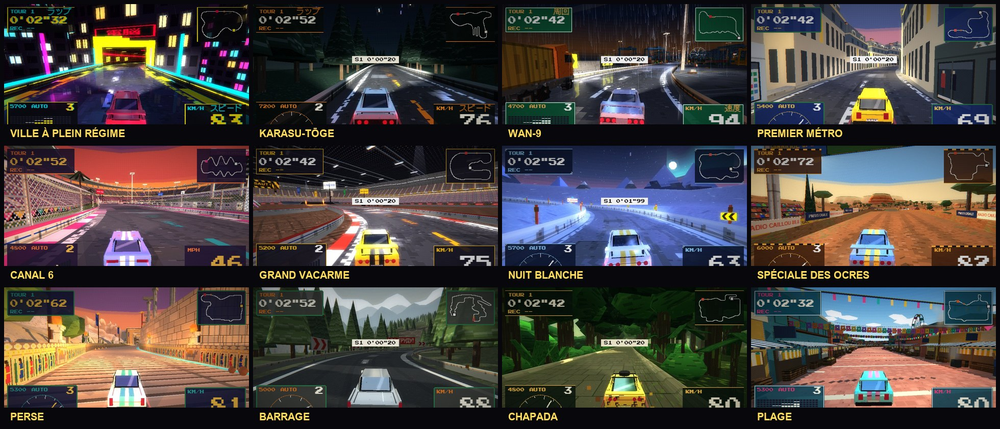

<b><a href="https://rovis91.github.io/ville-a-plein-regime/">▶ Play now in your browser</a></b> · no install, no download

## How to play

Open the [live version](https://rovis91.github.io/ville-a-plein-regime/) (or `index.html` locally) in a modern browser. Pick a track, the number of players, a mode and a gearbox in the main menu (arrows to move, Enter to start), then drive.

| Control | Keyboard | Gamepad |
|---|---|---|
| Accelerate / brake / steer | ↑ ↓ ← → or ZQSD | ZR / ZL, stick |
| Handbrake (starts a slide) | Space | A |
| Nitro | X or N | X |
| Automatic / manual gearbox | G | − |
| Shift down / up (manual) | A / E | L / R |
| Next radio station | C | stick click |
| Mute music | M | |
| Ghost to chase (bronze, silver, gold, personal best) | F | |
| Copy a challenge link of your last lap | L | |
| Pause / restart | Esc or P / R | + |

Two to four players share one screen (two gamepads, two Joy-Cons, or the keyboard split in two: ZQSD on the left, arrows on the right). To play online, choose ONLINE on the title screen and share the 4-letter room code or the link.

## Features

- **12 tracks**, each with its own layout, car, radio stations, scenery and HUD: a neon highway city, a mountain pass, a bay expressway, Paris at dawn, a Los Angeles canal at sunset, an indoor arena, a snowy pass, a dirt-road rally stage, a Persian bazaar, a dam, a lost jungle city and a beach.
- **Game modes**: time attack with ghost medals, drift, race against three AI rivals, elimination, and a full-night **Tour** with points and a trophy.
- **Up to 4 players** on one screen, or **online** peer-to-peer over WebRTC: no server of our own, no account.
- **Driving model** inspired by a real Japanese GT: automatic or manual gearbox, handbrake slides, nitro, slipstream, smashable scenery.
- **Live-synthesised soundtrack**: three or more radio stations per track (darksynth, eurobeat, g-funk, rumba…) that react to how you drive.
- **Challenge links**: send a lap as a URL and your friend races your ghost.
- **Demo mode**: leave the pad alone and the game plays itself, track after track.
- Pixel-art 3D with [three.js](https://threejs.org); a static site with no build step.

## Credits

- [three.js](https://threejs.org) r187 (MIT), [PeerJS](https://peerjs.com) 1.5.4 (MIT).
- Fonts Press Start 2P and DotGothic16 (SIL Open Font License).
- Drum samples: Roland TR-808 recordings by Michael Fischer (Technopolis, 1994), freely distributed by their author without a formal license; see `assets/samples/TR808.TXT`.
- Instruments: FluidR3_GM (CC BY 3.0) and AKWF waveforms (CC0).
- Cars have invented names; their specs are inspired by real cars. Tracks, scenery, station names and music are original.

## License

[MIT](LICENSE) for the game code. Third-party components keep their own licenses (see Credits).
