# Cahier de feedback — carte BARRAGE

Constat uniquement : aucune solution n'est proposée. Les captures viennent du moteur (`outils/captures.html`, 1920×1080, un tour complet à `pas=5` puis `pas=2`, plus des vues d'inspection `vue=`). `idx` est l'indice d'échantillon de piste (0 à 2371, environ 2,4 m par échantillon, départ à 0).

Origine : **[A]** = retour de l'auteur, **[C]** = constat de l'analyse.

Les numéros d'indice de la spec (`SPEC-BARRAGE.md`, indices de contrôle 8, 16, 19, 22, 42…) ne correspondent pas aux `idx` des captures : seuls les `idx` ci-dessous font foi.

## Plan de la piste (idx observés)

| Zone | idx approx. | Ce qu'on y voit |
|---|---|---|
| 1. Vallée aval, départ | 0 – 240 | route droite, village, rivière à gauche, mur au fond |
| 2. Déversoir et pied du mur | 240 – 340 | gerbes, chevrons, entrée du bâtiment |
| 3. Salle des turbines | 340 – 440 | halle, pont roulant, fenêtres |
| 4. Sortie de halle jusqu'au tunnel | 440 – 810 | murs, silos, bâtiment à toit rond, épingle |
| 5. Tunnel | 810 – 940 | coque, portiques orange |
| 6. Après le tunnel, montée | 940 – 1170 | talus, mur, grand bloc à droite |
| 7. Crête | 1170 – 1650 | route sur le barrage, lac à droite, falaise |
| 8. Descente | 1650 – 2372 | virages, murs, pont, retour au village |

Remarque : la spec annonce des galeries en zigzag dans le mur (indices 23 à 42) avec trois épingles. Dans les captures, la route entre la sortie du tunnel (idx ≈ 940) et la crête est à l'air libre ; le drapeau « tunnel » n'est vrai que de idx 815 à ≈ 930.

---

## Problèmes généraux

**G1. Ambiance et élévation [A]** — Le sol n'a pas de forme crédible : le relief ne raconte pas un barrage (vallée, mur, lac, versants). La carte donne l'impression de pièces posées sur un plan, pas d'un site.
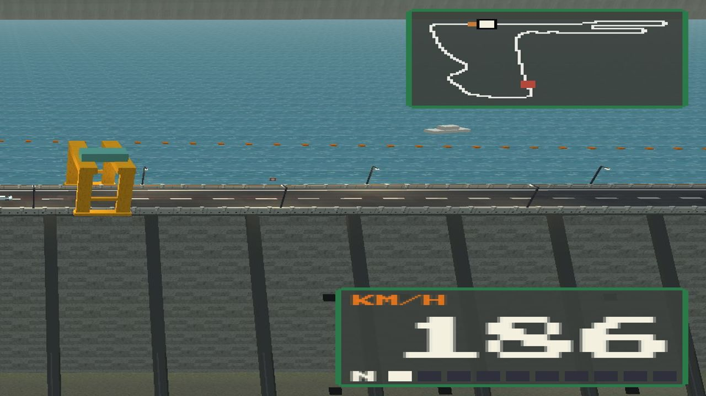
*Vue d'inspection depuis la vallée, idx 1502 : le mur est un voile gris rayé de pilastres, le lac apparaît derrière la route.*

**G2. Niveau du lac [A]** — Le plan d'eau affleure la route de crête et son parapet ; il paraît à la hauteur de la chaussée, et non nettement en dessous. Sur la vue d'inspection, la crête est une bande de route sur une même nappe d'eau qui se prolonge de chaque côté.
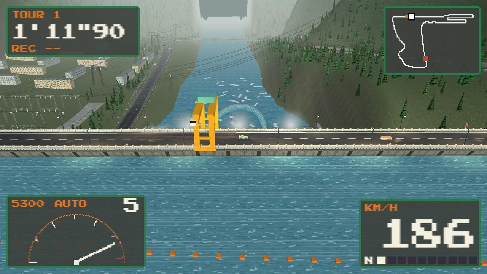
*Vue d'inspection au-dessus de la crête, idx 1500.*

**G3. Dessous et vides visibles [A]** — Des faces non texturées ou des plans de fond apparaissent quand on regarde sous les objets ou au-delà du terrain : fond blanc/gris pâle sous le bord de la route et sous les arbres, dessous sombre sans texture de bâtiments.
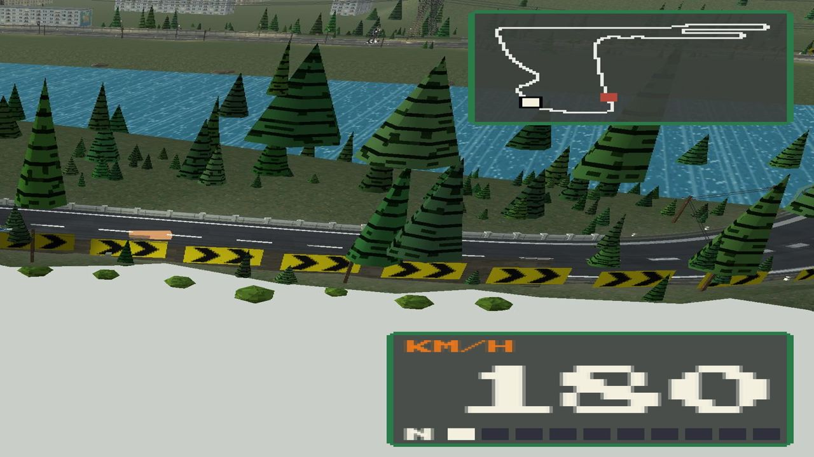
*Vue d'inspection, idx 2102 : un plan blanc pâle occupe le bas de l'image sous la route ; le lac et les arbres flottent au-dessus.*

**G4. Objets qui flottent [A][C]** — Silos, bâtiments, pylônes et arbres reposent sur un terrain dont le niveau ne les rejoint pas (voir zones 4 et 8). Vus de loin, ils semblent posés dans l'air au-dessus des pentes.
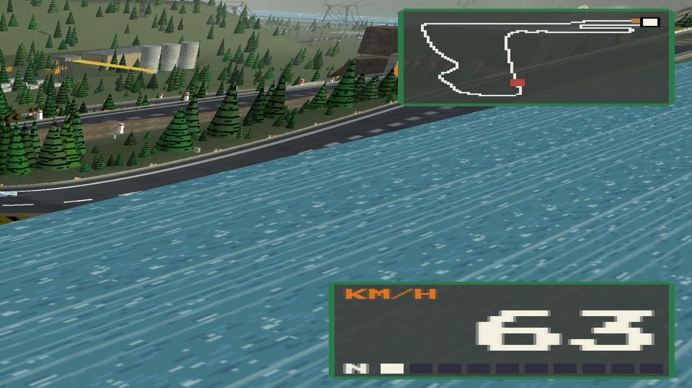
*Vue d'inspection, idx 1040 : le lac, les silos gris et une grue jaune dans le fond ; la route longe l'eau sans berge.*

**G5. Murs sans raison, souvent le long de la route [A][C]** — De longs murs (béton gris, mur brun, mur de pierre) bordent la route sur de nombreux tronçons sans rien retenir ni cacher : zones 1, 4, 6 et 8. Ce défaut revient sur presque toute la carte.

**G6. Panneaux de virage devant des murs [A]** — Des panneaux chevrons jaunes sont plantés devant ou contre des murs, là où il n'y a rien à signaler (zones 4 et 8).

**G7. Peintures et fresques en excès [A]** — Fresques sur les immeubles, dans la halle, en grandes affiches dans les arbres et lettres rouges sur le mur ; elles sont trop nombreuses et trop dispersées.

**G8. Montagnes et versants [A][C]** — Les versants sont soit des murs verts presque verticaux, soit des blocs gris-vert dont la texture se fond en dégradé avec la brume ; les silhouettes ne ressemblent pas à des montagnes.

**G9. Effet de vague [C], origine non identifiée** — Deux candidats visibles : (a) les gerbes du déversoir ont une forme de grosse vague blanche qui se courbe au bord de la route (zone 2) ; (b) la route est tachée de plaques blanches carrées, très visibles surtout au départ et à l'aval (zone 1). Aucun des deux n'est confirmé comme cause du ressenti de l'auteur.

**G10. Continuité entre les zones [A][C]** — Chaque zone a sa propre ambiance et ses propres matériaux : village soviétique, halle verte et orange, tunnel jaune sodium, crête claire, forêt de la descente. Rien ne relie les transitions : on passe d'une zone à l'autre sans paysage commun (voir zones 3→4, 5→6, 6→7).

**G11. Sapins [A]** — Les sapins de barrage sont des cônes verts à bandes noires carrées, sans tronc visible ; ils diffèrent de ceux de la carte 2 (touge), qui ont un tronc et des étages plus lisibles. Voir la comparaison en fin de cahier.

---

## 1. Vallée aval, départ (idx 0 – 240)

**1.1 Arc-en-ciel [A]** — Un arc-en-ciel se dresse au-dessus des gerbes, visible dès la vallée.
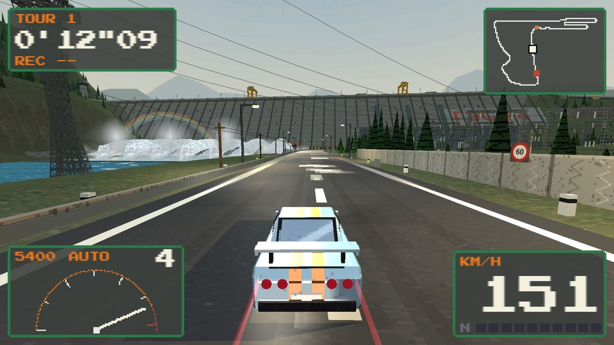
*idx 190.*

**1.2 Fresques sur les immeubles [A]** — Le premier immeuble porte une grande mosaïque aux motifs de fleurs ; d'autres immeubles et murs en portent aussi. L'auteur veut une seule peinture, sur le premier immeuble, de style propagande soviétique.
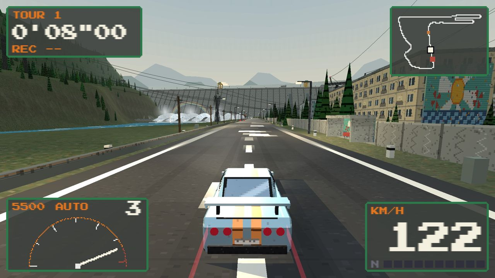
*idx 92.*

**1.3 Mur de béton à droite [C]** — Un long mur de béton clair, à joints en zigzag, longe la route à droite sur plus de 100 m (idx 40 – 200). Il ne retient rien de visible : derrière lui, le terrain est au même niveau que la route.
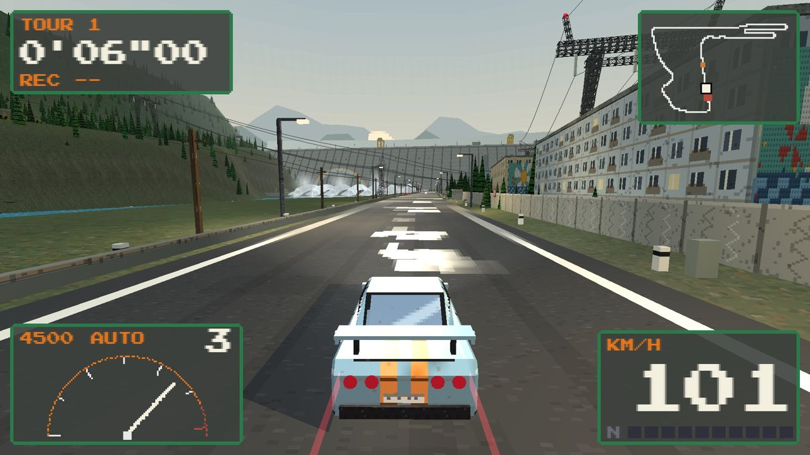
*idx 53.*

**1.4 Plaques blanches sur la route [C]** — De grandes plaques blanches carrées sont posées sur la chaussée devant la voiture, de la ligne de départ.
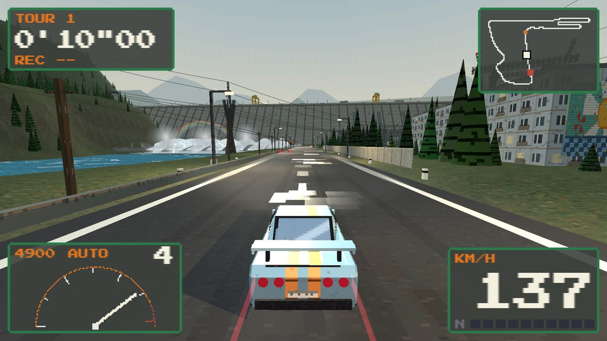
*idx 137.*

## 2. Déversoir et pied du mur (idx 240 – 340)

**2.1 Gerbe en forme de grosse vague blanche [C]** — La nappe d'écume au bord de la route a la forme d'une vague courbe d'une dizaine de mètres de haut, plate et blanche, qui domine la route. Voir aussi G9.
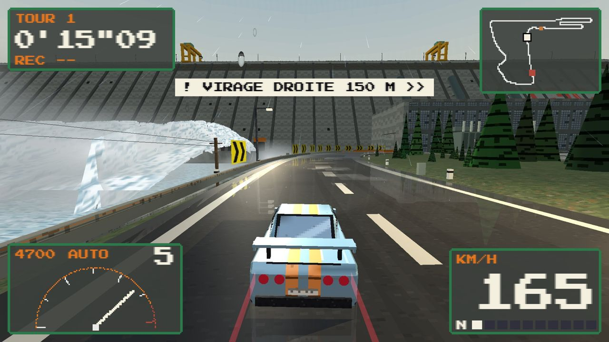
*idx 273.*

**2.2 Arc-en-ciel et lettres rouges sur le mur [A][C]** — Le mur porte une grande inscription rouge (type ГЭС) et l'arc-en-ciel repasse au-dessus des gerbes ; le mur lui-même est un voile gris à pilastres noirs.
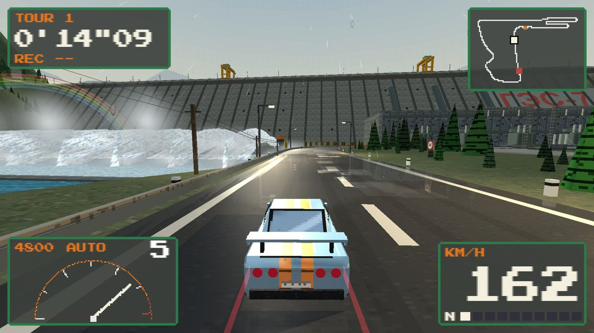
*idx 245.*

**2.3 Chevrons géants et eau au bord de la route [C]** — Des chevrons jaunes de grande taille (plus haut que la voiture) bordent la route à l'entrée du pied de mur ; la route est mouillée et reflète tout ; des gerbes touchent le bas de l'image à gauche.
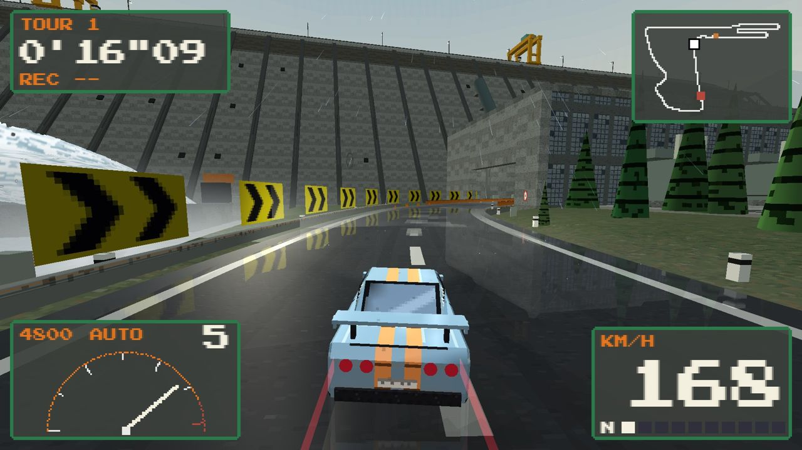
*idx 302.*

## 3. Salle des turbines (idx 340 – 440)

**3.1 Fresque dans la halle [A]** — Le mur de gauche est couvert d'une grande mosaïque bleue, verte et rouge sur toute la longueur de la halle.
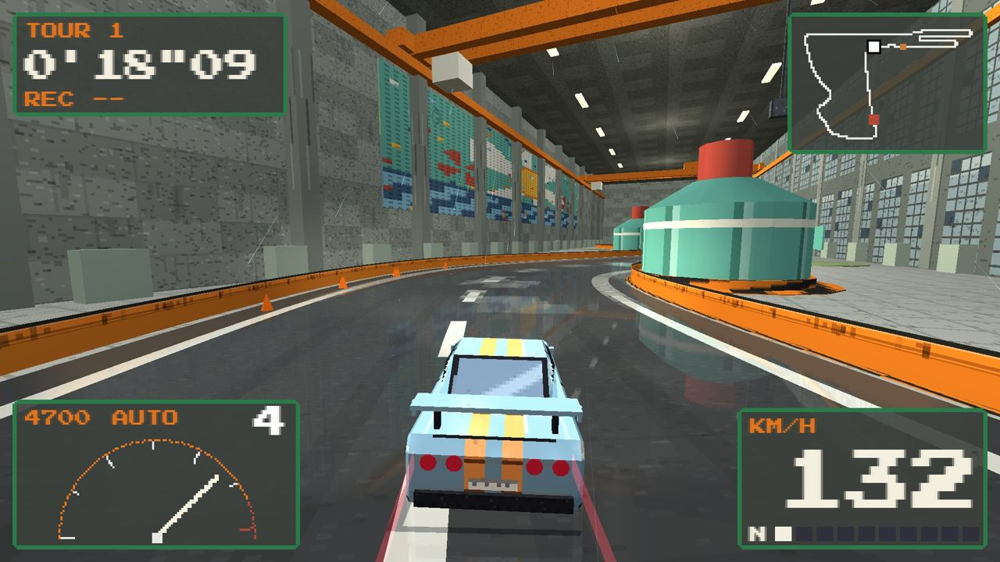
*idx 355.*

**3.2 Halle : murs, vitrages et pont roulant [C]** — Murs gris à joints, vitrage à grands carreaux à droite, pont roulant orange au plafond, rambarde orange sur les deux bords. Le sol hors route est gris clair carrelé ; les alternateurs sont des cylindres vert d'eau isolés derrière la rambarde.
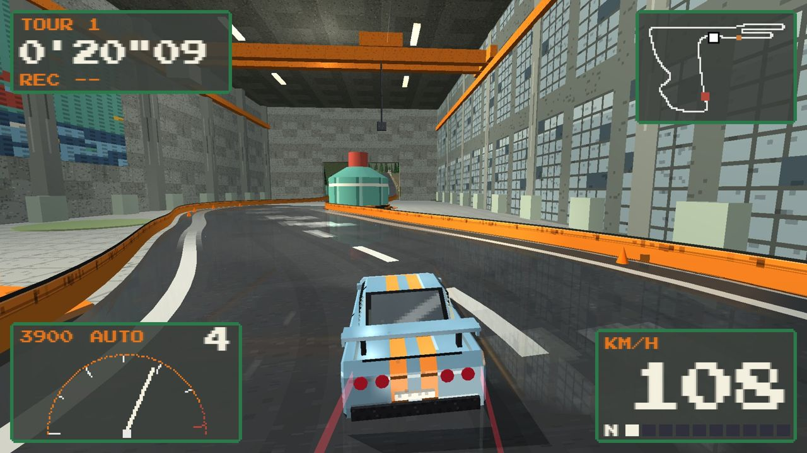
*idx 398.*

**3.3 Texture du sol par-dessus la route [A]** — Vers la fin de la halle, le sol clair en dalles carrées recouvre une partie de la chaussée devant et sous la voiture ; la route sombre disparaît par endroits sous cette texture.
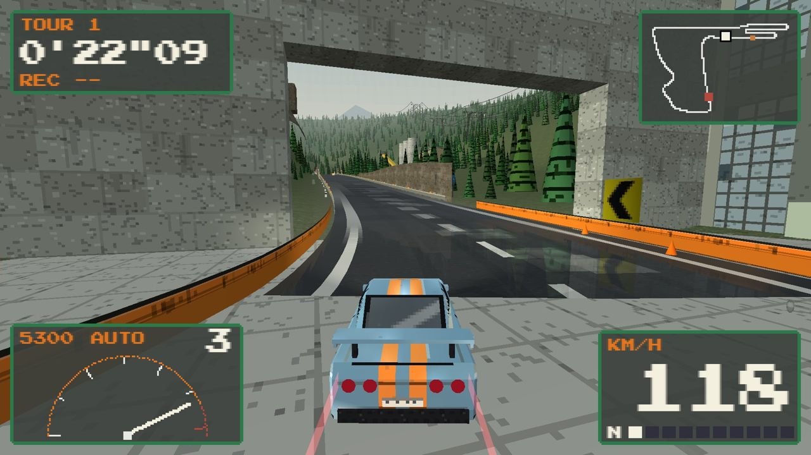
*idx 437.*

## 4. Sortie de halle jusqu'au tunnel (idx 440 – 810)

**4.1 Mur à droite à la sortie de la halle [A]** — Dès la sortie, un long mur brun de pierre longe la route à droite, haut de plusieurs mètres, sans objet apparent. L'herbe monte derrière lui.
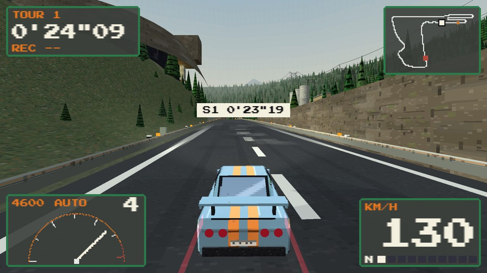
*idx 481.*

**4.2 Cimenterie qui flotte [A]** — Les silos gris de la cimenterie et son bâtiment beige sont visibles au-dessus du talus de droite, légèrement dans le vide ; un mur gris est collé à gauche de la route.
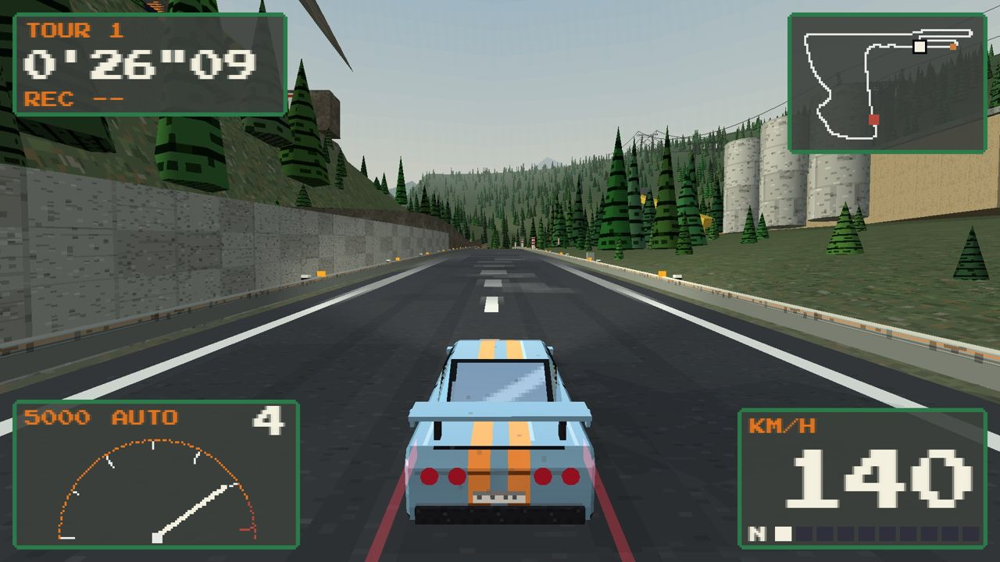
*idx 529.*

**4.3 Mur à gauche encore [A]** — Un mur de béton gris longe la route à gauche de idx 500 à 640 ; du côté opposé, une pente d'herbe est sans lien avec lui.

**4.4 Panneaux de virage devant un mur [A]** — Dans l'épingle, les chevrons jaunes sont plantés au bord de la route, devant un mur brun qui occupe tout le fond.
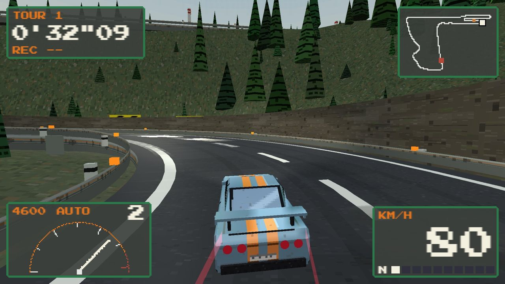
*idx 669.*

**4.5 Bâtiment au toit rond sans texture dessous ni sur le côté [A]** — Un volume brun à toit arrondi surplombe la route à l'approche du portail. Sa face inférieure et son flanc sont lisses et sombres, sans texture de béton ou de façade ; en vue d'inspection par le dessous, tout est noir uni.
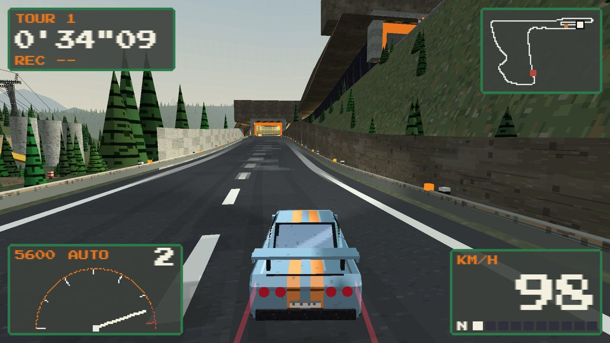
*idx 702.*
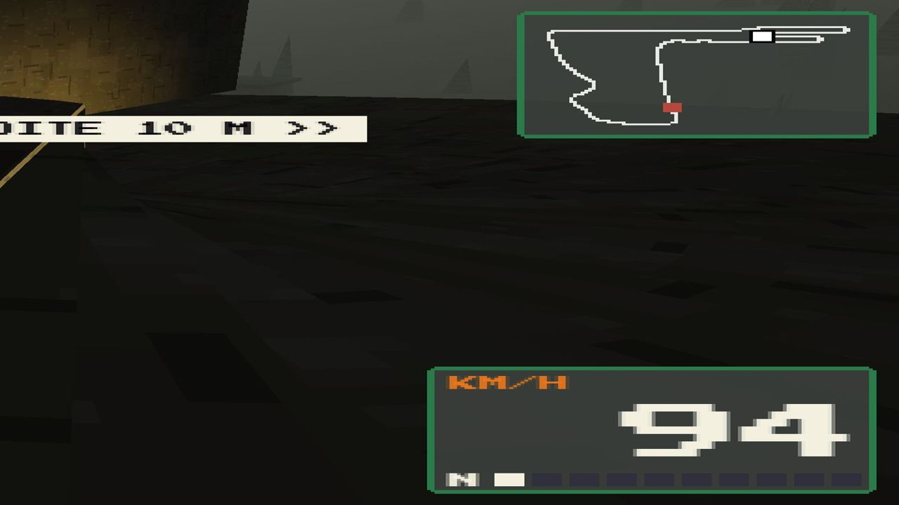
*idx 800, vue d'inspection.*

## 5. Tunnel (idx 810 – 940)

**5.1 Arche orange à l'entrée [A]** — Un grand cadre orange carré entoure l'entrée du tunnel, sous un linteau de béton rayé.
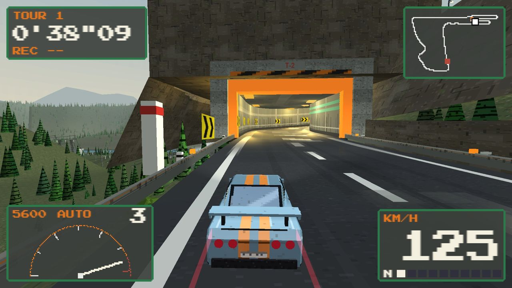
*idx 780.*

**5.2 Tunnel à section carrée [A]** — La coque est un rectangle à plafond plat et à angles droits : murs verticaux, plafond à néons jaunes, bandeau vert. Ni voûte ni toit rond. Les parois sont d'un jaune très uniforme, sans suintement.
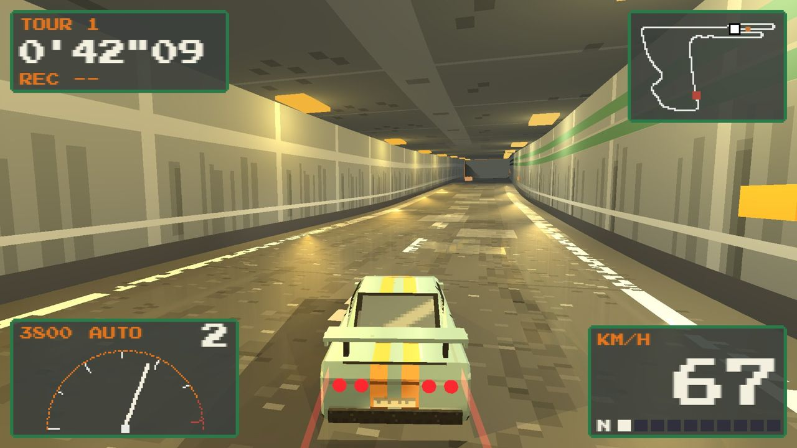
*idx 869.*

**5.3 Cadre orange à la sortie [C]** — La sortie est un second cadre orange rectangulaire, à travers lequel on voit une paroi grise très proche et des arbres.
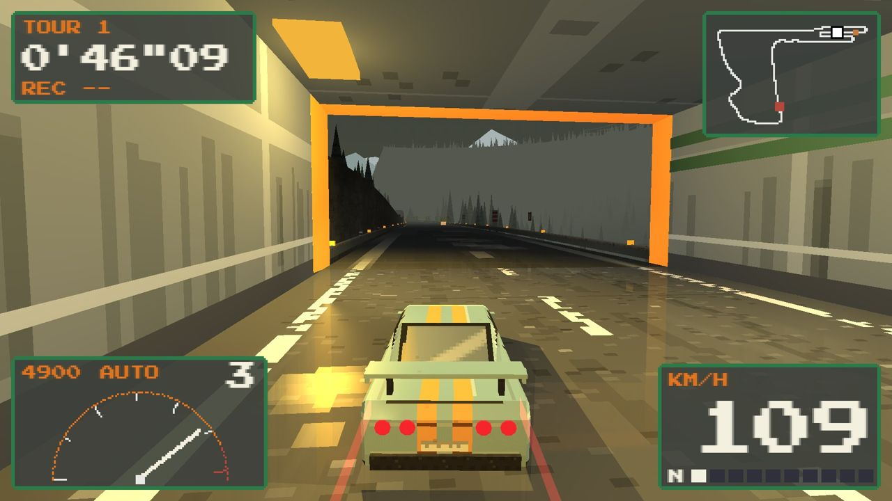
*idx 904.*

## 6. Après le tunnel, montée (idx 940 – 1170)

**6.1 Murs à côté de la route [A]** — Après la sortie, un mur brun longe la route à gauche et un mur gris-brun la suit sur plusieurs centaines de mètres ; ils ne retiennent rien et se terminent dans l'herbe.
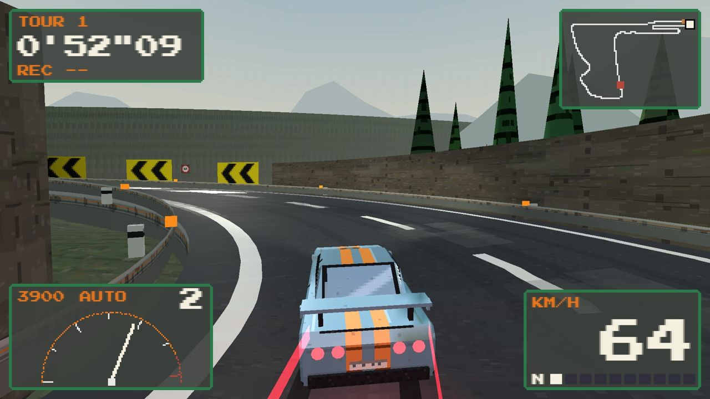
*idx 1028.*

**6.2 Gros bloc au loin [A]** — Au fond à droite, un bloc gris-vert très haut et très long dépasse de la brume ; il n'a pas de forme de barrage ni de montagne et sa texture se fond en dégradé avec le brouillard. L'auteur le voit surtout depuis le haut du barrage.
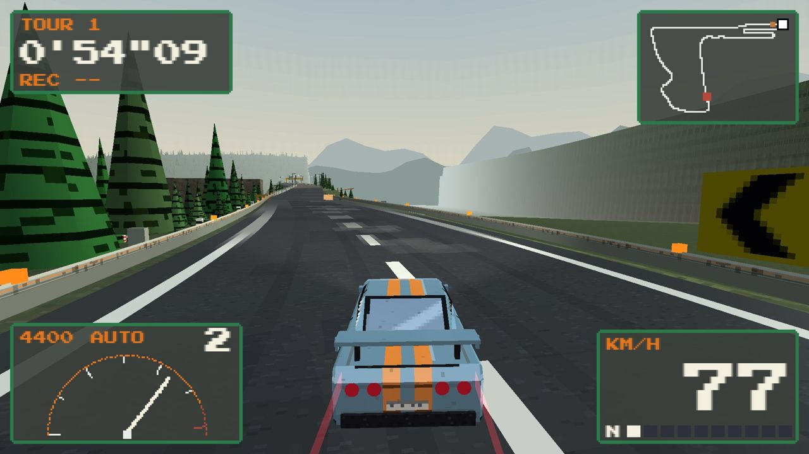
*idx 1054.*

**6.3 Pente et courbe sans repère [C]** — La route monte en courbe entre le mur et un talus d'herbe très plat, sans relief, avec un seul rang d'arbres isolés loin à gauche.

## 7. Crête (idx 1170 – 1650)

**7.1 Eau au niveau de la route [A]** — Le lac frôle le parapet de droite sur toute la crête, à la hauteur de la chaussée ; de petites bouées orange alignées flottent juste derrière la rambarde. Un petit bâtiment est posé sur l'eau à droite. L'auteur voit la texture du dessous du plan d'eau.
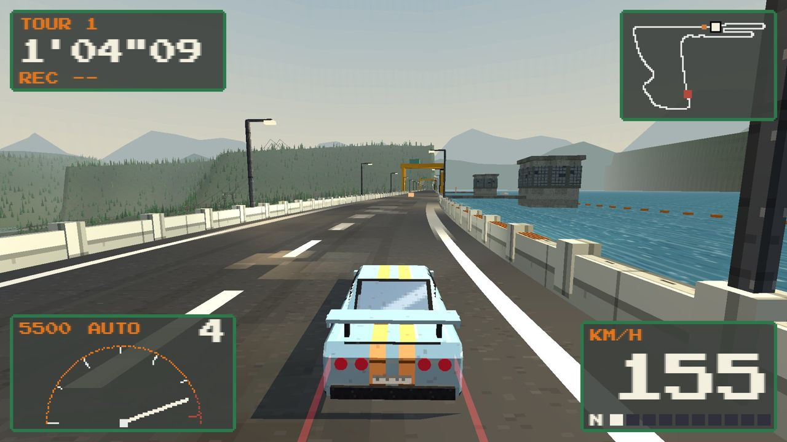
*idx 1269.*

**7.2 Grand bloc et falaise verticale [A][C]** — Une falaise gris-vert verticale occupe tout le côté droit en fond ; à gauche, un versant boisé monte d'un seul bloc sans pente. Les deux forment un couloir de murs plats autour de la route.
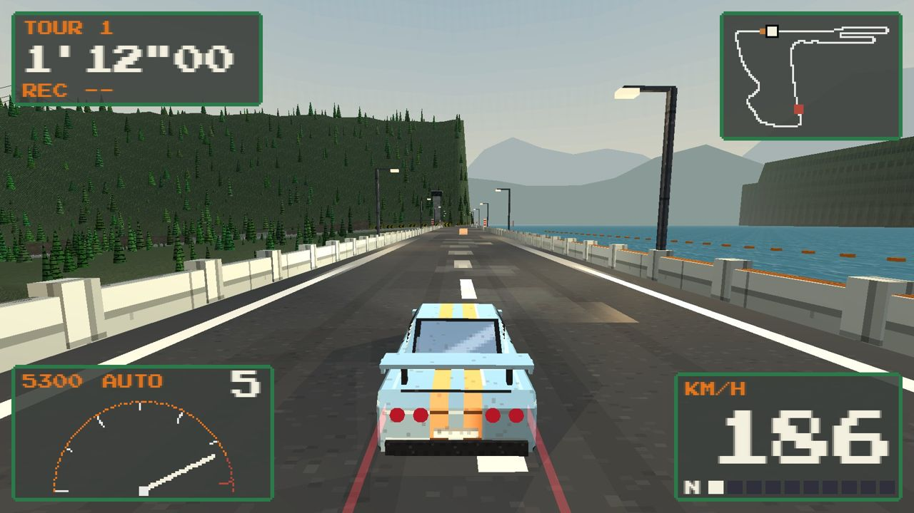
*idx 1505.*

**7.3 Plus de brouillard demandé [A]** — Du haut du barrage, la brume est trop faible pour cacher le gros bloc éloigné (6.2, 7.2).

**7.4 Crête presque nue [C]** — Les lampadaires et un portique jaune rythment la route, mais le parapet et la route sont les seuls éléments ; ni tour de contrôle, ni vannes, ni vide côté vallée visible depuis la route.

## 8. Descente (idx 1650 – 2372)

**8.1 Tour grise sur le versant [C]** — Dans la première épingle de la descente, une tour grise sombre dépasse de la forêt, plantée dans la pente sans base visible.
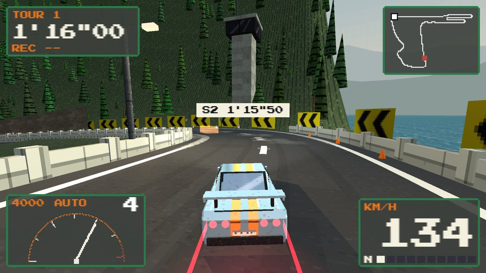
*idx 1628.*

**8.2 Murs sur les côtés de la descente [A]** — Des murs en pierre brune ou grise suivent la route à droite sur presque toute la descente, tantôt bas, tantôt de 4 à 5 m,. Le début de la piste ne passe pas entre des bâtiments mais entre ces murs.
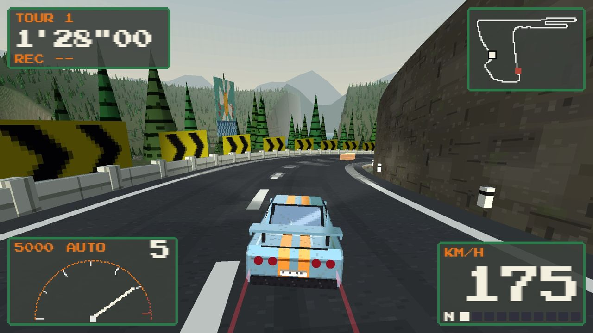
*idx 1927.*

**8.3 Terrain de la descente [A][C]** — Le versant est une pente verte raide et régulière couverte de sapins identiques ; le bas de la pente flotte au-dessus de l'eau (aucune berge) à l'approche du pont (idx 1960 – 2000).

**8.4 Panneaux et affiches dans les arbres [C]** — Une affiche rectangulaire (fresque) est plantée entre les arbres sur un poteau, à gauche, vers idx 1927.

**8.5 Retour au village : virage et chevrons [C]** — À la fin, la route tourne devant des immeubles clairs posés à plat sur l'herbe, avec une file de chevrons et un pylône à droite ; les immeubles semblent flotter sur la prairie.
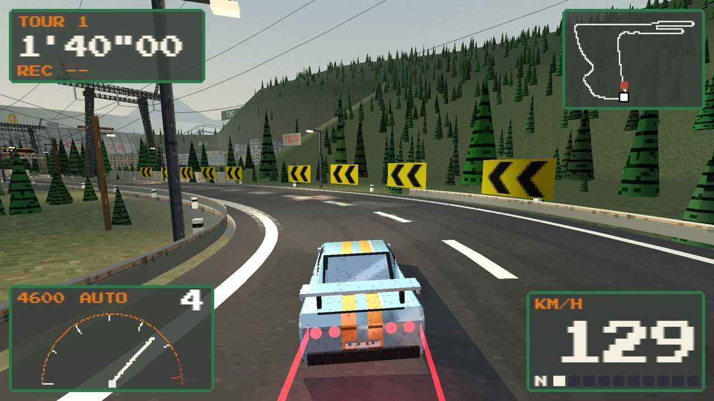
*idx 2145.*

---

## En regard d'une ancienne carte (touge)

Captures de touge sous les mêmes réglages :

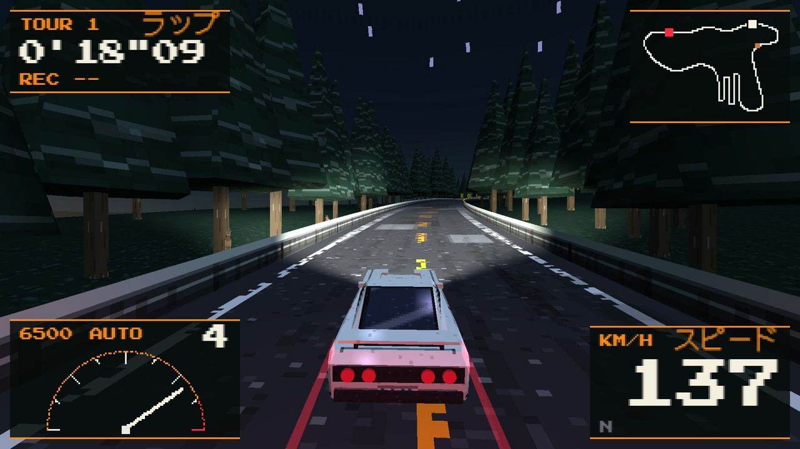
*touge, tour à pas=6.*
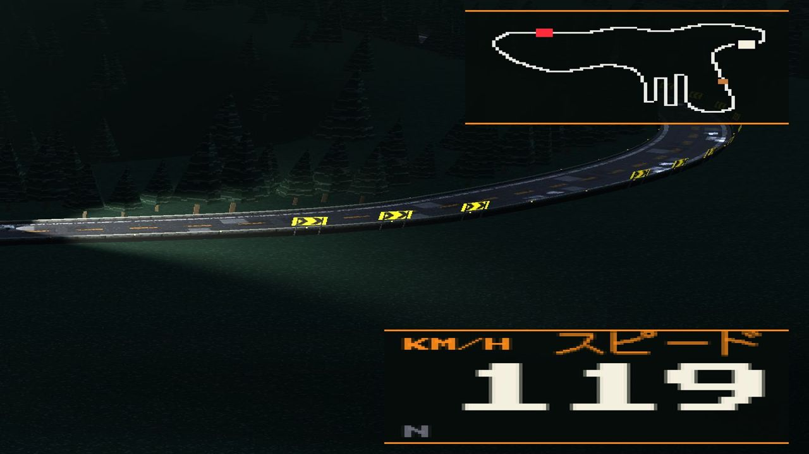
*touge, vue d'inspection large, idx 500.*

- Touge a un terrain continu : la route est posée sur une pente unique, avec talus, rambardes et arbres qui s'y raccordent ; dans la vue large, la route suit le versant et aucune forme ne flotte.
- Les sapins de touge ont un tronc visible, des étages sombres lisibles et sont en rangs serrés de chaque côté de la route ; ceux de barrage sont des cônes sans tronc, dispersés.
- Touge n'a pas de mur sans cause : le seul bord de route est une glissière continue.
- L'ambiance est unique de bout en bout (nuit, brume, lumières de ville) ; barrage change de décor à chaque zone.
- La distance est lisible : la ville éclairée au loin donne l'échelle et l'altitude ; sur barrage, le lointain est un bloc gris-vert qui se fond dans la brume.
- Touge n'a pas de plan d'eau, de dessous visible, ni de surface posée sur la route.
