# Cahier de feedback : MATIN SUR LA CHAPADA (`chapada`)

Constat uniquement : aucune solution, aucune piste de correction.
Source : un tour complet du pilote automatique (échantillons de piste `idx` de 0 à 2535, tour de 110 s), captures du moteur en 1920 × 1080 (`pas=5`, `pas=2`, 33 points `idx=`, 5 vues `vue=`), comparées à `touge` (16 captures, même méthode) et à `givre` (régime seulement). « Auteur » = retour de l'auteur, « Analyse » = relevé fait sur les images.

Repères de piste (échantillons `idx`, d'après les points du tracé) : plateau de départ 2376 → 458 · lacets en gorge 458 → 1304 · chute et galerie 1304 → 1435 · gué 1479 → 1700 · pont 1776 → 1852 · remontée en forêt 1885 → 2376 · arche vers 2441 → 2535 (le tour boucle sur le plateau).

Vue d'ensemble de ce qu'on voit : des fonds beige-gris plats, un seul vert foncé pour tous les arbres, un bitume propre tout du long, une brume légère qui laisse voir très loin. L'image ne dit ni « jungle », ni « temple perdu », ni « aventure ».

---

## Problèmes généraux

**G1. On est presque toujours au rupteur** (Auteur, mesuré). Sur le tour, le régime est à plus de 85 % du rupteur pendant 47 % du temps et à plus de 92 % pendant 18 %. Même mesure : touge 19 % et 4 %, givre 28 % et 7 %. Le rupteur de chapada est à 7200 tr/min, la voiture plafonne à 216 km/h sur le 5ᵉ rapport, collée à 7197-7200 tr/min de l'échantillon 425 à 640 (8 s), puis reste au-dessus de 6800 à plusieurs reprises (1976, 1905, 2200). Les 5 rapports sont utilisés ; le régime redescend à chaque virage lent (idx 721, 1237, 2062) puis remonte tout de suite au rupteur sur la ligne droite suivante. Vitesse moyenne : 165 km/h (touge 159, givre 160). 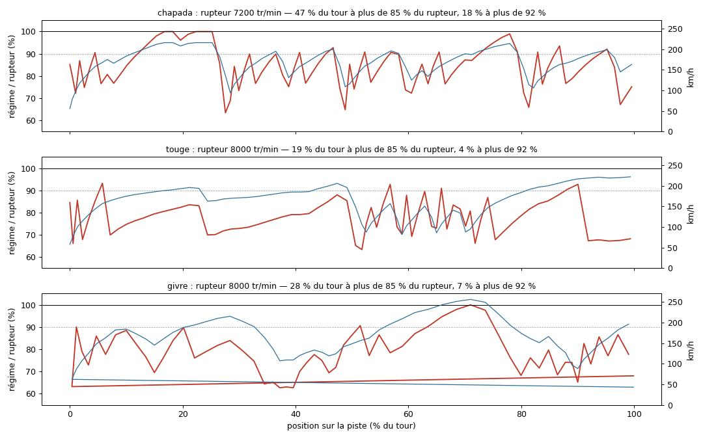

**G2. L'ambiance n'est pas celle d'une aventure dans la jungle** (Auteur). L'image lit « film d'horreur, carte abandonnée » : lumière grise et plate, aucun contraste chaud/froid, aucune densité, rien de précieux ni de mystérieux (pas de ruine monumentale, de statue, de temple, d'objet d'aventure). La spec annonce des « rayons rasants, or chaud » et « ombres bleu-vert » : l'écran montre une lumière diffuse beige-grise (voir 01-plateau-061, 02-lacets-1100) sauf dans quelques taches de la forêt.

**G3. Le décor lointain se voit beaucoup trop** (Auteur). Les mesas du plateau, les falaises de la gorge et les rangées d'arbres se lisent nettes jusqu'à l'horizon (01-plateau-302, 04-gue-1501, 06-foret-2221). Le brouillard réglé à `fogD [20, 340]` (la spec disait `[12, 220]`) laisse environ 340 m de visibilité franche. Pas de poches de brume denses au pont ni au fond de gorge, comme prévu par la spec : la brume est partout pareille. Le `bloom` est à 0,05 (la spec : « autour de 0,25 »).

**G4. La végétation n'est ni luxuriante ni étouffante** (Auteur). Partout sauf deux courts passages, on voit le ciel au-dessus de la route et le sol nu entre les troncs : pas de canopée fermée, pas de sous-bois, pas de lianes qui pendent sur la route, pas de mur de feuillage (06-foret-vue-2000, 02-lacets-701). La route est dégagée de chaque côté par un bas-côté propre et une glissière continue.

**G5. Les arbres sont laids et tous pareils** (Auteur). Une silhouette unique : tronc fin, houppier en losange ou en parasol aplati, vert très sombre, faces planes. Les « arbres en fleur » de la fiche sources sont des boules rose bonbon et jaunes posées au bout d'un bâton (02-lacets-951, 06-foret-1880) : ils se lisent comme des sucettes. Aucun étage (palmiers, fougères arborescentes, bromélias) n'est lisible à la vitesse du jeu.

**G6. Faux nuages** (Auteur). Des petits losanges blancs, plats, au bord des crêtes et à l'horizon (01-plateau-302, 04-gue-1501, 04-gue-1551 à droite) : on voit les cartes qui les portent, elles ne se lisent pas comme de la brume. Elles flottent au-dessus du relief.

**G7. Textures posées sur la route** (Auteur et Analyse). Des taches blanches floues, rectangulaires, sur le bitume, de la ligne droite du plateau jusqu'au sous-bois (01-plateau-422, 02-lacets-1100, 06-foret-2221). Dans la galerie et au gué, des surfaces translucides ou orangées se superposent à la chaussée (03-galerie-1401, 04-gue-1551). Le document `docs/MOTEUR-OPTIONS-CARTES.md` note que, sur chapada, les surfaces de décor sont posées à 4 cm au-dessus de la chaussée aux échantillons 1450 et 1550 et que le mouillé de la route ne se lit pas.

**G8. Continuité entre les zones** (Auteur, général). Chaque zone est un décor distinct, sans transition : le plateau gris-vert passe à une paroi brune unie (idx 520 → 612), la paroi à une galerie à plafond plat (1290), la galerie à une plaine rouge-brun (1430), le pont à une forêt (1830). Les couleurs de sol changent d'un coup (olive, brun, rouge-brun, noir de litière). Rien ne relie la gorge, la rivière et la chute : la rivière n'apparaît qu'au gué, sans qu'on sache d'où elle vient ni où elle va.

**G9. Effet de vague** (Auteur, sur plusieurs cartes). Sur chapada, on le voit dans les strates des parois, qui ondulent en grandes courbes molles (04-gue-1551 à gauche, 02-lacets-1100), dans le haut de paroi qui s'affaisse par endroits, et dans les flancs de colline du plateau, ombrés en larges bandes diagonales (01-plateau-302). La fiche sources de la paroi (`REFS-chapada.md`, fiche 1) interdit explicitement le « haut de paroi qui ondule ». Origine non établie.

**G10. Sol et eau sans reflet de l'ambiance** (Auteur). Le ciel doré de l'aube ne se retrouve ni dans la route (mouillée ou non), ni dans l'eau, qui est un plan brun-rouge mat strié de blanc (04-gue-1460), ni dans la chute (blocs blancs semi-transparents).

**G11. La carte ne ressemble pas à ses sources** (Analyse). La fiche 5 demande des ruines de pierre sèche d'Igatu et des campos rupestres : les maisons du plateau sont des volumes sombres à toit rouge intacts, sans ouverture ni ruine lisibles (01-plateau-061). La fiche 3 demande une eau d'ambre transparente sur des dalles de grès : l'eau est un aplat rouge-brun opaque sans dalles lisibles. La fiche 6 demande un pont avec brume qui masque l'autre rive et un grand arbre fantôme : on voit l'autre rive et aucun arbre fantôme. La fiche 7 (arche de grès avec lumière en contre-jour, voûte sombre) donne un empilement de blocs bruns (07-arche-2451).

**G12. Pas de monuments ni de repères** (Analyse). Touge a un portique, un temple et un torii vus de loin (ref-touge-1264) ; chapada n'a que des panneaux de virage et des bornes, identiques d'une zone à l'autre.

---

## Zone 1 : plateau de départ (`idx` 2376 → 458, ligne droite du plateau)

**Z1.1. L'endroit ressemble à un lieu abandonné, triste** (Auteur). Sol olive-gris uniforme, quelques arbres noirs tordus, murets de pierre sèche, aucune vie, aucune lumière dorée visible malgré le soleil bas : 01-plateau-061, 01-plateau-fin-2400.
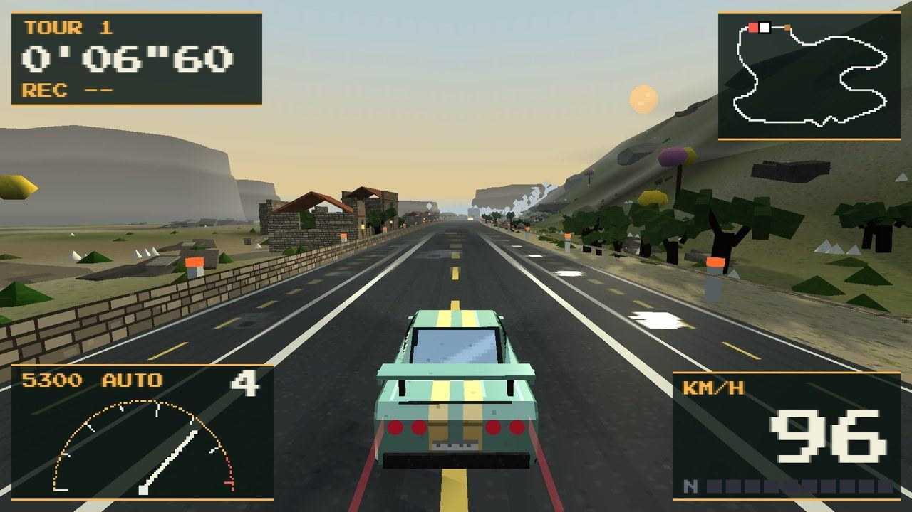

**Z1.2. Les bâtiments sont difformes et sans histoire** (Auteur). Deux ou trois volumes de pierre noire aux toits rouges et aux pans décalés ; leur silhouette est irrégulière sans que ce soit une ruine voulue ; ils se lisent comme des abris délabrés, pas comme les restes d'une cité (idx 61 à 302, 2400 à 2535).
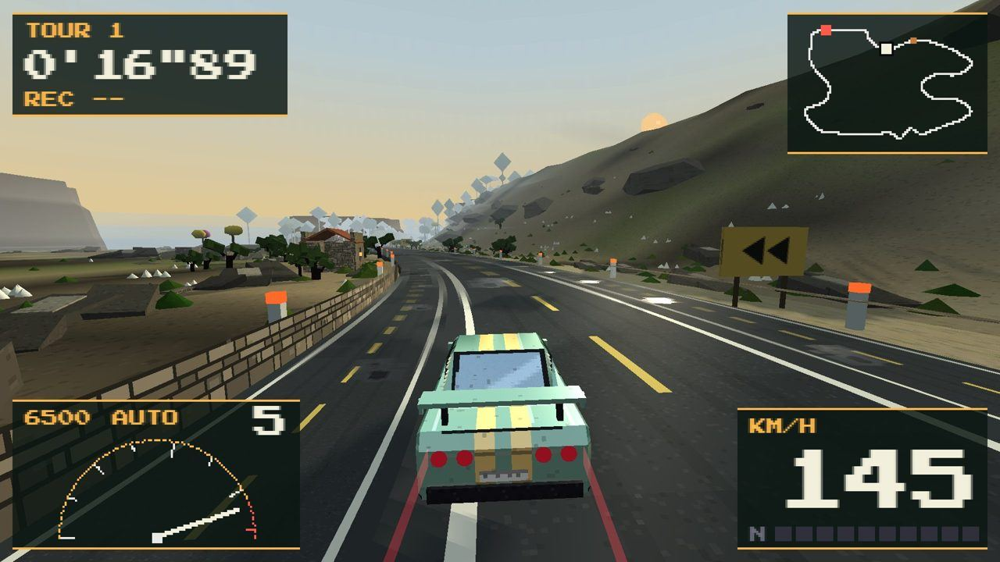

**Z1.3. Le relief est un grand flanc de colline lisse, parsemé de dalles noires** (Analyse). Les dalles d'affleurement sont de gros blocs sombres à faces planes posés sur la pente, qui lisent comme des objets flottants ; les « sempre-vivas » sont des cônes blancs (idx 300 à 500, 61).
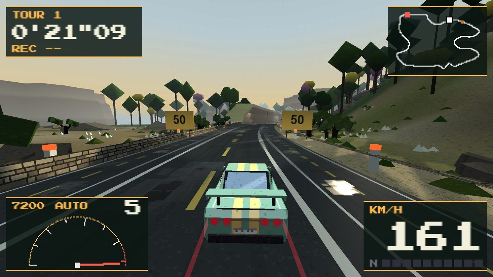

**Z1.4. Faux nuages et décor lointain trop net** (Auteur, Analyse). Losanges blancs au-dessus des crêtes, mesas grises très nettes au fond, à droite et à gauche (01-plateau-302, 01-plateau-vue-2460).
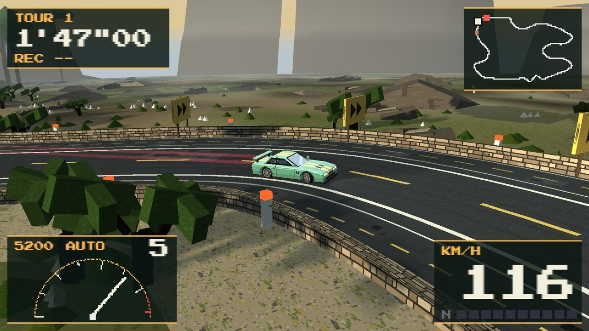

**Z1.5. Taches blanches sur la route** (Analyse), à droite de la chaussée dès l'échantillon 61, plus marquées en 422.

**Z1.6. Une zone qui ne prépare rien** (Analyse). Le plateau de départ est aussi le plateau de fin de tour : on y revient avec la même image, sans différence entre départ (2376 → 0) et arrivée (2400 → 2535). L'arche de fin n'est pas sur la route (voir Zone 7).
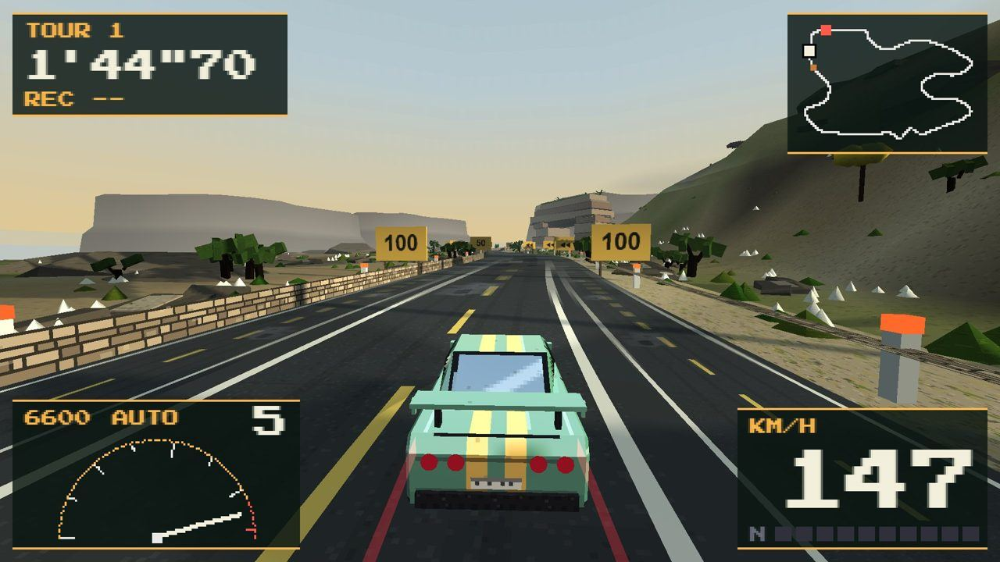

---

## Zone 2 : lacets en gorge (`idx` 458 → 1304)

**Z2.1. La zone est monotone : toujours les mêmes décors** (Auteur). Sur 850 échantillons (une trentaine de secondes), on alterne la même paroi brune lisse à gauche, les mêmes arbres en parasol à droite, la même glissière, les mêmes panneaux 50/150 (02-lacets-612, 02-lacets-701, 02-lacets-951, 02-lacets-1100).
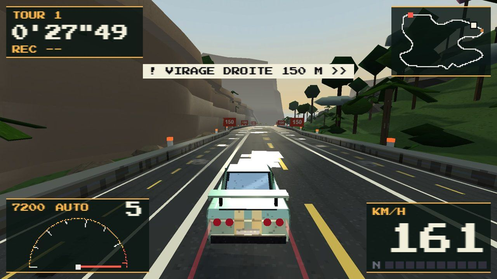

**Z2.2. La paroi est un mur uni** (Analyse). Un grand plan brun beige, strates à peine visibles, sans mousse, sans végétation sur les corniches, sans coulures, sans éboulis ; elle ne ressemble ni à du grès ni à de la roche ; sur 02-lacets-612 elle occupe la moitié de l'image sans aucun détail.
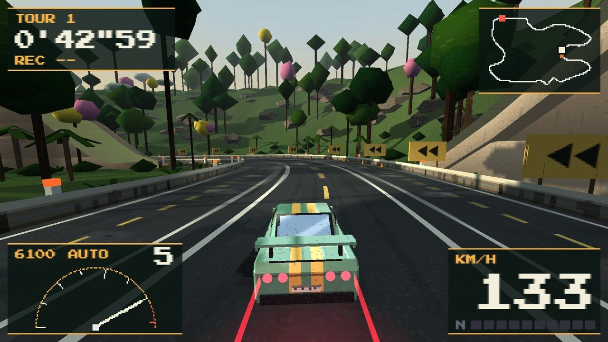

**Z2.3. Arbres : parasols et losanges sur des bâtons** (Auteur, Analyse), pastel rose et jaune par endroits (02-lacets-701, 02-lacets-951) ; ils laissent voir le ciel et le fond de vallée.
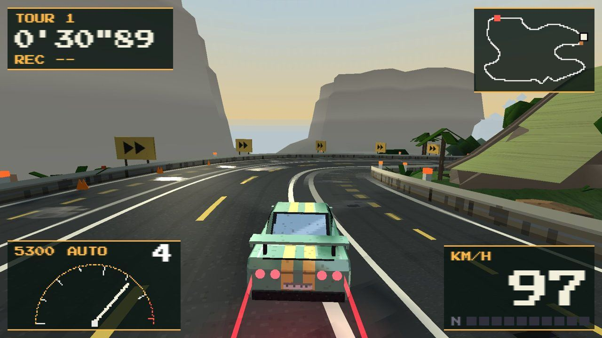

**Z2.4. Le vide au-delà du garde-corps n'est pas dangereux ni profond** (Analyse). Les épingles descendent mais le côté extérieur montre une pente d'herbe lisse et la forêt basse en contrebas, sans vertige (02-lacets-701, 02-lacets-1100).
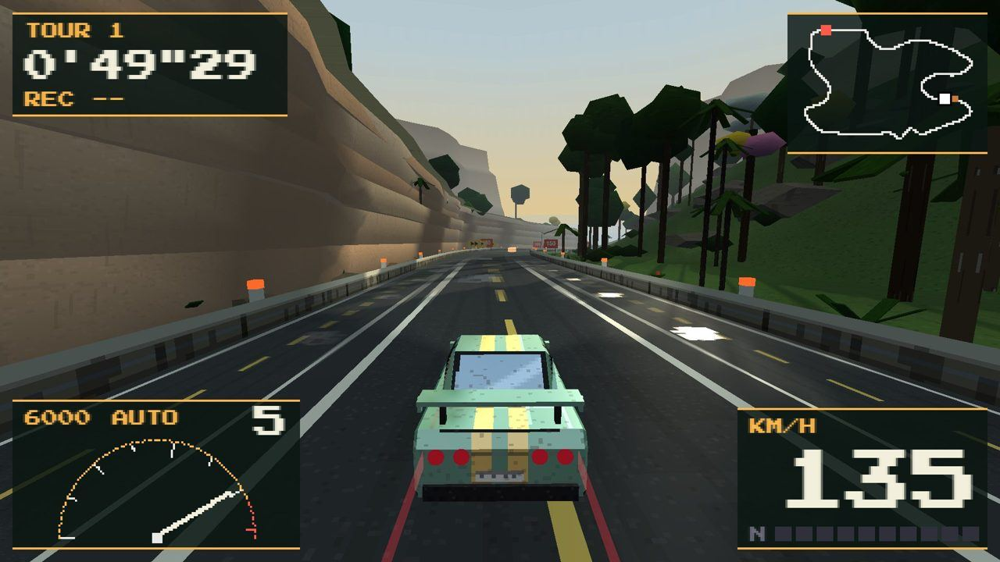

**Z2.5. Ondulation des strates** (Auteur « vague », Analyse). Les bancs de la paroi forment des courbes molles et le haut de la paroi s'affaisse (02-lacets-1100, plus loin 04-gue-1551).

**Z2.6. Régime** : ligne droite de l'échantillon 425 à 640 au rupteur, 8 s, dans la descente en haut des lacets (voir G1).

---

## Zone 3 : la chute et la galerie (`idx` 1304 → 1435)

**Z3.1. La zone est buguée : des couches de textures qui ne vont pas ensemble** (Auteur). À l'entrée (idx 1202), une grande pièce verte triangulaire et translucide traverse l'image au-dessus de la route, des colonnes d'eau en blocs blancs et une paroi orange se superposent ; à 1401, le même triangle vert-olive couvre une partie du plafond, avec d'autres plans translucides sur la chaussée (03-chute-1202, 03-galerie-1401).
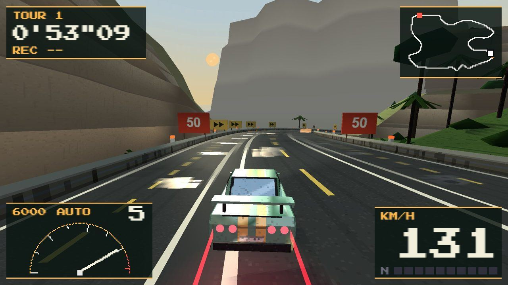
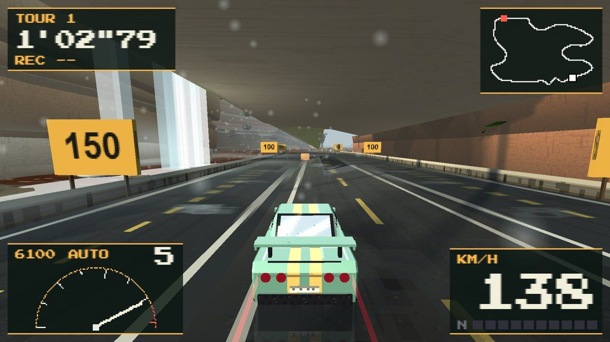

**Z3.2. Le sens géologique manque** (Auteur). La route passe sous un plafond plat uni, mais la chute tombe à côté, à l'air libre, dans l'image de gauche, à quelques mètres du plafond : on n'est ni derrière un rideau d'eau, ni dans une grotte, ni dans un canyon. Le côté droit est une paroi orange lisse qui n'a pas la teinte de la gauche (grise-blanche) (03-galerie-1290, 03-galerie-1371).
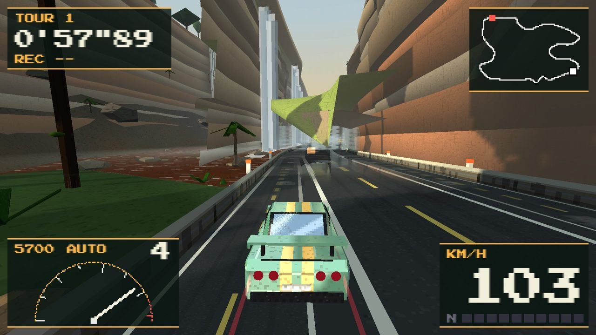
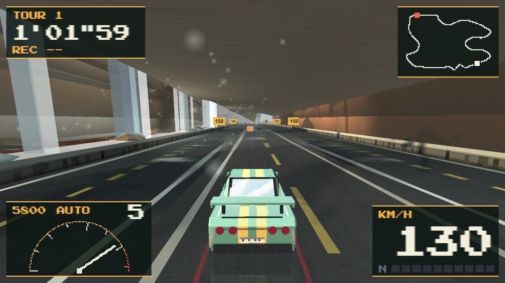

**Z3.3. La chute est faite de colonnes blanches lisses, sans eau qui tombe ni brume au pied** (Analyse). Elle se lit comme des bandes de verre ; le rideau « translucide devant la caméra » et les embruns de la spec sont de petits points blancs épars (03-galerie-1290).

**Z3.4. Textures sur la route** (Auteur). La chaussée a des plaques claires sans origine, et le reflet de mouillé promis ne se lit pas (« rien ne se voit », `MOTEUR-OPTIONS-CARTES.md`) ; la galerie reste un bitume sec sombre comme ailleurs (03-galerie-1371).

**Z3.5. Aucun reflet de l'ambiance** (Auteur). Pas de lumière turquoise, pas d'arc-en-ciel à la sortie, couleurs brun-gris ; la sortie vers le gué (1430) est un aplat rouge-brun (voir Zone 4).

---

## Zone 4 : le gué, la « mangrove » (`idx` 1479 → 1700)

**Z4.1. La rivière orange ressemble à de la terre battue** (Auteur). Un plan brun-rouge à gros grain, strié de traits blancs, sans transparence, sans reflet du ciel, sans courant lisible : 04-gue-1460, 04-gue-1501.
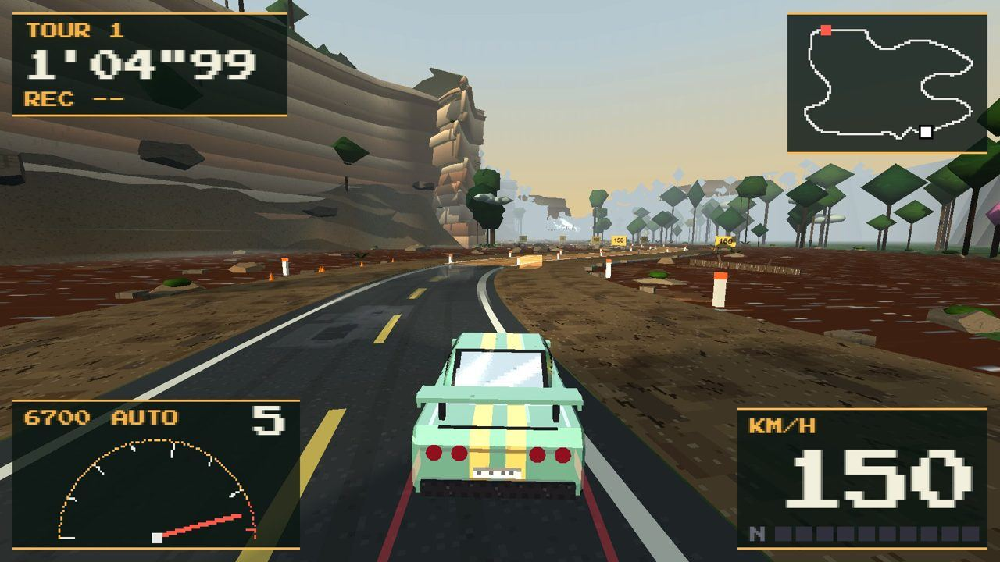

**Z4.2. La route du gué est un ruban orange rayé de blanc** (Analyse). La chaussée change complètement de matière : un orange lumineux et saturé, strié de blanc flou, sans lien avec le bitume gris d'avant et d'après ; la bande « sèche » à côté est un sol brun de terre (04-gue-1551, 04-gue-vue-1550).
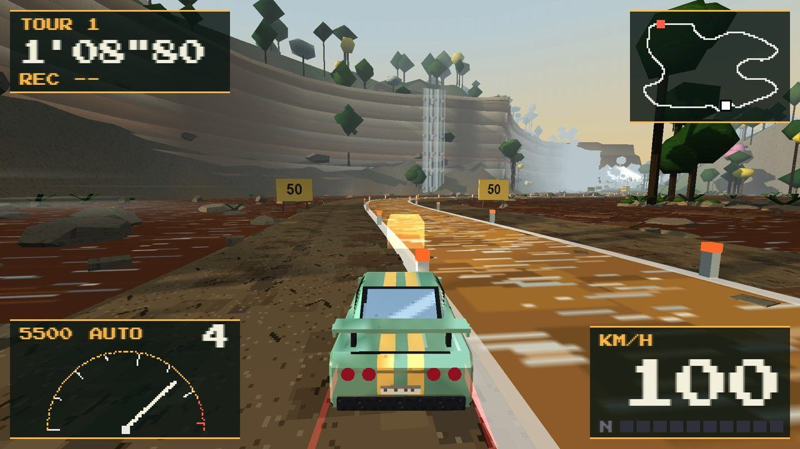
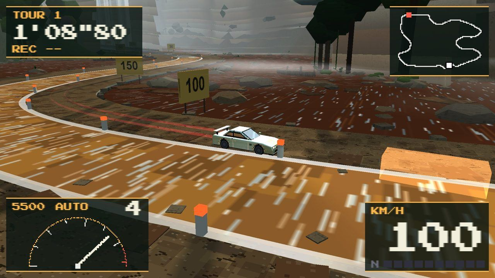

**Z4.3. Un bloc orange translucide flotte sur la route** (Analyse). Un parallélépipède orange clair, mi-transparent, posé dans l'axe de la chaussée, à 1501, 1551 et 1652 : on ne sait pas ce que c'est.

**Z4.4. Manque de brouillard et de mystère** (Auteur). L'espace est ouvert, plat, avec les rangées d'arbres, les falaises et la chute visibles à plusieurs centaines de mètres (04-gue-1501) ; les « textures lointaines sont moches » : le fond est une bande de losanges verts et blancs, des parois à faces planes et la chute en colonne blanche.
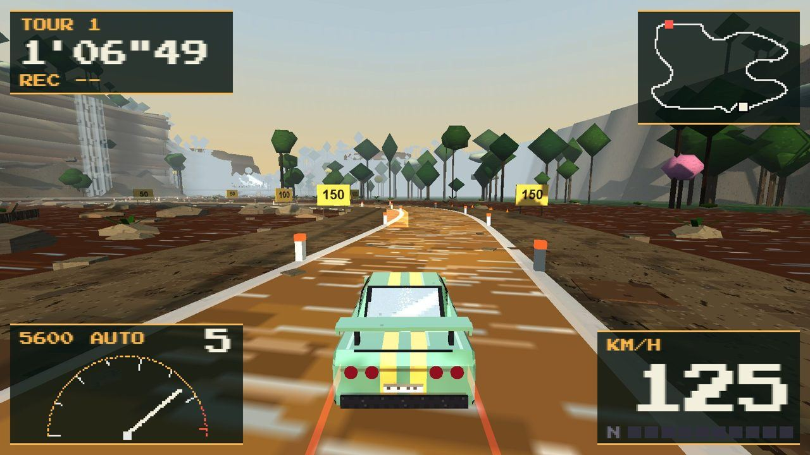

**Z4.5. Des cailloux et des plantes isolés** (Analyse) : peu de pierres à profil bas, qui ne forment ni dalles ni galets ; quelques feuilles vertes plantées dessus. L'eau paraît un sol (sol rouge-brun avec rochers) et non une surface avec de la profondeur.

**Z4.6. Ligne de la route** (Analyse) : les bords blancs sont continus et propres ; on ne voit pas la route disparaître dans l'eau ni le gué comme un endroit où l'on traverse.
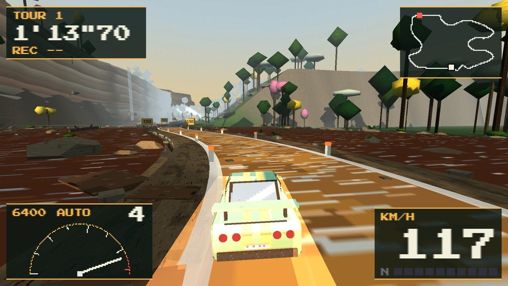

---

## Zone 5 : le pont (`idx` 1776 → 1852)

**Z5.1. Le pont ressemble à un pont en acier, pas à un pont de lianes** (Auteur). Les deux câbles sont de gros tubes noirs lisses, droits et parallèles, qui se lisent comme des glissières ou des poutres ; les suspentes sont invisibles ; le tablier est un damier de planches régulières (05-pont-1791, 05-pont-vue-1810). La spec et les fiches demandaient des câbles d'acier ; l'auteur attendait un pont en lianes.
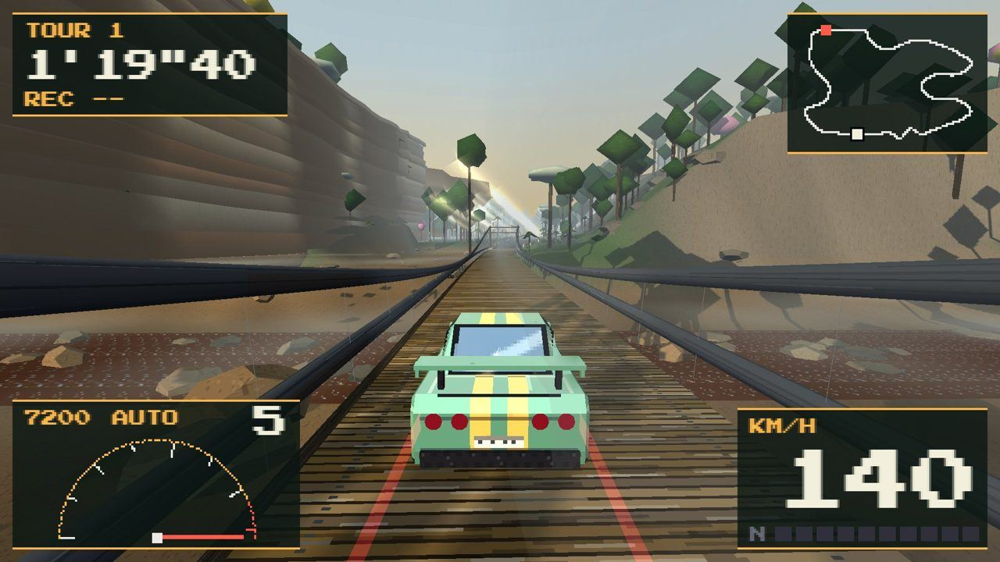

**Z5.2. Pas de ravin, pas de vide** (Analyse). Vu de côté, le pont est à peine au-dessus d'un sol beige-rouge ; la rivière n'est pas visible en dessous (05-pont-vue-1810). La fiche 6 décrit « le ravin de dalles et de rochers en dessous ».
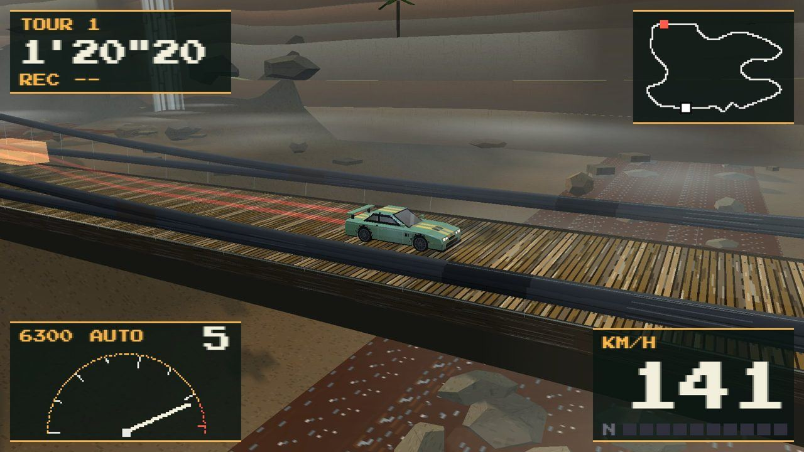

**Z5.3. Brume du pont absente** (Analyse). On voit la rive d'en face, les pylônes et la forêt de l'autre côté, nets (05-pont-1752) ; la spec prévoyait un brouillard qui s'épaissit dès le point 19 et un « grand arbre fantomatique ».
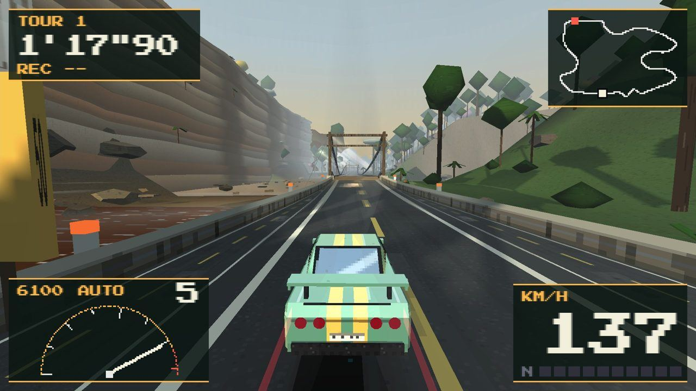

**Z5.4. L'entrée et la sortie du pont** (Analyse) sont sans ancrage ni pylône visible depuis la route : la chaussée devient planches d'un coup (1752 → 1791).

---

## Zone 6 : la remontée en forêt, après le pont (`idx` 1885 → 2376)

**Z6.1. Pleine de faux rayons de lumière moches** (Auteur). Les rayons sont des plans blancs ou jaunes plats, à bords nets, qui coupent le ciel et la cime des arbres en diagonale ou à l'horizontale ; sur 06-foret-1830 on voit le bord rectangulaire d'un plan de lumière ; sur 06-foret-1880 et 06-foret-1952 ils sortent d'un point du ciel comme une étoile.
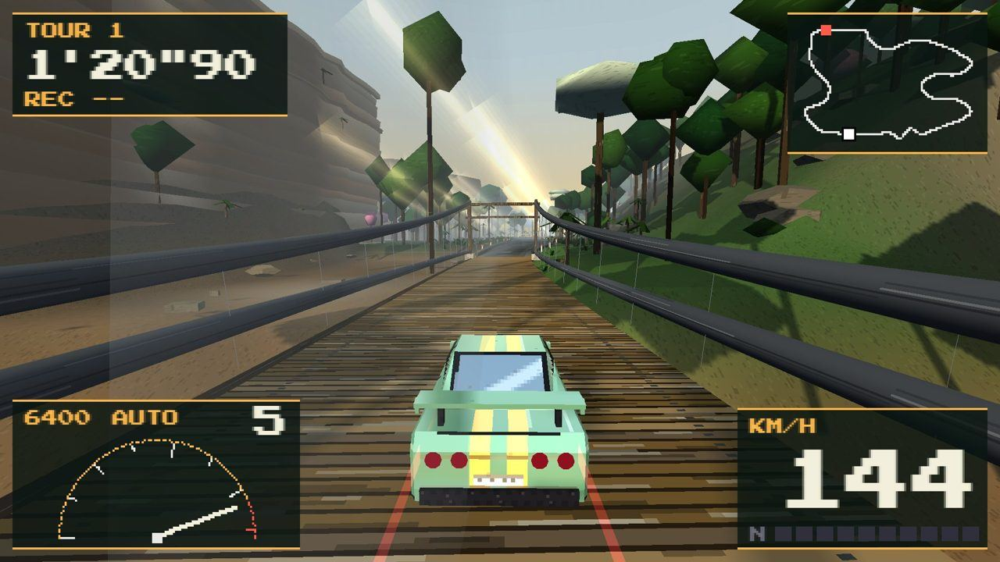
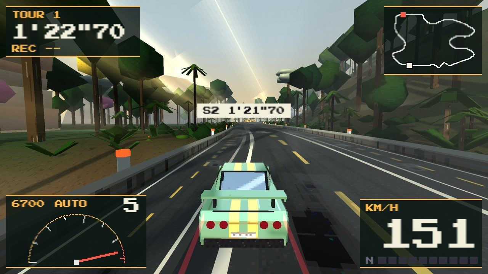

**Z6.2. Cela ressemble trop à la zone 2** (Auteur). Mêmes arbres en parasol, mêmes losanges, même glissière, mêmes panneaux de virage, même bitume propre ; seule la couleur du sol diffère (06-foret-2051 comparée à 02-lacets-701).
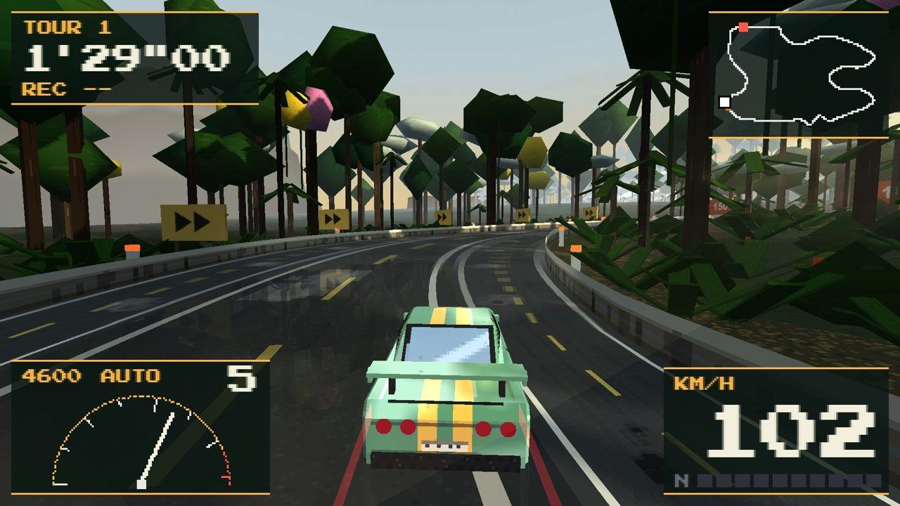

**Z6.3. Ce n'est pas une jungle** (Auteur). Les troncs sont espacés, le sol est une litière sombre avec quelques feuilles, le ciel est visible partout, la vue porte loin au travers des troncs (06-foret-vue-2000, 06-foret-2130, 06-foret-2221).
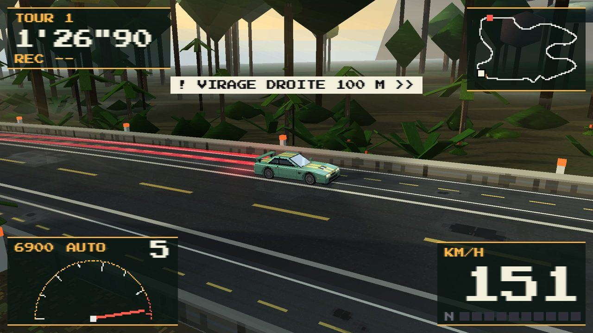

**Z6.4. Houppiers en feuilles plates, boules rose et jaune** (Auteur, Analyse), troncs lisses sans lianes ni épiphytes (06-foret-1880, 06-foret-2221).
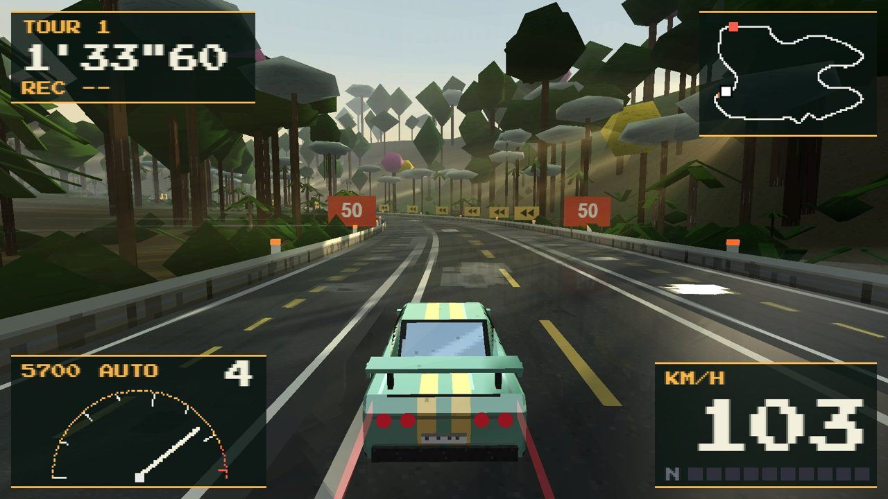

**Z6.5. Palmiers à frondes droites noires** posés isolés (06-foret-1880 en haut à gauche) : ils lisent comme des plumeaux.

**Z6.6. Route intacte au milieu de la forêt** (Analyse) : bitume propre, lignes jaunes régulières, glissière en pierre claire continue ; rien ne dit que la nature reprend le dessus (06-foret-2221).
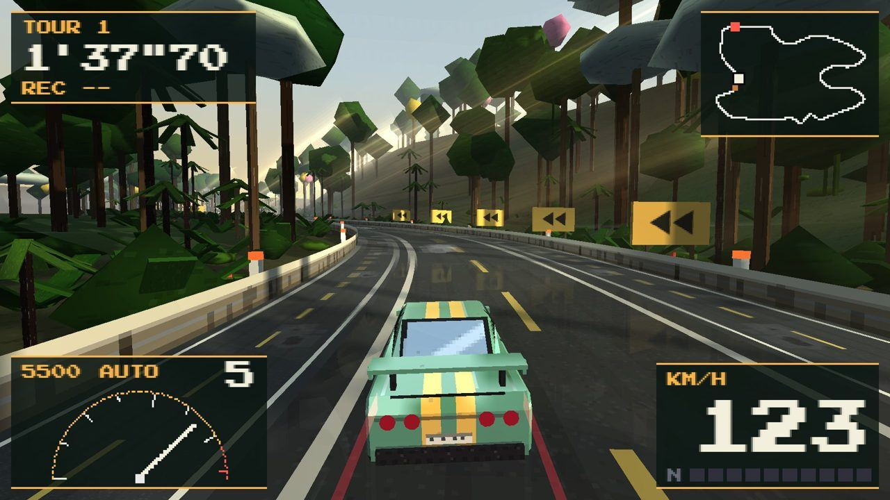

---

## Zone 7 : l'arche de roche (`idx` 2441 → 2535)

**Z7.1. « C'est quoi l'arche de roche bizarre à la fin ? »** (Auteur). Un empilement de dalles brunes rectangulaires à arêtes vives, posé à droite de la route et non au-dessus, qui se lit comme un tas de briques ou un pont en construction, pas comme une arche naturelle (07-arche-2451).
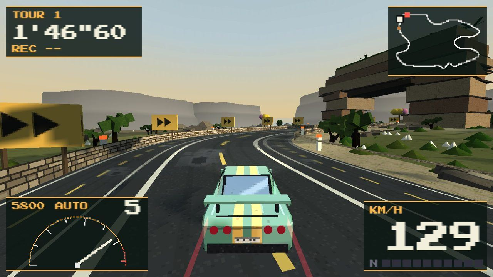

**Z7.2. Le passage entre piliers est une porte de briques** (Analyse). La route passe ensuite entre deux murs en appareil de briques, sous un linteau noir, avec le portique d'arrivée derrière : même texture que les murets du plateau, pas de lumière en contre-jour, pas de brume dorée (07-arche-2490).
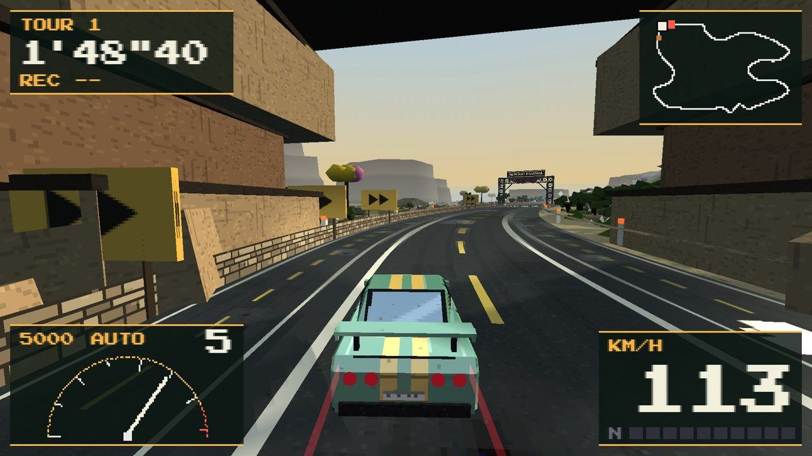

**Z7.3. Aucun lien avec le reste** (Analyse) : l'arche arrive après un plateau bas et sec, sans préparation ni écho dans les autres zones.

---

## En regard d'une ancienne carte (touge)

À chaque endroit du tour de touge, l'image est lisible d'un coup d'œil (ref-touge-180, ref-touge-1264).
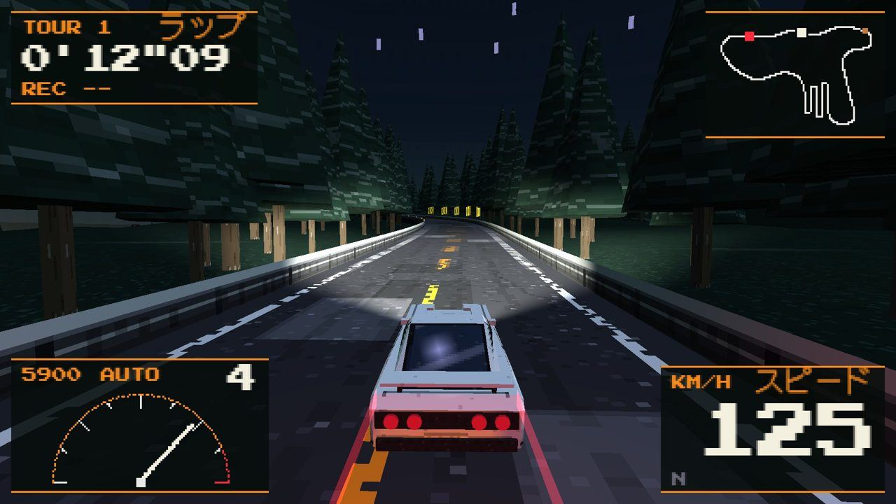
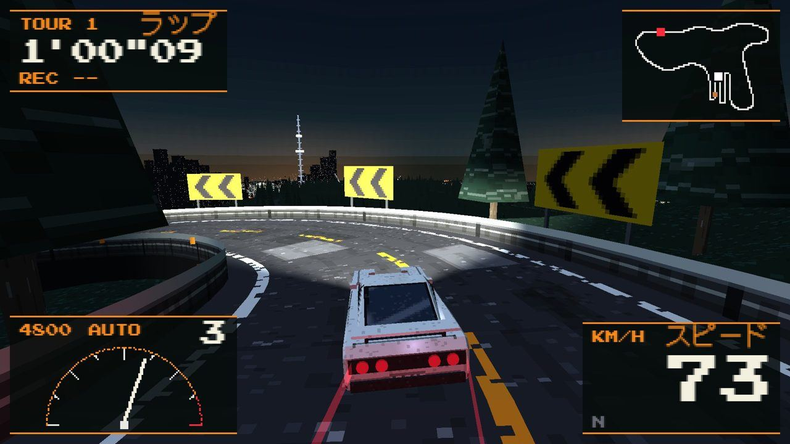

- **Une seule ambiance tenue de bout en bout** : nuit, brume, lumière des phares ; chapada change d'ambiance à chaque zone sans lien.
- **Végétation dense et enveloppante** : de chaque côté, un mur de grands conifères sombres, serrés, qui ferment la vue ; chapada laisse le ciel et le fond visibles.
- **Distance maîtrisée** : le fond s'efface dans le noir et la brume ; sur chapada on voit des falaises, des arbres et la chute à plusieurs centaines de mètres.
- **Repères reconnaissables** : un temple, un torii, une ville lumineuse, un portique ; chapada n'a que des panneaux.
- **Une matière de route unique et cohérente** avec des reflets de phares, sans surfaces superposées ; chapada change la matière de la route à la galerie et au gué.
- **Un rythme de moteur plus varié** : 19 % du tour à plus de 85 % du rupteur (touge), 28 % (givre), 47 % (chapada).
- **Des zones qui s'enchaînent** : montée, virages, sommet, descente, sans coupure de décor ; chapada passe d'un décor à un autre sans transition.

---

## Nombre de problèmes

12 généraux (G1 à G12) et 36 par zone (Z1.1 à Z7.3) : 48 problèmes.
