# Cahier de feedback — carte « ROUTE ROYALE » (perse)

Constat seulement : aucune solution ni piste de correction. Source : captures du moteur en 1920×1080 (`outils/captures.html`, `taille=1920x1080&jeu=1`), un tour en `pas=5` puis `pas=2`, plus des `idx=` et des `vue=` sur les points signalés. Les images sont la moitié « rendu net » de chaque capture (HUD compris). `idx` = échantillon de piste, 0 à 1185 sur 1186 ; le départ est à 1179.
Origine de chaque point : **[auteur]** = retour de l'auteur ; **[analyse]** = vu sur les captures.
Zones de `docs/SPEC-PERSE.md`, avec les indices relevés en jeu :

| Zone | idx | Spec |
|---|---|---|
| 1. Départ et plaine | 1179 → ~340 | secteur 1 |
| 2. Virage de sortie de plaine | ~340 → ~470 | fin du secteur 1 |
| 3. Grand escalier | ~470 → ~540 | secteur 2 |
| 4. Porte des Nations et deuxième virage | ~540 → ~615 | secteur 3 |
| 5. Cent colonnes | ~615 → ~740 | secteur 4 |
| 6. Jardin et virage avant le bazar | ~740 → ~880 | secteur 5 |
| 7. Bazar couvert | ~880 → ~1020 | secteur 6 (tunnel) |
| 8. Bazar ouvert et retour au départ | ~1020 → 1179 | secteur 6 |

---

## Problèmes généraux

**G1. Panneaux de virage partout [auteur : « enlève tous les panneaux de virage »].** Des chevrons jaunes et noirs, par rangées de 3 à 5, annoncent chaque virage de la carte, dehors comme sous la voûte du bazar. Des bandeaux de texte (« ! VIRAGE DROITE 100 M >> », « << 100 M VIRAGE GAUCHE ! ») flottent en plus dans la salle et le bazar. Sur beaucoup de vues, ils se lisent mieux que le décor.
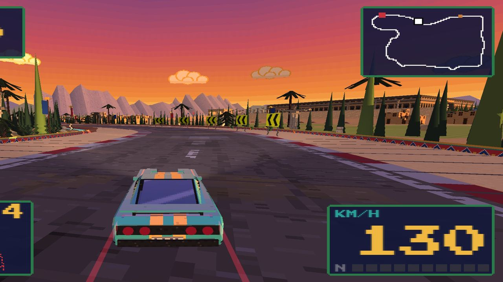

**G2. Densité très inégale d'une zone à l'autre [auteur].** Le départ empile portique, cyprès, bannières, maisons, canal et montagnes dans le même écran ; l'escalier, le deuxième virage et le virage avant le bazar n'ont presque rien. La carte passe de saturée à vide sans transition. Comparer `depart-idx1185` et `virage2-idx560`.

**G3. Décor lointain absent ou répétitif [auteur : « il manque souvent de décors au loin »].** Hors du départ et du jardin, l'horizon est une bande de sable, une ligne de montagnes violettes et le ciel. Dans la plaine, une file de cyprès identiques et une rangée basse de maisons. Aucun repère au loin (palais, falaise de tombeaux, grande porte) ne guide l'œil dans les virages. Voir `plaine-idx340`, `virage2-vue-idx577`.

**G4. Peu de continuité entre les zones [auteur].** Chaque zone commence net : sable nu puis tapis rouge sur la chaussée (idx ~590), façade noire puis salle intérieure (~620), sortie de salle puis jardin (~740), jardin puis portail du bazar (~858), voûte puis rue à ciel ouvert (~1020). Rien ne prépare ni n'enchaîne ces changements. Voir `virage2-idx590`, `bazar-sortie-idx1026`.

**G5. Lanternes suspendues sans support [auteur, étendu par l'analyse].** Des cubes jaunes pendent d'un fil qui sort du cadre, sans poteau, mur ni bâtiment. On les voit de idx ~560 à ~641 (avant et dans l'Apadana) et dans le bazar ouvert (~1040 à ~1154, sous un câble tendu en travers du ciel). Voir `apadana-lumieres-idx600`, `bazar-ouvert-idx1071`.

**G6. Lumière du bazar incohérente [auteur : « des rayons de lumière et des fois non »].** Sous la voûte, certaines lanternes tracent un faisceau blanc en cône, d'autres rien. Le sol est brûlé en beige clair par endroits (idx ~901, ~1000), sombre ailleurs. Voir `bazar-couvert-idx901`, `bazar-couvert-idx1000`.

**G7. « Effet de vague » [auteur] : non reproduit sur images fixes.** Le constat porte sur le mouvement ; les captures ne le montrent pas. Éléments observés qui peuvent s'y rattacher : le profil d'altitude monte de 0 à 14 m sur idx ~430 → ~540, puis redescend de 14 m à 0 sur le reste du tour ; la chaussée de l'escalier est striée en bandes horizontales régulières (`escalier-idx479`) ; les façades du bazar ouvert ont des textures en zigzag (`bazar-ouvert-idx1071`). Rien n'a été confirmé en jeu.

**G8. La route sert d'ornement [analyse].** La spec veut une route sobre, l'ornement sur les bords. De idx ~590 à ~740, la chaussée est un tapis rouge saturé à médaillons, l'élément le plus contrasté de la carte. Il commence par un bord rectiligne net au milieu de la route (~590). Voir `virage2-idx590`, `colonnes-idx661`.

**G9. Écarts avec `docs/REFS-perse.md` [analyse].** (a) Le mur de terrasse devrait être un socle de grands blocs, presque nu ; on voit une longue façade sombre à portes noires répétées (idx 590–613). (b) Les refs écartent les dômes à bulbe ; un dôme turquoise se voit à l'horizon du bazar ouvert (~1091). (c) L'escalier devrait être une double volée de marches basses sur une terrasse de 18 m ; il se lit comme une route plate striée (zone 3). Voir `virage2-idx590`, `bazar-ouvert-idx1071`.

**G10. Ciel qui change de couleur [analyse].** À la sortie de la voûte (idx ~1026), le ciel est un dôme rouge sombre à nuages noirs, très différent du dégradé orange/rose du reste ; il redevient orange à ~1091.
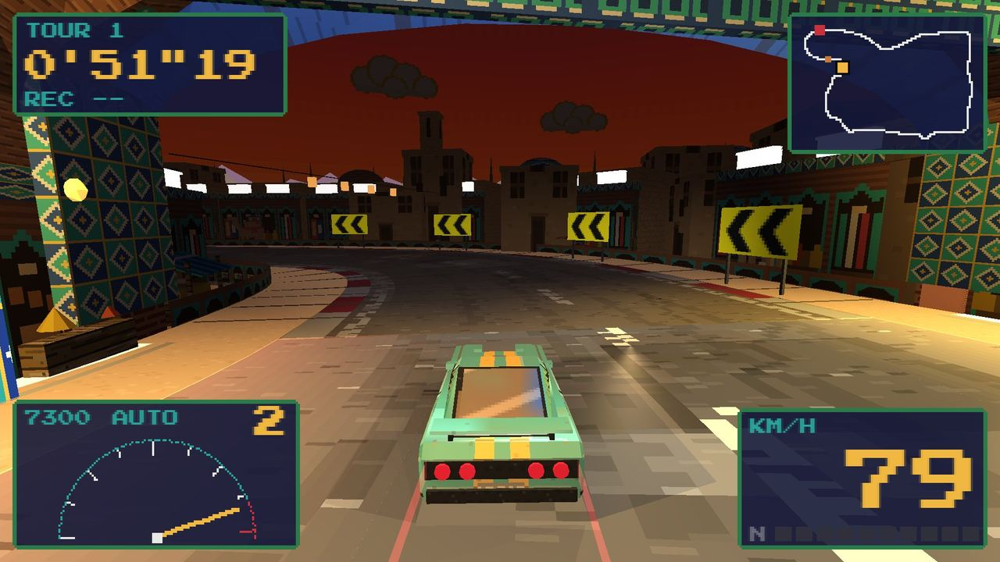

---

## Zone 1 — Départ et plaine (idx 1179 → ~340)

**1.1. Départ trop chargé [auteur : « le début est un peu trop chargé »].** idx 1185 → ~21 : portique bleu à damier, mât de bannière, cyprès serrés, maisons au loin, canal turquoise, bornes, nuages et montagnes dans un seul écran, sur une voiture presque à l'arrêt.
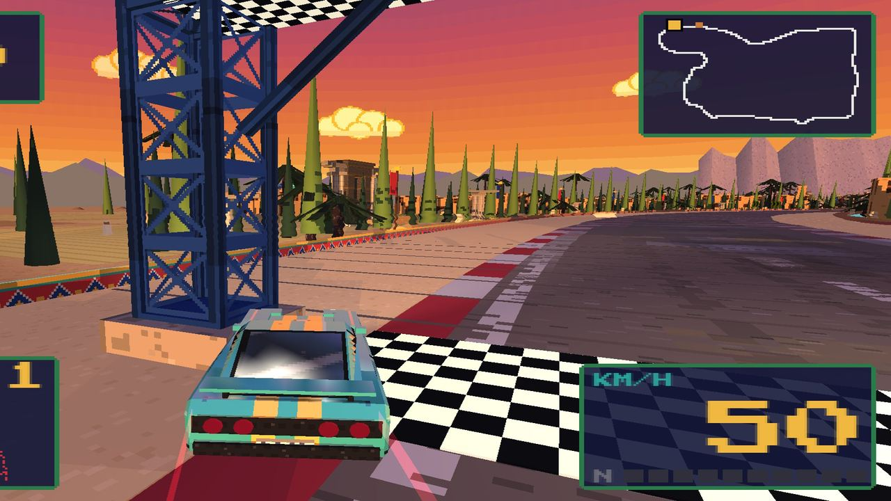

**1.2. Canal turquoise sans début ni fin lisibles [analyse].** idx ~21 : un canal borde la gauche de la piste et s'arrête en biais ; il reparaît plus loin (~383, ~815).
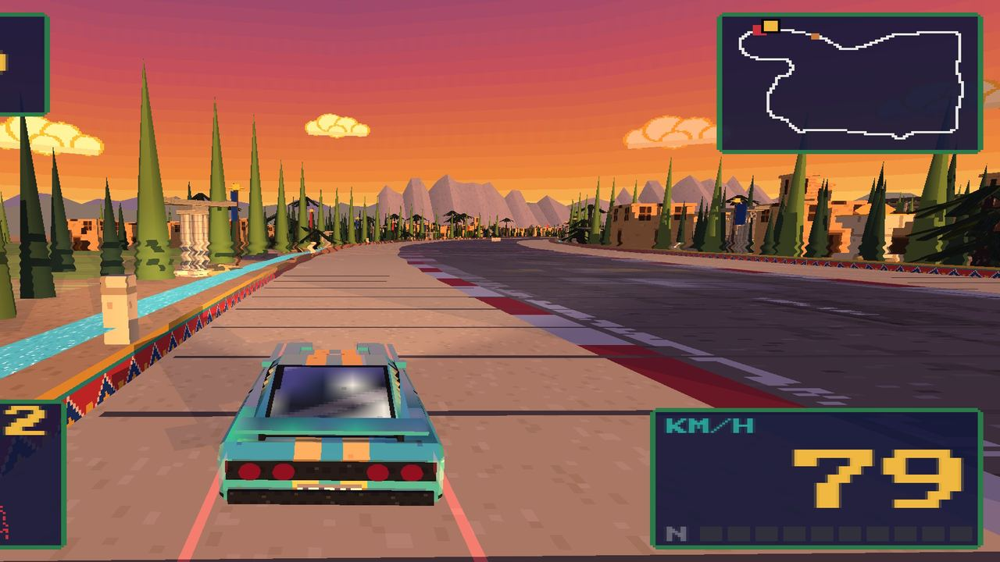

**1.3. Chevrons dès la plaine [auteur, G1].** idx ~129 : une rangée de cinq panneaux sur un virage doux, dans la seule zone rapide de la carte. Voir `plaine-idx129` (G1).

**1.4. Rideau de cyprès identiques [analyse].** idx ~129 → ~340 : même silhouette, même hauteur, même espacement des deux côtés ; il cache le fond au lieu de le montrer, et les maisons restent en bande basse.
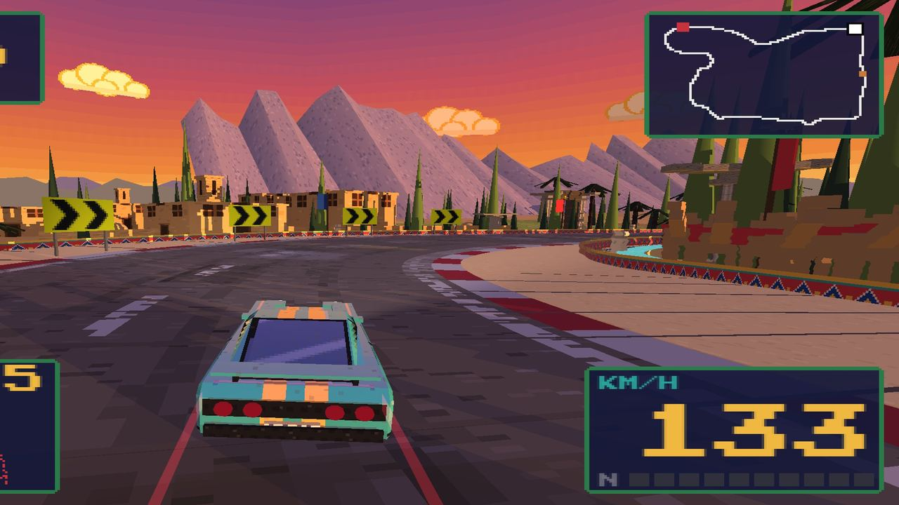

## Zone 2 — Virage de sortie de plaine (idx ~340 → ~470)

**2.1. Zone vide avant l'escalier [auteur : « la zone de l'escalier après le virage est vide »].** idx ~429 : à gauche un bout de canal, une borne et du sable ; à droite une longue façade basse à l'horizon ; entre les deux, rien.
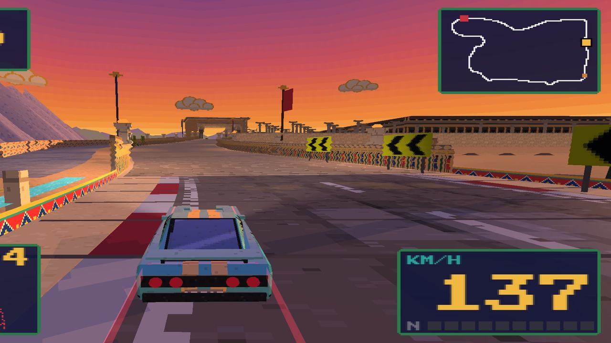

**2.2. Sable à perte de vue autour de l'approche [analyse].** Vue de côté à idx ~472 : la route est entourée de sable nu jusqu'à la montagne ; seules les balustrades bordent la piste.
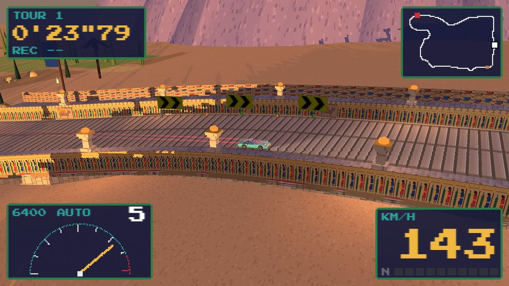

## Zone 3 — Grand escalier (idx ~470 → ~540)

**3.1. Escalier vide autour [auteur, même retour que 2.1].** idx ~479 : la balustrade à frise d'Immortels est le seul décor ; derrière elle, rien jusqu'à la porte au fond.
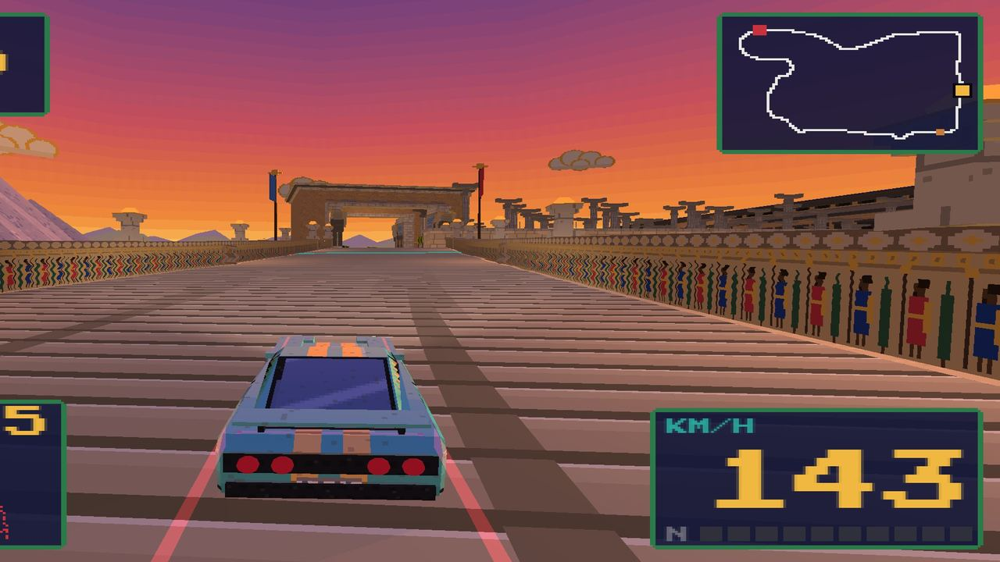

**3.2. L'escalier ne se lit pas comme un escalier [analyse].** La chaussée est une surface plate à bandes horizontales régulières ; pas de marches visibles, pas de volée miroir, pas de palier, pas de mur de terrasse haut à côté. Voir `escalier-idx479`.

## Zone 4 — Porte des Nations et deuxième virage (idx ~530 → ~615)

**4.1. Pas de grande porte [auteur : « ça manque d'une grande porte »].** idx ~505 → ~530 : la porte est un cadre bas et large au fond, petit à l'écran ; les taureaux ailés se lisent comme des blocs sombres, sans piliers hauts. Aucune structure de grande taille ne marque l'entrée de la terrasse.
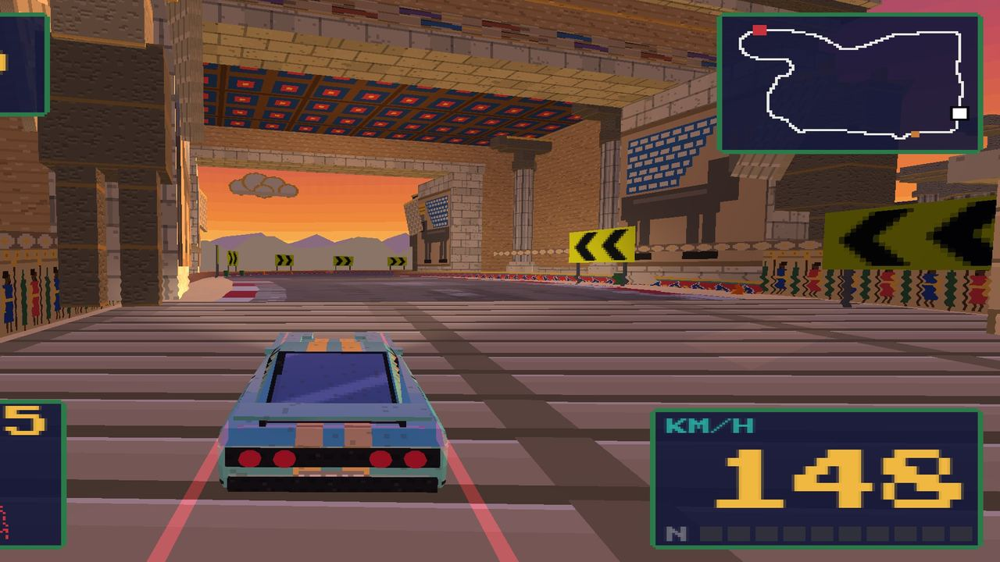
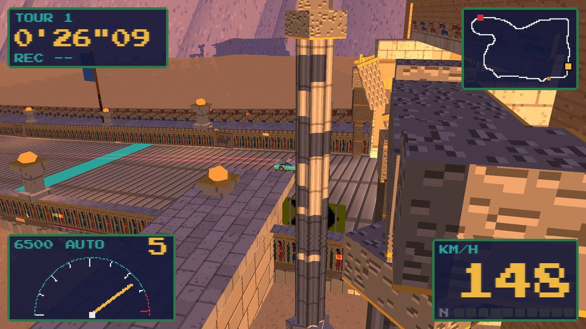

**4.2. Deuxième virage sans décor [auteur : « le deuxième virage n'a aucun décor »].** idx ~560 → ~590 : sable nu à l'intérieur du virage, façade basse à l'extérieur ; seuls la bordure en losanges rouges et les chevrons sont là.
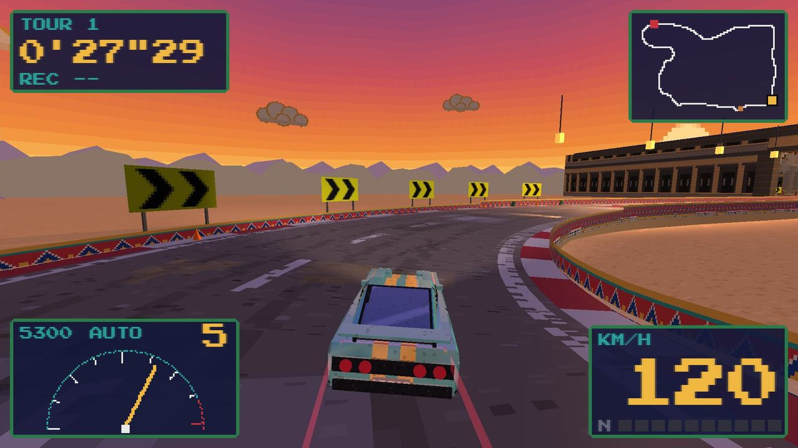
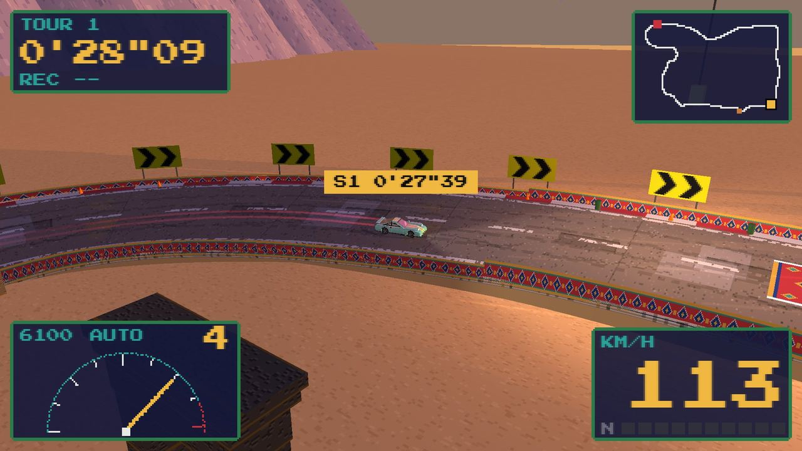

**4.3. Lumières qui volent avant le bâtiment [auteur].** idx ~560 → ~613 : cubes jaunes suspendus à des fils qui montent hors du cadre, au-dessus de la route et du sable, devant la façade de l'Apadana.
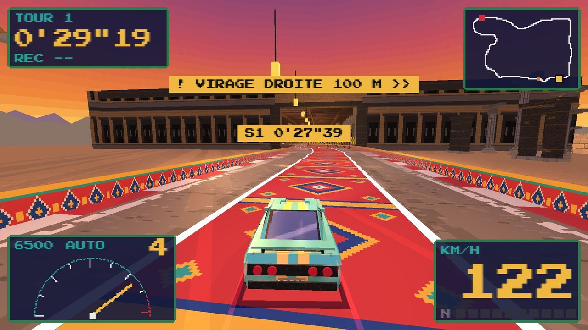

**4.4. Tapis rouge qui commence net sur la route [analyse].** idx ~590 : la chaussée grise devient tapis rouge par un bord rectiligne en travers, sans transition.
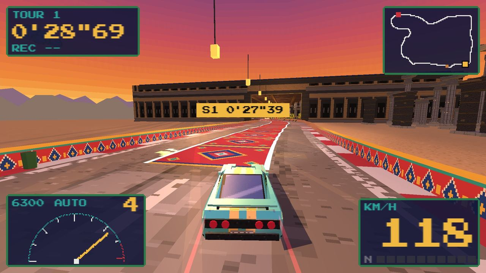

**4.5. Façade de l'Apadana : mur plein à portes noires répétées [analyse].** idx 590–613 : longue paroi sombre, même rangée de portes sur toute la largeur de l'écran, sans relief ni ornement, qui cache tout le fond. Voir `virage2-idx590`, `apadana-lumieres-idx600`.

## Zone 5 — Cent colonnes (idx ~615 → ~740)

**5.1. Panneaux dans la salle [auteur, G1].** idx 620–661 : chevrons géants et bandeau « VIRAGE DROITE » dans une salle de colonnes.
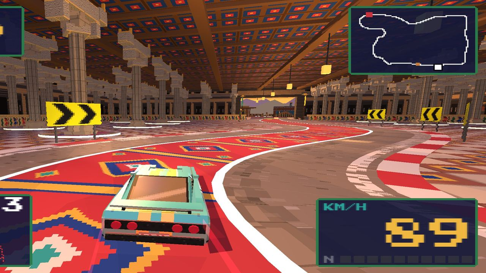

**5.2. Sortie de salle : gros bloc brun uni et bandes jaunes [analyse].** idx ~731 : un bloc brun sans texture occupe le tiers droit de l'écran ; deux bandes jaunes larges traversent la chaussée (aussi vues à ~773).
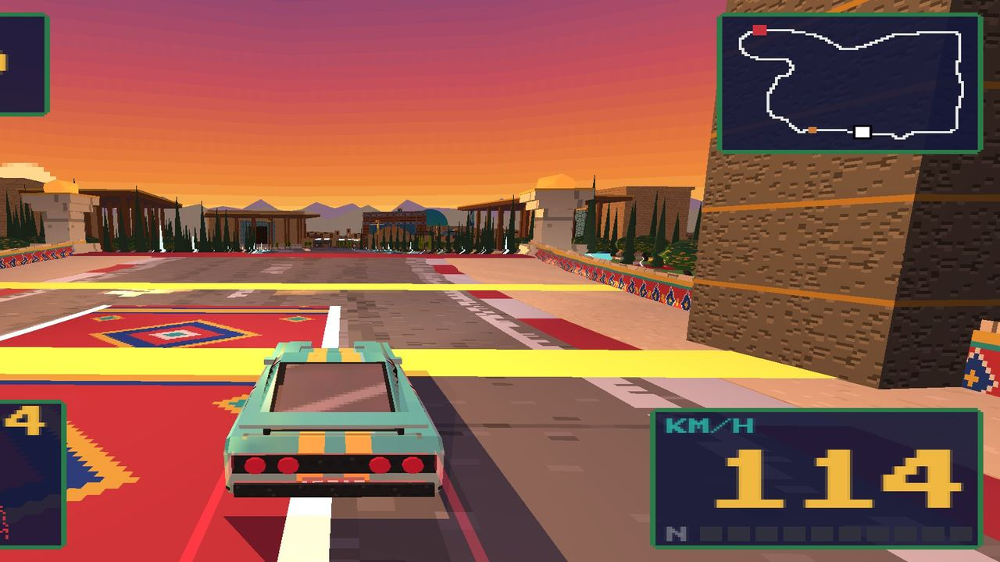

## Zone 6 — Jardin et virage avant le bazar (idx ~740 → ~880)

**6.1. Jardin lisible mais sans lien avec le reste [analyse].** idx ~773 : cyprès alignés, canal, fontaines et pavillons ; la zone est bien remplie, mais n'a aucun lien visuel avec la salle derrière ni avec le bazar devant.
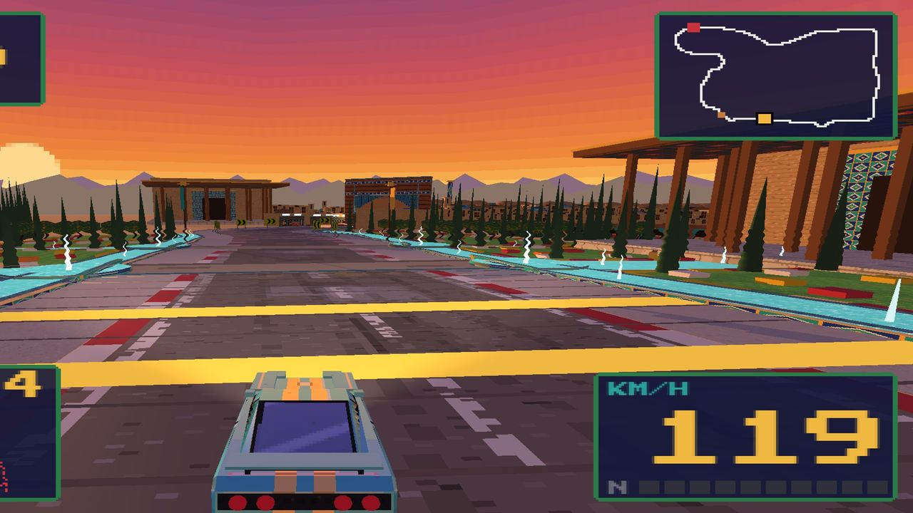

**6.2. Virage avant le bazar vide [auteur : « le virage avant le bazar est vide »].** idx ~815 → ~858 : côté intérieur du virage, rien entre la chaussée et l'horizon ; le jardin ne couvre que la droite.
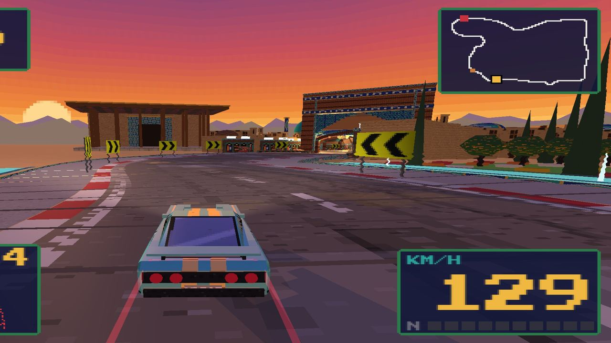
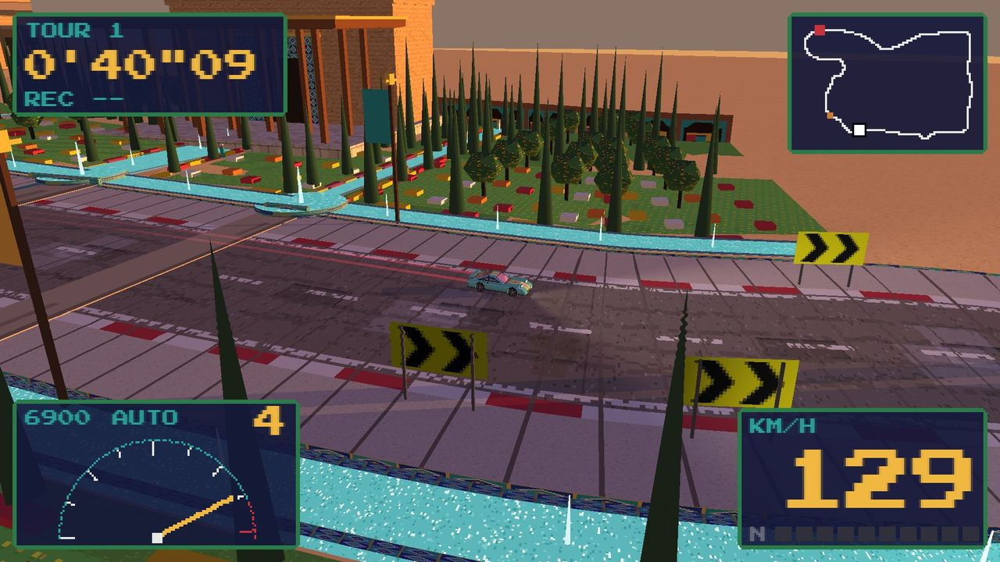

**6.3. Panneaux à cheval sur la bordure [analyse].** idx ~815 : deux chevrons plantés sur le vibreur ou au bord de la chaussée. Voir `virage-bazar-vue-idx815`.

## Zone 7 — Bazar couvert (idx ~880 → ~1020)

**7.1. Portail d'entrée : dalle brune plaquée devant l'arc, toit manquant [auteur : « superpositions de textures de bâtiment, il manque le toit »].** idx ~858 : un plan brun plat en gradins se superpose à la façade de faïence bleue et cache l'arc ; l'ensemble n'a pas de toit lisible.
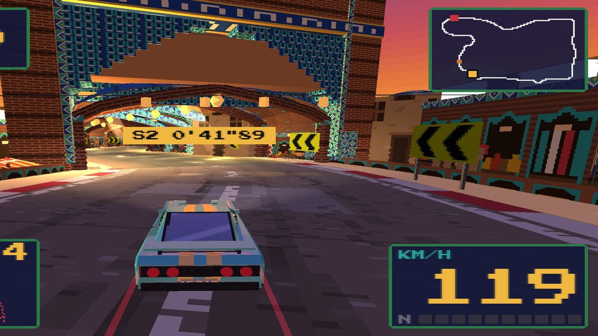

**7.2. Maisons sous la voûte [analyse].** idx ~881 et ~1000 : un cube de maison à fenêtres se tient sous la voûte de briques ; au premier plan, un pilier de brique énorme coupe la vue.
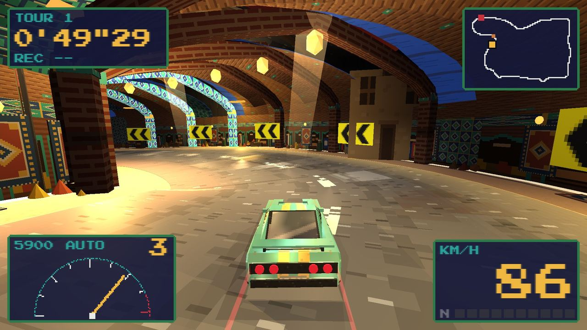

**7.3. Faisceaux lumineux une lanterne sur deux [auteur, G6].** idx ~901 → ~1000 : cônes blancs sous certaines lanternes seulement.
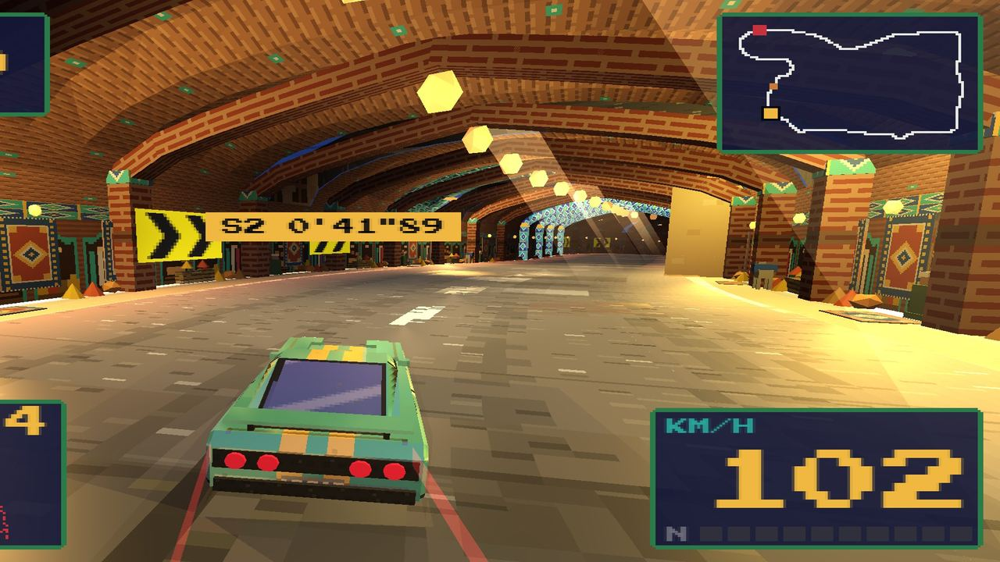
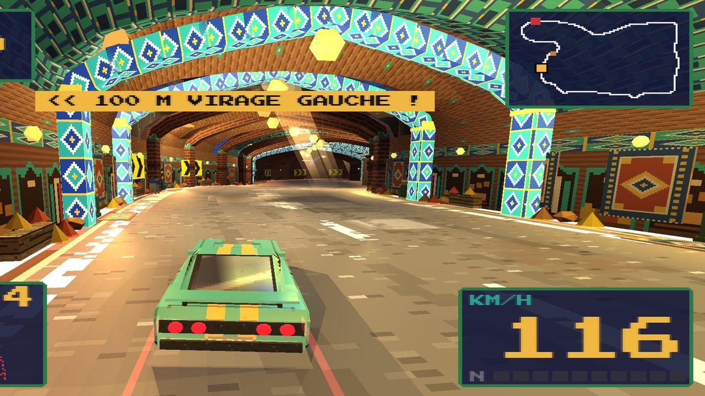

**7.4. Lanternes hexagonales flottantes [analyse].** idx ~901 → ~1000 : cubes jaunes en l'air sous la voûte, sans fil ni crochet. Voir `bazar-couvert-idx901`.

**7.5. Panneaux dans un tunnel [auteur, G1].** idx ~938, ~1000 : chevrons au sol à chaque arc. Voir `bazar-couvert-idx938`.

## Zone 8 — Bazar ouvert et retour au départ (idx ~1020 → 1179)

**8.1. Sortie de voûte : ciel rouge sombre, silhouettes noires [analyse].** idx ~1026 : voir G10.

**8.2. Grands bâtiments cubiques sans toit ni détail [analyse].** idx ~1040 : volumes bruns percés de fenêtres, plus hauts que les arcades, avec un rectangle d'ombre plat posé sur la façade.
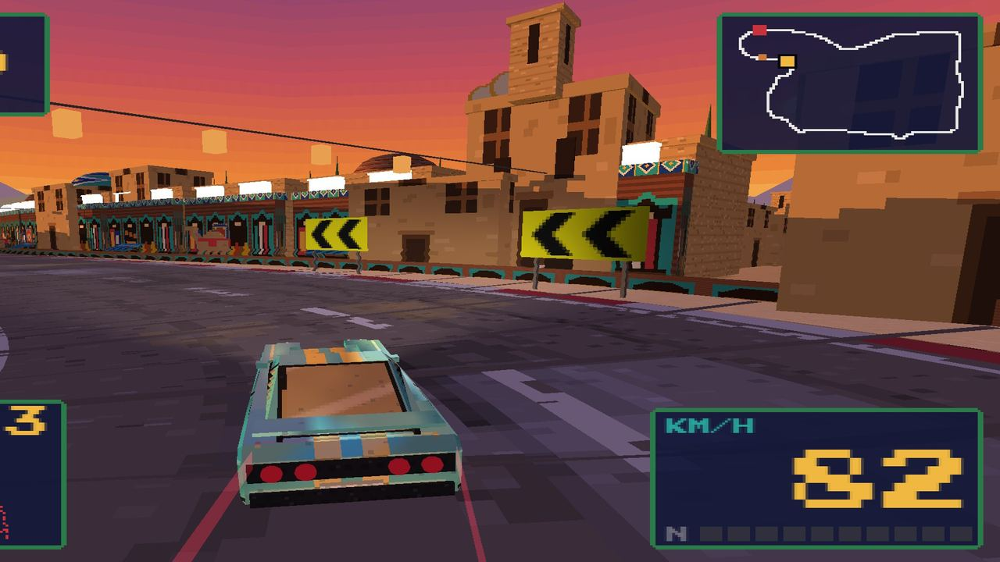

**8.3. Arcades sans toit, rebords blancs en l'air [auteur : « il manque le toit des fois »].** idx ~1071 → ~1154 : le haut des arcades est une bande blanche sans bâtiment ni toit au-dessus, sur ciel ouvert.
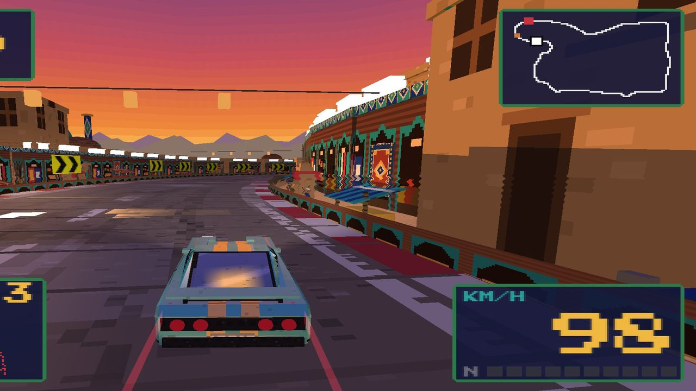

**8.4. Texture étirée et cisaillée sur la façade intérieure [analyse].** idx ~1071 : à droite, la devanture et l'étal rayé montrent des lignes de texture en zigzag vertical, comme étirées. Voir `bazar-ouvert-idx1071`.

**8.5. Câble en travers du ciel, cubes suspendus [analyse].** idx ~1040 → ~1154 : un trait fin traverse tout l'écran à hauteur du ciel, avec des cubes orange. Voir `bazar-ouvert-idx1071`.
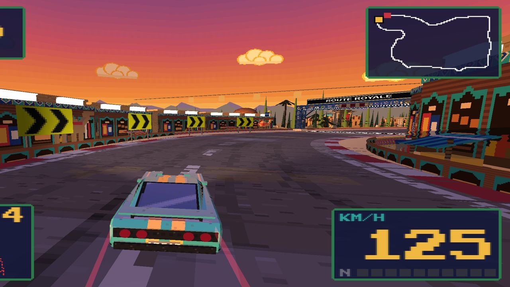

---

## En regard d'une ancienne carte (paris)

Mêmes réglages de capture (`pas=5`, 1920×1080).

- **Continuité.** Paris garde la même grammaire de façades des deux côtés de la rue, de zone en zone : pas de coupure nette entre deux ambiances. Perse change de matière, d'échelle et de lumière à chaque zone.
- **Densité stable.** Arbres, voitures garées, terrasses, enseignes lisibles et mobilier de rue reviennent à chaque vue. Perse alterne surcharge et sable nu.
- **Fond.** Chaque vue de Paris a une ligne de toits et un repère au bout de l'avenue (arc de triomphe, courbe d'immeubles). Perse n'a souvent que sable, montagnes et ciel.
- **Pas de rangées de chevrons.** Paris signale un virage par un bandeau de texte, pas par une rangée de panneaux dans la rue.
- **Lumière cohérente.** Une lumière chaude diffuse sur les façades, sans faisceaux ni lanternes en l'air. Perse mélange tapis rouge saturé, sol brûlé, faisceaux et ciel qui change.
- **Textures sans superposition.** Pas de plan plaqué devant une façade, pas de toit manquant, pas de bâtiment sous une voûte.
- **Route sobre.** Deux teintes de bitume et lignes blanches, tout l'ornement sur les bords.

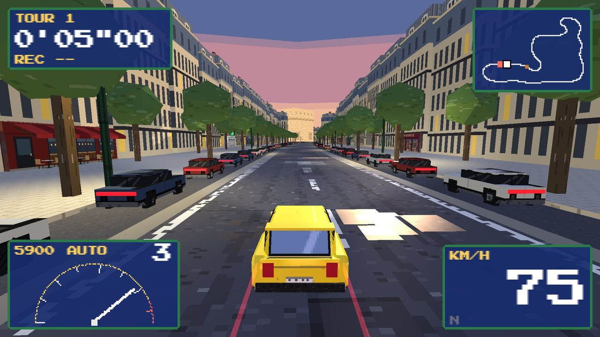
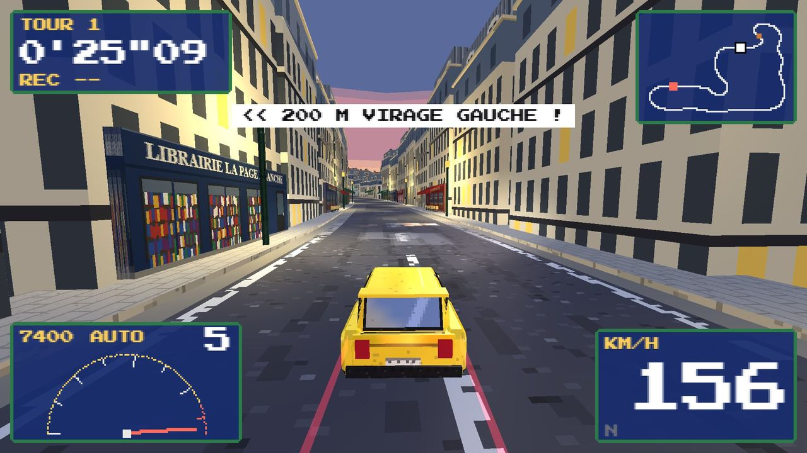
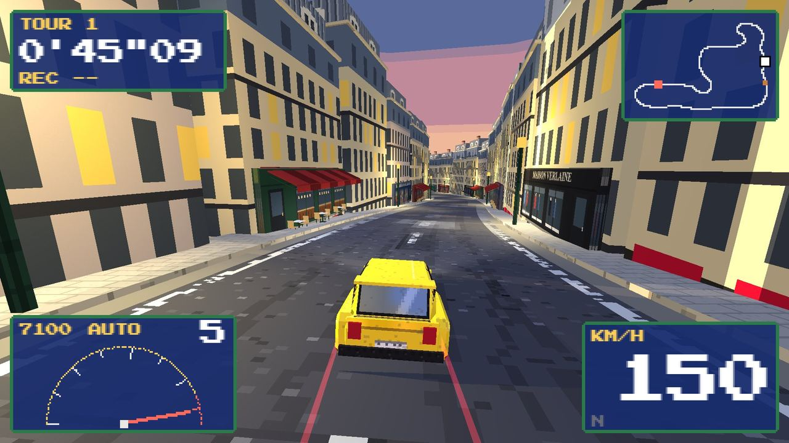
