# Cahier de feedback : Playa 307 (carte `plage`)

Constat seulement : aucune solution, aucune piste de correction. Chaque problème porte un numéro, un lieu (zone, indice de piste `idx`), une image et son origine : **[auteur]** si le retour vient de l'auteur, **[analyse]** si je l'ai trouvé en regardant les captures.

Captures : tour complet `pas=5` puis `pas=2`, plus des `idx=` et des `vue=` aux endroits signalés, tous en `taille=1920x1080&jeu=1`. Les images de ce cahier sont la moitié droite (rendu net 1920 × 1080, HUD compris) ramenée à 1280 × 720. Le rendu réel du jeu (moitié gauche) montre les mêmes défauts. Aucune erreur console pendant les captures ; le temps d'image n'est pas l'objet de ce cahier. Un tour fait environ 1 290 échantillons de piste ; les `idx` ci-dessous sont ceux des captures.

Ordre de la piste : départ sur la plage (idx ~1180 → 250) · ponton (~250 → 360) · rue aux guirlandes (~400 → 490) · marché couvert (~540 → 600) · garrigue (~610 → 730) · arche et entrée de grotte (~700 → 775) · grotte (~775 → 1000) · chaussée de lagune (~1000 → 1200) · retour plage (~1200 → départ).

---

## Problèmes généraux

**G1 · Pas de continuité entre les zones [auteur].** Chaque zone est un décor posé à part : sol, palette, silhouette d'horizon et densité changent d'un coup à chaque frontière (voir J1 à J6 plus bas). Le résultat se lit comme une suite de plateaux, pas comme un lieu qui se prolonge.
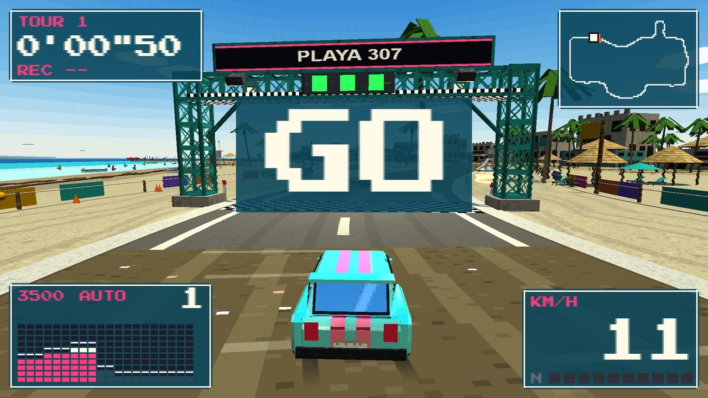
*Le départ : portique, cônes, sable. Rien n'annonce ce qui vient ensuite.*

**G2 · Il manque le point d'eau du cénote, le cœur de la carte [auteur].** Aucune étendue d'eau ne se trouve sur le trajet de la grotte ni avant elle. Le cénote ouvert prévu par `docs/SPEC-PLAGE.md` (bassin turquoise de 125 m, choix rampe ou traversée) n'existe pas : à sa place, une route de garrigue, une arche de pierre et un panneau « CENOTE SOLO NADAR » devant une entrée sèche (z6, idx 700 → 745). Dans la grotte, l'eau se réduit à un liseré sombre de 1 m contre les parois (z7).

**G3 · Peu de festif, peu de vie [auteur].** L'ambiance de fête est concentrée sur une centaine d'échantillons (la rue, idx ~400 → 490). Ailleurs : la plage est presque vide (quelques silhouettes en bâtons, immobiles sur les captures), le ponton aussi, la garrigue et la chaussée n'ont ni voiture, ni personne, ni signe d'activité. Le marché n'a ni vendeur ni client visible. En regard, `ville` est pleine d'enseignes, de lumières et de volumes sur toute la piste.

**G4 · Effet de vague [auteur, origine inconnue].** Les captures fixes ne le montrent pas à coup sûr, c'est un effet de mouvement. Ce que j'y vois de régulier et d'ondulé : des bandes concentriques dans le ciel au-dessus de l'horizon (g-00, z2-01), des rides de sable en bandes obliques sur la plage (z1-04), les bandes d'eau de la lagune et du ponton. La carte active aussi `chaleur: 0.35` (mirage de la route au loin) dans `cartes.js`. Je n'ai pas isolé lequel des quatre est celui que l'auteur voit.
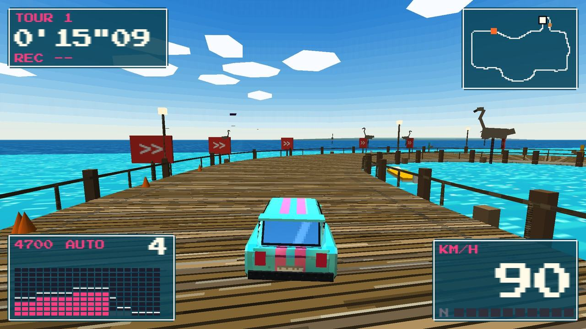

**G5 · Route : marquages routiers partout [auteur, pour la grotte ; analyse pour le reste].** Lignes de rive blanches, pointillés centraux, bords jaunes et cyan : une route moderne bien tracée dans la garrigue, sur la chaussée de lagune et jusque dans la grotte. Sur la plage, la chaussée brune porte de longues bandes sombres parallèles, répétées sur toute la longueur, y compris à l'arrêt devant la ligne de départ (g-00, z1-02). Les sources (`docs/REFS-plage.md` §5) donnent une ligne de rive jaune et un accotement de gravier blanc, pas des lignes blanches.

**G6 · Architecture à l'écart des sources [analyse].** Les bâtiments sont des boîtes à toit plat crénelé, grises, ocre ou bleu-vert sombre, sans balcon, terrasse, toit de palmes ni jardin. Elles se lisent comme un bourg de pierre, pas comme les 1 à 2 étages crépis saumon et jaune de la Quinta Avenida, ni comme les resorts de Playa del Carmen (REFS §1 et §3 : palettes qui « claquent », pas de dégradé).
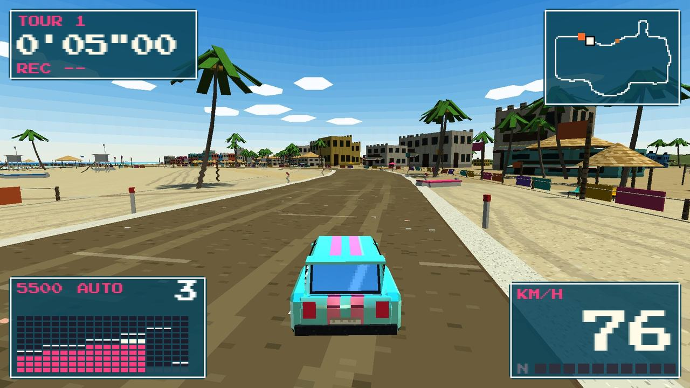

**G7 · Éclairage uniforme et contrastes brutaux [analyse].** Un seul éclairage de plein midi sur toute la carte ; les passages à l'ombre (halle, grotte) sont des interrupteurs : la halle est jaune clair, la grotte brun-vert, la sortie de grotte noire (z7-05). Aucune transition de lumière ne prépare ces passages.

**G8 · Textures lisses ou répétées [analyse].** Parois de grotte en hachures verticales identiques sur toute la longueur, pavage du ponton à rayures régulières, bitume lisse de la garrigue et de la lagune, sable à bandes. Les surfaces larges ne portent ni usure, ni saleté, ni variation locale.

**G9 · Objets posés, sans lien avec le sol ou avec le tout [auteur, pour le ponton ; analyse pour le reste].** Piquets, cônes, panneaux « >> », dalles et rampes sont posés sur le sol sans raccord : pas d'ombre de contact, pas de fondation, pas de logique d'implantation (z1-02, z2-02, z2-03).

---

## Zone 1 · Plage de départ (idx ~1180 → 250)

**Z1-1 · Éléments 3D en plein milieu dès le début [auteur].** Au départ, la tour de maître-nageur sur pilotis, une rampe grise et une dalle bleue sont posées sur le sable à quelques mètres de la chaussée ; le portique de départ et ses pylônes verts occupent l'écran (idx 0 → 60). Ces volumes sont posés sans cadre : le sable autour est vide.
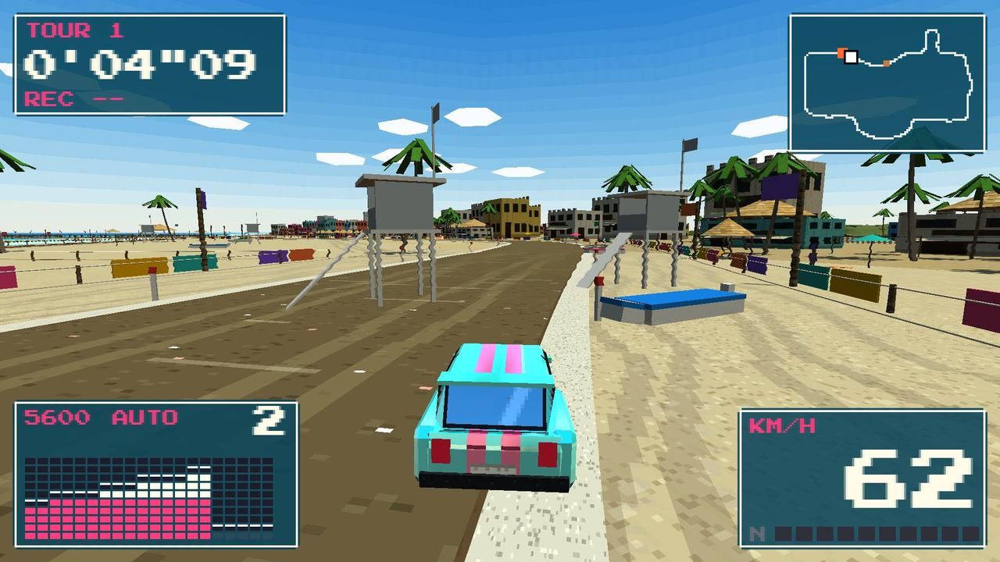
*idx 21.*

**Z1-2 · Bâtiments de droite laids le long de la plage [auteur].** Ils sont alignés en bloc contre la plage : façades planes grises et ocre, toit plat crénelé, fenêtres carrées identiques, pas de terrasse, pas de palapa, pas de piscine ni de jardin visibles. L'auteur demande des resorts de Playa del Carmen : ici rien n'y ressemble (volumes bas et étalés, toits de palmes, terrasses ouvertes, verdure).

*idx 33.*
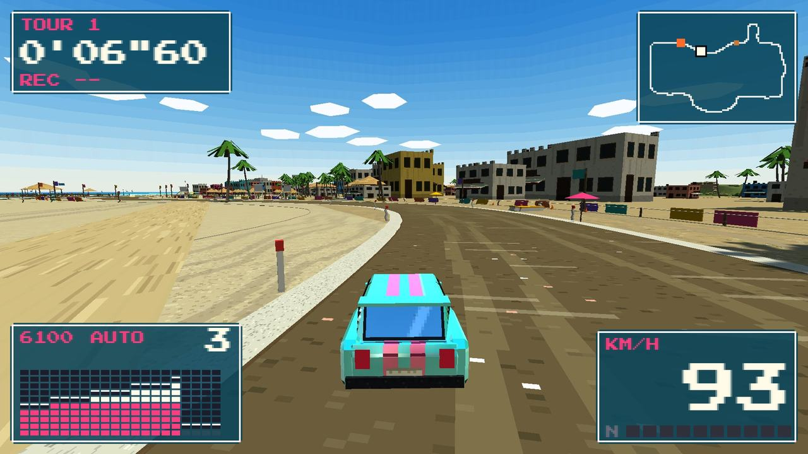
*idx 60 : un grand bloc gris et un bloc ocre, sans lien avec la plage au premier plan.*

**Z1-3 · Plage vue d'en haut : objets éparpillés [analyse].** Du dessus, la plage est un grand sable où sont semés des palmiers, deux tours de sauvetage, une dalle bleue, des bouées et une corde ; rien ne les relie, aucune allée, aucune zone d'usage (terrasses, chaises, bar).
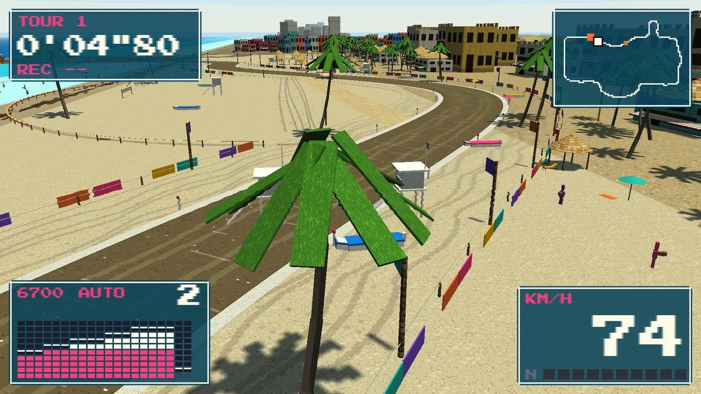
*idx 30, caméra d'inspection.*

**Z1-4 · Mer plate, sans laisse de mer [analyse].** La bande de turquoise est lisse et uniforme, sans sargasses ni ligne d'écume irrégulière ; les sources en font un trait du lieu (REFS §1). Les bouées en ligne et la corde font mur côté mer mais sont répétitives (idx 21 → 150).

---

## Zone 2 · Ponton (idx ~250 → 360)

**Z2-1 · Pilotis artificiels : une piste, puis « un truc » au milieu [auteur].** Du dessus, le ruban de route monte sur un tablier étroit qui part de la plage ; à côté, un deuxième tablier large, rectangulaire, porte la palapa-bar et un panneau « MUELLE 307 ». Les deux formes ne forment pas un tout : le ruban de route traverse le tablier sans qu'il lui ressemble, les gardes-corps ne se raccordent pas, la route semble posée sur le ponton plutôt que le ponton construit pour la route.
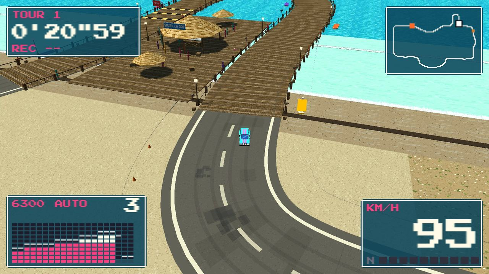
*idx 345, caméra d'inspection.*
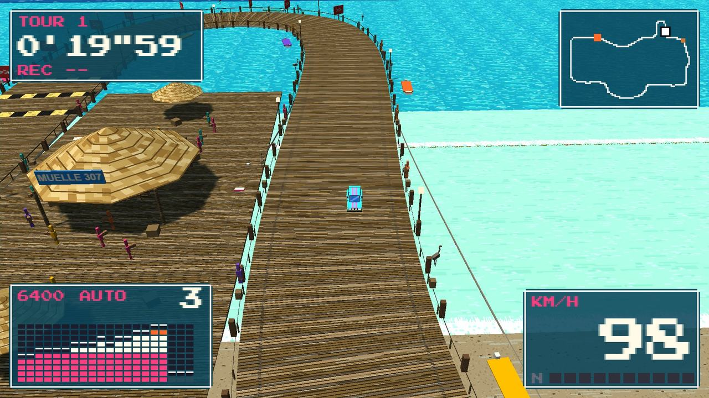
*idx 325.*

**Z2-2 · Tracé en U posé sur l'eau [analyse].** À hauteur de voiture, le ponton est un long plateau de planches à rayures régulières, bordé de gardes-corps identiques et de panneaux « >> » rouges ; l'eau turquoise de chaque côté est lisse, avec des reflets en bandes. Les sources (REFS §2) donnent des pilotis ronds gris-vert à base noire, un tablier à 2 ou 3 m au-dessus de l'eau et une ligne droite vers le large, pas un U.

*idx 251.*

**Z2-3 · Sortie du ponton : le sable et la route reprennent sans raccord [analyse].** Le tablier s'arrête net sur la plage ; la route de sable reprend avec un autre revêtement et un liseré blanc (voir J2).
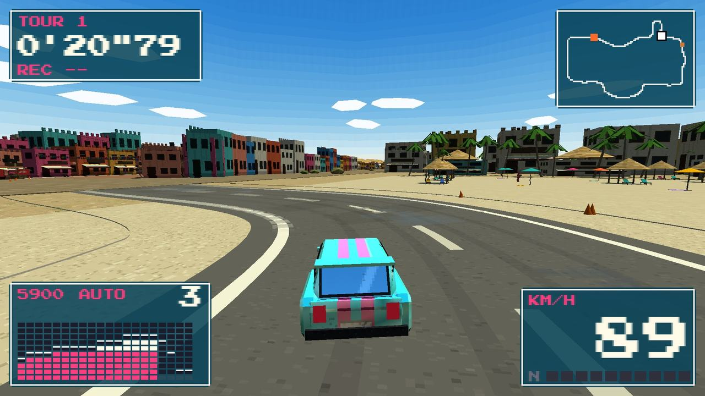
*idx 350.*

---

## Zone 3 · Rue aux guirlandes (idx ~400 → 490)

**Z3-1 · Bonne idée, trop uniforme [analyse].** Papel picado, auvents rayés et façades hautes donnent le « festif » demandé, mais seulement ici. Les façades sont sombres (brun, bleu-vert foncé), de plusieurs étages à toit crénelé, et se répètent des deux côtés ; les sources donnent 1 à 2 étages saumon et jaune vifs. Le sol rouge est plat, sans passants ni voitures visibles, les étals sont vides.
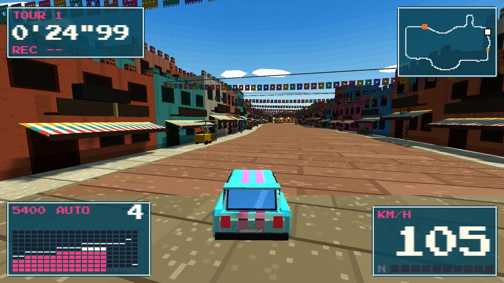
*idx 431.*

---

## Zone 4 · Marché couvert (idx ~540 → 600)

**Z4-1 · Marché peu marché [auteur, via « inspire-toi des marchés couverts mexicains »].** Le toit et ses piliers existent, mais le contenu est une suite de grands rideaux colorés (rose, jaune, orange) et de caisses ; je ne vois ni hamacs, ni sombreros, ni poteries, ni vendeurs, ni clients (REFS §4 : étals serrés, ombre franche, silhouette de toit large et bas bordé de hamacs). L'éclairage est un jaune pâle sans ombre dense ; le plafond ouvre sur une trouée de ciel au bout.
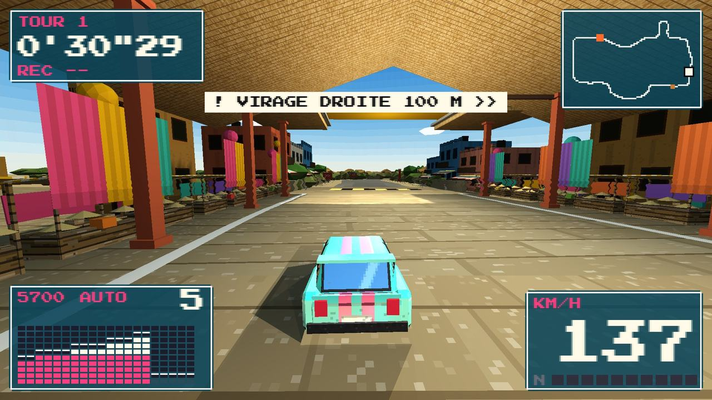
*idx 562.*

---

## Zone 5 · Garrigue (idx ~610 → 730)

**Z5-1 · Végétation basse sympathique, mais plate [auteur].** Buissons bas aux bords nets, murets de pierre ; l'auteur trouve la zone agréable et note qu'il manque peut-être de plus grands arbres plus loin : la ligne d'horizon est basse et régulière, sans arbre qui dépasse.
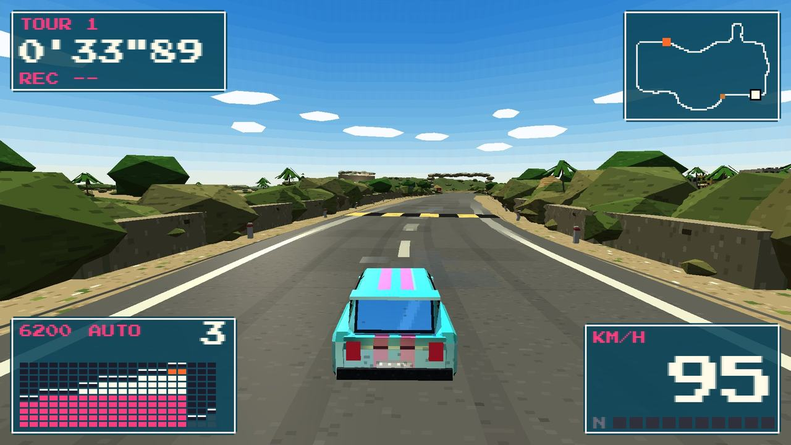
*idx 641.*

**Z5-2 · Une route nue dans la garrigue [analyse].** Une chaussée grise parfaite, marquée de lignes blanches, traverse la broussaille sans trace d'usure ni panneaux vert-blanc ; seuls les topes jaunes et noirs donnent une identité (REFS §5).

---

## Zone 6 · Arche et entrée de grotte (idx ~700 → 775)

**Z6-1 · Le cénote ouvert est remplacé par une arche et un panneau [auteur, via « tu as enlevé le point d'eau »].** À l'endroit où la spec plaçait le bassin, on trouve une arche de pierre posée sur la route, un panneau « CENOTE SOLO NADAR » et une palapa. Aucune eau ni rebord calcaire ni lianes.
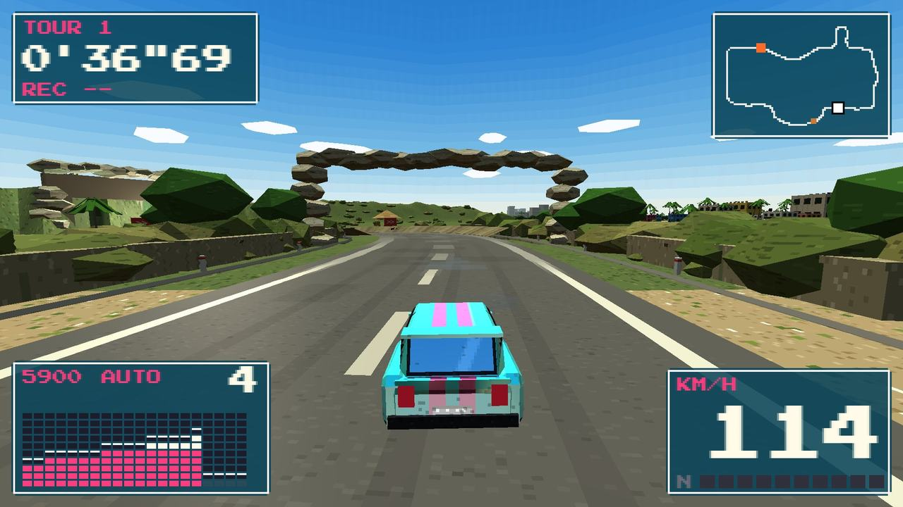
*idx 700.*
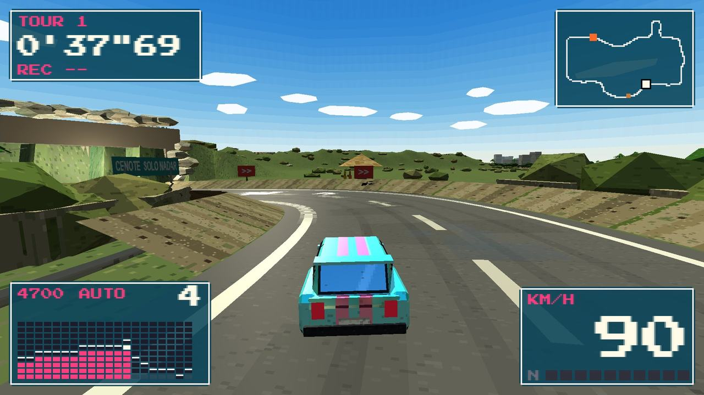
*idx 721.*

**Z6-2 · L'entrée de la grotte porte une texture plaquée en plein milieu [auteur].** Face à la voiture, le linteau est un bloc plat avec un panneau vert à texture de pixels, bordé de pierres, qui se lit comme un mur peint plus que comme une bouche de grotte. La chaussée porte devant lui des taches blanches de marquage.
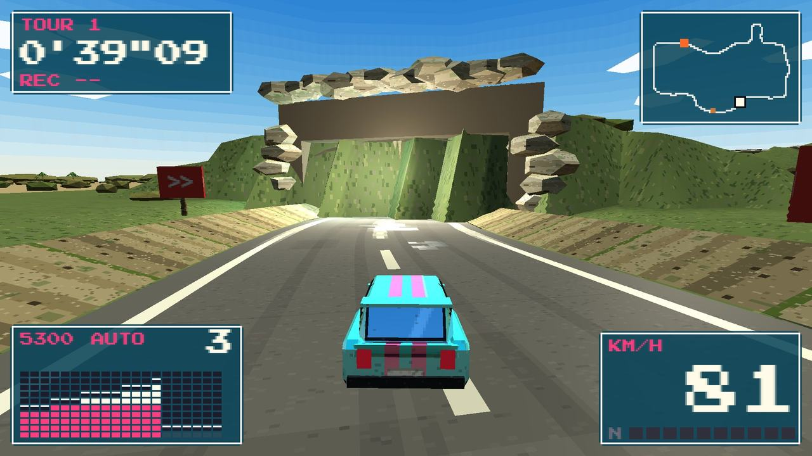
*idx 745.*
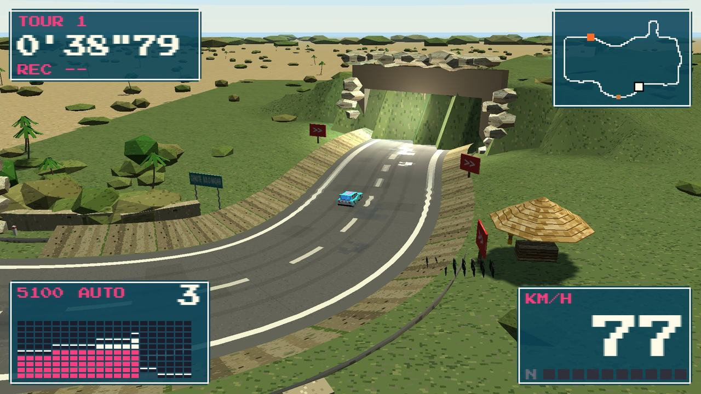
*idx 740, caméra d'inspection : le bloc vert est une dalle plane.*
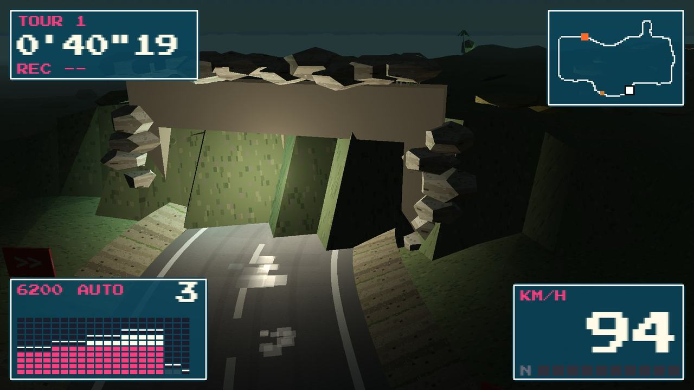
*idx 765 : vue sombre sous l'arche, le bloc est un pan plat.*

---

## Zone 7 · Grotte (idx ~775 → 1000)

**Z7-1 · Intérieur sympa mais pas travaillé [auteur].** Voûte à stalactites en cônes réguliers, parois en hachures verticales, rochers posés sur le bord de la route. L'ensemble se lit bien mais reste un tube de même section tout du long, sans salle ni relief de sol (REFS §6 : salle, vasque, reflets).
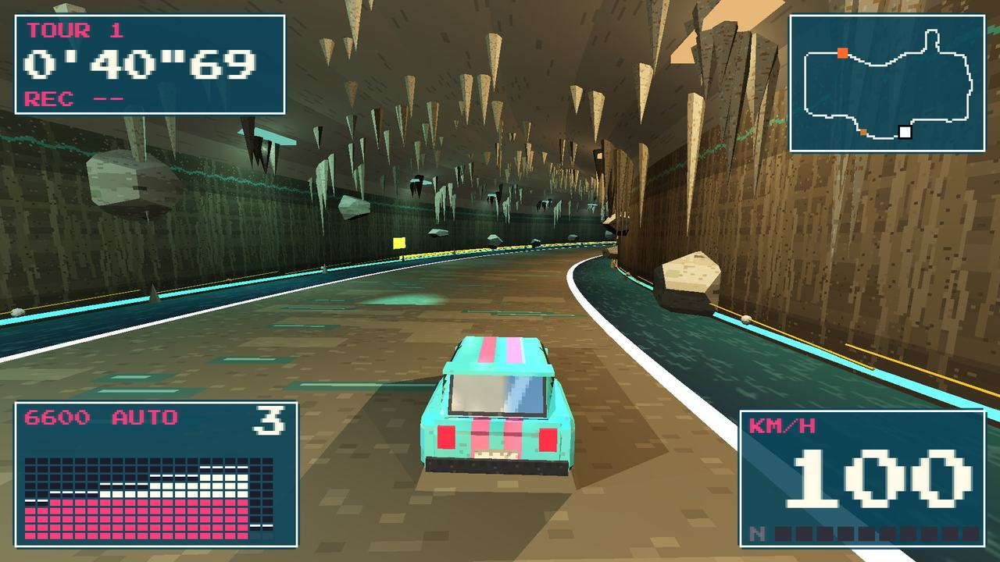
*idx 775.*

**Z7-2 · Marquages au sol dans une grotte [auteur].** Bande blanche de rive, liserés jaune et cyan, pointillés centraux : la route est propre comme une autoroute, sans boue, flaque irrégulière ni éboulis.
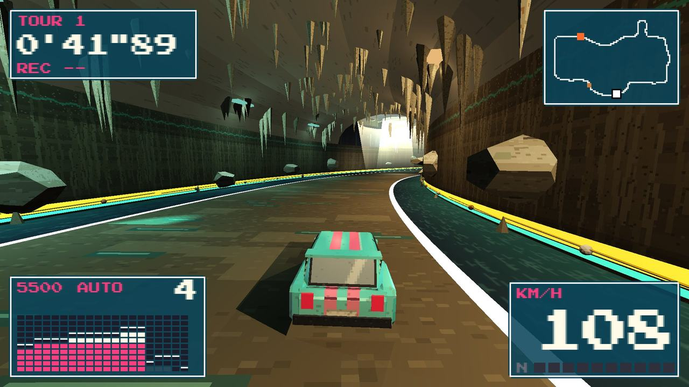
*idx 801.*

**Z7-3 · Puits de lumière trop artificiels [auteur].** La lumière arrive en colonnes blanches opaques aux bords nets, qui coupent le champ et masquent la voûte ; elles ressemblent à des cylindres plaqués plus qu'à de la lumière qui tombe dans l'eau.
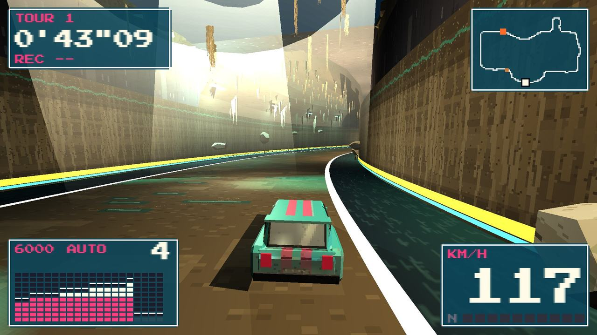
*idx 830.*
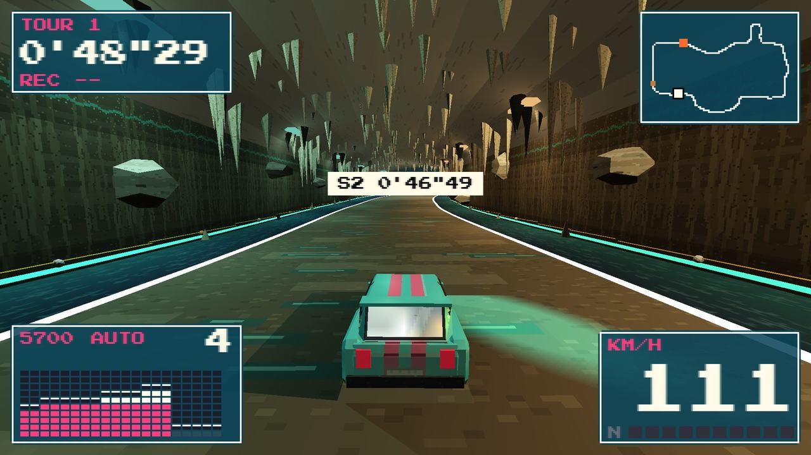
*idx 960.*

**Z7-4 · Pas de point d'eau dans la grotte [auteur].** Le liseré d'eau turquoise foncé contre les parois est le seul liquide ; il ne forme ni bassin, ni reflet des colonnes de lumière, ni rive visible. Le cœur des cénotes (eau claire, turquoise, lumineuse) n'apparaît nulle part.

**Z7-5 · Sortie noire [analyse].** À la sortie (idx ~1000), la bouche donne sur un paysage de nuit : ciel bleu nuit, palmiers en silhouette, plafond de roche, alors que la carte est à midi. Le jour ne se voit pas par l'ouverture ; on sort d'une grotte sombre dans un noir plus sombre.
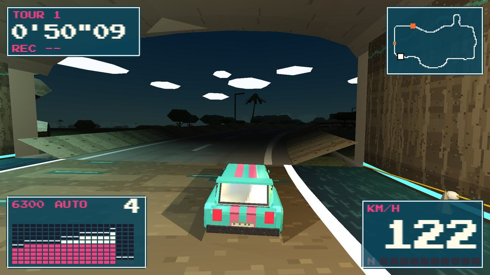
*idx 1002.*

---

## Zone 8 · Chaussée de lagune (idx ~1000 → 1200)

**Z8-1 · Dernière ligne droite pas aimée [auteur].** Une longue bande d'asphalte large, plate, bordée de glissières et de lampadaires, avec des topes jaune et noir ; l'eau est loin des deux côtés et ne sert à rien : pas de virage, pas de relief, pas de point de vue. La vitesse monte à 190 km/h sans autre événement que les topes.
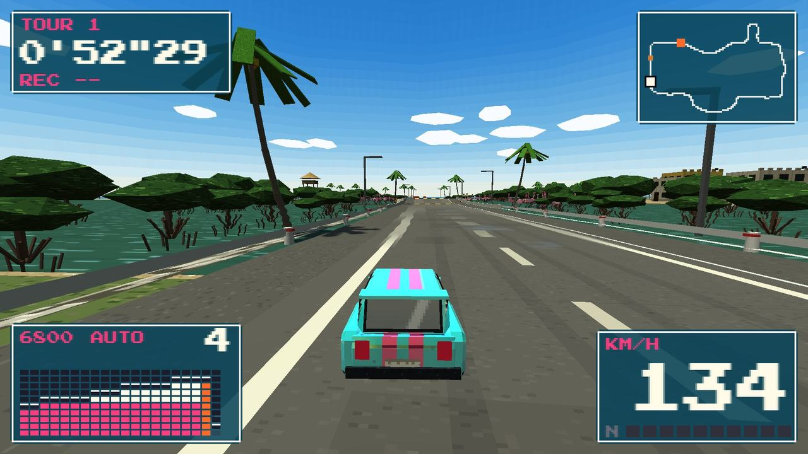
*idx 1060.*
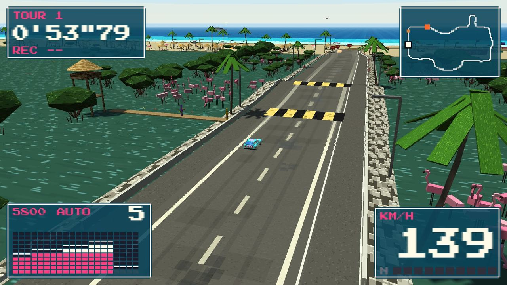
*idx 1100, caméra d'inspection : une bande droite posée sur l'eau, deux topes.*

**Z8-2 · Zone végétale agréable, mais manque de grands arbres plus loin [auteur].** Mangrove aplatie en champignons verts de même hauteur, quelques flamants roses posés dans une eau vert sombre ; rien ne dépasse à l'horizon, ni palmiers hauts, ni arbres lointains. Les sources donnent une ligne de mangrove à 200 à 500 m (REFS §7).
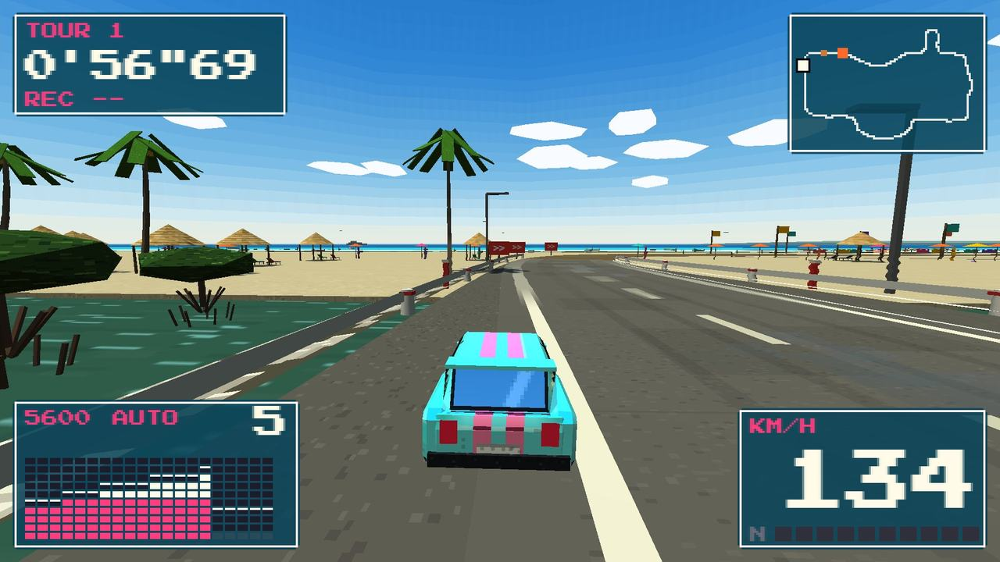
*idx 1181.*

**Z8-3 · Eau de lagune mate et plate [analyse].** Vert sombre uniforme, sans reflets ni profondeur, qui se confond avec la mangrove.

---

## Zone 1 bis · Retour plage (idx ~1200 → 1290)

**Z1b-1 · Retour à la plage sans transition [analyse].** On passe d'une chaussée de béton gris à du sable roulable sans seuil ; le portique de départ apparaît au loin, entouré des mêmes parasols et palmiers.
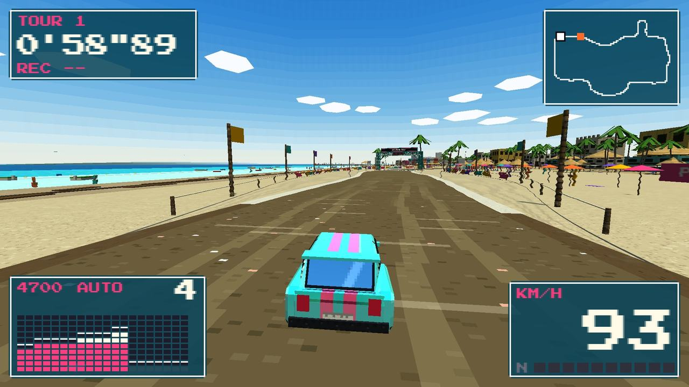
*idx 1230.*

---

## Jonctions entre zones

**J1 · Plage → ponton [analyse].** Le ponton commence là où le sable finit ; pas de seuil, pas de débarcadère, pas d'accès piéton. Voir z2-01.

**J2 · Ponton → rue [auteur : « aucune séparation entre la zone 1 et 2, ça manque de vie »].** En sortant du ponton, on roule sur un bitume nu puis on arrive devant un mur de façades de couleurs alternées, sans avenue, ni place, ni seuil qui prépare la rue. L'espace entre les deux est vide.
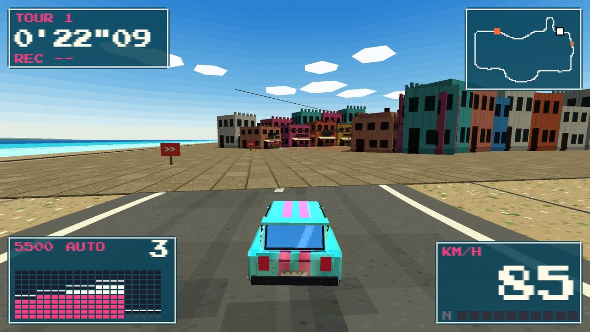
*t ≈ 22 s du tour pas=2.*

**J3 · Rue → marché : un vide [auteur : « un vide entre la zone 2 et la partie avec le toit »].** Après la rue, une esplanade rouge se vide : quelques façades en arrière-plan, la halle au loin sans rien entre elle et la voiture ; le bandeau « S1 » s'affiche en plein vide.
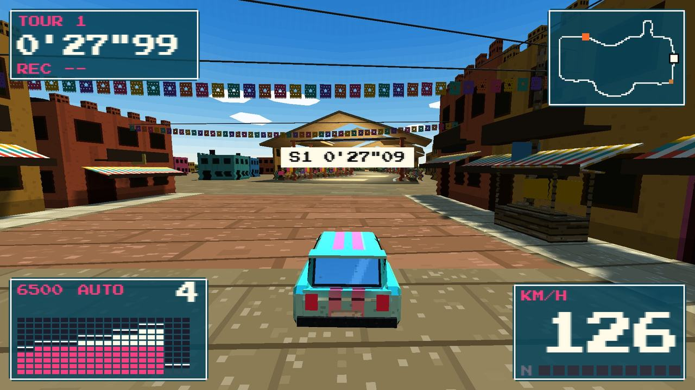
*idx 500.*

**J4 · Marché → garrigue [analyse].** La halle s'ouvre sur une route sans transition : le sol passe du dallage jaune au bitume gris, le toit de paille s'arrête net.

**J5 · Garrigue → arche → grotte [analyse].** Voir Z6-2 : la bouche de grotte surgit au bout d'une route nue sous une arche de pierre ; rien (humidité, eau, végétation dense) ne l'annonce.

**J6 · Grotte → lagune [analyse].** Voir Z7-5 : la sortie est noire, puis une grande chaussée de béton éclairée plein midi commence.

---

## En regard d'une ancienne carte (`ville`, tour `pas=6`, mêmes réglages)

Ce que `ville` a et que `plage` n'a pas, en constats :

- **Densité continue.** Du départ à la fin, des volumes remplissent les deux côtés (immeubles, enseignes, panneaux de virage) ; les ruptures sont préparées par un objet (portique, enseigne, rampe). Sur `plage`, de grands vides sans objet séparent les zones (J2, J3, Z8-1).
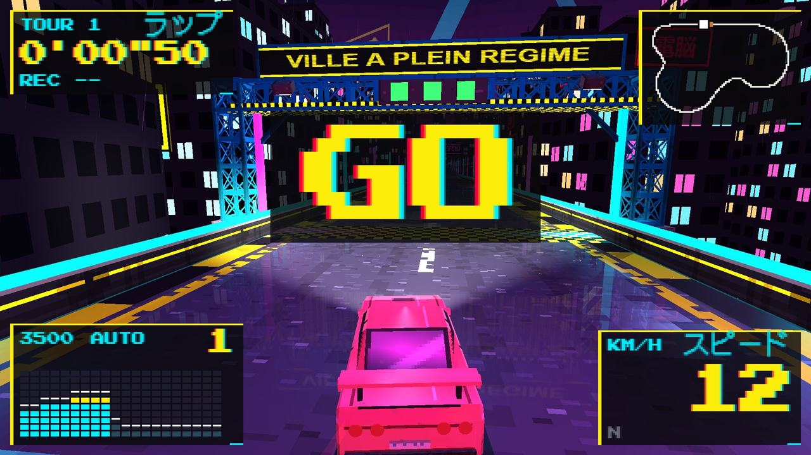
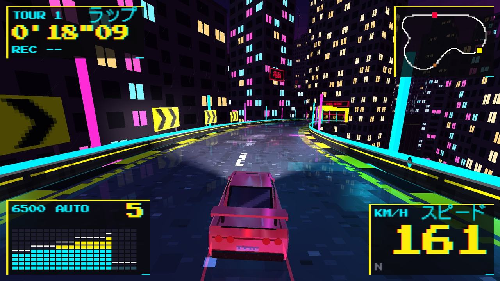
- **Une seule lumière qui change progressivement.** Néons, ciel, reflets sur la chaussée sont de la même famille partout ; le tunnel a sa propre lumière, mais la couleur et la matière restent dans la famille. Sur `plage`, la lumière saute entre soleil dur, jaune pâle (halle), brun-vert (grotte) et noir (sortie).
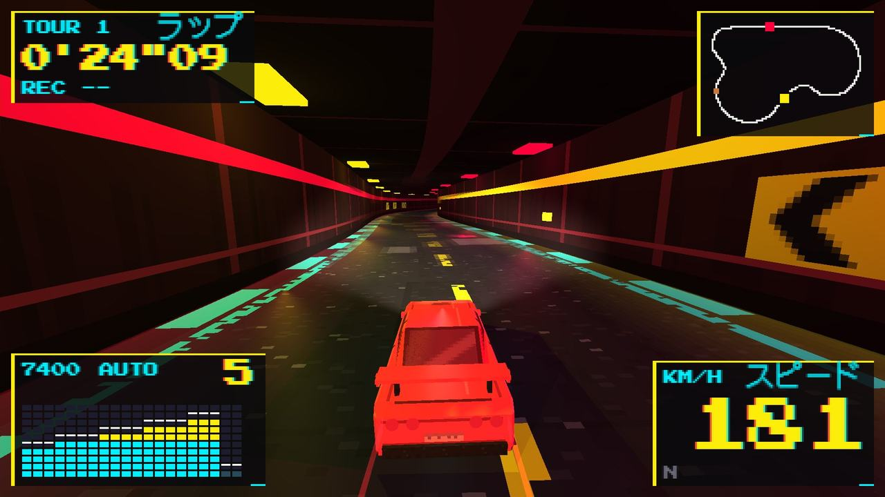
- **Un sol qui participe.** Reflets mouillés, bordures éclairées, marquages cohérents avec le décor ; sur `plage`, le revêtement change souvent (bitume brun, bandes de sable, dallage rouge, bitume gris) sans raccord visible.
- **Des signes de vie.** Enseignes lisibles, panneaux, activité lumineuse sur chaque tronçon. `plage` n'a presque pas de personnes ou de véhicules en dehors de la rue.
- **Des éléments posés avec une logique.** Les objets de `ville` suivent la route (rail, barrière, panneau de virage) ; sur `plage`, de nombreux objets sont posés au milieu du sable sans lien avec la route ou entre eux (Z1-1, Z1-3).
- **Un identifiant sonore et visuel par séquence.** `ville` : tunnel rouge, avenue néon ; `plage` n'a qu'un point fort fort (la rue), et le cénote, supposé être le cœur, est une grotte sans eau.

---

## Annexe : liste des problèmes

Généraux : G1 à G9 (9). Zone 1 : Z1-1 à Z1-4 (4). Zone 2 : Z2-1 à Z2-3 (3). Zone 3 : Z3-1 (1). Zone 4 : Z4-1 (1). Zone 5 : Z5-1, Z5-2 (2). Zone 6 : Z6-1, Z6-2 (2). Zone 7 : Z7-1 à Z7-5 (5). Zone 8 : Z8-1 à Z8-3 (3). Retour plage : Z1b-1 (1). Jonctions : J1 à J6 (6). Soit **37 problèmes**.
