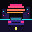
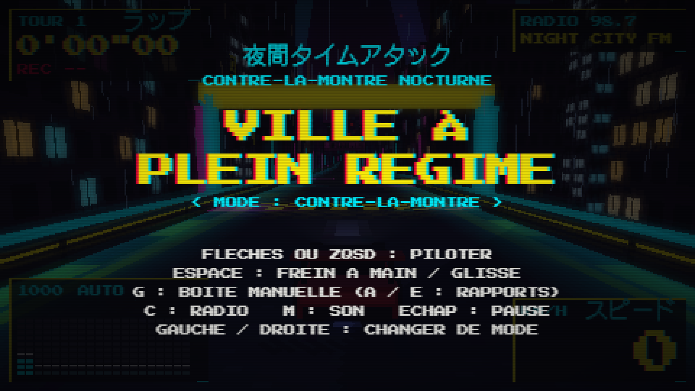
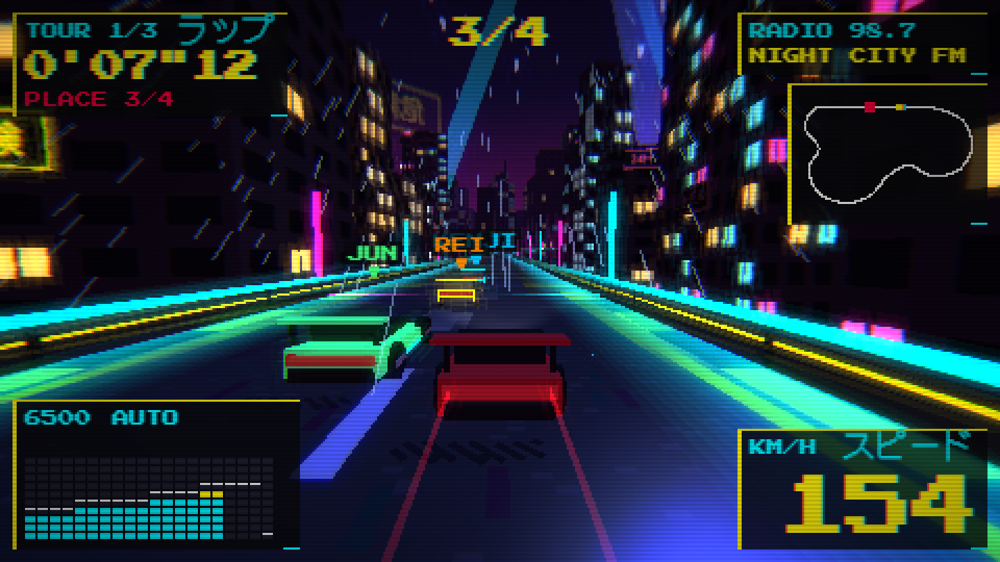
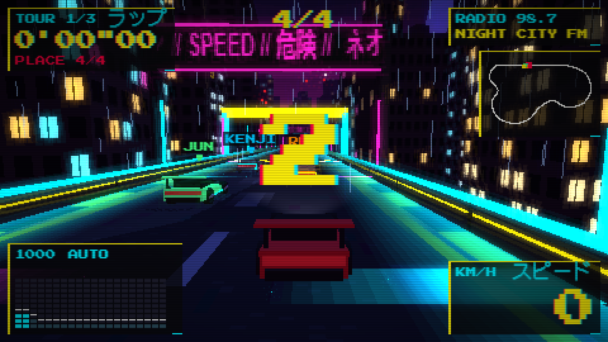
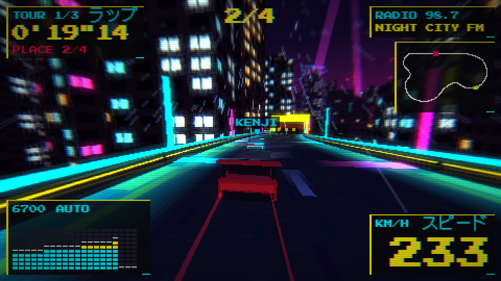
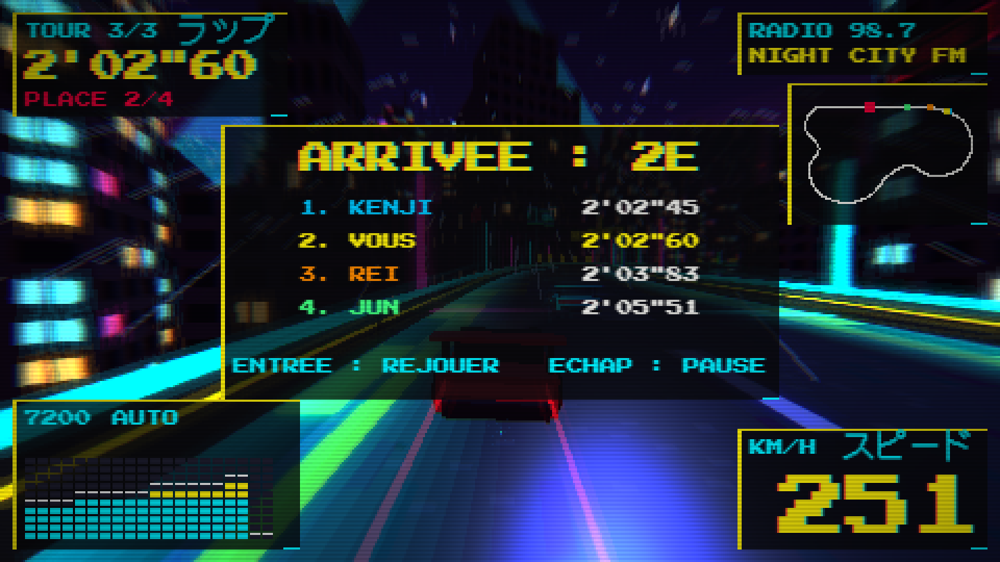

[English README](../README.md)

<h1 align="center">VILLE À PLEIN RÉGIME</h1>

<b>夜間タイムアタック</b> · <i>contre-la-montre nocturne</i>

<b>★ ★ ★ NOUVEAU ! ★ ★ ★</b> 
<b>LA NUIT EST À VOUS. LA VILLE AUSSI.</b>

---

### 🌃 Minuit. Les néons s'allument. Le compte-tours grimpe.

Prenez le volant d'une bête de 500 chevaux et lâchez-la dans les artères d'une mégalopole cyberpunk qui ne dort jamais. Pluie, gratte-ciel, enseignes en katakana : chaque virage est une carte postale, chaque ligne droite une invitation à passer la sixième.

Et quand la ville ne suffit plus : **HUIT CARTES**, du col de montagne japonais à l'autoroute de la baie, des rues de Paris à l'aube au canal de Los Angeles à l'heure dorée, d'une arène couverte pleine à craquer à un col enneigé, jusqu'à une spéciale de rallye sur la terre ocre. Chacune avec **sa voiture, ses rivaux, ses radios et son tableau de bord**.

### 🏁 CINQ MODES DE JEU EXPLOSIFS !

- **CONTRE-LA-MONTRE** : enchaînez les tours, battez vos records… et rattrapez le **fantôme** de la médaille que vous visez : **bronze**, **argent**, puis **or** ! Un tour dont vous êtes fier ? Envoyez-le à un ami par un simple **lien de défi** : il affrontera votre fantôme.
- **GLISSE** : 2 tours pour le style. Plus ça glisse vite, de travers et longtemps, plus ça paie… et le **multiplicateur** grimpe tant que vous enchaînez sans toucher un mur !
- **COURSE** : 3 tours, 3 rivaux sans pitié. **KENJI**, **REI** et **JUN** ne vous feront aucun cadeau… et ils ont des choses à vous dire : **la référence** vous toise, **la tête brûlée** joue des portières, **la recrue** tremble sur la grille !
- **ÉLIMINATION** : 4 voitures, 4 tours. À chaque passage sur la ligne, **le dernier sort**. Jusqu'au duel final !
- **TOURNÉE** : **une nuit entière**, de 18 h 40 sur la terre ocre au premier métro de 5 h 30 à Paris. Huit manches, des points à chaque manche, grille inversée… et un **trophée** au bout !

### 👥 JUSQU'À QUATRE SUR LE MÊME ÉCRAN… OU EN LIGNE !

Des amis sur le canapé ? Choisissez **ÉCRAN PARTAGÉ** (2 à 4 joueurs). Loin les uns des autres ? **EN LIGNE**, un code de salon de 4 lettres suffit, sans serveur ni inscription. À deux : l'écran se coupe en deux, **joueur 1 en haut, joueur 2 en bas**, chacun sa caméra, son compteur, sa nitro… et son moteur dans les oreilles !

- **COURSE** : 3 tours, vous deux et les **deux rivaux les plus rapides** de la carte. L'aspiration de l'autre est à prendre !
- **ÉLIMINATION** : 4 voitures, 4 tours, le dernier sort. Éliminé ? Votre écran suit le meneur jusqu'au bout.
- **GLISSE EN DUEL** : 2 tours, vous deux seuls en piste, **le meilleur score gagne**. Un coup de portière casse l'enchaînement… des deux !

Sur l'**écran d'inscription**, chacun appuie sur un bouton de ce qu'il tient : **une manette chacun**, **un Joy-Con chacun** (tenu à l'horizontale), ou **le clavier partagé**, ZQSD d'un côté, flèches de l'autre. À l'arrivée : **REVANCHE** ! Rien n'est enregistré à deux, ni record ni trophée : c'est une partie de canapé.

### ⚙️ UNE MÉCANIQUE DE PRO

- Boîte **automatique ou manuelle** : passez vos rapports comme un vrai pilote !
- **Frein à main** et glisses contrôlées : prenez les épingles en travers !
- **Nitro** : une jauge à remplir en prenant des risques, à dépenser où vous voulez
- Physique inspirée d'une **vraie GT japonaise** : couple, rapports, aéro, tout y est !
- Frottez les murs… et regardez voler les **étincelles** !

### 📻 25 STATIONS DE RADIO EN DIRECT

La bande-son est **composée en temps réel** et **réagit à votre conduite**. Plus vous appuyez, plus elle s'emballe ! Trois stations ou plus par carte, de la darksynth à l'eurobeat, du g-funk à la rumba gitane : branchez-vous sur **NEON CITY FM** ou zappez d'une touche.

### 🕹️ MODE DÉMO

Posez la manette : au bout de 25 secondes, le jeu court tout seul, carte après carte, dans l'ordre de la nuit. Une touche, et la main est à vous.

### 💾 AUCUNE INSTALLATION !

Pas de disquette, pas de CD, pas de téléchargement de 40 Go. **Un navigateur, et c'est parti.**

| | |
|---|---|
| 🎮 Genre | Course arcade |
| 👤 Joueurs | 1 à 4 sur le même écran, ou en ligne |
| 🖥️ Plateforme | Tout navigateur moderne |
| ⏱️ Chargement | Instantané |
| 💰 Prix | **GRATUIT** |

<b>DISPONIBLE DÈS MAINTENANT DANS TOUS LES BONS NAVIGATEURS.</b> 
Le pilotage nocturne doit se pratiquer en toute sécurité, sur écran uniquement.

---
