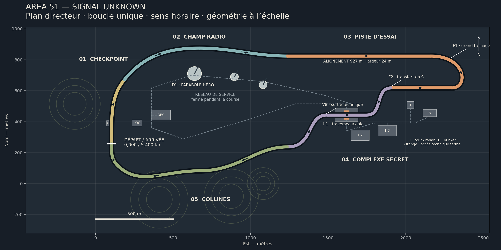
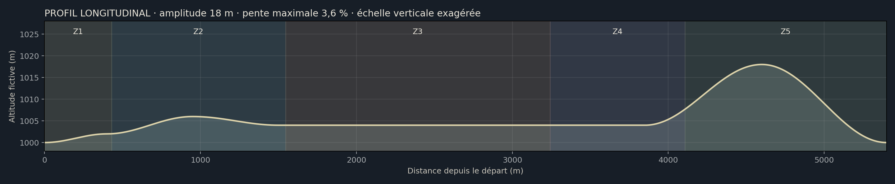
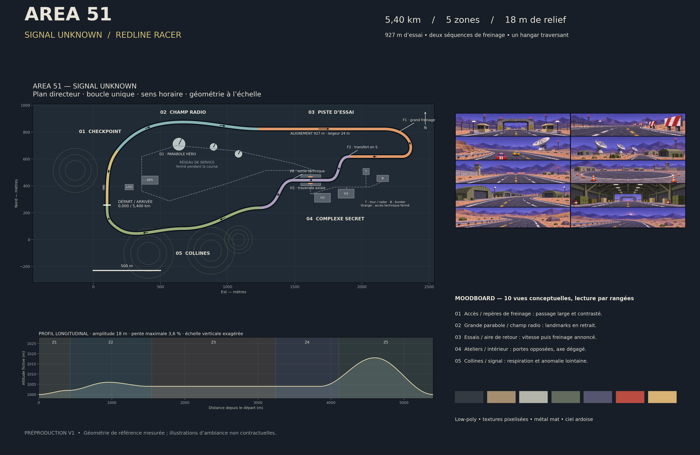

# AREA 51 — SIGNAL UNKNOWN

Preproduction proposal V1, 17 November 2026. Application of `docs/methods/TRACK-DESIGN.md`: promise → territory → layout → zones → moodboard → assets. Design dimensions; not a track already integrated, nor sensations validated in game.

## A. Promise

A very-high-speed loop crosses a fictional Nevada military site, from the radio field to its measurement strip and then to the secret workshops. The long acceleration finds its resolution in a broad braking zone before a placement sequence between hangars.

The signature: an immense dish above a fast curve, followed later by a hangar crossed along its axis. The emotion is speed under surveillance; the mystery remains a distant luminous signal. The dry, functional terrestrial territory distinguishes Area 51 from Lunar Outpost, the guide's lunar concept, which is not one of the twelve existing tracks.

## B. Territory and circulation

A long dry basin hosts three groups: reception/logistics in the west, radio instrumentation in the north, tests and workshops in the east. The low hills to the south justify the curved return. There is no central airfield and no aviation runway to go around.

The route uses a main service road, a test strip, an equipment-transfer axis through H1 and a perimeter surveillance road. H1 is a through control hall, not a parking hangar whose rear wall was arbitrarily pierced. Its workshops and stores stay at the sides. Hangars H2/H3 face a service yard to the south.

The dotted line represents a 7 m service loop, linked to the control building and the workshops. Its junctions are closed during the race by visible gates; it is never a racing alternative. The connection to the hall is a technical access with alternating traffic outside the race. In the mock-up, add the short building access roads to this loop and the fences of the sub-sites, without multiplying drivable lanes for the player.

Landmarks: D1 dominant dish; tower/radar on the approach to the complex; H1 with its massive number; low hills in the background. No equipment at the apex. The geometry is fictional, with no reproduction of a real military site.

## C. Dimensioned layout

- Single closed loop of **5,400 m**, clockwise, with no crossing, playable branch or dead end. Start in the west, heading north.
- Centreline footprint: **2,261 × 830 m**. Plan for about 2.8 × 1.5 km of composition territory, then the background mountains.
- Main straight: **927 m**, from PK 1.546 to PK 2.473. Braking takes place at its end, before the F1 turnaround.
- Usual width: **20 m**; test strip and F1: **24 m**; complex: **20 m**; return: **20 m**. Width transitions over 80 m. Ordinary shoulders 4 m, 8 m on the tests. Line widths on the plan are symbolic; centreline coordinates are to scale.
- Two technical sequences: F1, a large right-hand turnaround at the end of the tests; F2, left/right transfer, straight crossing of H1 then a second left/right shift. This second shift ends the same technical sequence, with no new long acceleration between the two.
- No jump, spectacular banking, bridge or tunnel. H1 is the only covered passage.

The length is computed by sampling the twelve Bézier curves (500 intervals per curve), then uniformly scaled. `geometrie.json` keeps their control points in metres; `axis-circuit.csv` provides the centreline and altitudes. The 5,400 m equality is a concept sizing, not a measurement of the engine's future spline.

| Sequence | Approx. PK | Intent and visibility |
|---|---:|---|
| North access | 0–0.430 | Getting up to speed, gate open off the lines, first visible inflection |
| Large radio curve | 0.430–0.976 | Progressive fast right; dish set back inside the large arc, does not hide the exit |
| Radio counter-curve | 0.976–1.546 | Slight left/right, straightening toward the tests; clear horizon line |
| Test strip | 1.546–2.473 | Acceleration and slipstream, preparation for the big braking |
| F1: asymmetric turnaround | 2.473–2.850 | Tightening right; brake in a straight line, favour the exit over a mandatory drift |
| Re-acceleration to workshops | 2.850–3.241 | 391 m straight, placement choice before F2 |
| F2: transfer | 3.241–3.497 | Slow to medium left/right; braking distinct from F1, exit aligned toward H1 |
| H1 axis | 3.497–3.754 | 257 m straight; crossing the hall over 149 m, doors visible from one another |
| Workshop exit | 3.754–4.108 | Wider left/right, progressive re-acceleration toward the desert |
| Return from the hills | 4.108–5.400 | Large open inflections, gentle descent then a last medium corner opening onto the start (minimum radius close to 110 m) |

**Hangar H1.** Plan footprint 149 × 82 m; height 25 m; opposite doors east and west, usable opening 32 × 14 m; drivable strip 20 m in the centre. The design reserves 57 m straight before the east door and 51 m after the west door. This reserve suits a passage at intermediate speed after F2: it is not a gate approached at the maximum speed of the tests. No central pillar or stock on this strip. Constant interior lighting and a non-overexposed exit.

**Braking and multiplayer.** F1 is announced over the last 300 m of the straight by the curve of the kerbs and three 300/200/100 signs. F2 is announced over the last 200 m of its re-acceleration. These distances are visual reserves to be tuned per car, not validated stopping distances. Overtaking: slipstream on the tests, side-by-side braking in F1, best exit from F2, two possible lines in the large radio curves. No island at the checkpoint, no forced narrowing at the doors. Outer kerbs stay continuous to prevent cutting the test area and the S-bends.

## D. Profile and five zones

Fictional altitude **1,000–1,018 m**, amplitude **18 m**, computed maximum slope **3.54%**. Tests, F1, F2 and hangar stay on the 1,004 m plateau. The climb starts after the hangar; rounded summit at PK 4.600, then descent toward the start. Cosine vertical interpolation: no break, identical altitude and slope at the closing junction. Vertical exaggeration is stated on the graph.

| Zone | PK / length | Driving | World and transition |
|---|---|---|---|
| 1. Checkpoint and access road | 0–0.430 / 430 m | Wide start, acceleration | Offset booth, fences, logistics; dish already visible |
| 2. Radio-telescope field | 0.430–1.546 / 1,116 m | Large fast curve then slight correction | D1 and two secondary antennas on a technical terrace; opening toward the tests |
| 3. Military test strip | 1.546–3.241 / 1,695 m | 927 m alignment, F1, re-acceleration | Measurement markings, radar/tower; the curve leads back to the workshops |
| 4. Secret complex | 3.241–4.108 / 866 m | F2, interior passage and S exit | Hangars organised around yards; concrete/sand transition after H1 |
| 5. Desert hills | 4.108–5.400 / 1,292 m | Fast return, open curves | Low outcrops, surveillance road; D1 regains its place on the horizon |

Zone lengths rounded to the metre; the sum may differ by one metre through rounding. Three proposed timed sectors: start → test entry (1.546), tests → complex entry (3.241), complex/return → finish (5.400). The five zones are ambience sectors, distinct from these three split times.

## E. Board and annotated moodboard

The ten thumbnails are **generated conceptual illustrations**, guided by the local 12-track overview image. They are neither captures of the new map nor a second source of geometry. The dimensioned plan prevails, notably over the illustrated circular area: F1 is an asymmetric turnaround, not a playable roundabout.

Read left to right and top to bottom:

| Reference | What I keep | What I do not borrow |
|---|---|---|
| 1. Checkpoint | Readable gate, side booths | Any reduction of the race width |
| 2. Marking | Contrasting markers and dry textures | Giant signs or signs placed on the line |
| 3. Hero dish | Massive silhouette, clear road | An antenna acting as an obstacle |
| 4. Radio field | Functional grouping and shelters | An accumulation of red towers |
| 5. Test strip | Straight horizon, announced braking | A road end or an airport runway |
| 6. End area | Width available for two cars | Roundabout, central island or cones in the racing line |
| 7. Workshops | Simple hangars, generous spacing | Maze of right-angle corners |
| 8. H1 interior | Through axis, useful lighting | Crates within reach of the lines or blinding contrast |
| 9. Hills | Low faceted rock, breathing space | Mountain switchbacks or rally bumps |
| 10. Signal | Ambiguous glow behind a ridge | Saucer, alien beam or event on the roadway |

Keywords: **speed, surveillance, silence, dust, signal**. Palette: asphalt `#343A42`, sand `#A58D70`, concrete `#B3B5AA`, olive steel `#626B5E`, sky `#55556F`, red `#BA4C42`, amber `#D7B274`. Blue hour still bright; distant reliefs violet, dry dark road edged in cream. Dominant materials: concrete, painted metal, sheet metal, sand; pixelated textures, simple faceted volumes, few reflections.

Low density at the radios and in the hills, medium at the checkpoint, concentrated laterally in the workshops. Three distances: close markers/joints, medium equipment, distant chain of hills. Sounds: wind, ventilation, brief reverberation in H1. Animation: slow radar, windsock, rare beacons. The signal possibly appears behind the ridge of the return, never at braking; no effect on driving.

Three prohibitions: explicit UFOs; futuristic neon ribbons; installations or vegetation hiding apexes and exits.

## F. Priority assets

Reference scale: car of about 4.5 × 2 m. Plan placements take priority over illustration suggestions.

| Asset | Dimensions and silhouette | Role / zone | Priority |
|---|---|---|---|
| D1 hero dish | Ø 90 m in plan, height 60 m; faceted bowl on massive base | Main landmark Z2, visible from Z1/Z5; bowl edge more than 80 m from the road | Essential |
| Secondary dishes | 2 units Ø 52 m in plan, height 35 m | Radio family Z2, common orientation | Essential |
| H1 through hangar | 149 × 82 × 25 m; doors 32 × 14 m | Interior signature Z4 | Essential |
| Modular H2/H3 | About 118 × 67 × 20 m each, olive sheet metal | Side workshops Z4, logistics yard to the south | Essential |
| Test strip | 927 × 24 m, joints and measurement bands | Speed Z3; 8 m shoulders | Essential |
| Tower and radar | 30 m tower; 8 × 3 m panel radar | Secondary landmark Z3/4; plan footprint = technical plot | Essential |
| Transmission antennas | 2–3 masts of 18–35 m, simple lattice | OPS centre and workshops, without competing with D1 | Secondary |
| Bunker | Building 35 × 22 × 7 m in plot B, peripheral embankment | Experimentation east of the complex; technical access off the track | Essential |
| Control / security kit | Booth 8 × 5 × 4 m, 3 m fence, signs and gates | Z1, closing services and guidance | Essential |
| Desert / ambience kit | Faceted rocks 2–15 m, low embankments, windsock, glow | Z5 and horizon, limited movement | Essential for terrain; secondary accents |

## G. Study of the twelve tracks and trade decisions

References: [Redline Racer repository](https://github.com/Rovis91/redline-racer), local definitions `src/data/maps.js`, the 12-track overview image, capture `raceCase-1.png`, the Barrage hall and the Persian plain. Design and image study, not a piloted test of the twelve maps.

| Existing track | Identity not to duplicate |
|---|---|
| Ville à plein régime | Neon night, tunnel and urban curves |
| Karasu-Toge | Narrow climb and stacked hairpins |
| WAN-9 | Bay motorway, long straight, bridge and lighthouse hairpin: closest gameplay neighbour |
| Premier Métro | Urban streets and re-accelerations, monumental square |
| Canal 6 | Wide serpentine, slide and jump |
| Grand Vacarme | Compactness, jumps and frequent braking |
| Nuit Blanche | Pass, switchbacks and snow/ice grip |
| Spéciale des Ocres | Bumpy dirt, crests and jumps |
| Route Royale / Perse | Terrace, columns, bazaar and tight angles |
| Barrage 74 | Elevation change and turbine hall: H1 must stay axial and clear |
| Manuscrit 512 / Chapada | Jungle, narrow bridge, cave and fords |
| Playa 307 | Jetty, market, cenote and dyke |

**Racing Track Designer:** long straight resolved by F1, 391 m re-acceleration then F2 transfer; preserve the fast return. **Level Designer:** wide lanes, aligned gates, visibility of braking zones and closed services; no line conflict at the entries. **World Designer:** layout in three specialised groups and coherent logistics circulation; circuit shape dictated by the radio terrace and the hills. **Environment Artist:** large volumes, matte materials and pixelated textures, radio signature above all.

**Integrated skeptical review:** speed alone does not differentiate Area 51 from WAN-9; the test/hangar pair and the military functions carry the difference. The two S-bends of the complex must form a single placement sequence, with no artificial succession of chicanes. The straight reserve at the doors is 51–57 m, hence passage at intermediate pace; if the car requires it, lengthen this axis in the first mock-up. Interior light must preserve multiplayer readability. The plan provides a continuous geometry, but curvature must be smoothed when converting to the game spline. Indicative minimum radii measured on the curves: F1 about 58 m, F2 about 55 m, last corner about 110 m. The latter is therefore a medium corner, not a fully flat-out return. The service network was redrawn to avoid the exit S: a single controlled crossing of H1, two orange barriers, explicit access roads to H2/H3, tower and bunker.

## H. Validation status

Proposed decisions: promise, territory, loop and length, five zones, profile, H1 placement, palette, moodboard and asset shortlist. Position closure and direction tangents are verifiable in the Bézier checks. The mock-up must keep the distances, then adapt the curvature transitions.

At most three arbitrations before driving validation:
1. Car and target speeds: the game's `kmh` factor forbids deducing sensations from the metric radius alone.
2. F1/F2 tuning and visibility: confirm real braking, re-acceleration and two-car overtaking in a blockout.
3. H1 straight reserve: confirm that 51–57 m is enough after F2; lengthen the axis if necessary.

Out of scope: map code, detailed modelling, special physics, animated military vehicles and exhaustive asset production. The file is ready for discussion and a first mock-up, without claiming that driving has already been validated.
