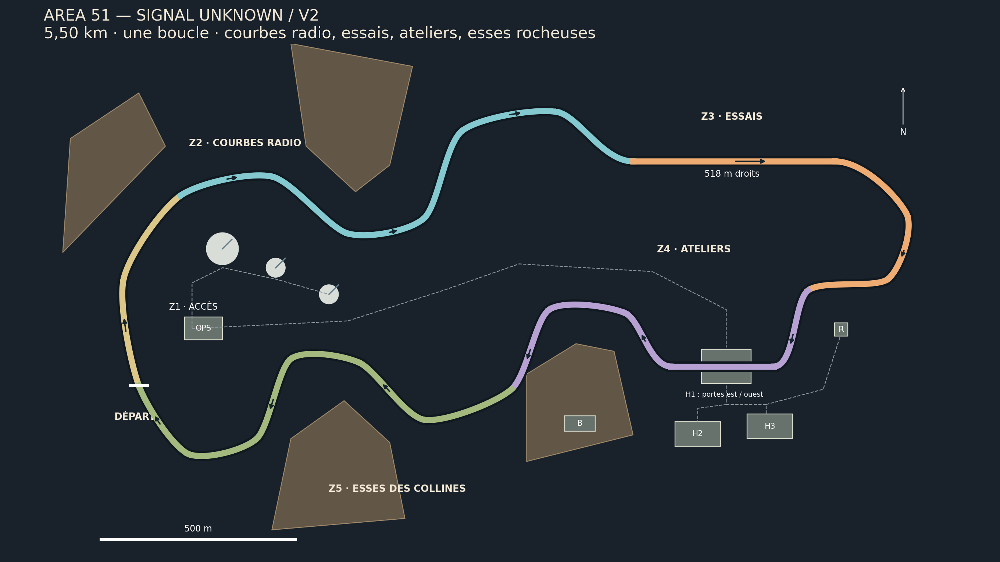
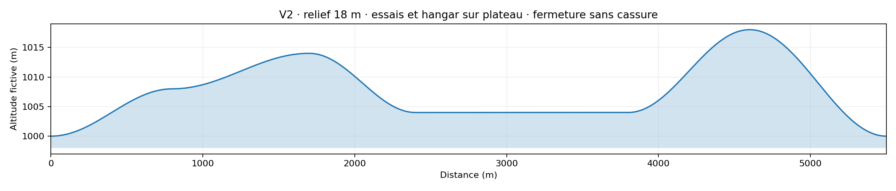
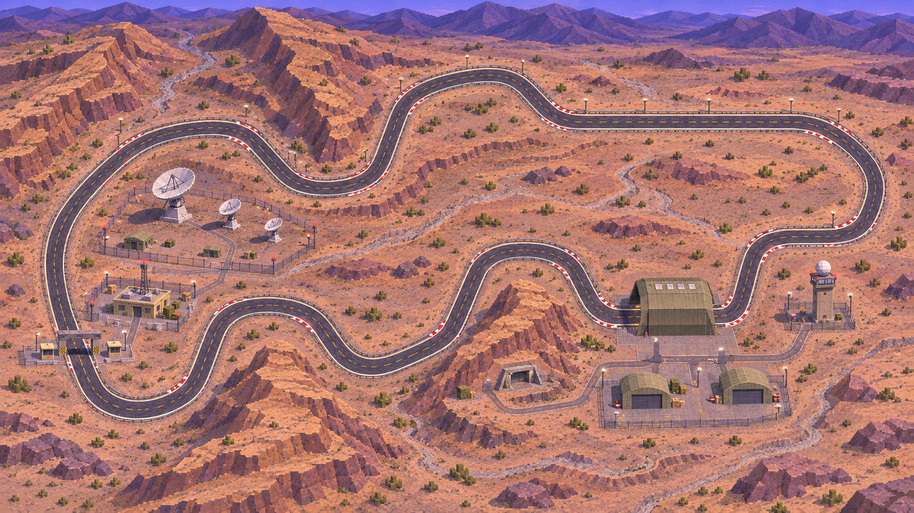

# Area 51 — V2 layout revision

This proposal replaces the V1 layout for the rest of the design. V1 is kept as history; its lengths and placements must not be mixed with those of V2.

## Diagnosis before drawing

V1 favoured a 927 m alignment and a peripheral loop. Antennas and buildings filled a loosely structured interior; the hills were essentially outside. The large fence of the image reinforced the impression of an airfield. Adding a few objects or small chicanes would not have fixed this problem.

The local guide requires deciding the territory, then the lines, before developing the decor. Two references cited by the guide were consulted:

- [Luke McMillan — A Rational Approach to Racing Game Track Design](https://www.gamedeveloper.com/design/a-rational-approach-to-racing-game-track-design): role of entries, apexes, exits, compound curves and punctuation by straights. Application: shorten the tests, multiply readable loaded sequences and keep a generous roadway. Its recommendations specific to the arcade games analysed are not absolute rules: the marked braking zones requested for Area 51 are kept.
- [Benoît Gomes — Racing Level Design: The Rally Case](https://www.gamedeveloper.com/design/racing-level-design-the-rally-case): understand the reason for the roads, build a coherent territory and use landmarks to memorise sequences. Application: bring the reliefs forward into the territory and separate military functions into recognisable groups. The narrow roads and traps of rally are not reused.

## New promise and territory

High speed between three groups: radio plateau in the west, test area in the north-east, workshops in the south-east. Rocky spurs to the north and south give a reason for the large inflections. The road skirts their feet; it does not climb their summits. The roadway relief stays low.

The base has local enclosures for radio, operations and workshops. The fence no longer reproduces the circuit outline. The through hall keeps an east–west axis, with lateral logistics access closed during the race. Service roads are about 7 m; the circuit 20 m, raised to 24 m at the tests and braking zones. The dishes have a terrace and dedicated access roads, away from the track and the workshops.

## V2 layout

Closed clockwise loop, with no crossing or dead end, **5,500 m** computed on the sampled curves. The test alignment measures **518 m**, against 927 m in V1. A straight axis of about 264 m crosses the hall over about 127 m: approach and exit reserves of about 59 and 78 m. 32 m doors, 20 m drivable strip; no central object.

| Zone | Distance from start | Function |
|---|---|---|
| Access | 0–0.542 km | Getting up to speed in a large open curve |
| Radio curves | 0.542–1.973 km | Double lobe, right–left–right succession, large change of loading around a rocky spur |
| Tests | 1.973–3.120 km | 518 m straight, announced braking and a tightening compound right, exit toward workshops |
| Workshops | 3.120–4.223 km | Technical placement before the hall, axial crossing, return around the bunker embankment |
| Hill esses | 4.223–5.500 km | Broad alternation of curves around the reliefs, re-accelerations and last curve toward the start |

The variety comes from three behaviours: maintaining speed in the radio loads; metering a prolonged braking in the compound right of the tests; preparing the exit of the sequences to the south. This is not about adding a hairpin at every change of direction. The two technical groups remain the tests and the workshops; the radio curves and the return esses aim at a sustained pace, to be confirmed with the car.

Overtaking: slipstream on the test strip, two-car braking in its wide exit, best re-acceleration after the hall, different lines in the large loads. To preserve: announced braking zones, no crest hiding an apex, no antenna at the roadside. The tangent and width parameters remain adjustable in mock-up.

Amplitude 18 m, computed maximum slope 3.15%. The workshops and the hall are flat. The height of the decor hills is distinct from the road profile. The aerial view accentuates their silhouette to show the geography; it does not serve as an altimetric survey.

## Aerial view

Conceptual illustration generated from the new plan; it visually replaces the V1 aerial view. It keeps the large inflections but remains non-metric: the plan and `geometrie-v2.json` are the reference for distances and positioning. Palette and retro low-poly principles of the initial file kept.

## Critical review before mock-up

- The shape is now readable even without buildings: two lobes to the north and two rocky spurs to the south.
- The long straight no longer dominates the whole lap. The opposite risk is a road too constantly under load: keep the exit breathing spaces and avoid tightening the esses further.
- The spline is closed with common tangents; the curvature transitions and real radii must be tuned in the blockout, without announcing validated speeds.
- The hall remains a crossing after slowing down. Check the visibility of its exit and two-car passage.
- Service roads and external accesses remain to be detailed in simple volumes; they must create no playable branch.

V2 is a design proposal, not a map integrated or tested in the game. The priority assets remain those of V1, with placements and sizes governed by the V2 plan.
