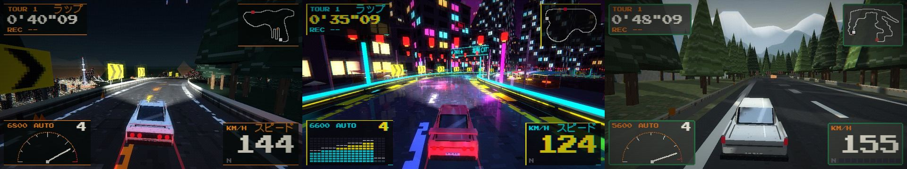
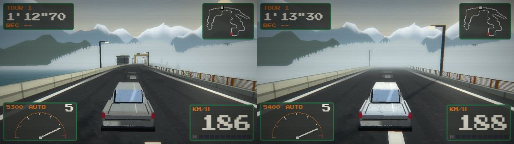
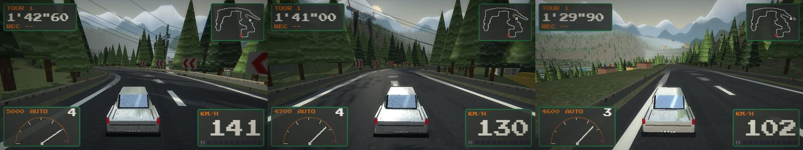
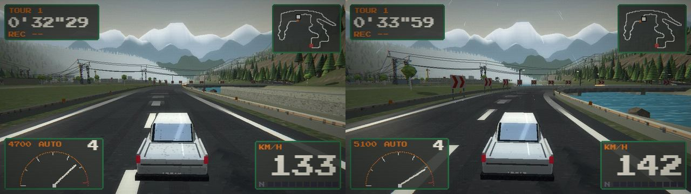
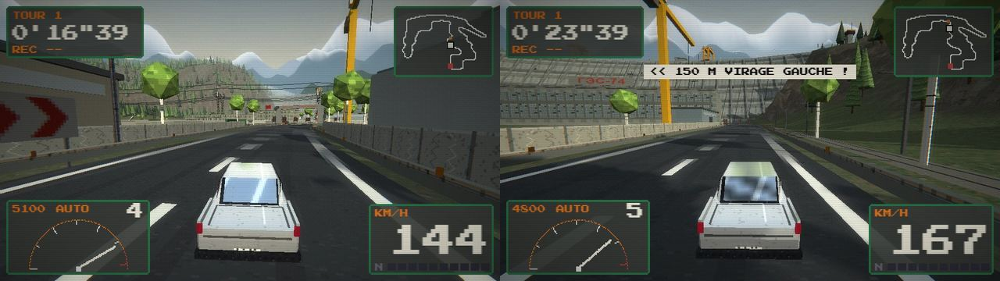
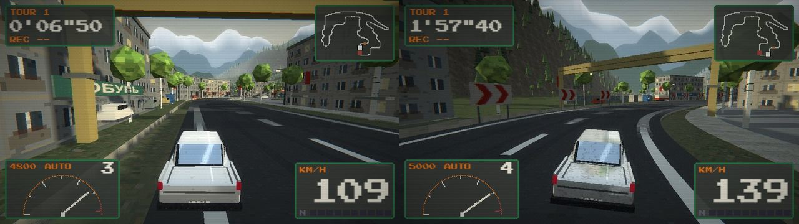
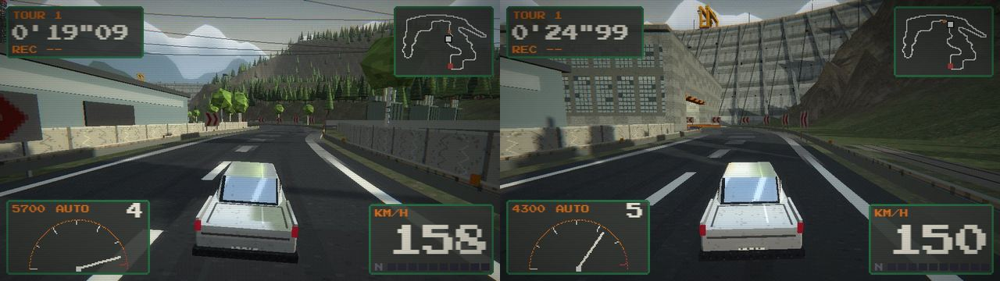
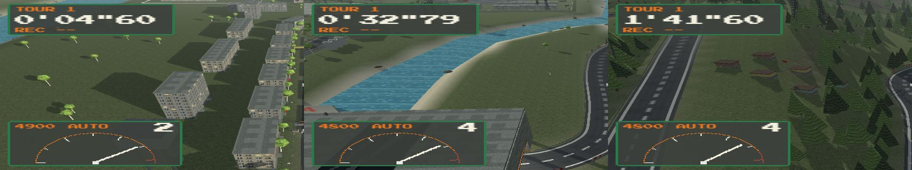

# Barrage 74 — analyse à neuf

Session qui n'a pas construit la carte. Code observé : branche `claude/refonte-barrage-afe3e1` (63a51b2). Aucun code du jeu n'est modifié ici.
Chaque constat (A-01, A-02…) se valide ou se refuse seul. Ils sont classés par effet attendu, le plus fort d'abord.

## Suite donnée (même branche)

L'auteur a accepté toutes les propositions. Elles sont faites sur cette branche, jugées sur captures du rendu réel après chaque étape, sauf ce qui suit.

| Constat | État |
|---|---|
| A-01 brouillard | Fait. Visibilité de 55 m, zone des points 68 à 73. Le moteur tend un voile sur le ciel, l'astre et les lointains dans la zone (plus simple que prévu : pas de marquage des objets, pas de shader du ciel modifié). |
| A-02 descente | Fait : vue ouverte, meules et palissades retirées, carrière, camp refait avec son portique. La carrière est à l'ombre du versant : elle se lit par son concasseur, ses tas et son talus clair, moins par ses gradins. |
| A-03 garnison | Fait : sur le quai, barbelés côté route, portail à étoiles, missiles et radar au premier rang. |
| A-04 grues | Fait : immeuble en chantier, deux grues KB rouge oxyde sur rails, plus de grue ailleurs. |
| A-05 conduites | Fait : deux tubes le long du trottoir de droite, lyres, deux traversées. Pas de raccord dessiné jusqu'à la chaufferie. Les voitures garées et les kiosques sont passés à gauche. |
| A-06 lumière | Fait : voile général (`fogD: [40, 760]`), sommets teintés, une fenêtre sur trois allumée dans les immeubles (texture d'émission `panneauKlum`), halo sur chaque lampadaire, projecteurs allumés sur les miradors de la garnison et sur trois mâts au poste électrique. Les lampes n'éclairent pas le sol (il fait jour). |
| A-07 vallée | Fait : clôture d'un seul côté, rien dans les 150 m avant la halle, objets de droite à 4 m du bord. |
| A-08 tracé | Fait : S de la culée resserré, freinage à 165 km/h à 3 809 m, tour lancé 117 s, trace or régénérée. `vit` et médailles non réglés. |
| A-09 coût | En partie : 450 → 389 appels au pire, 198 → 183 en moyenne (sapins en un seul lot, fûts seulement à moins de 90 m de la route, enseignes identiques regroupées). La cible de 320 n'est pas atteinte : le pire est une image où le cube des reflets (125 appels) se redessine en plus de la scène (231), et cette cadence est celle du moteur. **Erratum** : le chargement de 8 s était celui d'un Chrome à froid ; à chaud barrage charge en 1,7 s comme `touge`. Il n'y a rien à corriger là. |
| A-10 rivière, bouleaux | Fait. |
| A-11 sommets | Fait : aplats, neige au-dessus d'une ligne nette. |
| A-12 chevrons | Fait pour la halle (`th.chevSauf`). Gardés dans la cité, où ils aident à lire le zigzag. |

Retour de l'auteur après essai, appliqué :
- Halos des lampes retirés (ils rendaient mal ; les lumières dynamiques sont remises à plus tard). Les fenêtres et les têtes de lampe restent allumées.
- Plus de lampadaires avant le tunnel. Sur le pont et la crête, ils sont hors du parapet ; dans la cité, aucun n'est posé dans un immeuble.
- Brouillard : zone des points 68 à 79. Il est entier à la sortie du tunnel (le moteur ne l'efface plus en tunnel) et ne se lève qu'en forêt, après le S de la culée.
- Cité : sept lieux réservés au bord de la rue avant les barres (cinéma, marché, grande roue, statue sur sa place, patinoire, station-service), puis, dans l'intérieur de chaque virage, fontaine, avion sur pylône, kiosque à musique ou parterre. Mobilier de trottoir entre les voitures garées (banc, tableau d'honneur, colonne d'affiches, cabine). Les voitures sont posées sur le sol réel et agrandies de 20 %.
- Garnison : grande parabole pleine sur sa tour, quatre lance-roquettes sur camion, rails levés, au premier rang.

Troisième retour, appliqué : voitures garées posées sur le parvis (le sol de la cité reste au niveau de la rue sous les dalles, et la dalle de gauche ne s'affichait pas) ; cité en rangs parallèles derrière chaque immeuble de la rue, avec école, jardins d'enfants et boxes de garages dans les cours, bouleaux trois fois plus nombreux ; plus de souches ni de petites piles de grumes dans la montée ; chevrons seulement dans les virages de moins de 50 m de rayon (`th.chevK`).

À faire plus tard (noté à la demande de l'auteur, pas commencé) :
- Une gare animée à la place du train de marchandises à l'arrêt, peu visible depuis la route.
- Le reflet brillant de la chaussée sous la pluie ne se voit plus quand la texture de route est lissée (`th.lisse`, `routeTex`), ni quand la route est en côte. C'est dans le moteur, à reprendre avec les lumières dynamiques.
- Les lumières dynamiques des lampadaires (les halos ont été retirés).

Restent du ressort de l'auteur : tout ce qui se juge manette en main (le brouillard à 190 km/h, le nouveau freinage de la culée, la lecture de la garnison et de la carrière en passant). La montée en forêt (échantillons 864 à 1436) a reçu trois repères : une coupe de bois sur la rampe (clairière de souches, piles de grumes, camion, enseigne), un grand panneau rouge « СЛАВА ТРУДУ! » à l'extérieur de l'épingle du ravin, un arrêt d'autobus sur la traverse.

## Verdict

1. Le site est réussi : vallée, mur, retenue basse, versants. Rien ne flotte plus, le lac est à sa place. Les reproches du premier cahier sur le relief sont réglés.
2. Les trois meilleurs moments sont le mur qui grandit au bout de la vallée (échantillons 460 à 560), la salle des turbines et le tunnel. Ils tiennent la comparaison avec `touge`.
3. Le reste est en dessous de `touge` et de `ville`, et la cause n'est pas le nombre d'objets : `touge` en a moins. Elle est dans la lumière. `touge` et `ville` sont de nuit, avec trois couleurs et une route bordée de lumière ; Barrage est en plein jour gris, net jusqu'à 1,3 km, et chaque boîte se voit comme une boîte.
4. Le brouillard de la crête est un problème de réglage et de trois couches qui échappent au brouillard, pas de technique. Un essai le prouve (A-01).
5. La descente est vide parce que les sapins cachent la vallée des deux côtés. La vue existe, elle est derrière le rideau (A-02).
6. Les objets que l'auteur ne comprend pas (arches, cube jaune, grues) ont le même défaut : une forme juste posée seule, sans ce qui l'explique autour.
7. La garnison existe mais ne se voit pas de la route : son mur de 2,5 m cache tout. La déplacer sur le quai règle deux retours d'un coup (A-03, A-04).
8. Le tracé a 2 km sans freinage, de l'épingle du ravin à l'épingle haute, soit un tiers du tour (A-08).
9. Le coût est le plus élevé des trois cartes comparées : 435 à 455 appels de dessin pour un budget de 300, et 8 s de chargement contre 1 à 2 s (A-09).
10. Ordre conseillé : A-01, A-02, A-03 avec A-04, A-05, puis le reste.

## Comment j'ai regardé

- Rendu réel du jeu (540 lignes), par `outils/captures.html` avec `jeu=1` : un tour complet toutes les 4 s (31 vues), 80 vues ciblées, des vues hautes, des vues de côté.
- Même tour sur `touge` (toutes les 5 s) et sur `ville`.
- Deux essais par `opt=` sans toucher au code : brouillard serré sur la crête, voile général sur la carte.
- Banc rapide sur les trois cartes, dans la même minute.
- Les échantillons vont de 0 à 2902, environ 2 m chacun. Les captures de travail sont dans `captures/ab/` (ignoré par git) ; celles qui illustrent ce document sont dans `propositions/img-analyse-barrage/`.

*`touge` (échantillon 880 environ), `ville`, Barrage dans la montée (échantillon 1066). `touge` n'a presque pas d'objets : une forêt noire, des glissières qui brillent, la ville en contrebas. Barrage montre la même forêt en plein jour.*

---

## A-01 — Le brouillard de la crête (retour 4 de l'auteur)

**Où** : échantillons 1578 à 1862 (points 68 à 75).

**Constat.** Je confirme. À gauche ci-dessous, l'état actuel à l'échantillon 1680 : un voile blanc à mi-distance, le lac visible, le portique à 300 m visible, les sommets nets au-dessus. Le réglage actuel est 30 → 380 m : à 100 m un objet n'a perdu que 20 % de son contraste.

*À gauche : actuel (`brume: [[68, 76, 30, 380]]`), échantillon 1680. À droite : essai `brume: [[68, 76, 1, 70]]`, échantillon 1700, sans autre changement.*

À droite, l'essai : le lac, la forêt, le portique suivant et la route au-delà de 60 m ont disparu. Le brouillard de la scène fait donc bien le travail. Ce qui trahit encore l'effet :
- les sommets lointains, posés hors brouillard (`fog: false` dans `decors.js`) ;
- le ciel, lui aussi hors brouillard : bleu en haut, crème à l'horizon, plus sombre que le brouillard ;
- le disque du soleil.

**Proposition.** Garder le brouillard de la scène et corriger ces trois couches.
1. Réglage : `brume: [[68, 73, 0, 55]]`. On voit à 55 m, soit une seconde à 190 km/h. Dix mètres réels ne sont pas jouables à cette vitesse (0,2 s) ; 55 m donne l'effet « on ne voit rien » en restant pilotable sur un arc de 600 m de rayon bordé de deux parapets. La zone s'arrête au point 73 au lieu de 76 : avec le fondu de 180 m, le S de la culée (250 km/h) est dégagé.
2. Dans `game.js` (code partagé, voir la fin) : dans la zone, le ciel se fond dans la couleur du brouillard, et le soleil ainsi que les objets marqués « lointain » s'effacent.
3. Dans le décor : marquer les sommets `userData.lointain = 1`.
4. Les lampadaires de la crête tous les 28 m des deux côtés (ils y sont déjà) deviennent le seul repère : rien à ajouter.

Justification : c'est la seule voie qui fait disparaître le décor sans rien poser dedans, et l'essai montre qu'elle marche.

## A-02 — La descente (retour 5)

**Où** : échantillons 2099 à 2589. Le creux est de 2290 à 2560.

**Constat.** Je confirme. Du belvédère à l'entrée de la cité, 540 m entre deux rangs de sapins, identiques à la montée. Les meules (échantillon 2385, à droite) sont deux boîtes jaunes empilées de 3,4 m, derrière une palissade : un cube jaune, sans forme de meule. Le camp de pionniers (échantillons 2160 à 2175, à gauche) est fait de six boîtes à toit plat de 9 × 6 m.

*Échantillon 2385 : le couloir. Même endroit, à droite : la meule. Échantillon 2160 : le seul passage ouvert de la descente, avec le camp et le mur au fond.*

L'image de droite est la meilleure de la descente, et c'est la seule où le rang de sapins est ouvert côté vallée. À l'échantillon 2364, on devine le poste électrique entre les troncs : la vue sur la cité, les lignes et le mur est là, cachée.

**Proposition.**
1. Ouvrir le côté vallée du belvédère à l'entrée de la cité (dans le bloc « forêt » : étendre `ouvert` aux échantillons entre `K.belvedere` et `K.entreeVille`, côté vallée, en profondeur comme pour les trouées existantes). C'est la recette de `touge` : la route en forêt, la ville en contrebas.
2. Supprimer les meules et les palissades de perches. Du foin de kolkhoze n'a pas sa place au bord d'une route de chantier, et la forme ne se lit pas.
3. Poser la carrière, prévue et jamais faite, côté montagne entre les points 95 et 97 (échantillons 2420 à 2500) : un front de taille en trois gradins dans la roche du versant, un concasseur sur pilotis avec sa bande transporteuse, deux tas de granulat, deux camions-bennes orange. Elle est vue de face en sortant de l'épingle du belvédère.
4. Camp de pionniers : toits à deux pentes, huit cabanes sur deux rangs serrés, un portique d'entrée en lettres au bord de la route (« ПИОНЕРСКИЙ ЛАГЕРЬ »). Sans cela, ce sont des boîtes.

Justification : la vue règle le vide sur toute la longueur, la carrière donne un repère au milieu, et les deux objets incompris disparaissent ou deviennent lisibles.

## A-03 — Rien à gauche après la salle des turbines (retour 3)

**Où** : échantillons 644 à 776, le quai entre la halle et le pont.

**Constat.** Je confirme. À gauche de la route, une pelouse plate de 75 × 180 m (x de −40 à 35, z de 110 à 290) jusqu'au canal de fuite, sans rien. À droite, le muret et le bassin. La vue haute (plus bas, A-10) montre la même pelouse vide.

*Échantillons 690 et 720.*

La garnison actuelle (échantillons 300 à 340, à gauche de la route de la vallée) ne se lit pas comme une base : son mur de béton de 2,5 m cache les camions, les blindés et les missiles. De la route, on voit trois immeubles et un drapeau.

**Proposition.** Déplacer la garnison sur cette pelouse, comme l'auteur le suggère, et la rendre visible :
- côté route, une clôture basse de poteaux et de barbelés à la place du mur plein ;
- au premier rang, à 12 m de la route, les deux rampes de missiles sur leurs buttes et le radar ; derrière, la place d'armes avec les sept camions et les deux blindés ; au fond, contre le canal, deux casernements et l'état-major ;
- le portail vert et le poste de garde face à la route, à mi-longueur ; les trois miradors aux angles.
Le terrain libéré dans la vallée reçoit le chantier (A-04).

Justification : une défense antiaérienne au pied du mur est crédible, elle remplit le seul vide plat de la carte, et les objets existent déjà.

Décision sur l'étoile rouge du portail : je la garde. C'est l'emblème de l'armée, pas un slogan, et la carte porte déjà les banderoles du 1er mai.

## A-04 — Les grues jaunes (retour 2)

**Où** : échantillons 262 à 300 et 460 à 480.

**Constat.** Je confirme, avec deux précisions. La forme fait occidentale plus que la couleur : mât plein de 1,8 m, flèche horizontale, cabine au sommet, c'est une grue à tour en marteau. Et il n'y a pas une grue mais trois, tirées au sort parmi les objets de la zone ; l'une est à 6 m de la chaussée et se lit comme un poteau jaune (image de gauche), une autre se détache devant le mur (image de droite). Aucune ne construit quoi que ce soit.

*Échantillons 285 et 480.*

**Proposition.**
1. Retirer la grue de la rotation des objets de la zone industrielle.
2. Faire du terrain de l'ancienne garnison (x de −30 à 108, z de 442 à 640) le chantier : un immeuble de neuf étages en panneaux, monté jusqu'au cinquième, ossature nue au-dessus ; les piles de panneaux qui existent déjà ; deux grues sur une voie de rails, à 30 m de la route pour qu'on voie leur silhouette entière.
3. Modèle de grue : type KB soviétique. Portique bas roulant sur rails, lest au pied sur la plate-forme tournante, tour en treillis ajouré (la texture `treillisPortique` existe), flèche relevée à 30° tenue par des haubans, cabine vitrée en haut de la tour. Couleur : rouge oxyde, cabine crème.

Justification : le rouge oxyde évite la confusion avec les portiques orange de la crête, la flèche relevée est la silhouette des chantiers soviétiques, et un immeuble en cours donne enfin une raison aux grues.

## A-05 — Les « arches » de la cité (retour 1)

**Où** : échantillons 67, 144, 2635 et 2827.

**Constat.** Je confirme. Deux poteaux carrés de 0,8 m couleur moutarde plantés dans la pelouse, deux poutres carrées en travers à 8 m : un but de rugby. Aucun tuyau n'arrive ni ne repart. Rien ne dit « chauffage ».

*Échantillons 62 et 2812.*

**Proposition.** En faire un réseau continu, lisible comme une conduite :
- deux tubes ronds jumeaux de 0,5 m (cylindres à huit pans), gainés de tôle gris clair avec des bagues rouillées tous les 6 m, posés à 0,8 m du sol sur de petits plots de béton ;
- ils longent un côté de la rue derrière le trottoir sur toute la traversée de la cité, et partent de la chaufferie (la cheminée de brique en x 392, z 1052) ;
- ils ne montent en portique que là où ils traversent la chaussée, avec des coudes visibles : deux traversées au lieu de quatre (échantillons 144 et 2635).

Justification : la conduite hors sol est l'un des signes les plus sûrs d'une ville soviétique ; mieux vaut la rendre lisible que la retirer.

## A-06 — La lumière : ce qui sépare Barrage de `touge` et `ville`

**Où** : toute la carte hors halle et tunnel.

**Constat.** C'est l'écart principal et il n'est dans aucun retour. `ville` : nuit, néons, trois couleurs. `touge` : nuit, phares, glissières éclairées, ville au loin. Barrage : un jour gris uniforme où l'on voit net à 1,3 km (`fogD: [70, 1000]`, multiplié par 1,3 dans le moteur). Le thème dit « matin voilé à 6 h 40 » ; l'image n'a ni voile ni lumière allumée.

J'ai essayé un voile général (`fogD: [25, 420]`) : les plans se détachent mieux dans la vallée, mais les sommets hors brouillard restent nets derrière des versants pâlis, ce qui se voit.

**Proposition.**
1. `fogD: [35, 600]` sur toute la carte, une fois le point 2 de A-01 fait. Les sommets marqués « lointain » prennent alors la teinte du brouillard à 60 %.
2. Allumer ce qui est allumé à 6 h 40 : les lampadaires de la cité, du pont et de la crête avec un halo, une fenêtre sur trois dans les immeubles, les projecteurs du poste électrique et de la garnison.
3. Ne pas ajouter de couleur : le gris béton, le vert d'eau des groupes, l'orange des garde-corps et le rouge des banderoles suffisent.

Justification : c'est ce qui donne une heure et un climat à l'image, pour un coût nul.

## A-07 — De la cité à la centrale (retour ancien encore ouvert)

**Où** : échantillons 208 à 571.

**Constat.** La zone est meublée, mais on roule 600 m entre deux clôtures de béton de 2,3 m. Les hangars, citernes et garages sont derrière : on en voit les toits. C'est le reproche « des murs le long de la route » du premier cahier, revenu sous une autre forme. En revanche la clôture à losanges est le bon objet, et la fin de la ligne droite est le meilleur plan de la carte.

*Échantillon 355 : le couloir. Échantillon 525 : le mur et la halle.*

**Proposition.**
1. Clôture d'un seul côté, celui du chantier (à gauche). À droite, pas de clôture : le poste électrique, déjà modélisé et le plus soviétique des objets de la vallée, se voit en entier derrière son propre grillage.
2. Avancer les objets à 4 m du bord là où il n'y a plus de clôture, portes vers la route.
3. Ne rien poser dans les 150 derniers mètres avant la halle (échantillons 480 à 560) : ni grue, ni arbre devant le mur.

Justification : on garde l'objet juste, on ouvre un côté, on protège le meilleur plan.

## A-08 — Tracé et rythme

**Constat** (mesuré avec `trace-b.js` de la session précédente : 5 799 m, tour lancé en 114,6 s).
- Aucun freinage entre 2 240 m (épingle du ravin) et 4 229 m (épingle haute) : 2 km, soit 35 % du tour, à fond pendant 40 s. La crête à fond est voulue (la corde au garde-corps), mais la traverse, le tunnel et la culée le sont aussi.
- C'est la carte la plus longue : 115 à 120 s au tour contre 90 s pour `touge` et 45 s pour `ville`. Le décor doit tenir 2,6 fois plus longtemps que celui de `ville`.
- Vitesse de pointe de 264 km/h à 3 972 m, dans le S de la culée, juste avant la descente.

**Proposition.** Resserrer le S de la culée est (points 76 à 79) à 35 m de rayon au lieu de 60 environ : un freinage à 3 800 m, à la sortie du brouillard. Régler `vit` et les médailles ensuite. Ne pas raccourcir le tour.

Justification : un seul freinage ajouté coupe les 2 km en deux et donne un enjeu à la sortie de la crête.

## A-09 — Coût

**Constat.** Banc rapide, les trois cartes dans la même minute, machine chargée à 25–36 % (les millisecondes sont donc indicatives, le reste est sûr) :

| Carte | ms par image (deux mesures) | Appels de dessin | Chargement |
|---|---|---|---|
| barrage | 5,00 / 4,50 | 455 / 435 | 8,1 s |
| ville | 4,40 / 3,67 | 353 / 354 | 1,0 s |
| touge | 2,71 / 3,19 | 233 / 231 | 1,7 s |

Le budget du banc est de 300 appels. (Le chargement de 8,1 s est un artefact de démarrage à froid : voir l'erratum en tête.)

**Proposition.**
1. Appels : la halle, la garnison, le poste et la prise d'eau sont faits de `bloc()` isolés, un objet de dessin chacun. Les passer par la liste `peints` (une seule passe) ou par matière commune. Cible : moins de 320.
2. Chargement : `proche()` parcourt un échantillon sur trois à chaque appel, et elle est appelée pour 15 000 tirages d'arbres, 2 200 rochers et chaque sommet du terrain (pas de 12 m, marge de 720 m). Lui donner une grille de cases de 40 m. Cible : moins de 3 s.

Justification : aucun effet sur l'image, et c'est à faire avant d'ajouter la carrière et le chantier.

## A-10 — Ce qui ne se voit que d'en haut

**Constat.** Vue de haut, la cité est une suite de barres sur une pelouse sans allées ni cours ; la vallée est une pelouse et une rivière. De la route, la cité tient : immeubles alignés, enseignes, kiosques, voitures. Je ne propose rien pour la cité vue d'en haut : on n'y est jamais.

*La cité (échantillon 30), le quai vide après la halle (échantillon 700), le camp de pionniers (échantillon 2400).*

Deux défauts visibles en jeu en découlent tout de même :
- la rivière est d'un bleu vif à gros carreaux (échantillons 700 à 800), seule surface saturée de la carte. **Proposition** : la teinte de la retenue (`#4f7f8c`), plus sombre, et une texture deux fois plus fine.
- les bouleaux sont des boules vert clair sur un bâton blanc, tous pareils, tous les 18 m. **Proposition** : trois tailles et deux verts, plantés par groupes de trois à cinq, moitié moins dans la cité.

## A-11 — Les sommets lointains

**Constat.** Ils sont lisses, en dégradé, avec une neige en traînées floues ; tout le reste de la carte est en textures à gros pixels. Ils ressemblent à des nuages peints. Ils sont aussi la seule chose nette au-delà du brouillard.

**Proposition.** Facettes plates en trois tons sans dégradé, neige en aplat au-dessus d'une ligne, et le marquage « lointain » de A-01.

## A-12 — Les chevrons

**Constat.** Cinq à six chevrons rouges par image dans la halle (échantillons 560 à 640), dans le zigzag de la cité et dans la vallée. Le moteur en pose un tous les 12 m dès que le rayon passe sous 167 m. Dans la halle, les garde-corps orange suffisent à lire la voie.

**Proposition.** Une option de carte pour exclure des portions (code partagé, voir ci-dessous), appliquée à la halle et à la cité.

## Ce que je ne changerais pas

- Le relief, le mur, la retenue basse et sa bande de marnage.
- La salle des turbines et son slalom.
- Les têtes de bunker du tunnel, le pont mouillé, le char sur son socle à l'entrée de la cité.
- La clôture à losanges, les enseignes, les banderoles, les chevrons rouges et blancs.

## À part : ce qui touche au code partagé

| Constat | Fichier | Changement | Effet sur les autres cartes |
|---|---|---|---|
| A-01 | `game.js`, près de la ligne 1936 | Dans une zone `th.brume`, avec `k` de 0 à 1 déjà calculé : le ciel se mélange à la couleur du brouillard (un uniforme ajouté au shader du ciel), l'opacité du disque du soleil et des objets `userData.lointain` passe à `1 − k`. Une douzaine de lignes. | Aucun. Seul Barrage a `th.brume`. Le shader du ciel n'est modifié que si la carte a `th.brume`, pour garder les mêmes shaders ailleurs. |
| A-01 | `game.js`, ligne 1998 | La force des rayons de lumière lit le brouillard du moment au lieu de `TH.fogD[1]`. | Aucun sans `th.brume`. |
| A-06 | `game.js` | Les objets « lointain » prennent 60 % de la couleur du brouillard hors zone, si la carte le demande (`th.lointainVoile`). | Aucun sans l'option. |
| A-12 | `game.js`, ligne 565 | `th.chevSauf: [[a, b], …]` : pas de chevrons entre ces points. | Aucun sans l'option. |
| Limite connue | `game.js` | La voiture noire sort gris clair (reflet du ciel ajouté à la peinture). Je confirme sur toutes les captures. Non traité ici : cela touche toutes les voitures. | À décider à part. |

Rien dans `sim.js` ni dans les catalogues communs. A-08 modifie des points du tracé dans `cartes.js`, entrée `barrage` seulement.
