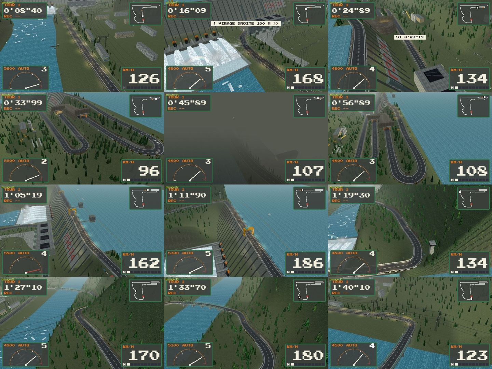
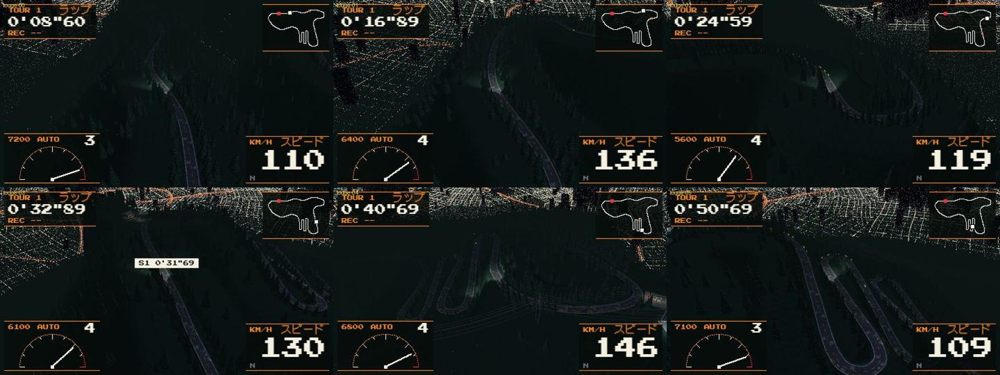
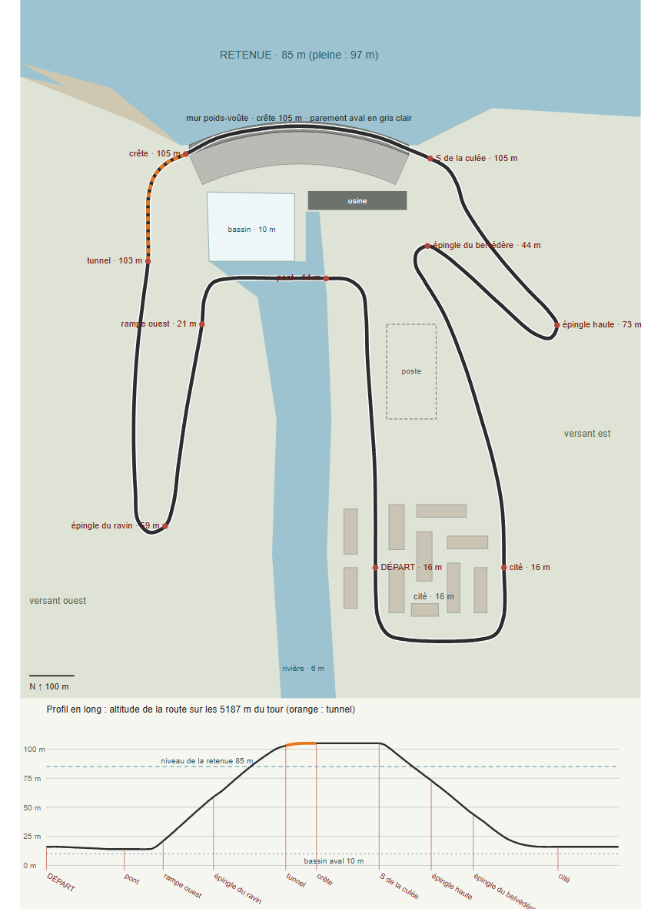
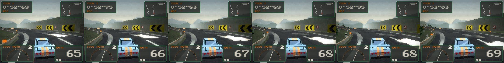

# Proposition de refonte — carte BARRAGE 74 (`barrage`)

Étape 1 : rien n'est construit. Chaque point numéroté (B-01, B-02…) se valide ou se refuse seul. Carte de comparaison : `touge`.
Cible : une version **statique** jouable. Ce qui bouge ou vit est listé à part (« Phase vie »).

**En une phrase** : on garde le thème (centrale soviétique de 1974, matin voilé) et on refait le site, le relief et le tracé à partir d'un vrai barrage de montagne, Saïano-Chouchenskaïa ramené à 95 m : une vallée en V, un mur courbe qui la ferme, une retenue 20 m sous la crête, une cité en aval, une route qui monte un versant, passe la crête et redescend l'autre.

## Ce que j'ai constaté avant de proposer

Captures faites pour cette proposition (tour à pas de 5 s, vues hautes tous les 200 échantillons, rendu réel du jeu, même chose sur touge) :

*Barrage actuel, vues hautes. Vignettes 03 et 05 : les lacets de la montée sont empilés sur une arête mince, avec le lac juste derrière, à leur hauteur. Vignettes 06 et 07 : le lac affleure la crête et contourne la culée. Vignette 02 : la cimenterie posée sur un talus à 45°.*

*Touge, mêmes vues hautes : un seul versant continu, la forêt le couvre, la route y est posée, la ville est loin en dessous. Rien ne flotte parce que rien n'est posé ailleurs que sur ce versant.*

Les défauts du cahier ont trois causes, et aucune n'est un défaut d'objet :

1. **Le sol est calculé à partir de la route** (`terrain()` : chaque point du sol prend l'altitude de la route voisine). Sur touge, la route suit un versant, donc le résultat est un versant. Sur barrage, la route actuelle empile trois lacets à 45 m d'écart en plan pour 20 m de dénivelé chacun, monte de 93 m sur une culée large de 150 m, puis descend en corniche : le sol qui en sort est une suite de terrasses raides, et le décor l'a rattrapé avec des murs (le long de presque toute la route), une « falaise » à 54° (code : `1.4` m par mètre) et des collines relevées de 190 m au loin (le « gros bloc »).
2. **Les niveaux d'eau ne viennent d'aucun site.** Le lac est à 101 m pour une crête à 105 m, et sa nappe déborde derrière la culée est jusqu'au niveau des lacets.
3. **Le soleil est placé derrière le mur, à 7° au-dessus de l'horizon, face à la route de la vallée.** Le parement aval est à contre-jour (un voile gris sans relief) et le soleil rasant se reflète sur les flaques dessinées dans la texture de chaussée (des pâtés de pixels carrés, lus par le moteur comme des zones brillantes : `textures.js`, « flaques ») : ce sont les « plaques blanches » du cahier (1.4). Essai fait : phares coupés (`phares: 0`), elles restent ; ce n'est donc pas le faisceau des phares. Touge a les mêmes flaques, mais de nuit elles ne renvoient que les phares.

Le tracé proposé ci-dessous a été passé dans la vraie physique (`buildTrack` + pilote automatique de `sim.js`, hors du jeu, sans toucher à `cartes.js`) : il boucle, sans choc, et aucune portion ne passe à moins de 52 m d'une autre.

---

## 1. Direction artistique

**B-01 — Le lieu : un vrai site, Saïano-Chouchenskaïa à l'échelle 1/2,5.** Barrage poids-voûte sur un fleuve de Sibérie du Sud, dans une gorge des monts Saïan, avec sa cité ouvrière en aval. On reprend ses proportions réelles, divisées par 2,5 environ :

| | Site réel | Carte |
|---|---|---|
| Hauteur du mur | 242 m | 95 m (pied à 10 m, crête à 105 m) |
| Longueur de crête | 1 074 m, en arc de 600 m de rayon | 500 m, en arc de 600 m de rayon |
| Largeur de la vallée : au fond / à la crête | 360 m / 900 m | 200 m / 500 m |
| Pente des versants au droit du mur | environ 45° | 35° au plus (0,7 m par m), 20 à 25° ailleurs |
| Revanche (crête − retenue pleine) | 8 m (547 − 539) | 8 m (105 − 97) |
| Retenue au plus bas, début mai | 500,7 m, soit 38 m sous la pleine | 85 m, soit 12 m sous la pleine, 20 m sous la crête |
| Route de crête | 9 m de large | 9 m |
| Accès | tunnel routier de 1 100 m en rive gauche | tunnel de 280 m dans la culée ouest |
| Cité ouvrière | Tcheriomouchki, 4 km en aval | 900 m en aval |

Sources : [Саяно-Шушенская ГЭС](https://ru.wikipedia.org/wiki/Саяно-Шушенская_ГЭС) (dimensions, vallée, versants, crête, tunnel, cité, évacuateur), [Саяно-Шушенское водохранилище](https://ru.wikipedia.org/wiki/Саяно-Шушенское_водохранилище) (marnage annuel jusqu'à 40 m), [fedpress, 6 mai 2010](https://fedpress.ru/federal/econom/tek/id_183116.html) (niveau 500,7 m). Photos à regarder au moment de construire : [face aval](https://commons.wikimedia.org/wiki/File:Вид_на_Саяно-Шушенскую_ГЭС.jpg), [côté retenue](https://commons.wikimedia.org/wiki/File:Саяно-Шушенская_ГЭС_с_верхнего_бьефа.jpg), [catégorie Commons](https://commons.wikimedia.org/wiki/Category:Sayano–Shushenskaya_Dam). Les fiches de `docs/REFS-barrage.md` restent valables pour les objets (mur, usine, poste, pylônes, crête).
*Justification : le cahier (G1, G2, G8) dit que le site n'est pas crédible ; un site réel donne d'un coup les niveaux, les pentes et la place de chaque chose.*

**B-02 — L'époque et le moment : début mai 1974, 6 h 40.** C'est la date où la retenue est au plus bas (elle a été vidée pendant l'hiver, la crue de fonte n'est pas encore arrivée) et où l'on ouvre les vidanges de fond pour préparer la crue. Conséquences visibles : le lac est 20 m sous la route de crête, avec une bande de rive nue entre 85 et 97 m ; de la neige reste sur les sommets ; les mélèzes ont leurs aiguilles neuves, vert clair ; brume de fond de vallée.
*Justification : c'est la réponse directe à « le lac est au niveau de la crête » (G2, 7.1), et elle est vraie.*

**B-03 — La lumière : le soleil passe au sud-est, à 22° de hauteur.** Aujourd'hui il est au nord, derrière le mur, à 7°. Nouvelle direction : `astre.dir ≈ [0.70, 0.38, 0.60]` (x vers l'est, z vers le sud). Effets : le parement aval est éclairé en biais (les plots de 18 m font des ombres, le mur a du relief) ; le versant ouest est au soleil, le versant est dans l'ombre douce ; dans la vallée on roule vers le mur avec le soleil dans le dos, donc plus de reflet rasant sur la chaussée. Ombres adoucies avec l'option existante `th.ombre: { doux: 1 }`.
*Justification : cahier G1 (« voile gris rayé »), 1.4 (plaques blanches).*

**B-04 — Le brouillard : plus dense, et une brume basse dans la vallée.** `fogD` passe de `[110, 1300]` à `[60, 850]`, couleur un peu plus froide (`#b9c6c8`). Depuis la crête, le fond de vallée est à 100 m en dessous et la cité à 900 m : on la devine dans la brume. Le lac se perd dans le brouillard vers 850 m. Les montagnes lointaines sont posées hors brouillard (B-22), comme la ville de touge.
*Justification : demande de l'auteur (7.3).*

**B-05 — Le ciel.** On garde le matin voilé gris-bleu, avec un horizon un peu plus chaud du côté du soleil (sud-est) : `#6f8aa0` en haut, `#a4b8c0`, `#e0d6bc` à l'horizon. Pas d'arc-en-ciel.

**B-06 — La palette, resserrée à six tons et un accent.**
- béton `#8d918a` (mur, usine, pont, portails, parapets : la même texture partout), béton mouillé `#6d726d` ;
- roche `#6a6458`, éboulis et rive nue du marnage `#b4ab96` (clair, sec) ;
- herbe de mai `#6f7d4e`, mélèze `#5e7a44` (clair), pin cembro `#33452f` (sombre) ;
- eau de la retenue `#4f7f8c` (acier froid), eau du bassin et de la rivière `#6c9aa5`, écume `#e8f2f4` ;
- neige des sommets `#e9eef0` ;
- bitume `#3a3c3e`, lignes `#f4f0e4` ;
- **un seul accent : orange sécurité `#e8761e`** (portiques de crête, garde-corps aval, balises). Le jaune sodium `#f2b43a` n'existe que dans le tunnel et sur les lampadaires. Le rouge délavé `#b5483c` n'existe que sur la fresque (B-37) et les lettres de l'usine (B-38). Le vert d'eau des machines disparaît avec la halle (B-10).
*Justification : cahier G10 (chaque zone avait ses matériaux).*

**B-07 — L'ambiance.** Un grand ouvrage, tôt le matin, presque désert : le grondement des vidanges au fond, la brume, les mélèzes, le béton. Imposant mais clair et lisible, pas sinistre. La même lumière et la même palette du départ à l'arrivée ; le seul changement d'éclairage du tour est le tunnel.

---

## 2. Circuit

**B-08 — Le tracé est refait entièrement.** Même idée générale (vallée, pied du mur, montée, crête, descente), mais chaque portion est posée sur le versant du site au lieu de fabriquer son propre sol. Longueur : **5,19 km** (4,75 aujourd'hui). Sens de la marche : on remonte la vallée vers le mur, on monte par la rive ouest, on passe la crête d'ouest en est, on redescend par la rive est.

*Plan (nord en haut, la rivière coule vers le sud) et profil en long. En orange : le tunnel. Fichier vectoriel : `img-barrage/trace-propose.svg`.*

| # | Secteur | Distance | Altitude | Pente | Ce qu'on y fait |
|---|---|---|---|---|---|
| 1 | **Rue de la cité** (départ) | 0 – 250 m | 16 m | 0 | Ligne droite entre les immeubles, cap au nord, le mur au bout de la vallée |
| 2 | **Route de la vallée** | 250 – 640 m | 16 → 14 m | −0,5 % | À fond, la rivière à gauche, le poste électrique à droite ; le mur grossit |
| 3 | **Pont du pied du mur** | 640 – 1 000 m | 14 m | 0 | Gauche à angle droit, 190 m de pont mouillé par les embruns, gauche à angle droit |
| 4 | **Rampe ouest** | 1 000 – 1 480 m | 15 → 57 m | +8,5 % | Montée vers le sud dans les mélèzes, la rivière en contrebas à gauche |
| 5 | **Épingle du ravin** | 1 480 – 1 590 m | 57 → 64 m | +6 % | Épingle à droite, 22 m de rayon, autour d'un ravin |
| 6 | **Traverse haute** | 1 590 – 2 170 m | 64 → 103 m | +7 % | Montée vers le nord à flanc, trois trouées sur la vallée et le mur de profil |
| 7 | **Tunnel de la culée** | 2 170 – 2 450 m | 103 → 105 m | +1 % | 180 m droits puis droite de 75 m de rayon, voûté, néons sodium |
| 8 | **Crête** | 2 450 – 3 010 m | 105 m | 0 | Sortie en pleine lumière ; grand droite de 600 m de rayon, à fond, le vide à droite, le lac à gauche 20 m plus bas |
| 9 | **S de la culée est** | 3 010 – 3 150 m | 105 → 99 m | −5 % | Droite puis gauche autour du belvédère |
| 10 | **Descente est** | 3 150 – 3 480 m | 99 → 74 m | −8 % | Traverse rapide vers le sud-est, à l'ombre, toute la vallée à droite |
| 11 | **Épingle haute** | 3 480 – 3 560 m | 74 → 69 m | −7 % | Épingle à droite, 17 m de rayon : le plus gros freinage du tour |
| 12 | **Traverse du belvédère** | 3 560 – 3 870 m | 69 → 45 m | −8 % | On roule vers le nord-ouest, droit sur le parement aval et les jets |
| 13 | **Épingle du belvédère** | 3 870 – 3 950 m | 45 → 39 m | −7 % | Épingle à gauche, 25 m de rayon, au-dessus de l'usine |
| 14 | **Descente sur la cité** | 3 950 – 4 560 m | 39 → 16 m | −4,5 % | Longue descente vers le sud au-dessus du poste, sous les lignes à 500 kV |
| 15 | **Tour de la cité** | 4 560 – 5 190 m | 16 m | 0 | Deux droites à angle droit autour du quartier, retour dans la rue |

Chiffres vérifiés dans la physique avec les points d'essai : rayon minimal 16,6 m (le test exige plus de 15), pentes de −8,5 à +8,6 % (la carte actuelle va à 11,6 %), écart minimal entre deux portions 52 m, tour lancé du pilote automatique 94,8 s sans choc. Le versant le plus raide que la route impose entre deux de ses portions est de 0,75 m par mètre (37°, à la culée ouest, où c'est de la roche) ; partout ailleurs moins de 0,45.
*Justification : cahier G1, G5, 8.3 ; consigne « faire découler le tracé du site ».*

**B-09 — Comment il se joue.**
- **Rythme** : 1 km à fond (rue, vallée), un double angle droit sur le pont mouillé, 1,1 km de montée coupée par une épingle, un virage aveugle en tunnel, 560 m à fond sur la crête, puis 1,5 km de descente avec trois gros freinages, puis deux angles droits en ville. Trois temps : vitesse, montée, descente.
- **Freinages** (vitesses du pilote automatique, à régler ensuite avec `vit`) : entrée du pont (≈ 185 km/h), épingle du ravin (≈ 90), virage du tunnel (≈ 200, à resserrer à ≈ 120 au réglage), épingle haute (≈ 70), épingle du belvédère (≈ 105), angles de la cité (≈ 205, à resserrer).
- **Dépassements** : la route de la vallée (aspiration, 9 m de large, camions à doubler), la sortie de l'épingle du ravin, la crête (la mécanique `corde` existante est gardée : frôler le garde-corps côté vide remplit la nitro), le freinage de l'épingle haute.
- **Moments forts** : (1) le mur qui grossit pendant 600 m de ligne droite ; (2) le pont sous les embruns, avec le parement de 95 m à 200 m sur la droite ; (3) la sortie du tunnel directement sur la crête ; (4) la traverse du belvédère, face au mur et aux jets, en freinant.

**B-10 — La halle des turbines n'est plus traversée.** L'usine reste, au pied du mur, vue de dehors (B-19). Si ce point est refusé, la route fait un crochet de 180 m par la travée de montage de l'usine entre la vallée et le pont, portes ouvertes aux deux bouts, sans rien changer d'autre au tracé.
*Justification : aucune route ne traverse une salle des machines ; c'est elle qui forçait la route à rester au pied du mur puis à grimper 93 m sur place, d'où les lacets empilés et les murs. Elle portait aussi trois défauts du cahier (3.1, 3.2, 3.3).*

**B-11 — Comment il se ressent, secteur par secteur.**
- Cité, vallée : ouvert, large, rapide, tranquille ; l'échelle est donnée par les immeubles de cinq étages puis par le mur.
- Pont : exposé, mouillé, bruyant ; on est tout petit sous l'ouvrage.
- Rampe ouest, traverse haute : fermé par les arbres comme la montée de touge, avec trois ouvertures sur la vallée.
- Tunnel : oppression courte (8 s), virage sans visibilité.
- Crête : la libération ; le vide à droite, le lac en contrebas à gauche, les sommets enneigés en face.
- Descente est : plongée ; on voit en permanence où l'on va (la cité, en bas) et d'où l'on vient (le mur).

**B-12 — Réglages de carte qui suivent le tracé** (entrée `barrage` de `cartes.js`, rien de partagé) : `tun` sur le secteur 7 ; `surf` mouillé plein sur le pont, fondu sur 20 m, sec partout ailleurs (la galerie ne suinte plus) ; `pluie` (embruns) sur le pont seulement ; `corde` et `chaud` sur la crête ; `amb` sur le pont et la crête ; `trafic: 4` gardé ; `sect`, `vit`, médailles et trace or refaits après un tour de réglage ; `large` : aucun (la route fait 9 m partout).

---

## 3. Décors généraux

**B-13 — Le sol devient une fonction du site, la route s'y pose.** Le relief est décrit une fois, par une formule de vallée (altitude du fond le long de la rivière + largeur du fond + pente de chaque versant selon la position), et passé à `terrain()` par son paramètre `creux` existant. La route est tracée sur ce relief (c'est le cas des points d'essai) ; le sol se raccorde à elle sur 15 m, avec au plus 3 m de déblai ou de remblai. Pas de sol relevé artificiellement au loin, pas de falaise fabriquée.
*Justification : c'est ainsi que touge tient (un versant, la route dessus) ; cahier G1, G4, 8.3.*

**B-14 — Les niveaux, chiffrés.**

| Niveau | Altitude |
|---|---|
| Rivière à la sortie de la carte (1,2 km en aval) | 6 m |
| Cité, rue du départ | 16 m |
| Eau du bassin de dissipation, au pied du mur | 10 m |
| Plate-forme de l'usine et du poste | 14 à 15 m |
| Pont du pied du mur (chaussée) | 14 m |
| **Retenue ce matin-là** | **85 m** |
| Retenue pleine (limite basse des arbres côté lac) | 97 m |
| **Route de crête** | **105 m** |
| Col des versants au-dessus des culées | 150 à 180 m |
| Crêtes proches (fin du sol modelé) | 250 à 400 m |
| Sommets lointains enneigés | 600 à 900 m |

La rivière descend de 10 m à 6 m sur 1,1 km (0,4 %), avec deux petits seuils d'eau vive.

**B-15 — La vallée aval.** Fond plat large de 200 m au pied du mur, 450 m à la cité. La rivière (70 à 90 m de large, bancs de galets, berges en enrochement) coule au milieu puis se colle au versant ouest. La rive est porte une terrasse de 250 m de large, 6 à 10 m au-dessus de l'eau : c'est là que sont l'usine, le poste et la cité, comme sur un vrai site. À 1,3 km en aval, la vallée tourne à l'ouest derrière un éperon : la vue est fermée par du relief, pas par un bord de carte.

**B-16 — Les versants.** Deux pentes régulières : 20 à 25° dans la vallée, 30 à 37° en approchant du mur, avec la roche qui affleure sur les 150 derniers mètres (couche `rocheGES` de l'option `th.couches`, déjà en place, réglée sur la pente). Deux accidents seulement, placés là où la route en a besoin : le **ravin** du versant ouest (un ruisseau, dans l'épingle du secteur 5) et l'**épaule** du versant est (un replat en pente douce de 300 m de large, où tiennent les deux épingles de la descente). Au-dessus de la route, les versants continuent jusqu'aux crêtes : on ne voit jamais le haut d'un talus se découper sur le ciel à 20 m de la route.

**B-17 — Le mur.** Poids-voûte : crête en arc de 600 m de rayon, bombé vers le lac, 500 m de long ; parement aval incliné (0,72 m par mètre, comme aujourd'hui), épais de 78 m au pied ; plots de 18 m en relief ; trois rangées de fenêtres de galeries. Les deux bouts s'encastrent dans la roche des versants (une entaille visible, pas un bord droit posé sur l'herbe). Côté lac : parement vertical, visible sur 20 m au-dessus de l'eau, avec une ligne sombre au niveau 97 m et une échelle de niveau peinte.

**B-18 — Les vidanges et le bassin.** Quatre pertuis de fond dans la moitié ouest du mur, 12 m au-dessus du bassin. Chaque jet est un **volume** blanc compact en arc (25 m de portée, 4 m d'épaisseur), pas une nappe plate dressée : il retombe dans un bassin de béton de 190 × 150 m, sous un nuage d'embruns bas (15 m au plus). Le bassin est à 200 m du pont : on voit les jets de loin, de face depuis la vallée et de trois quarts depuis le belvédère ; la route ne passe plus à côté.
*Justification : cahier 2.1, G9.*

**B-19 — L'usine, vue de dehors.** Au pied de la moitié est du mur : une halle de 220 × 42 m, haute de 26 m, toit plat, façade sud à grandes baies éclairées de l'intérieur (on devine un pont roulant orange derrière les vitres), trois conduites forcées qui descendent le parement jusqu'à son toit. Le canal de fuite sort sous l'usine et rejoint la rivière. Une route de service fermée par une barrière y mène depuis l'entrée du pont.

**B-20 — La retenue.** Un lac de vallée, pas une nappe : il occupe le fond de la vallée amont, large de 500 m au mur, avec un bras qui part au nord-ouest et un autre au nord-est, et se perd dans le brouillard à 850 m. Ses rives sont les versants eux-mêmes ; entre 85 et 97 m, ils sont **nus** (roche claire et limon sec, sans arbre) : c'est la bande de marnage, celle qui montre d'un coup d'œil que l'eau est basse. Le plan d'eau est découpé par le relief ; il ne passe plus derrière les culées ni sous la route.
*Justification : cahier G2, 7.1, G3 (dessous du plan d'eau visible).*

**B-21 — La forêt.** Taïga de montagne : mélèzes vert clair et pins cembro sombres sur les versants, de la route jusqu'aux crêtes, **avec les arbres de touge** (forme `cedre` et forme `tronc`, fût visible, étages lisibles), retexturés pour le jour. Bouleaux à tronc blanc dans le fond de vallée et autour de la cité. Plantation comme sur touge : un rang serré de chaque côté de la route dans les secteurs 4, 6 et 10, la forêt derrière, rien dans les trouées. Au-dessus de 300 m, la forêt s'éclaircit en pelouse et en éboulis.
*Justification : demande de l'auteur (G11) ; touge.*

**B-22 — L'horizon et le lointain.** Trois plans de montagnes en silhouette, à 1,2, 1,7 et 2,3 km, tout autour (le ciel du jeu est à 2,5 km), hors brouillard, chacun plus pâle et plus bleu que le précédent ; neige au-dessus de 600 m sur les deux derniers. Des arêtes et des sommets, pas des blocs : profils en dents irrégulières, pentes de 25 à 40°. Le sol modelé monte jusqu'à des crêtes à 250-400 m qui cachent le pied de ces plans.
*Justification : cahier G8, 6.2, 7.2 ; sur touge, c'est la ville lointaine, hors brouillard, qui donne l'échelle.*

**B-23 — Aucun dessous ni bord visible.** Trois règles de construction : (1) le sol modelé se termine toujours soit derrière une crête plus haute que l'œil, soit au-delà de 850 m (brouillard plein) ; (2) tout bâtiment a ses six faces texturées et un soubassement qui descend 3 m sous le sol ; (3) l'eau n'existe que là où le sol est plus bas qu'elle, et le sol sous l'eau est modelé (pas de nappe vue par en dessous). À vérifier par des vues hautes tout autour à chaque tour de construction.
*Justification : cahier G3, 4.5, 7.1.*

**B-24 — Tout est posé sur un sol plat fait pour lui.** Chaque bâtiment, pylône ou silo est placé par l'altitude du sol (`hAt`) sur une plate-forme terrassée de sa taille, raccordée au versant par un talus. Les trois ensembles bâtis (usine, poste, cité) sont sur la terrasse de la rive est, qui est plate. La cimenterie et ses silos sont supprimés (ils étaient sur un talus à 45°). Les pylônes ne sont posés que là où la pente fait moins de 30°.
*Justification : cahier G4, 4.2, 8.1, 8.5.*

---

## 4. Transitions

Règle commune : **le même sol, les mêmes arbres, le même mobilier de route, le même béton et la même lumière sur toute la carte.** Une zone se distingue par ce qu'on voit au loin et par la forme de la route, pas par un changement de matériaux. Chaque frontière ci-dessous dure au moins 100 m.

**B-25 — Cité → vallée (250 m).** Les immeubles s'espacent, puis viennent la chaufferie et sa cheminée, des garages bas, l'arrêt d'autobus ; l'allée de bouleaux et les lampadaires de la rue continuent 150 m après le dernier bâtiment ; le trottoir devient un accotement de gravier.

**B-26 — Vallée → pont (640 m).** Le poste électrique longe la route sur 220 m à droite, ses lignes convergent vers l'usine : on arrive « dans » l'ouvrage avant le pont. La chaussée fonce et brille progressivement sur 80 m (option `mouilleVisible`, déjà en place), la brume des embruns s'épaissit, la glissière devient le parapet de béton du pont 30 m avant la culée.

**B-27 — Pont → rampe ouest (1 000 m).** Le parapet finit en glissière ; l'enrochement de la berge devient talus d'herbe puis sous-bois en 60 m ; les premiers mélèzes sont au bout du pont ; une ligne à 500 kV traverse la vallée au-dessus du pont et monte le versant avec la route.

**B-28 — Rampe → épingle du ravin → traverse haute.** Forêt continue. L'épingle est annoncée par le ravin qu'on voit s'ouvrir à droite 100 m avant ; la route le franchit sur un petit pont de béton (10 m), seul ouvrage de la montée.

**B-29 — Traverse haute → tunnel (2 020 – 2 170 m).** Sur 150 m, la roche remplace l'herbe sur le talus amont (la pente passe de 25 à 37°), les arbres s'éclaircissent, puis la route entre dans une entaille taillée dans le rocher ; le portail est au fond de l'entaille, dans la paroi. Les lampadaires sodium commencent 60 m avant le portail.

**B-30 — Tunnel → crête (2 450 m).** Le portail de sortie est dans la roche de la culée, 20 m avant le mur. Le jour entre dans les 60 derniers mètres du tunnel (option `th.oeil` existante, déjà réglée pour une sortie rapide). Le parapet de la crête commence dans le portail ; on sort face à la longue courbe de la crête, pas face à une paroi.
*Justification : cahier 5.3 (« une paroi grise très proche »), G10.*

**B-31 — Crête → culée est → descente (3 010 m).** La crête finit sur une plate-forme taillée dans la roche (le belvédère : tour de contrôle, parapet, deux lampadaires). Le garde-corps redevient glissière dans le S ; la roche laisse la place à l'herbe puis aux mélèzes en 100 m. La lumière baisse d'un cran parce qu'on entre dans l'ombre du versant est : c'est l'ombre portée réelle du relief, pas un changement de réglage.

**B-32 — Descente → cité (4 300 – 4 560 m).** La route longe par le haut le poste électrique, passe sous les lignes ; viennent des jardins ouvriers et des cabanes (clôtures basses, sur terrain plat), les garages, puis le premier immeuble. Les lampadaires de la cité commencent 150 m avant elle.

---

## 5. Détails de décor

**B-33 — Bord de route : une glissière continue, aucun mur.** Glissière métallique des deux côtés partout hors ouvrage (la même que touge, teinte de jour), avec catadioptres. Parapet de béton de 1,15 m sur le pont et côté lac de la crête. Trottoir et bordure dans la cité. **Tous les murs de béton, de pierre brune et de pierre grise le long de la route sont supprimés** ; le seul « mur » est la roche taillée de l'entaille du tunnel et du belvédère, qui est le terrain lui-même.
*Justification : cahier G5, 1.3, 4.1, 4.3, 6.1, 8.2 ; touge n'a qu'une glissière.*

**B-34 — Côté vide de la crête : un garde-corps ajouré.** Côté vallée, une lisse d'acier orange à barreaux sur une bordure de 40 cm, à la place du parapet plein : on voit le vide, la vallée et la cité depuis la voiture. La limite de roulage ne change pas (les murs de la physique sont à la même place).
*Justification : cahier 7.4 (« ni vide côté vallée visible depuis la route »).*

**B-35 — Mobilier de la crête.** Deux portiques roulants orange sur rails au-dessus des pertuis (la route passe dessous), lampadaires sodium tous les 28 m en quinconce, la tour de prise d'eau accrochée au parement amont avec sa passerelle (elle sort de l'eau 20 m plus bas : plus de bâtiment posé sur l'eau), un barrage flottant de bouées orange sur le lac, loin du mur. Les bouées collées au parapet disparaissent avec le niveau.
*Justification : cahier 7.1, 7.4.*

**B-36 — Panneaux de virage : ceux du moteur, comme touge.** On repasse à `chev: 1` (les chevrons que le moteur pose sur toutes les anciennes cartes) et on supprime les chevrons propres au décor, dont les chevrons géants. Ils n'apparaissent donc qu'à l'extérieur des épingles et des angles, devant la forêt ou le ciel puisqu'il n'y a plus de mur.
*Justification : cahier G6, 2.3, 4.4.*

**B-37 — Une seule fresque.** Sur le pignon du premier immeuble à droite après la ligne de départ : une mosaïque de style propagande soviétique des années 70 (un ouvrier et une ouvrière de profil, un barrage, un soleil, des lignes électriques, en rouge délavé, ocre et bleu), sans symbole politique réel. Toutes les autres fresques, la mosaïque de la halle, l'affiche dans les arbres et les lettres rouges peintes sur le mur sont supprimées.
*Justification : demande de l'auteur (1.2, G7).*

**B-38 — Une seule inscription : « ГЭС-74 » en lettres d'acier sur le toit de l'usine.** Lettres découpées de 4 m, rouge délavé, sur une charpente, comme sur les centrales réelles. Elle est dans l'axe de la route de la vallée.
*Justification : il faut un nom au lieu, et ce n'est pas une peinture ; si l'auteur compte ces lettres dans l'excès relevé en G7, refuser ce point les supprime.*

**B-39 — La cité.** Six immeubles de cinq étages (60 × 12 × 15 m, panneaux de béton clair, loggias) alignés sur la rue du départ et sur deux rues perpendiculaires, **posés sur un sol plat avec trottoirs**, entrées, bancs, bouleaux, lampadaires ; une chaufferie à cheminée de brique ; l'arrêt d'autobus ; des garages. La ligne de départ est dans la rue, entre deux immeubles.
*Justification : cahier 8.2 (« le début de la piste ne passe pas entre des bâtiments mais entre ces murs »), 8.5.*

**B-40 — Le poste et les lignes.** Le poste actuel (transformateurs, portiques, disjoncteurs, clôture, bâtiment de commande) est gardé et déplacé sur la terrasse, entre l'usine et la cité. Trois lignes à 500 kV en partent : une vers le sud le long de la vallée, une qui traverse la rivière et monte le versant ouest, une qui monte l'épaule est. Pylônes posés par l'altitude du sol, sur pente de moins de 30°.

**B-41 — Le tunnel.** Section **voûtée** (options existantes `th.tun.voute` et `th.tun.h` : 7 m sous la clé, voûte de 3 m de flèche), béton coffré avec traînées d'humidité et taches de calcite, une file de luminaires sodium au sommet de la voûte, chemin de câbles sur un côté. **Portails sans cadre orange** : une arche de béton encastrée dans la roche, avec deux murs en aile. Dans le virage, les chevrons du moteur.
*Justification : demande de l'auteur (5.1, 5.2), cahier 5.3.*

**B-42 — Le pont du pied du mur.** Poutres de béton sur trois piles, 190 m, parapet de béton, lampadaires ; vue dégagée à droite sur le bassin, les jets et le parement.

**B-43 — Repères de pilotage, un par secteur.** La fresque (départ) ; la cheminée de la chaufferie (fin du tour) ; les lettres de l'usine (bout de la vallée, repère de freinage du pont) ; un pylône au pied de la rampe ; le petit pont du ravin (épingle) ; le portail (tunnel) ; les deux portiques orange (crête) ; la tour de contrôle (S de la culée) ; un rocher isolé (épingle haute) ; le belvédère et son parapet (épingle du belvédère).

**B-44 — La chaussée.** Bitume fin `chausseeFine` gardé, sec et mat partout sauf le pont. Les plaques blanches sont les flaques de cette texture qui renvoient le soleil rasant. Deux mesures : le soleil au sud-est (B-03) n'est plus face à la voiture dans la vallée ; et la carte prend une variante de la texture sans flaques hors du pont (dans `textures-barrage.js`, sans toucher à la texture commune). À contrôler au premier tour de captures dans la vallée et sur la crête.
*Justification : cahier 1.4, G9.*

**B-45 — Des rampes à pente constante.** Les altitudes des points de contrôle sont calculées à la longueur d'arc pour que chaque rampe ait une seule pente (rampe ouest 8,5 %, traverse haute 7 %, descentes 8 % puis 4,5 %), épingles comprises ; les changements de pente se font en quatre endroits seulement (pied de la rampe, entrée du tunnel, S de la culée, entrée de la cité), sur 60 m chacun. Contrôle : moins de 8 bascules de pente de plus de 1 % sur le tour (27 aujourd'hui ; 20 avec les points d'essai, toutes dans les trois épingles).
*Justification : effet de vague (G9), mesure du tangage de la caméra.*

---

## Phase « vie » ultérieure (hors de cette proposition)

Rien de ceci n'est dans la version statique : l'eau qui bouge (jets, bassin, rivière, clapot de la retenue) ; les embruns qui dérivent ; la brume qui se lève ; les portiques roulants en mouvement ; le tramway et l'autobus de la cité ; des ouvriers, un pêcheur sur le lac ; la fumée de la chaufferie ; des oiseaux ; un camion sur la route de service ; les fenêtres qui s'allument. Le trafic de camions (`trafic: 4`) est du jeu, pas du décor : il est gardé.
Aussi hors de cette proposition (idées de la spec V1 qui demandent du moteur) : crue progressive d'un tour à l'autre, raccourci du déversoir, vent sur la crête.

---

## Table de couverture du cahier

### Problèmes généraux

| Cahier | Problème | Réponse |
|---|---|---|
| G1 | Ambiance et élévation, sol sans forme crédible | B-01 (site réel), B-13 (le sol vient du site), B-08 (tracé posé dessus), B-15 à B-17 |
| G2 | Lac au niveau de la crête | B-02, B-14 (retenue à 85 m, crête à 105 m), B-20 (bande de marnage) |
| G3 | Dessous et vides visibles | B-23 (trois règles), B-20 (plus de nappe sous la route) |
| G4 | Objets qui flottent | B-24 (plates-formes, terrasse), B-13 |
| G5 | Murs sans raison le long de la route | B-33 (tous supprimés), B-08 et B-13 (plus de terrasses à retenir) |
| G6 | Chevrons devant des murs | B-36, B-33 |
| G7 | Peintures et fresques en excès | B-37 (une seule), B-38 (lettres d'acier, refusable à part) |
| G8 | Montagnes et versants : murs verts, blocs gris | B-16 (pentes de 20 à 37°), B-22 (trois plans de sommets), B-21 |
| G9 | Effet de vague | Voir « Effet de vague » ci-dessous : B-03 et B-44 (reflet qui glisse sur la route), B-45 (tangage), B-18 (jets en volume) |
| G10 | Aucune continuité entre zones | B-06 (palette unique), B-07, règle commune et B-25 à B-32 |
| G11 | Sapins différents de touge | B-21 (les arbres de touge) |

### Par zone

| Cahier | Problème | Réponse |
|---|---|---|
| 1.1 | Arc-en-ciel | Supprimé (B-05) |
| 1.2 | Fresques sur les immeubles | B-37 : une seule, sur le premier immeuble, style propagande |
| 1.3 | Mur de béton à droite de la vallée | Supprimé (B-33) |
| 1.4 | Plaques blanches sur la route | B-03 (soleil déplacé : c'était son reflet rasant, pas les phares), B-44 (contrôle et repli) |
| 2.1 | Gerbe en grosse vague blanche | B-18 : jets en volume, à 200 m de la route |
| 2.2 | Arc-en-ciel et lettres rouges sur le mur | Supprimés (B-05, B-37) ; le mur prend du relief par la lumière (B-03, B-17) |
| 2.3 | Chevrons géants, eau au bord de la route | B-36 (chevrons du moteur) ; la route ne longe plus les gerbes (B-08, B-18) ; le mouillé est limité au pont (B-12) |
| 3.1 | Fresque dans la halle | La halle n'est plus traversée (B-10) ; fresque supprimée (B-37) |
| 3.2 | Halle : murs, vitrages, pont roulant | B-10, B-19 (usine vue de dehors) |
| 3.3 | Sol de la halle par-dessus la route | Disparaît avec B-10 ; règle générale : aucune surface de décor n'est posée sur la chaussée |
| 4.1 | Mur à droite à la sortie de la halle | Supprimé (B-33) ; la zone n'existe plus (B-08) |
| 4.2 | Cimenterie qui flotte | Supprimée (B-24) |
| 4.3 | Mur à gauche | Supprimé (B-33) |
| 4.4 | Chevrons devant un mur dans l'épingle | B-36, B-33 |
| 4.5 | Bâtiment au toit rond sans texture | Supprimé (c'était l'habillage du portail) ; B-41 (portail dans la roche), B-23 (six faces texturées) |
| 5.1 | Arche orange à l'entrée du tunnel | B-41 : arche de béton, sans orange |
| 5.2 | Tunnel à section carrée | B-41 : voûte |
| 5.3 | Cadre orange à la sortie, paroi proche | B-41, B-30 (on sort sur la crête) |
| 6.1 | Murs après le tunnel | Supprimés (B-33) ; la zone n'existe plus : le tunnel débouche sur la crête (B-08) |
| 6.2 | Gros bloc au loin | C'était le sol relevé artificiellement et le mur à contre-jour : B-13, B-22, B-03, B-04 |
| 6.3 | Pente et courbe sans repère | La zone n'existe plus ; un repère par secteur (B-43) |
| 7.1 | Eau au niveau de la route, bouées, bâtiment sur l'eau, dessous du plan d'eau | B-14, B-20, B-35, B-23 |
| 7.2 | Grand bloc et falaise verticale | B-16, B-22 ; la crête est entre le vide et le lac, plus entre deux parois (B-08) |
| 7.3 | Plus de brouillard | B-04 |
| 7.4 | Crête presque nue | B-34 (vide visible), B-35 (portiques, tour de prise d'eau), B-31 (tour de contrôle) |
| 8.1 | Tour grise plantée dans la pente | Supprimée ; la tour de contrôle est sur la plate-forme du belvédère (B-31, B-24) |
| 8.2 | Murs sur toute la descente ; le départ entre des murs | B-33 ; B-39 (départ dans la rue, entre les immeubles) |
| 8.3 | Versant raide et régulier, bas de pente au-dessus de l'eau | B-16, B-13, B-15 (berges), B-21 |
| 8.4 | Affiche dans les arbres | Supprimée (B-37) |
| 8.5 | Immeubles posés sur l'herbe, chevrons, pylône | B-39 (sol plat, trottoirs), B-36, B-40 |

### Problèmes communs du `README.md` qui concernent barrage

| README | Problème | Réponse |
|---|---|---|
| 1 | Effet de vague | Voir ci-dessous |
| 2 | Aucune continuité entre zones | Section 4 |
| 5 | Objets qui flottent | B-24 |
| 6 | Textures sur la route | B-10, B-44 |
| 7 | Murs sans raison | B-33 |
| 8 | Panneaux de virage | B-36 |
| 9 | Ambiance loin de l'intention, lumière en interrupteur | B-01, B-07 ; un seul changement de lumière, le tunnel (B-30) |
| 10 | Sapins différents de touge | B-21 |
| 11 | Niveaux sans logique | B-14 |
| 3, 4, 12 | Densité, lointain, rupteur | 3 : densité tenue par la forêt continue (B-21) et un repère par secteur (B-43). 4 : B-22. 12 : ne concerne que chapada ; à contrôler quand même au réglage de `vit` |

### Effet de vague (G9, README 1)

Cherché en mouvement, dans le rendu réel du jeu (270 lignes), par suites de six images espacées de 0,07 s à six endroits du tour, et par mesure du tangage de la caméra image par image sur un tour complet.

*Barrage actuel, virage après le tunnel, six images en 0,35 s : une nappe blanche naît sur la chaussée, s'étale et glisse en travers de la route.*

1. **Trouvé : une nappe blanche qui glisse sur la route.** C'est le reflet du soleil rasant sur les flaques de la texture de chaussée (même cause que les plaques blanches, 1.4). À l'arrêt, ce sont des rectangles ; en mouvement, surtout en virage, le reflet enfle, se déforme et traverse la route en un tiers de seconde. Dans la vallée, il reste collé devant la voiture et pulse. C'est le candidat le plus sérieux : il est blanc, il ondule, il n'existe qu'en mouvement, et les cartes de nuit ne l'ont pas. Réponse : B-03 et B-44.
2. **Mesuré, mais pas propre à barrage : le tangage de la caméra.** La caméra suit la pente de la route. Sur barrage, la pente de la montée oscille entre 1,4 et 11,6 % (16 bascules de 2 à 4° d'affilée entre les échantillons 650 et 1 260), et 6 de plus dans la descente. Touge en a autant (26 sur le tour, contre 27), mais de nuit, sans horizon visible ; sur barrage, de jour, l'horizon, la ligne du lac et la crête du mur montent et descendent à l'écran. La session perse a mesuré la même chose sur sa carte. Réponse : B-45.
3. **Vu, secondaire :** l'écume du bassin et la brume, dont la texture se balance (un sinus dans le décor actuel) ; la gerbe en forme de vague (2.1). Tout cela est près du pied du mur seulement. Réponse : B-18, et rien ne se balance dans la version statique.
4. **Écarté :** le faisceau des phares (essai `phares: 0`), le profil de la route lui-même (pas de bosses : la voiture ne décolle jamais), le mode d'affichage « console 32 bits » (tremblement des sommets et textures sans perspective : il n'est pas actif dans le rendu normal).

Je n'ai pas la confirmation que le point 1 est bien ce que l'auteur appelle « la vague » ; les réponses aux points 1 à 3 sont de toute façon dans la proposition.

---

## Changements partagés demandés (`sim.js`, `game.js`, `decors.js` commun)

**Aucun.** Tout ce qui précède tient dans le périmètre de la carte : l'entrée `barrage` de `cartes.js`, la fonction `barrage` de `decors.js`, `formes-barrage.js`, `textures-barrage.js`, la ligne `barrage` de `traces-or.js` (trace or à refaire, le tracé change) et la ligne `PAL` de `game.js`. Les options de moteur utilisées existent déjà et sont inactives sur les anciennes cartes (`couches`, `ombre.doux`, `tun.voute`, `tun.h`, `oeil`, `mouilleVisible`, `routeTex`, `frole`). `terrain()` est utilisé tel quel, par son paramètre `creux`. Les arbres de touge sont réutilisés en lecture (formes `cedre` et `tronc`), sans modifier `formes-touge.js`. Effet sur les anciennes cartes : nul.

## Coût

Mesure des captures d'aujourd'hui : barrage 4,15 ms par image, touge 1,19 ms. La refonte retire des objets (halle, cimenterie, murs, lacets empilés) et ajoute de la forêt ; l'objectif de l'étape 2 est de rester sous les 4,15 ms actuels, mesurés au banc (`outils/banc-rapide.js`).
