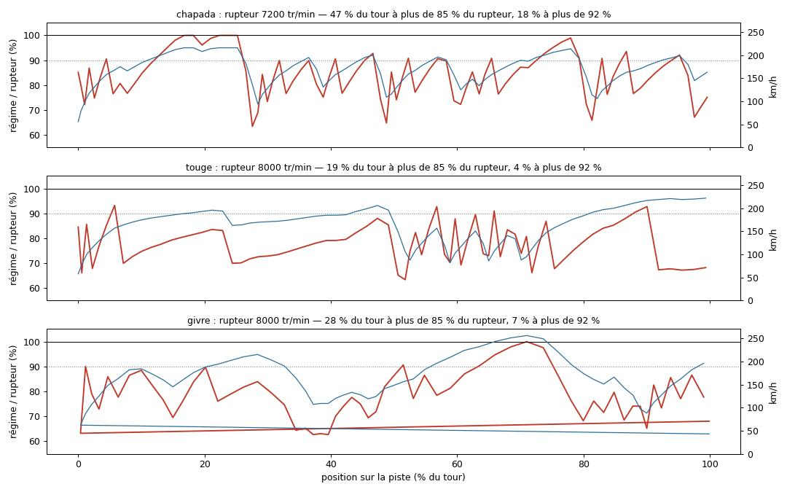
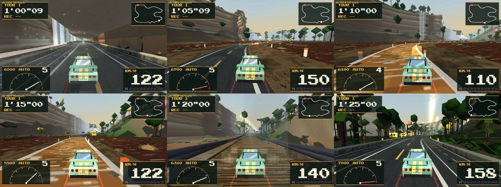
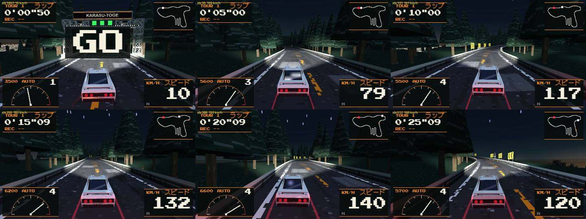
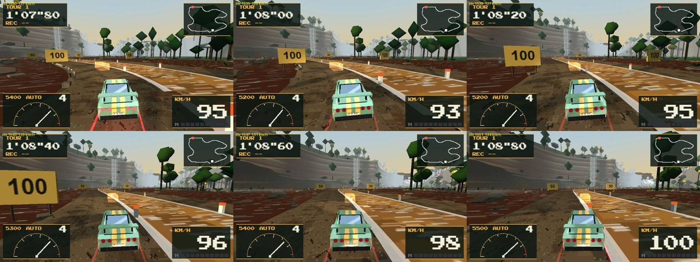
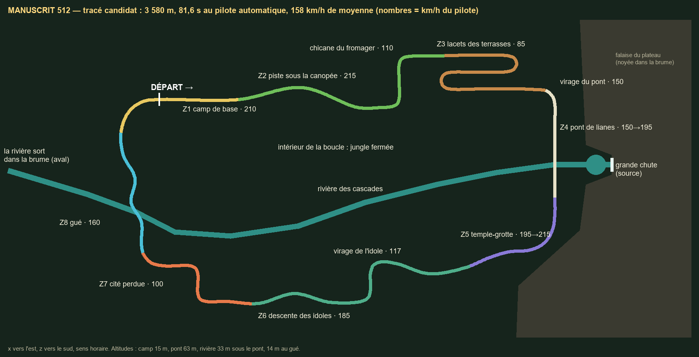

# Proposition de refonte : la carte du Brésil (`chapada`)

Étape 1 : rien n'est construit. Chaque point numéroté se valide ou se refuse seul. Les points d'une même lettre sont indépendants, sauf mention « dépend de ».
Carte de comparaison : `touge`. Cible : une version statique (ce qui bouge est listé à part, section 7).

Ce que j'ai fait avant d'écrire : lu le cahier (48 problèmes) et ses 33 captures ; capturé un tour de la carte actuelle et un tour de touge au même pas (23 et 19 vues), plus des suites rapprochées (une vue tous les 4 échantillons, soit 8 m) sur le plateau, la gorge, le gué et dans la forêt de touge ; mesuré le régime et essayé un nouveau tracé dans la simulation (`sim.js`, sans navigateur).

## 0. Trois constats qui commandent le reste

**Le rupteur vient d'abord de la boîte de vitesses, pas du tracé.** La mesure du cahier se refait avec `node outils/regime.js chapada touge givre` (nouvel outil, tour lancé du pilote automatique, pas de 1/120 s) :

| | plus de 85 % du rupteur | plus de 92 % | temps sur le dernier rapport |
|---|---|---|---|
| chapada actuelle | 50 % | 24 % | 75 % |
| touge | 18 % | 3 % | 25 % |
| givre | 28 % | 10 % | 43 % |
| chapada actuelle, seule la boîte changée (C-2) | 23 % | 6 % | 32 % |
| **tracé candidat + boîte (C-1, C-2)** | **21 %** | **4 %** | **21 %** |

La 5ᵉ de l'Onça plafonne à 216 km/h pile au rupteur (7 200 tr/min), et ses rapports sont si serrés que chaque rapport ne quitte jamais la zone 76-94 % du rupteur. La 5ᵉ de touge tire jusqu'à 325 km/h. 

**Touge enferme sa route avec presque rien.** Une rangée de cèdres de 26 m de chaque côté, entre 4,5 et 11,5 m du bord, un arbre tous les 6 m ; puis 2 600 arbres au hasard jusqu'à 230 m ; un seul sol sombre ; un brouillard de la couleur du fond ; un repère par portion. Chapada fait l'inverse : bas-côté dégagé, arbres fins et espacés, brouillard clair qui porte à 340 m.

**« L'effet de vague » : pas d'origine moteur trouvée, une origine de décor probable.** Écarté par la mesure : le profil de la route (chapada a 0,6 inversion de courbure verticale par km, touge 8,4 : la route de chapada ondule moins que celle de touge) ; la caméra (même code pour toutes les cartes). Vu sur les suites rapprochées : la crête des parois monte et descend d'une image à l'autre, parce que les parois suivent le maillage du terrain (mailles de 8 m), leurs bancs horizontaux glissent en courbes molles, et les grandes facettes du terrain s'éclairent par bandes.  Non vérifié : le recalage de la carte d'ombre sous soleil rasant (16°), qui peut faire ramper le bord des ombres. La refonte supprime les trois causes vues (D-9) et relève le soleil (A-3) ; le contrôle en mouvement est prévu à l'étape 2 (section 8).

---

## 1. Direction artistique

**A-1. Le lieu : la cité perdue du Manuscrit 512, dans une vallée de forêt de la Chapada Diamantina (Bahia).** Le Manuscrit 512 (Bibliothèque nationale du Brésil, daté de 1753) raconte que des bandeirantes ont trouvé dans le sertão de Bahia une ville de pierre abandonnée : une entrée à trois arches, une place avec la statue d'un homme qui montre le nord sur un socle noir, des obélisques aux coins, un grand édifice à reliefs, une rivière au bord de la place, des inscriptions inconnues. Les recherches du XIXᵉ siècle l'ont cherchée dans la Chapada Diamantina ; l'histoire a nourri les expéditions de Fawcett, dont s'inspire Indiana Jones. La carte reste donc au Brésil et dans la Chapada, et gagne ce qui lui manquait : un but, un mystère, des monuments. Justification : G2 et G12 (rien de précieux ni de mystérieux, aucun repère).

**A-2. Nouveau nom : « MANUSCRIT 512 », sous-titre « BAHIA · LA CITÉ PERDUE ».** Dans la lignée de BARRAGE 74, PLAYA 307, CANAL 6. L'identifiant `chapada`, les rivaux (TIAGO, LUANA, BRUNO) et les trois stations de radio ne changent pas. Justification : « Matin sur la Chapada » annonce un paysage, pas une aventure.

**A-3. Époque et heure : de nos jours, une expédition est sur place ; 9 h, après une nuit de pluie.** Soleil à 38° de hauteur (aujourd'hui 16°), direction `[0.5, 0.62, 0.6]`, couleur `#fff0c0`. Le soleil plus haut tombe en taches à travers la canopée au lieu de raser le sol en longues ombres en escalier. Justification : G2 (lumière grise et plate), et les ombres étirées à 1,4 m par texel relevées dans `MOTEUR-OPTIONS-CARTES.md`.

**A-4. Lumière : clair-obscur chaud et vert.** Sous la canopée, ombre vert profond ; au sol et sur la route, des taches de soleil franches (l'ombre portée des houppiers, pas des plans de lumière) ; au fond, la brume éclairée. Réglages de départ : `hemi [0xcfe6a8, 0x1c3a22, 0.62]`, `sun [0xffe6b0, 1.15]`, `bloom 0.18` (0,05 aujourd'hui), `ombre { doux: 1, champ: 250 }`. Justification : G2, Z6.1.

**A-5. Brume vert-or, courte, de la couleur du fond.** `fog #a9bb7e`, `fogD [18, 190]` (aujourd'hui gris-bleu `#b8c6cc` et `[20, 340]`). À 60 m les troncs pâlissent, à 190 m il ne reste que la brume. C'est le procédé de touge (le fond s'efface dans la couleur du brouillard), transposé de jour. Justification : G3, Z4.4, « brume au fond de la forêt qui ferme la vue ».

**A-6. Palette.**
- Verts (70 % de l'image) : profond `#12301e`, canopée `#1f5a2c`, émeraude au soleil `#3f9a3c`, jeune feuille `#b8dc5a`, mousse `#7fa83a`.
- Pierre de la cité : quartzite rosé `#b09a86`, ombre `#6a5e56`, socle noir `#26221f`, or `#e8b83a` (rare).
- Eau : jade `#2f8f7a`, profonde `#134a40`, écume `#eef6e8`.
- Accents chauds (5 % de l'image, toujours près de la route) : flamme `#ffb040`, héliconia rouge `#d8362a`, toile de tente `#d8c89a`.
- Route : dalles `#77725f` et `#5e5a4c`, joints moussus `#4d6a34`.
- Supprimés : le beige-gris des sols, le brun des parois, l'orange du gué, le rose bonbon et le jaune des arbres en fleur.
Justification : G2 (aucun contraste chaud/froid), Z4.1, Z4.2, G5.

**A-7. Ce qui fait « aventure » et pas « abandon », règle par règle.**
1. Couleur : verts saturés et or, jamais de gris-beige ; aucune grande surface désaturée.
2. Lumière : toujours un contraste soleil/ombre dans l'image ; jamais de lumière diffuse uniforme.
3. Densité : on ne voit jamais le sol nu ni l'horizon ; chaque image a un premier plan végétal qui déborde sur le cadre.
4. État des ruines : monumentales, sculptées, **debout** ; couvertes de mousse et de racines, pas écroulées en tas ; aucune masure, aucun toit de tuiles, aucun muret de pierre sèche.
5. Présence : l'expédition est là, torches allumées, cordes, caisses, tentes, échafaudages de bambou. Un lieu qu'on explore, pas un lieu qu'on a quitté.
6. Eau : claire, verte, vive, avec une source visible (la grande chute) ; jamais brune ni opaque.
7. Précieux : de l'or en petite quantité (l'idole, le doigt de la statue, les yeux de la tête colossale).
Justification : G2, Z1.1, Z1.2.

**A-8. Interface et couleurs de carte.** HUD : `y #f2ecd0`, `c #ffc247`, `r #ff5a3a`, fond `rgba(8,20,12,.84)`, style `trait` gardé. Ligne `PAL` de `game.js` : `[0x08140c, 0x1f5a2c, 0xe8b83a, 0xf2ecd0, 0xff5a3a]`. Justification : accorder l'écran-titre à la nouvelle palette.

**A-9. La voiture passe du vert au jaune d'expédition** (`col 0xe9b44c`, bandes `0x26221f`). Justification : une voiture verte dans une carte verte se perd ; sur touge la voiture blanche se détache du noir.

**Références réelles et sources.**
- Manuscrit 512 : https://en.wikipedia.org/wiki/Manuscript_512 (la ville, l'arc triple, la statue sur socle noir, les obélisques, la rivière, les recherches dans la Chapada Diamantina, le lien avec Fawcett).
- Forêt de fond de vallée, palmier juçara : https://pt.wikipedia.org/wiki/Vale_do_Pati ; récit de la traversée (forêt qui rappelle la mata atlântica, juçaras) : https://www.360meridianos.com/vale-do-pati-travessia/
- Grande chute au fond d'un canyon fermé : https://pt.wikipedia.org/wiki/Cachoeira_do_Buracão ; chute qui « fume » : https://en.wikipedia.org/wiki/Cachoeira_da_Fuma%C3%A7a
- Grotte au bassin bleu traversé par un rayon de soleil (d'avril à septembre) : Poço Encantado, Itaetê, https://www.bahia.ws/en/poco-encantado-chapada-diamantina/
- Falaises de grès et quartzite en bancs : fiche 1 de `docs/REFS-chapada.md` (gardée pour la teinte de la roche).
- Réserve : la vraie forêt de la Chapada est une forêt de galerie, moins haute et moins dense que ce que je propose. La carte force le trait vers la jungle, comme le demande le cahier. L'eau réelle est couleur thé ; je la passe au vert jade parce que le thé a donné la « terre battue » (Z4.1).

---

## 2. Circuit

**C-1. Le tracé est refait entièrement.** 3 580 m (5 067 aujourd'hui), 81,6 s au pilote automatique (touge : 81,0 s), 158 km/h de moyenne, de 82 à 222 km/h, sens horaire, altitude de 14 à 63 m. Les 70 points du candidat sont dans [`img-chapada/trace-candidat.json`](img-chapada/trace-candidat.json) ; ils ont tourné dans la simulation (le pilote frôle un mur pendant un pas de calcul sur un tour, 8 freinages dont 5 de plus de 40 m). Justification : G1, Z2.6, et la demande de ne garder que la forêt.

| Zone | Points | Longueur | Ce qu'on fait | Vitesse du pilote |
|---|---|---|---|---|
| Z1 Camp de base | 66 → 2 | 430 m | dernier virage rapide, ligne de départ, pleine charge | 175 → 210 km/h |
| Z2 Piste sous la canopée | 2 → 13 | 640 m | deux courbes à fond dans le tunnel d'arbres, puis gros freinage et chicane autour du fromager | 215, puis 219 → 109 |
| Z3 Lacets des terrasses | 13 → 28 | 680 m | montée de 30 m, deux épingles serrées (R 19 m), un freinage chacune | 161 → 88, 135 → 86 |
| Z4 Pont de lianes | 28 → 34 | 330 m | virage du pont à 150, puis 150 m de pont étroit en accélération | 150 → 195 |
| Z5 Temple-grotte | 34 → 40 | 330 m | tunnel en courbe, à fond, sans voir la sortie | 195 → 215 |
| Z6 Descente des idoles | 40 → 53 | 640 m | saut à la sortie, gros freinage, équerre gauche puis droite, deux courbes rapides | 219 → 119, puis 185 |
| Z7 Cité perdue | 53 → 63 | 330 m | freinage sous l'arc triple, deux équerres (R 18 m) autour de la place, sortie en courbe | 191 → 101 |
| Z8 Gué | 63 → 66 | 200 m | S dans l'eau, la voiture est freinée par l'eau au centre | 155 → 170 |

**C-2. Boîte de l'Onça rallongée et étagée** : rapports `[3.2, 1.9, 1.3, 0.97, 0.74]` (aujourd'hui `[3.2, 2.1, 1.52, 1.18, 0.95]`), pont et rupteur inchangés. La 5ᵉ tire à 277 km/h au lieu de 216. Temps au tour presque inchangé (104,6 s au lieu de 104,0 s sur le tracé actuel). C'est un réglage de l'entrée `chapada` de `cartes.js`, pas du code partagé. Justification : G1 (voir le tableau de la section 0 : la boîte seule fait passer de 50 % à 23 %).

**C-3. Objectifs chiffrés, revérifiés à l'étape 2 avec `outils/regime.js`** : moins de 25 % du tour au-dessus de 85 % du rupteur, moins de 6 % au-dessus de 92 %, moins de 30 % du temps sur le dernier rapport, tour du pilote entre 78 et 85 s, au moins 5 freinages de plus de 40 m. Justification : G1, comparaison à touge (18 %, 3 %, 25 %, 5 freinages de plus de 40 m).

**C-4. Largeur : 13 m de chaussée (demi-largeur 6,5 m, touge 6 m) partout, sauf quatre endroits.** Camp : 18 m (dépassement au départ). Pont : 9 m (file unique, `W: 4.5`). Place de la cité : 20 m (dépassement au freinage). Gué : 22 m (choix de ligne). Technique actuelle gardée (`W: 4.5` et `large` ailleurs). Justification : G4 (une route étroite est plus facile à refermer par la végétation), comparaison à touge.

**C-5. Trois endroits pour doubler, trois façons.** Freinage du fromager (219 → 109, après 15 s à fond : aspiration puis freinage tardif). Arc triple de la cité (191 → 101, la place large offre deux lignes). Gué (l'eau du centre ralentit, les deux bords de dalles sèches sont plus longs). Justification : la carte actuelle n'a qu'un type de dépassement (l'épingle).

**C-6. Un seul saut, à la sortie du temple** (30 m après le portail, tremplin de 40 m, hauteur 1,2) : on sort de la falaise par l'escalier écroulé et on retombe dans la descente. Les deux sauts actuels (bord du plateau, tremplin du pont) disparaissent avec leurs lieux. Justification : garder un moment « Indiana Jones » sans poser un saut sur le pont de lianes, que l'auteur veut lire comme un pont.

**C-7. Surfaces : sec partout, mouillé fort (2,5) dans l'eau du gué, mouillé léger (0,5) dans la grotte.** Plus de mouillé dans la forêt. Justification : G7 (le mouillé actuel ne se voit pas et sert de prétexte à des surfaces posées sur la route).

**C-8. Le rythme d'un tour, pour le ressenti.** Vitesse et enfermement (Z1-Z2, 15 s à fond dans le tunnel vert) → surprise (le fromager barre la route) → effort (les lacets, lents, dans la pierre) → ouverture et vide (le pont, seul endroit où le regard part loin, vers la chute dans la brume) → noir et vitesse (la grotte) → envol (le saut) → révélation (la cité au bout de la descente) → éclaboussure (le gué) → retour au camp. Aucune phase à fond de plus de 15 s (aujourd'hui 8 s au rupteur à 216 km/h, et 82 % du tour pied au plancher sans raison de lever). Justification : G1, Z2.1 (monotonie).

**C-9. Trace or refaite** dans `traces-or.js` une fois le tracé figé, par l'outil existant `outils/traces-or.js`. Justification : l'ancienne trace ne correspond plus.

---

## 3. Décors généraux

**D-1. Une seule vallée, et la route en fait le tour.** L'aval est à l'ouest (bas, 14 m), l'amont à l'est (haut). À l'est, la falaise du plateau ferme la vallée ; la grande chute en tombe. La route longe le versant nord (camp, canopée, lacets), franchit la gorge au pied de la chute (pont), traverse l'éperon sud par la grotte, redescend le versant sud jusqu'à la cité au bord de la rivière, passe la rivière à gué et revient au camp. Justification : G8, G11, « penser la carte comme un tout ».

**D-2. L'eau a une source, un cours et une sortie, et la route la croise deux fois.**
- Source : la grande chute, 75 m, tombe de la falaise est dans un bassin (niveau 34 m).
- Gorge : la rivière passe sous le pont, 30 m sous le tablier.
- Cours : elle descend par quatre ressauts (cascades de 3 à 6 m) à l'intérieur de la boucle, de 34 m à 15 m, et longe la place de la cité.
- Gué : elle s'étale sur des dalles plates, 40 m de large, 20 cm d'eau (niveau 14 m).
- Sortie : elle part vers l'ouest et se perd dans la brume à 150 m du gué.
- Un affluent : un ruisseau descend les terrasses des lacets et passe sous la route par un ponceau de pierre (Z3).
On voit donc l'eau au pont (d'en haut), dans la descente (entre les troncs, à droite), à la cité, au gué. Justification : G8 (« la rivière n'apparaît qu'au gué »), Z5.2, cahier commun n° 11.

**D-3. Plus de galerie à ciel ouvert : un vrai tunnel dans la roche.** La galerie « derrière la chute » est supprimée. La chute se regarde depuis le pont, de face, à 145 m, dans la brume. Le passage couvert devient une grotte entièrement fermée (`tun`, points 34 à 40), creusée dans l'éperon, avec deux puits de lumière (`ouv`) : on est dedans ou dehors, jamais entre les deux. Justification : Z3.1, Z3.2 (ni rideau d'eau, ni grotte, ni canyon).

**D-4. La forêt en trois épaisseurs, sur tout le tour** (recette de touge, adaptée) :
1. **Le mur** (du bord de route à 12 m) : une rangée de grands arbres de chaque côté, un tous les 6 à 8 m, fût de 14 m, houppier de 16 m de large : les houppiers se touchent au-dessus de la route. Au pied, une bande continue de sous-bois de 2 à 4 m de haut (fougères arborescentes, grandes feuilles, buissons) qui cache le sol et les troncs du fond.
2. **La forêt** (12 à 90 m) : arbres tirés au hasard, plus serrés que touge sur les 40 premiers mètres.
3. **Le rideau** (90 à 190 m) : de grandes masses de feuillage sans détail, que la brume réduit à des silhouettes pâles.
Justification : G4, Z6.3, comparaison à touge (rangée à 4,5-11,5 m, puis 2 600 arbres).

**D-5. Le ciel n'est visible qu'à cinq endroits voulus** : le camp (clairière), le sommet des lacets, le pont, la place de la cité, le gué. Partout ailleurs la canopée est fermée au-dessus de la route. Contrôle à l'étape 2 : sur les captures de Z2, Z5 et Z6, aucun pixel de ciel au-dessus de la chaussée. Justification : G4 (« on voit le ciel au-dessus de la route »).

**D-6. Le lointain : rien de lisible au-delà de 190 m, et une seule forme au fond.** La falaise du plateau est une silhouette plate, un ton au-dessus de la brume, sans strates ni arêtes, visible seulement du camp, du pont et du gué. Pas de mesas, pas de rangées d'arbres à l'horizon, pas de cartes de nuages. La brume épaisse du pont et de la rivière est faite de nappes additives posées à plus de 20 m de la chaussée et sous le niveau des yeux (procédé du ravin de touge), jamais en l'air sur fond de ciel. Justification : G3, G6, Z1.4, Z4.4, Z5.3.

**D-7. Un seul sol pour toute la carte** : litière sombre et mousse (une matière de terrain), avec deux couches (`couches`) : roche moussue sur les pentes, vase et galets à moins de 8 m de l'eau. Pas de sol olive, brun, rouge ni de sable. Justification : G8 (« les couleurs de sol changent d'un coup »), comparaison à touge (un seul sol).

**D-8. Relief : des versants boisés, aucune paroi nue.** Pentes de 30 à 60 % couvertes d'arbres. La roche n'apparaît qu'à quatre endroits, toujours habillée (mousse, fougères sur les corniches, coulures sombres, racines) : les terrasses des lacets (murs de soutènement taillés), la gorge sous le pont, la falaise du temple, les ressauts de la rivière. Justification : Z2.2 (paroi unie), Z2.4, Z1.3.

**D-9. Trois règles de construction contre « la vague ».**
1. Aucune paroi ni mur dont la crête suit le maillage du terrain : les crêtes sont horizontales par paliers, ou cachées dans la canopée et la brume.
2. Aucune grande surface à bandes horizontales régulières (strates) : la roche se lit par blocs et par coulures verticales.
3. Terrain maillé à 6 m près de la route au lieu de 8, et couvert par le sous-bois : aucune grande facette nue éclairée d'un bloc.
Justification : G9, Z2.5, cahier commun n° 1.

**D-10. Les ruines : une architecture, celle du manuscrit.** Arcs en plein cintre, obélisques, socles, reliefs, statues ; pierre de quartzite rosé en gros blocs taillés ; partout la même main, du premier bloc isolé dans la forêt jusqu'à la place. Ni pyramide maya, ni temple khmer, ni maisons d'Igatu. Justification : G11, G12, Z1.2, Z7.1-Z7.3.

**D-11. Les grandes masses, zone par zone.**
- **Z1 Camp** : clairière de 60 m sur la rive nord, canopée ouverte au-dessus de la ligne droite ; tentes et matériel à gauche, forêt à droite ; au fond, dans l'axe, l'entrée sombre du tunnel d'arbres.
- **Z2 Canopée** : tunnel vert fermé, sol plat, puis le fromager (45 m de haut, contreforts de 8 m) planté dans l'axe : la route le contourne par la chicane.
- **Z3 Lacets** : trois niveaux de terrasses de pierre à flanc de versant, murs de 3 à 5 m côté amont, vide boisé côté aval ; le ruisseau descend en escalier entre les épingles.
- **Z4 Pont** : la gorge, 60 m de large, 30 m de profondeur, parois moussues ; à gauche la chute et son nuage ; à droite la rivière qui file dans la brume.
- **Z5 Temple-grotte** : une façade sculptée dans la falaise (portail de 12 m sous un relief), puis la grotte ; à mi-parcours, une salle haute avec un bassin bleu sur la droite et un puits de lumière.
- **Z6 Descente** : versant sud, forêt fermée, la route en corniche ; statues de pierre de plus en plus rapprochées ; la rivière en contrebas à droite.
- **Z7 Cité** : l'arc triple, la place dallée au bord de la rivière, la statue sur son socle noir au centre, quatre obélisques, le grand édifice à reliefs sur le côté sud ; les arbres ont poussé dans les murs.
- **Z8 Gué** : la rivière large et plate, dalles affleurantes, grands arbres penchés des deux rives, une statue à demi immergée en amont.
Justification : chaque zone a une masse dominante différente (Z2.1, Z6.2 : zones qui se ressemblent).

---

## 4. Transitions

Règle commune (T-0 à valider en premier) : **le sol, la route, la brume, les arbres et la lumière sont les mêmes d'un bout à l'autre ; une zone ne se distingue que par ce qui s'ajoute à la forêt (toile, pierre, eau, roche).** Chaque zone envoie des « éclaireurs » dans la précédente, au moins 100 m avant la frontière. Justification : G8, cahier commun n° 2 et n° 3, comparaison à touge (« des zones qui s'enchaînent »).

**T-1. Camp → canopée (point 2).** La clairière se referme en entonnoir sur 120 m : les arbres se rapprochent, les houppiers se rejoignent, les dernières caisses et une torche sont déjà sous les arbres. La lumière baisse progressivement parce que le couvert se ferme, sans changement de réglage.

**T-2. Canopée → lacets (point 13).** Dès la sortie de la chicane, des blocs taillés isolés dans le sous-bois, puis un muret de soutènement bas côté gauche qui grandit jusqu'aux terrasses ; la route commence à monter 150 m avant la première épingle.

**T-3. Lacets → pont (point 28).** Après la deuxième épingle, les arbres s'espacent côté droit et la brume s'épaissit (nappes) ; on entend le lieu avant de le voir (phase vie) ; deux obélisques servent d'ancrage aux lianes et annoncent le pont 80 m avant ; les planches commencent sous les obélisques, par-dessus trois rangs de dalles.

**T-4. Pont → temple (point 34).** Le pont arrive droit sur la façade sculptée, visible dans la brume depuis le milieu du tablier (à 110 m) ; mêmes obélisques à la sortie qu'à l'entrée ; les torches du portail donnent le point chaud à viser. L'œil s'adapte en douceur (`oeil { tun: 0.7, clair: 0.15 }`, `tun.ambiant 0.7`) : pas de noir d'interrupteur à l'entrée ni de blanc à la sortie.

**T-5. Temple → descente (point 40).** La sortie est un second portail, plus petit, envahi de racines ; la canopée est fermée juste derrière, donc on sort dans l'ombre verte et non en plein soleil ; le tremplin est l'escalier écroulé du portail.

**T-6. Descente → cité (point 53).** Les statues du bord de route se rapprochent (une tous les 80 m, puis 40 m, puis 20 m), le dallage de la route s'élargit, deux murs bas guident vers l'arc triple, qu'on voit de face dans la brume 150 m avant.

**T-7. Cité → gué (point 63).** La place descend par trois marches larges vers la rivière ; la route quitte la place entre deux obélisques, les dalles de la chaussée deviennent les dalles du lit ; l'eau monte sur la chaussée en biseau sur 15 m (on voit la route entrer dans l'eau).

**T-8. Gué → camp (point 66).** Sur l'autre rive, les traces de l'expédition : cordes tendues, une barque, des caisses, puis les premières tentes dans le dernier virage ; la canopée s'ouvre sur la clairière.

---

## 5. Détails de décor

### Bord de route et chaussée

**O-1. Une seule chaussée de bout en bout : la voie dallée de la cité.** Grandes dalles de quartzite usées, joints moussus, sans peinture, sans ligne jaune, sans flaque claire ; nouvelle texture propre à la carte dans `textures-chapada.js`, branchée par `th.routeTex` (option existante). Les bords sont marqués par une rangée de dalles plus claires. Justification : Z6.6 (bitume propre), G7 (les taches blanches sont les flaques de la texture commune qui reflètent le ciel clair), comparaison à touge (une matière unique).

**O-2. Rien n'est posé sur la chaussée.** Aucun ruban, plan d'eau, voile ou bloc de décor au-dessus de la route, sauf l'eau du gué (O-17) et les planches du pont (O-12), qui **remplacent** la chaussée au lieu de la recouvrir. Contrôle à l'étape 2 par lancer de rayon vertical tous les 10 échantillons. Justification : G7, Z3.4, Z4.3.

**O-3. Le bord : une bordure de pierre basse (30 cm) et le sous-bois juste derrière.** Pas de glissière, pas de muret continu. La limite physique de la piste (le mur de `sim.js`) tombe sur la bordure et les racines. Garde-corps seulement là où il y a du vide : cordes sur piquets à l'extérieur des épingles, lianes du pont. Justification : G4 (« bas-côté propre et glissière continue »).

**O-4. La nature reprend la route, sans gêner la conduite** : racines qui passent la bordure, fougères qui débordent de 50 cm, feuilles mortes et mousse sur le premier mètre de chaque côté (dessinées dans la texture), lianes qui pendent au-dessus de la route à plus de 5 m de haut. Justification : Z6.6, G4.

**O-5. Plus de panneaux routiers.** Les panneaux 50/100/150, les bornes et les chevrons sont retirés. Les freinages se lisent par : deux torches allumées de chaque côté de la route à 100 m, une à 50 m, et le repère de la zone dans l'axe (fromager, tête colossale, arc triple). Trois flèches de bois peintes par l'expédition, pas plus : chicane du fromager, première épingle, équerre de l'idole. Justification : G12 (« chapada n'a que des panneaux »), cahier commun n° 8.

### Végétation

**O-6. Cinq silhouettes d'arbres, toutes refaites.**
1. Arbre de canopée : fût droit de 14 m, branches maîtresses visibles, houppier large en trois ou quatre masses arrondies, deux verts.
2. Émergent : le même en 30 m, un tous les 80 m, dépasse la canopée.
3. Fromager (sumaúma) : l'arbre unique de la chicane, plus deux plus petits à la cité et au gué.
4. Palmier juçara : fût fin de 10 m, couronne de palmes courbes qui retombent.
5. Embaúba : fût pâle, quelques grandes feuilles argentées, en lisière (camp, pont, gué).
Les houppiers en losange, les parasols plats, les « plumeaux » et les boules roses et jaunes sont supprimés. Justification : G5, Z2.3, Z6.4, Z6.5.

**O-7. Un sous-bois lisible à 200 km/h : de grandes formes, pas de petits détails.** Fougères arborescentes (3 m), touffes de grandes feuilles type bananier et héliconia (2 m, avec la fleur rouge une fois sur six), buissons en masse. Posés en bande continue au pied du mur d'arbres. Justification : G5 (« aucun étage lisible à la vitesse du jeu »), G4.

**O-8. Lianes et racines.** Rideaux de lianes entre les branches au-dessus de la route (statiques), lianes épaisses enroulées sur un tronc sur trois, racines de figuier étrangleur sur les ruines. Justification : G4, Z6.4.

**O-9. Aucun rayon de lumière en plan.** Tous les plans de rayons de la forêt sont supprimés. La lumière se voit par les taches au sol et par la brume claire entre les troncs. Seule exception : les deux colonnes de lumière de la grotte, faites par l'option moteur `th.tun.rayons` (déjà utilisée ailleurs), à `rayonsK 0.35`. Justification : Z6.1.

### Repères, un par zone

**O-10. Z1, le camp.** Quatre grandes tentes de toile, une table à cartes, des caisses, un 4×4 bâché, un mât radio avec trois lanternes, un échafaudage de bambou ; le portique de départ est en bois et bambou avec une banderole (voir M-1). Justification : A-7 règle 5, Z1.1.

**O-11. Z2 et Z3.** Le fromager dans la chicane, avec une échelle de corde et une plateforme d'observation. À la première épingle, une tête colossale de pierre de 5 m, yeux incrustés d'or, à l'extérieur du virage, dans l'axe du freinage. À la deuxième, le ruisseau en cascade et son ponceau. Justification : G12, Z2.1.

**O-12. Z4, le pont de lianes.** Deux câbles porteurs en lianes tressées, épais, en chaînette bien creusée ; suspentes verticales visibles tous les 2 m ; mains courantes en corde qui pendent ; planches inégales, de teintes et de longueurs variées, quelques-unes manquantes sur les bords (pas sur la trajectoire) ; ancrages sur quatre obélisques de pierre. Le tablier fait 9 m de large : c'est large pour un pont de lianes, c'est le minimum jouable. Justification : Z5.1, Z5.4.

**O-13. Z4, la chute et la gorge.** La chute : un ruban d'eau blanc étroit et strié qui se défait en nuage aux deux tiers de la hauteur, dans une entaille sombre de la falaise ; un gros nuage de brume au pied (nappes additives) ; pas de colonnes ni de blocs translucides. Sous le pont : la rivière verte, des rochers, les parois moussues. Justification : Z3.3, Z5.2, G10.

**O-14. Z5, le temple-grotte.** Portail : arc en plein cintre de 12 m, relief d'une figure couronnée de laurier au-dessus (le « portique » du manuscrit), deux braseros allumés. Intérieur : roche brute, voûte de 9 à 20 m, torches tous les 40 m côté gauche, bassin bleu éclairé par un puits de lumière côté droit dans la salle haute (référence Poço Encantado), stalactites courtes. Justification : Z3.2, Z3.5 (aucune lumière de couleur), G12.

**O-15. Z6, les idoles.** Statues debout de 3 m le long de la corniche, de plus en plus rapprochées ; à l'équerre, la grande idole assise de 7 m, à l'extérieur du virage, avec un éclat d'or et deux torches. Justification : G12, T-6.

**O-16. Z7, la cité.** Arc triple (arche centrale de 14 m pour la route, deux petites pour le décor), inscriptions gravées sur l'attique ; place de 60 m dallée ; statue de l'homme qui montre le nord, sur socle noir de 4 m, doigt doré ; quatre obélisques aux coins ; grand édifice à colonnade et reliefs côté sud, un figuier poussé dans sa façade ; échafaudages et cordes de l'expédition sur l'arc. Les deux équerres tournent autour du socle. Justification : G11, G12, Z1.2, Z7.1, Z7.2.

**O-17. Z8, le gué.** Une vraie surface d'eau : plan vert jade lissé (`th.lisse`), transparent sur le bord (on voit les dalles dessous sur 3 m), opaque et sombre au large, avec le reflet du ciel et des arbres (`mouilleVisible` appliqué à la surface de l'eau, voir M-2) ; lignes d'écume fines derrière chaque rocher ; dalles plates et gros galets qui dépassent ; la chaussée entre dans l'eau en biseau et en ressort de même. Au centre, 20 cm d'eau sur la trajectoire ; sur les deux bords, les dalles sèches. Justification : Z4.1, Z4.2, Z4.5, Z4.6, G10.

**O-18. L'arche de roche de fin de tour est supprimée**, ainsi que le hameau, les murets, les dalles d'affleurement, les sempre-vivas, les mesas et les cartes de nuages. Justification : Z7.1-Z7.3, Z1.2-Z1.4, G6.

---

## 6. Changements de code partagé demandés

Le projet tient avec **un seul** changement partagé souhaité (M-1) et un second facultatif (M-2). Tout le reste passe par l'entrée `chapada` de `cartes.js`, `decors.js` (fonction `chapada`), `formes-chapada.js`, `textures-chapada.js`, la ligne `PAL` et `traces-or.js`.

**M-1. `game.js`, bloc « ligne et portique de départ » : un cinquième champ facultatif dans `th.depart`, le nom d'une forme de portique.** Sans ce champ, le portique en treillis d'acier actuel est posé, à l'identique. Effet sur les anciennes cartes : aucun (elles ne posent pas le champ). Si refusé : le portique d'acier reste, peint en brun sombre, et le décor l'entoure d'un échafaudage de bambou. Justification : un treillis d'acier neuf au milieu du camp casse l'image dès la première seconde.

**M-2. `game.js`, option `th.mouilleVisible` : pouvoir donner le rendu mouillé (brillance et reflets) à une matière de décor nommée, ici l'eau du gué.** Aujourd'hui l'option ne touche que la chaussée, et `MOTEUR-OPTIONS-CARTES.md` note que sur chapada « rien ne se voit » parce que l'eau est une surface de décor. Effet sur les anciennes cartes : aucun (option absente chez elles). Si refusé : le reflet du ciel est peint dans la texture de l'eau, fixe. Justification : G10, Z4.1.

**Aucun changement de `sim.js`.** Le tracé, les largeurs, le saut, le tunnel et les surfaces utilisent les champs existants (`pts`, `large`, `sauts`, `tun`, `surf`). Les options `th.tun.*`, `th.oeil`, `th.ombre`, `th.lisse`, `th.routeTex`, `th.couches` existent déjà.

**Nouvel outil, déjà sur la branche : `outils/regime.js`** (mesure du temps au rupteur, sans navigateur). Il ne touche à rien d'autre.

---

## 7. Hors de la version statique (phase « vie », plus tard)

- V-1. Eau qui coule (rivière, chute, ruisseau), embruns au pont, gerbe au gué (la gerbe du moteur s'active déjà seule sur un mouillé fort : à vérifier).
- V-2. Flammes des torches qui vacillent, brume qui dérive, feuilles qui tombent.
- V-3. Aras et toucans en vol au pont et au camp, papillons bleus dans la descente, singes sur le fromager.
- V-4. Pont qui oscille, planches qui claquent (son).
- V-5. Sons d'ambiance par zone (`amb`) : forêt, chute, grotte, rivière ; à régler avec le son.
- V-6. Gens de l'expédition au camp et sur les échafaudages.
- V-7. Évolution au fil des tours (brume qui se lève).

---

## 8. Contrôles prévus à l'étape 2

1. `node outils/regime.js chapada touge` : objectifs de C-3.
2. Tour capturé au même pas que touge, planches côte à côte, zone par zone ; jugement sur image et non sur note.
3. Suites rapprochées (une vue tous les 8 m, rendu réel du jeu) sur chaque zone, pour la vague : aucune crête ni bande qui monte et descend.
4. Lancer de rayon vertical sur la chaussée (O-2), pixels de ciel au-dessus de la route (D-5), rien de reconnaissable au-delà de 190 m (D-6).
5. `node test.js`, `node test-cartes.js`, `node outils/banc-rapide.js chapada` ; repère actuel : 2,1 ms par image sur chapada, 1,4 ms sur touge (captures du jour, machine chargée).

---

## 9. Table de couverture du cahier

| Problème | Réponse |
|---|---|
| **G1** rupteur 47 % | C-1, C-2, C-3 : boîte rallongée et tracé refait, 21 % mesuré sur le candidat |
| **G2** ambiance film d'horreur | A-1 (cité perdue), A-3 à A-7 (lumière, brume, palette, sept règles « aventure ») |
| **G3** lointain trop net | A-5 (`fogD [18, 190]`, brume couleur du fond), D-6, `bloom` 0,18 (A-4) |
| **G4** végétation ni luxuriante ni étouffante | D-4 (trois épaisseurs), D-5 (ciel à cinq endroits), O-3, O-4, O-7, O-8 |
| **G5** arbres laids et pareils | O-6 (cinq silhouettes refaites, fleurs bonbon supprimées), O-7 |
| **G6** faux nuages | D-6 : cartes de nuages supprimées, nappes basses à plus de 20 m de la route |
| **G7** textures sur la route | O-1 (texture sans flaque ni rapiéçage clair), O-2 (rien sur la chaussée, contrôle par rayon), C-7 |
| **G8** continuité entre zones | T-0 à T-8, D-1, D-2, D-7 |
| **G9** effet de vague | D-9 (trois règles), A-3 (soleil plus haut), contrôle 3 de la section 8 ; origine non prouvée, dit en section 0 |
| **G10** sol et eau sans reflet | O-17, M-2, O-13 ; la route dallée sèche ne reflète pas, par choix (O-1) |
| **G11** écarts avec les sources | A-1 et D-10 : nouvelle source (Manuscrit 512) ; les fiches 3, 5, 6, 7 de `REFS-chapada.md` ne sont plus suivies, la fiche sera réécrite à l'étape 2 |
| **G12** ni monuments ni repères | O-10 à O-17 : un repère par zone, visible dans l'axe d'un freinage |
| **Z1.1** lieu abandonné, triste | Plateau supprimé ; départ au camp de base (D-11, O-10, A-7) |
| **Z1.2** bâtiments difformes | O-18 (hameau supprimé), D-10 (une seule architecture, debout) |
| **Z1.3** flanc lisse, dalles noires | O-18, D-8 (versants boisés, roche habillée) |
| **Z1.4** faux nuages, lointain net | D-6, O-18 |
| **Z1.5** taches blanches sur la route | O-1 |
| **Z1.6** zone qui ne prépare rien, départ = arrivée | C-8, T-8 : on revient au camp par le gué et la rive, avec une image différente de celle du départ vers la canopée (T-1) |
| **Z2.1** lacets monotones | Lacets réduits à 680 m et deux épingles, chacune avec son repère (O-11) ; huit zones courtes (C-1) |
| **Z2.2** paroi unie | D-8 : plus de paroi nue ; terrasses de pierre taillée, moussues |
| **Z2.3** arbres parasols et pastel | O-6 |
| **Z2.4** vide sans vertige | Le vide est concentré au pont (30 m, D-11 Z4) ; dans les lacets, le côté aval est un versant boisé fermé, sans prétention de vertige |
| **Z2.5** strates qui ondulent | D-9 |
| **Z2.6** 8 s au rupteur | C-1, C-2 |
| **Z3.1** couches de textures buguées | D-3 : galerie supprimée, vrai tunnel ; O-2 |
| **Z3.2** pas de sens géologique | D-3, D-1, O-14 |
| **Z3.3** chute en colonnes blanches | O-13 (ruban strié qui se défait en nuage, vu de face depuis le pont) |
| **Z3.4** textures sur la route de la galerie | O-2, C-7 (mouillé léger, sol du tunnel par l'option moteur, sans surface ajoutée) |
| **Z3.5** aucun reflet d'ambiance | O-14 (torches, bassin bleu, puits de lumière), T-4 |
| **Z4.1** rivière « terre battue » | O-17, A-6 (eau jade), M-2 |
| **Z4.2** route du gué orange rayée | O-1, O-17 (les dalles de la route deviennent celles du lit, sous une eau transparente au bord) |
| **Z4.3** bloc orange translucide | O-2 |
| **Z4.4** manque de brouillard et de mystère | A-5, D-6, D-11 Z8 (arbres penchés des deux rives, la rivière sort dans la brume) |
| **Z4.5** cailloux et plantes isolés | O-17 (dalles plates, galets groupés), D-7 (couche vase et galets) |
| **Z4.6** on ne voit pas la route entrer dans l'eau | O-17, T-7 (biseau de 15 m) |
| **Z5.1** pont d'acier | O-12 |
| **Z5.2** pas de ravin | D-2, D-11 Z4 (gorge de 30 m, rivière visible dessous), O-13 |
| **Z5.3** brume du pont absente | D-6, T-3 ; « l'arbre fantôme » de l'ancienne fiche est remplacé par la façade du temple qui sort de la brume (T-4) |
| **Z5.4** entrée et sortie sans ancrage | O-12 (quatre obélisques), T-3, T-4 |
| **Z6.1** faux rayons | O-9 |
| **Z6.2** ressemble à la zone 2 | D-11 : chaque zone a sa masse dominante ; la forêt est la base commune, voulue (T-0) |
| **Z6.3** pas une jungle | D-4, D-5 |
| **Z6.4** feuilles plates, boules roses, troncs lisses | O-6, O-8 |
| **Z6.5** palmiers plumeaux | O-6 (juçara à palmes courbes) |
| **Z6.6** route intacte | O-1, O-3, O-4 |
| **Z7.1** arche bizarre | O-18 (supprimée) ; le monument de fin de tour est la cité (O-16) |
| **Z7.2** porte de briques | O-18 ; l'arc triple en pierre taillée (O-16) et le portique de départ (O-10, M-1) |
| **Z7.3** aucun lien avec le reste | T-6 (la cité est annoncée par les statues sur 640 m), D-10 |
| Touge : une ambiance tenue | T-0, A-4, A-5 |
| Touge : matière de route unique | O-1 |
| Touge : repères | O-10 à O-17 |
