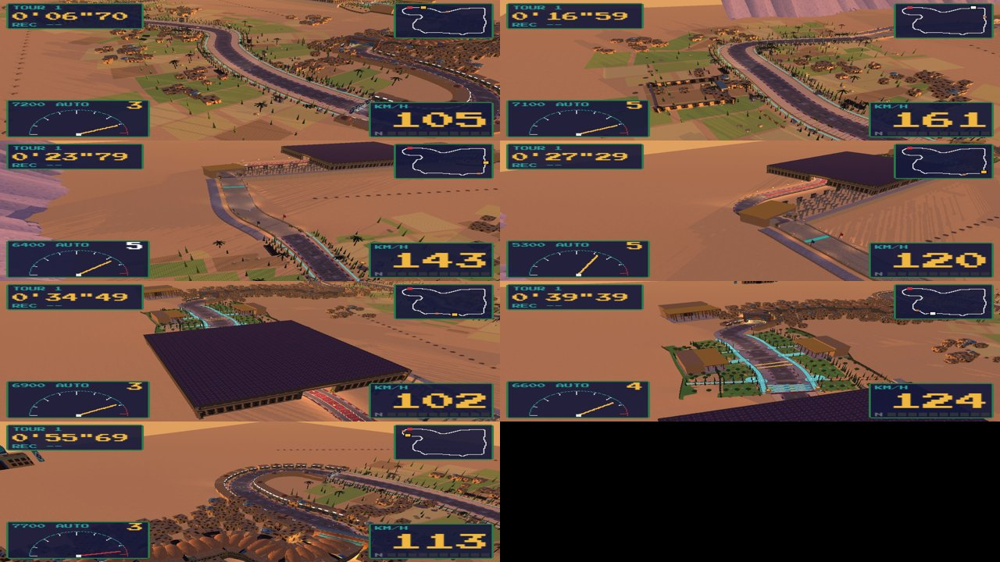
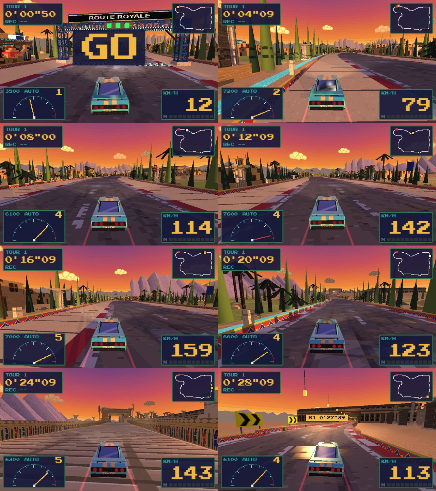
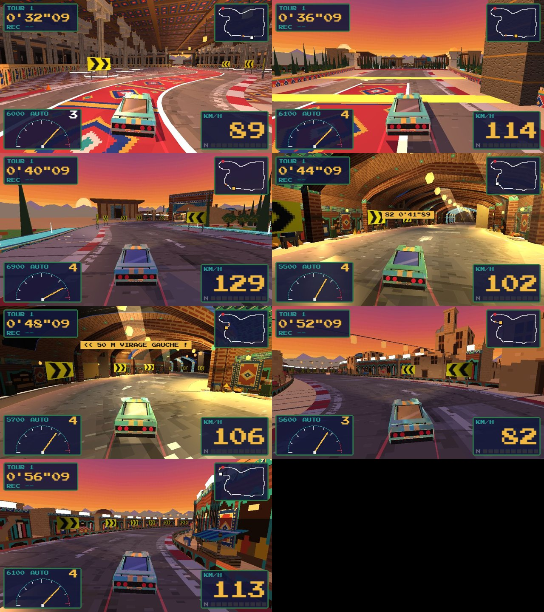
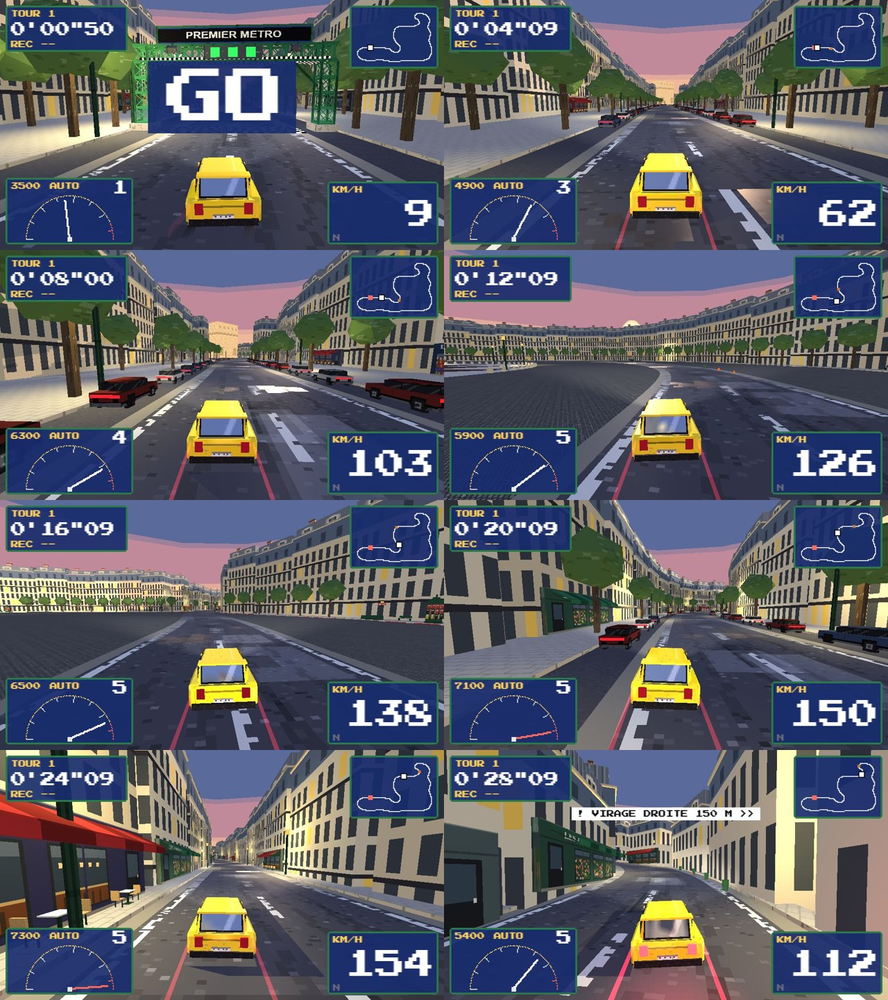
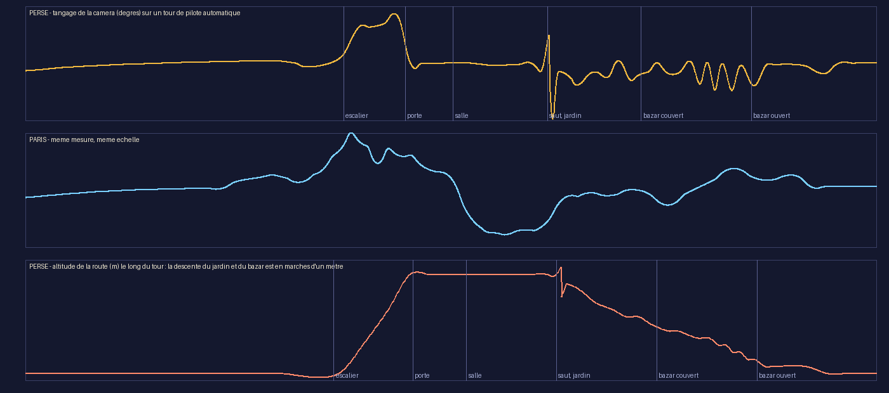

# Proposition de refonte — carte « ROUTE ROYALE » (perse)

Étape 1 : rien n'est construit. Chaque point « P-n » se valide ou se refuse seul. Les points « M-n » (fin du document) touchent du code partagé. Carte de comparaison : paris.

Base : branche `claude/refonte-perse-2c381f` (contenu du commit 23f5809), captures du moteur faites pour cette proposition (un tour à pas de 4 s de perse et de paris, un tour de perse à 10 images/s en rendu réel, huit vues aériennes), cahier `cahier-feedback/perse/CAHIER.md`.

## Ce que montrent les captures

**1. La carte est une suite de monuments posés sur du sable.** Vue d'en haut, la terrasse n'existe pas (la salle est une boîte sur une pente de sable), l'escalier est un ruban dans le vide, l'intérieur de la boucle (600 × 300 m, visible de partout) est nu. Paris n'a jamais ce problème : deux murs de façades continus bordent la route d'un bout à l'autre, et un repère ferme chaque perspective. C'est l'avis de l'auteur (« il manque du décor entre les zones ») : il manque moins des objets qu'un **terrain et un bâti continus**.



**2. Le décor actuel est une accumulation.** La plaine empile stèles, étendards, cyprès sur deux rangs, peupliers, autels, tentes, caravanes, colonnes en ruine, villages : beaucoup de choses petites et différentes, aucune grande masse. Paris fait l'inverse : quatre éléments (façade, arbre, voiture garée, devanture) répétés avec régularité.





**3. L'effet de vague a une origine mesurable : la caméra tangue dans la descente.** J'ai relevé l'inclinaison de la caméra à chaque image sur un tour (60 images/s). Dans le jardin et le bazar, elle pique et se relève de 2 à 3° toutes les demi-secondes, neuf fois de suite sous la voûte (échantillons 937 à 1028). Cause : les altitudes de la descente sont des entiers répétés (8, 7, 6, 6, 5, 5, 4, 4, 3, 3, 2, 2, 1, 1) ; la courbe qui les relie fait plat, pente, plat, pente, et la caméra suit le sol. Paris, mesuré de la même façon, n'a que des variations lentes. La voûte du bazar, dont la hauteur ondule à chaque travée, et les colonnes de lumière régulières accentuent l'effet. Les captures fixes ne pouvaient pas le montrer.



Autres suspects, non mesurables sur image mais retirés par précaution : le mirage `chaleur` (seul effet qui fait onduler l'écran) et les bandes fines de l'escalier, qui scintillent à 270 lignes.

---

## 1. Direction artistique

**P-1. Le lieu devient un site unique et cohérent : la terrasse de Persépolis, adossée à sa montagne, au-dessus de sa ville basse.** Le thème, l'époque mêlée (Persépolis restituée, jardin et bazar safavides, vus comme dans une miniature) et le nom restent. Ce qui change : tout tient sur un même terrain. À l'est et au sud, la montagne (Kuh-e Rahmat). Contre elle, la terrasse de pierre, à +14 m. Au nord, la plaine cultivée. À l'ouest, la ville de brique (le bazar), sur la pente qui redescend de la terrasse à la plaine. Au centre de la boucle, les vergers clos de la ville basse. *Justification : G4 et l'avis de l'auteur ; paris est une seule ville, pas une suite de décors.*

```
   NORD-OUEST : falaise de Naqsh-e Rostam (lointain)          NORD : champs, villages, Zagros
        ┌───────────────── plaine : route royale, d'ouest en est ─────────────────┐
 départ ●                                                                          │  virage au
        │   bazar ouvert                                                           │  pied de la
  ville │                    VERGERS CLOS DE LA VILLE BASSE                        │  montagne
   de   │   (descente)       (murs de terre, arbres, un caravansérail)             │
 brique │                                                        Apadana (ruine)   │  rampe du
        │   bazar couvert    ══════ mur nord de la terrasse, 14 m ═══════════╗     │  grand escalier
        │                                                                    ║     │  (montée)
        └─ portail ── jardin en terrasses ── salle aux cent colonnes ── Porte des Nations
                        SUD et EST : le Kuh-e Rahmat, ses deux tombeaux royaux       soleil : ouest-nord-ouest
```

**P-2. Heure et lumière : couchant d'été, soleil à l'ouest-nord-ouest, un peu plus haut.** `astre.dir` passe de `[-0.8, 0.08, 0.4]` à `[-0.8, 0.14, -0.35]`. Le soleil éclaire alors les faces nord et ouest : le mur de la terrasse et la montagne, vus depuis la plaine, sont dorés au lieu d'être à contre-jour, et les ombres sont deux fois moins longues (hauteur du soleil de paris). La rampe de l'escalier monte dans l'ombre du mur et débouche dans la lumière à la Porte. *Justification : aujourd'hui le soleil est derrière tout ce qu'on regarde depuis la plaine ; G3.*

**P-3. Une seule lumière sur tout le tour.** Même ciel, même brouillard, même couleur de soleil dehors, dans la salle et à la sortie du bazar. Aucun ciel rouge sombre. Les seules sources ajoutées sont fixes et posées sur un support : braseros sur socle de pierre (terrasse), lanternes au bout d'une chaîne (bazar). *Justification : G10, G5, G6, et paris (« lumière chaude diffuse, sans faisceaux ni lanternes en l'air »).*

**P-4. Ciel plus calme.** Quatre tons au lieu de dix : lilas `#3a3f78` en haut, mauve `#8a5a86`, saumon `#e08a62`, or pâle `#f6c98a` à l'horizon ; brouillard `#e6b07c`. Le rouge-rose saturé disparaît. Nuages en volutes gardés, moins nombreux, tous au-dessus de l'horizon ouest. *Justification : face à paris, le ciel de perse est la surface la plus saturée de l'écran et écrase le décor.*

**P-5. Palette resserrée en trois matières et deux accents.** Matières : **terre** (brique crue `#c49a5e`, chaume `#c8a860`, labour `#9a7048`) pour la plaine et la ville basse ; **pierre** (`#a88e73` au soleil, `#5f5046` à l'ombre, noir poli `#4b4540`) pour la terrasse ; **brique cuite** (`#a8643e`) pour le bazar. Verts : cyprès `#2f4a2e`, vergers `#5a7a3e`, luzerne `#8da05a`. Accents : **faïence turquoise et lapis** seulement sur les portails, les pavillons et les bassins ; **rouge garance** seulement sur les tissus du bazar (tapis pendus, auvents). Le sable orange uni disparaît. *Justification : G2, G8 ; aujourd'hui tout est orange, et le rouge est partout.*

**P-6. Abandon du « très chargé » de la spec.** La règle devient celle de paris : peu d'éléments, grands, répétés régulièrement ; un seul repère fort par vue. *Justification : 1.1 (« le début est un peu trop chargé »), G2.*

**Références réelles.**
- Terrasse, escalier, Porte, colonnes, salle, jardin, bazar : fiches de `docs/REFS-perse.md` (Livius, Wikipedia, Kaveh Farrokh, Archnet), gardées.
- Deux tombeaux royaux taillés dans le Kuh-e Rahmat, au-dessus de la terrasse, sur le modèle de ceux de Naqsh-e Rostam (attribués à Artaxerxès II et III) : [Livius, tombe d'Artaxerxès II](https://livius.org/articles/place/persepolis/persepolis-photos/persepolis-tomb-of-artaxerxes-ii), [Livius, tombe d'Artaxerxès III](https://livius.org/articles/place/persepolis/persepolis-photos/persepolis-tomb-of-artaxerxes-iii), [ISAC Chicago, The Royal Tombs](https://isac.uchicago.edu/node/2901) (résultats de recherche, pages non ouvertes).
- Apadana : 72 colonnes, salle entourée de portiques ouverts sur trois côtés, 13 colonnes encore debout au début du XXe siècle : [Wikipedia, Apadana](https://en.wikipedia.org/wiki/Apadana).
- Ruelle bordée de hauts murs (kucheh), ruelle de jardins (kucheh-bagh) : [Wikipedia, Kucheh](https://en.wikipedia.org/wiki/Kucheh) (page peu sourcée). Plaine de Chiraz « divisée en jardins séparés par des murs de terre » : [récit de voyageur cité par romeartlover.it](https://romeartlover.it/Shiraz2.html) (résultat de recherche).
- Jardin en terrasses de Chiraz (Bagh-e Takht) : [Archnet, Bagh-i Takht](https://archnet.org/sites/3911) (page non ouverte ; le jardin en gradins est un savoir général, à vérifier sur image avant de modéliser).

---

## 2. Circuit

**P-7. Le tracé en plan est gardé tel quel** (43 points, 2,4 km, 59 s au tour du pilote automatique, sens horaire). *Justification : le cahier ne contient aucun reproche de conduite ; tous les reproches portent sur le décor, les panneaux et la vague.*

**P-8. Le profil d'altitude est refait : pentes constantes, plus aucun palier dans une descente.** C'est la correction de la vague.
- Plaine (points 0 à 9) : 0 m partout. Le creux de 0,5 m au pied de l'escalier (dépassement de la courbe) disparaît.
- Rampe de l'escalier (points 9 à 12) : de 0 à 14 m à pente constante de 6 %.
- Terrasse (points 12 à 20) : 14 m, plate.
- Saut du perron à la sortie de la salle (point 20) : gardé, 2,5 m (P-11).
- Jardin et bazar (points 20 à 39) : de 11,5 m à 0 m à pente constante de 1,6 %, altitudes calculées selon la distance le long de la route, non entières.
- Retour au départ (points 39 à 42) : 0 m.
Critère de réussite : sur la mesure de tangage refaite, aucune oscillation de plus de 0,8° dans le jardin et le bazar, hors saut.

**P-9. La voûte du bazar a une hauteur constante** (clé à 11 m, naissances à 6 m). Les coupoles par travée se lisent par les arcs et la peinture de la voûte, pas par une hauteur qui ondule. *Justification : G7 ; même cadence que le tangage.*

**P-10. Le mirage `chaleur` est retiré de la carte.** *Justification : G7 ; c'est le seul effet qui déforme l'image en ondes, et il n'apporte rien à un couchant.*

**P-11. Le saut de la sortie de salle est gardé, mais c'est un perron.** La terrasse finit par un bord de pierre net, la route décolle de 2,5 m et se reçoit sur la première terrasse du jardin. Plus de bandes jaunes en travers ni de bloc brun uni : deux murs d'échiffre en grand appareil de chaque côté, deux braseros sur socle au bord. *Justification : 5.2 ; c'est le moment fort du tour.*

**P-12. Tous les panneaux à chevrons sont supprimés** (`th.chev: 0`), dehors, dans la salle et sous la voûte. Le bandeau de texte du HUD (« VIRAGE DROITE 100 M ») reste : c'est celui de toutes les cartes, paris compris, et il n'est pas dans le décor. Chaque virage est annoncé par le décor (P-33). *Justification : G1 (« enlève tous les panneaux de virage ») ; le cahier note que paris signale ses virages par ce seul bandeau.*

**P-13. Largeurs, surfaces, salle à colonnes (`place` et ses 15 piles), tunnel, voiture, rivaux : inchangés.** La bande turquoise de freinage en travers de la route, avant la Porte, est supprimée (P-28).

**Comment le tour se joue (vitesses affichées).**

| Secteur | Échantillons | Conduite | Sensation |
|---|---|---|---|
| 1. Route royale | 1179 → 340 | Départ, longs S à fond, 115 → 160 km/h. Large : on double ici. | Ouverture : la plaine, la terrasse dorée et la montagne qui grandissent droit devant. |
| 2. Virage du pied de la montagne | 340 → 430 | Long droite à 125 km/h, le seul gros freinage de la plaine. | La montagne ferme la vue ; on entre dans l'ombre du mur. |
| 3. Rampe du grand escalier | 430 → 540 | Montée droite, pavés, 145 km/h, large : deuxième zone de dépassement. | Oppression : mur de 14 m à droite, montagne à gauche, la Porte en haut dans la lumière. |
| 4. Porte et virage de la terrasse | 540 → 615 | Passage étroit entre les taureaux, puis droite à 90° à 110 km/h. | Surprise : on débouche sur la terrasse, tombeau royal en face, colonnes de l'Apadana à droite. |
| 5. Salle aux cent colonnes | 615 → 740 | Slalom libre entre les piles, 90 km/h, sol glissant. | Rythme serré, forêt de colonnes, soleil rasant entre les fûts. |
| 6. Perron et jardin | 740 → 880 | Saut, puis large gauche-droite à 115 → 130 km/h en descente. | Détente : eau, cyprès, soleil de face, portail de faïence au bout. |
| 7. Bazar couvert | 880 → 1020 | Coudes à 90° en enfilade, pavés, 100 km/h : la zone de glisse. | Oppression chaude : voûte de brique, puits de lumière réguliers. |
| 8. Bazar ouvert | 1020 → 1179 | Deux coudes, puis épingle large vers la ligne, 80 → 115 km/h. | La rue s'ouvre peu à peu sur la plaine. |

---

## 3. Décors généraux

**P-14. Le terrain est remodelé d'un seul tenant.** Plaine plate à 0 m ; terrasse à +14 m, à bords verticaux en grand appareil ; versant de la montagne qui part du bord est et sud de la terrasse ; ville de brique sur une pente régulière de +11,5 m à 0. Plus aucune pente de sable entre deux niveaux : un dénivelé est toujours un mur de soutènement ou le rocher. *Justification : vues aériennes ; 2.2, 3.2.*

**P-15. La terrasse devient une vraie plate-forme, agrandie vers le nord.** Elle couvre toute la bande sud de la carte, de la salle à la Porte, et s'avance au nord-est jusqu'au pied de la rampe (son bord nord passe de z = 372 à z ≈ 215 entre x = 560 et x = 652). Son mur nord et son mur est, hauts de 14 m, nus, en grands blocs à joints fins, se voient depuis toute la plaine. La rampe de l'escalier longe le mur est sur toute sa montée. *Justification : G9 (a), 3.2 (« pas de mur de terrasse haut à côté »), G3.*

**P-16. L'Apadana en ruine couronne l'angle nord-est de la terrasse.** Treize colonnes debout de 19 m, groupées, à chapiteaux de taureaux, sur leur soubassement à reliefs. C'est le repère de la plaine : on le voit dès le départ, il grandit pendant tout le secteur 1, comme l'arc au bout de l'avenue de paris. *Justification : G3 (« aucun repère au loin »).*

**P-17. Le Kuh-e Rahmat est une vraie montagne proche, pas une bande plate.** Versant modelé dans le terrain, calcaire clair en strates larges, 150 à 220 m de haut, qui commence à 30 m de la rampe et à 60 m derrière la salle. Deux tombeaux royaux en croix (22 m de haut) creusés dans la paroi : l'un dans l'axe de la sortie de la Porte, l'autre au-dessus de la salle. *Justification : G3, 4.2 ; sources ci-dessus.*

**P-18. L'intérieur de la boucle est rempli par la ville basse : des vergers clos.** Un damier de vergers de 40 à 60 m de côté, chacun fermé d'un mur de terre de 3 m, plantés de grenadiers et d'orangers en rangs (6 m), séparés par des ruelles. Au centre, un caravansérail carré (60 m, cour, toit plat). Tout reste bas : depuis la plaine on voit par-dessus jusqu'au mur de la terrasse ; depuis la terrasse on domine les vergers jusqu'à la plaine. *Justification : vide central visible sur six vues aériennes sur huit ; G4.*

**P-19. La plaine au nord de la route est cultivée jusqu'à l'horizon.** Champs en lanières (chaume, luzerne, labour) sur 600 m, trois villages de terre à toits plats, lignes de peupliers le long des canaux. Les tentes, les caravanes, les colonnes en ruine isolées et les autels du bord de plaine sont supprimés. *Justification : 1.1, 1.4, P-6.*

**P-20. Le lointain est fait de trois plans, différents selon la direction.** Au nord-ouest : la falaise claire de Naqsh-e Rostam (70 m, à 900 m) avec ses quatre tombeaux en croix, repère du retour vers le départ et de la sortie du bazar. Au nord et à l'ouest : deux chaînes du Zagros, l'une brune à 1,5 km, l'autre mauve à 3 km, crêtes différentes et non répétées. À l'est et au sud : le Kuh-e Rahmat (P-17). *Justification : G3 (« absent ou répétitif »).*

**P-21. L'eau a une source et un débouché.** Elle sort d'un bassin au pied de la montagne, derrière la salle, descend le jardin par son canal central, longe le bazar ouvert dans une rigole de pierre et rejoint le canal d'irrigation qui borde la route royale jusqu'aux champs. Un seul fil d'eau, continu, toujours du même côté de la route (côté intérieur de la boucle). Les bouts de canal isolés sont supprimés. *Justification : 1.2.*

**P-22. Le jardin est un jardin en trois terrasses.** Trois paliers plantés qui descendent avec la route, séparés par des murets de pierre de 1,2 m, canal central, cyprès en deux rangs, parterres creusés, un pavillon à portique au bout de chaque palier, mur d'enceinte de terre continu. Il occupe les deux côtés de la route et tout l'intérieur du virage vers le bazar. *Justification : 6.1, 6.2.*

**P-23. Le bazar est un quartier, pas un couloir.** Autour de la voûte et de la rue, une nappe de toits plats et de petites coupoles de brique, sur 80 m de chaque côté, qui descend la pente. Vue du jardin et de la plaine, la ville se lit comme une masse. Aucun dôme à bulbe. *Justification : G9 (b), 8.2, 8.3.*

---

## 4. Transitions

Règle commune : **le bord de route n'a que trois formes** (la ruelle de terre, la pierre de la terrasse, la brique du bazar), et à chaque frontière la forme suivante commence 60 à 100 m avant que la précédente finisse. Le sol, le ciel et le soleil ne changent jamais d'un coup.

**P-24. Bord de route de la plaine : la ruelle de jardins.** Des deux côtés, à 9 m de la chaussée : un mur de terre continu de 3 m à chaperon, des arbres de verger qui dépassent derrière, un rang de peupliers tous les 14 m devant. Tous les 90 m environ, le mur s'ouvre sur 30 m d'un seul côté (jamais les deux) pour montrer les champs ou la terrasse. C'est l'équivalent des façades de paris : il porte la continuité de tout le secteur 1. *Justification : 1.4, G4 ; comparaison à paris.*

**P-25. Du départ à la plaine.** Le départ est dans la ruelle de jardins, déjà commencée : portique de départ, murs de terre, peupliers, rien d'autre. Mât à bannière, maisons proches, bout de canal, bornes, cyprès serrés : supprimés. *Justification : 1.1.*

**P-26. De la plaine au virage du pied de la montagne (éch. 340).** Les murs de terre gardent leur ligne, mais leur soubassement devient de la pierre sur les 80 derniers mètres ; les peupliers laissent place à de grands platanes ; le rocher de la montagne affleure côté extérieur du virage, le mur nord de la terrasse occupe tout le côté intérieur. *Justification : 2.1.*

**P-27. Du virage à la rampe (éch. 430).** Au pied de la rampe, un parvis dallé de 40 m : le sol de terre devient dalles avant que la pente commence. Deux reliefs du lion et du taureau, de 4 m, marquent l'entrée. À droite le mur de la terrasse, à gauche le versant de la montagne, à 30 m, planté de quelques cyprès : plus de sable nu. *Justification : 2.1, 2.2, 3.1.*

**P-28. De la rampe à la Porte, puis à la terrasse (éch. 540 à 615).** La Porte est au sommet de la rampe, dans l'axe, visible pendant toute la montée. Derrière elle, le dallage de la rampe continue sans changement de teinte jusqu'à la salle : plus de tapis qui commence par un bord droit. Le virage se fait entre le soubassement à reliefs de l'Apadana (intérieur) et le pied de la montagne avec son tombeau (extérieur). *Justification : 4.2, 4.4, G4.*

**P-29. De la terrasse à la salle (éch. 615).** La salle n'a plus de façade pleine : elle s'ouvre par un portique de deux rangs de colonnes, de la même pierre que le dallage. On voit l'intérieur avant d'y entrer, et le couchant entre par les côtés. La lumière baisse progressivement sous le toit, sans noir. *Justification : 4.5, G4 (« façade noire puis salle intérieure »).*

**P-30. De la salle au jardin (éch. 740).** La salle se termine par le même portique ouvert ; depuis l'intérieur on voit déjà les cyprès et le canal. Le perron (P-11) est en pierre de la terrasse, la première terrasse du jardin est dallée de la même pierre sur 30 m, puis vient la terre claire des allées. Le canal central part du pied du perron. *Justification : 6.1.*

**P-31. Du jardin au bazar (éch. 858).** Le mur d'enceinte du jardin devient, sans s'interrompre, le mur du quartier du bazar ; les 50 derniers mètres avant le portail sont bordés d'arcades de brique basses, déjà celles du bazar. Le portail est dans l'axe de la dernière ligne droite du jardin, visible depuis le perron. *Justification : 6.1, 6.2, G4.*

**P-32. Du bazar couvert au bazar ouvert, puis au départ (éch. 1020 à 1179).** Les trois dernières travées de la voûte ont des jours de plus en plus grands ; la rue qui suit est couverte sur 40 m de toiles tendues d'une façade à l'autre, puis à ciel ouvert. Le brouillard du tunnel prend la couleur du brouillard extérieur : le ciel de sortie est le même qu'ailleurs. Les arcades s'abaissent ensuite, d'un étage puis de plain-pied, et se raccordent au mur de terre de la ruelle de jardins 60 m avant la ligne. *Justification : G10, 8.1, G4.*

---

## 5. Détails de décor

**P-33. Un repère dans l'axe à l'extérieur de chaque virage, à la place des chevrons.**
- Sortie de plaine : l'angle de la terrasse et les colonnes de l'Apadana.
- Sommet de la rampe : la Porte des Nations.
- Virage de la terrasse : le tombeau royal dans la paroi.
- Entrée de la salle : son portique.
- Virage du jardin : le pavillon du deuxième palier, puis le portail du bazar.
- Chaque coude du bazar couvert : une niche d'arcade à fond de faïence turquoise éclairée par une lanterne, face à l'arrivée.
- Épingle du retour : la porte du caravansérail, puis la falaise de Naqsh-e Rostam au loin.

**P-34. La Porte des Nations est un grand bâtiment.** Pavillon carré de 25 m de côté et 18 m de haut, murs de brique crue sur socle de pierre, corniche à gorge, toit plat. La route le traverse par deux baies de 12 m de haut. Deux taureaux ailés de 7 m à l'entrée, deux taureaux à tête humaine à la sortie, sculptés en volume contre les montants de pierre noire ; quatre colonnes de 16,5 m à l'intérieur. *Justification : 4.1 (« ça manque d'une grande porte »).*

**P-35. La rampe se lit comme un escalier.** Chaussée centrale en dalles lisses, sans bandes. De chaque côté, sur 2 m, de vraies marches basses en volume. Parapet plein côté montagne, à frise d'Immortels, couronné d'un bandeau de rosettes ; côté terrasse, le mur de 14 m. Un palier plat de 12 m à mi-hauteur, marqué par deux braseros sur socle. Pas de volée miroir (voir table, 3.2). *Justification : 3.2, G7, G9 (c).*

**P-36. La route est sobre partout.** Chaussée de pierre en deux tons proches, texture `chausseeFine` (sans plaques claires), lignes ivoire. Bordures : pierre claire et pierre sombre en alternance, au lieu du turquoise et rouge. Le tapis rouge à médaillons de la salle est supprimé : sol de dalles sombres polies, avec une allée centrale un ton plus clair entre deux filets, qui montre la ligne rapide. Les murets à motif de tapis de la plaine sont supprimés (le mur de terre les remplace). *Justification : G8, 4.4 ; paris (« route sobre, tout l'ornement sur les bords »).*

**P-37. Plus aucune lanterne ni câble en l'air.** Dehors : braseros de bronze sur socle de pierre de 1,5 m, par paires, seulement sur la terrasse (parvis, palier, Porte, perron). Dans la salle : rien de suspendu, la lumière vient des portiques. Dans le bazar ouvert : lanternes sur potence de fer fixée à la façade, une par arcade sur cinq. *Justification : G5, 4.3, 8.5.*

**P-38. Lumière du bazar couvert régulière.** Un jour au sommet de la voûte toutes les trois travées, tous identiques, chacun avec sa colonne de lumière ; une lanterne au bout d'une chaîne visible à la clé de chaque autre travée, sans cône. Sol éclairé de façon égale, sans plaques brûlées. *Justification : G6, 7.3, 7.4.*

**P-39. Le bazar couvert ne contient que ce qui tient sous une voûte.** Niches de boutiques en arc brisé des deux côtés, à hauteur et rythme constants, tapis pendus, étals bas. Aucune maison, aucun pilier dans le champ. *Justification : 7.2.*

**P-40. Le portail du bazar est un volume construit.** Grand cadre de brique de 14 m, plus haut que les toits, niche profonde en arc brisé revêtue de faïence lapis et turquoise, bandeau d'inscription, toit plat visible, deux ailes d'arcades. Aucun plan plaqué devant. *Justification : 7.1.*

**P-41. Toutes les arcades du bazar ouvert ont un étage et un toit.** Rez-de-chaussée en arcades, étage de brique à fenêtres en niche, toit plat à parapet. Façades texturées à l'échelle (pas de texture étirée), hauteurs de 7 à 10 m, sans cube plus haut que la rue. *Justification : 8.2, 8.3, 8.4.*

**P-42. Arbres : trois espèces, chacune à sa place.** Peupliers en rang le long de la route de plaine ; cyprès seulement dans le jardin et au pied de la montagne ; grenadiers et orangers dans les vergers. Hauteurs et écartements variés à l'intérieur d'un rang (±20 %). Les palmiers sont supprimés. *Justification : 1.4.*

**P-43. Budget.** Le temps d'image et le nombre de passes de dessin sont mesurés avant et après (`node outils/banc-rapide.js perse`) ; la refonte ne doit pas dépasser la carte actuelle (3,4 ms par image dans l'outil de capture). Les murs, vergers et toits sont des pièces répétées dessinées par lots.

### Hors version statique (phase « vie », plus tard)
Eau qui coule et jets des bassins, flammes des braseros, toiles et bannières qui bougent, fumée des cuisines du bazar, marchands et passants, caravane de chameaux sur la route royale, pigeons, chariots royaux en trafic, radio persane. Dans la version statique : aucun personnage ni animal, eau immobile, braseros à braise fixe.

---

## Table de couverture du cahier

| N° | Problème | Réponse |
|---|---|---|
| G1 | Panneaux de virage partout | P-12 (chevrons supprimés), P-33 (repères). Le bandeau du HUD reste, comme sur paris. |
| G2 | Densité très inégale | P-6, P-19, P-25 (départ allégé) ; P-15 à P-18, P-24, P-26, P-27 (vides remplis par de grandes masses). |
| G3 | Lointain absent ou répétitif | P-16, P-17, P-20 ; P-2 (il est éclairé). |
| G4 | Peu de continuité entre zones | P-1, P-14, P-24 à P-32. |
| G5 | Lanternes sans support | P-37, P-38. |
| G6 | Lumière du bazar incohérente | P-38, P-3. |
| G7 | Effet de vague | P-8 (cause mesurée), P-9, P-10, P-35 (bandes de l'escalier), P-41 (textures en zigzag). |
| G8 | La route sert d'ornement | P-36, P-28. |
| G9 | Écarts avec les sources | (a) P-15 ; (b) P-23 ; (c) P-35. |
| G10 | Ciel qui change de couleur | P-32, P-3. |
| 1.1 | Départ trop chargé | P-25, P-6. |
| 1.2 | Canal sans début ni fin | P-21. |
| 1.3 | Chevrons dès la plaine | P-12. |
| 1.4 | Rideau de cyprès identiques | P-24, P-42. |
| 2.1 | Zone vide avant l'escalier | P-15, P-26, P-27. |
| 2.2 | Sable à perte de vue | P-14, P-17, P-18, P-27. |
| 3.1 | Escalier vide autour | P-15 (mur), P-17 (montagne), P-34 (Porte en haut), P-35. |
| 3.2 | Ne se lit pas comme un escalier | P-35, P-15. **Volée miroir non faite** : elle devrait partir vers le nord le long du mur, là où passe la route ; une rampe de décor qui ne mène nulle part serait une incohérence de plus. Les marches, le palier et le mur font la lecture. |
| 4.1 | Pas de grande porte | P-34. |
| 4.2 | Deuxième virage sans décor | P-16, P-17, P-28. |
| 4.3 | Lumières qui volent | P-37. |
| 4.4 | Tapis qui commence net | P-36, P-28. |
| 4.5 | Façade de l'Apadana, mur à portes noires | P-29 (portique ouvert), P-16. |
| 5.1 | Panneaux dans la salle | P-12, P-36 (allée claire). |
| 5.2 | Bloc brun et bandes jaunes à la sortie | P-11. |
| 6.1 | Jardin sans lien avec le reste | P-22, P-30, P-31, P-21. |
| 6.2 | Virage avant le bazar vide | P-22, P-31. |
| 6.3 | Panneaux à cheval sur la bordure | P-12. |
| 7.1 | Portail : dalle plaquée, toit manquant | P-40. |
| 7.2 | Maisons sous la voûte | P-39. |
| 7.3 | Faisceaux une lanterne sur deux | P-38. |
| 7.4 | Lanternes flottantes | P-38. |
| 7.5 | Panneaux dans le tunnel | P-12, P-33. |
| 8.1 | Sortie de voûte : ciel rouge sombre | P-32. |
| 8.2 | Grands cubes sans toit ni détail | P-41, P-23. |
| 8.3 | Arcades sans toit | P-41. |
| 8.4 | Texture étirée et cisaillée | P-41. |
| 8.5 | Câble en travers du ciel | P-37. |

Points du `README.md` commun qui concernent perse : vague (1) → P-8 à P-10 ; continuité (2) → section 4 ; densité (3) → P-6, P-25 ; lointain (4) → P-16, P-17, P-20 ; objets flottants (5) → P-37, P-38 ; panneaux (8) → P-12 ; lumière en interrupteur (9) → P-3, P-32 ; écarts aux sources (10) → P-15, P-23, P-36.

---

## Changements de code partagé (`sim.js`, `game.js`, moteur)

**Aucun changement de `sim.js` ni du reste de `game.js` n'est demandé.** Tout se fait dans le périmètre de la carte : entrée `perse` de `cartes.js` (altitudes des `pts`, `th`), fonction `perse` de `decors.js`, `formes-perse.js`, `textures-perse.js`. Les options employées (`chev`, `routeTex`, `th.tun`, `astre`) existent déjà et valent par carte : aucun effet sur les anciennes cartes.

**M-1 (conditionnel, à valider maintenant pour ne pas y revenir).** Si, après P-8 à P-10, la mesure de tangage montre encore une oscillation dans la descente, j'ajoute dans `game.js` une option `th.camLisse` qui allonge le lissage de la hauteur de la caméra pour la carte qui la pose. Sans l'option, le calcul est inchangé : aucun effet sur les anciennes cartes, vérifié par `node test.js` et par la même mesure sur paris. Si P-8 suffit, M-1 n'est pas fait.

**Information pour les autres cartes.** La méthode de mesure du tangage est décrite dans le dossier de notes partagé (`prop-perse-effet-de-vague.md`) : la même cause (altitudes en paliers) est à vérifier sur barrage, chapada et plage.
