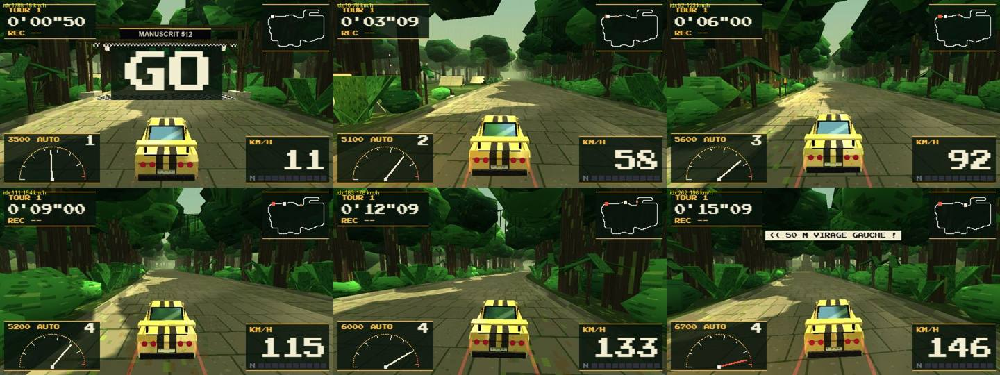
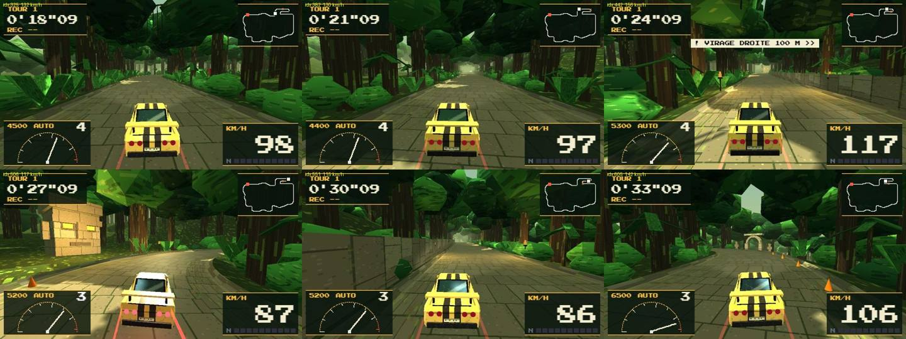
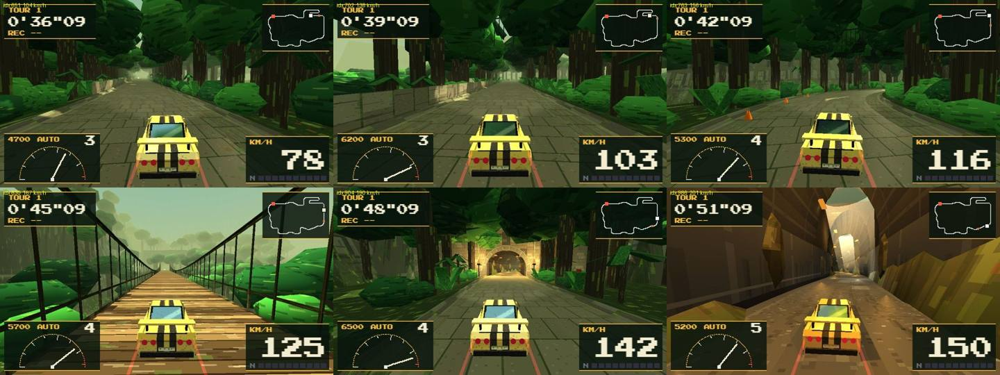
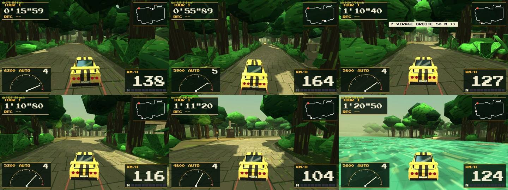
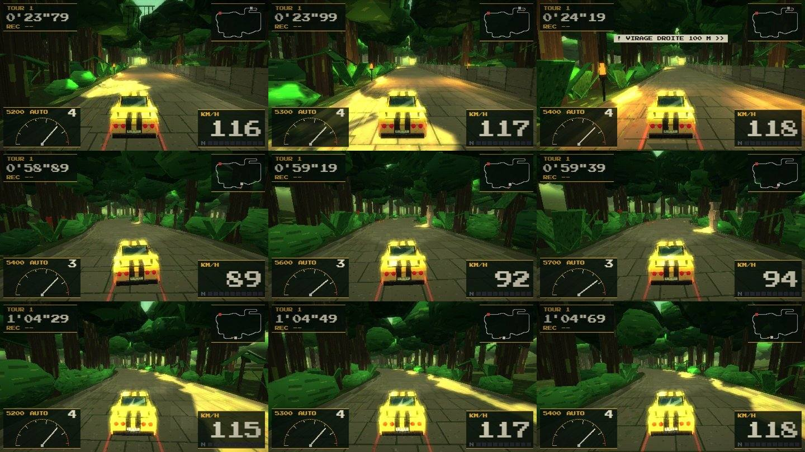
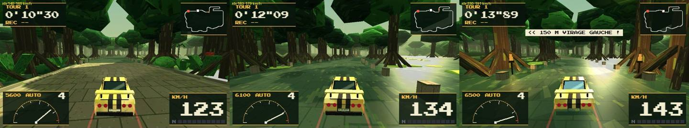
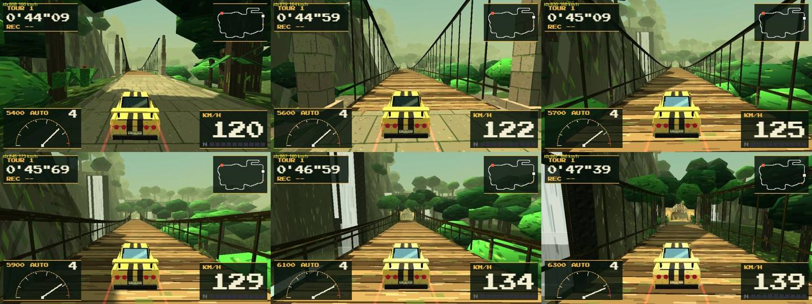
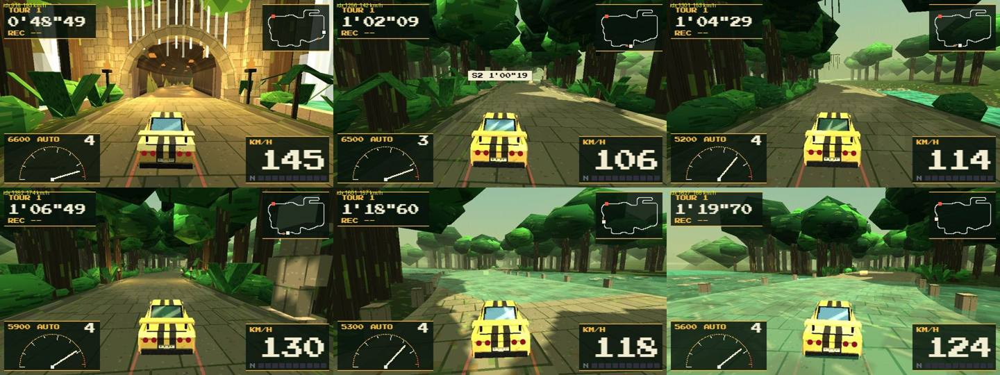

# Manuscrit 512 (`chapada`) : état de la version statique

Version jouable construite d'après [PROPOSITION-chapada.md](PROPOSITION-chapada.md). Pour la voir : `python outils/capture.py 8103`, puis `http://127.0.0.1:8103/index.html?carte=chapada`.

Rendu réel du jeu (270 lignes), trois suites de trois images à 8 m d'écart :

## Deuxième passe : l'eau au centre (retour de l'auteur)

Demande : remettre la cascade et l'eau, retrouver le marais tropical de l'ancienne version, rendre lisible le passage dans l'eau, et casser la répétition des zones de forêt. Le tracé en plan ne change pas.

- **Z2 devient le marais tropical** (à la place de la piste sous la canopée) : la plaine entre le camp et la chicane est inondée, la chaussée de pierre passe au ras de l'eau, les arbres ont les pieds dans l'eau sur des racines-échasses, nénuphars géants. Du point 2 au point 3, la chaussée est sous 20 cm d'eau, entre deux rangées de bornes (surface mouillée dans la physique).
- **Le bas de la descente devient la descente des cascades** : la rivière a été déviée pour longer la route sur 250 m, à droite, vue dégagée ; elle y tombe par trois ressauts.
- **La grande chute fait face au pont.** Elle tombe du plateau juste à gauche du temple, à 70 m : on la voit grossir pendant toute la traversée. Son bassin alimente la rivière qui passe sous le pont.
- **La grotte s'ouvre derrière un rideau d'eau** : deux nappes tombent de part et d'autre du portail dans deux bassins, des filets pendent du linteau au-dessus des voitures. Rien n'est posé sur la chaussée.
- **Le gué se lit** : eau transparente sur les dalles de la chaussée, bornes de pierre des deux côtés.

Restent en forêt fermée : les lacets et le haut de la descente (les idoles).

Après cette passe : rupteur 20 % et 4 %, tour 78,9 s sans contact, tests verts, 246 à 254 passes de dessin. Temps d'image sur machine chargée à 47 % : 2,3 à 2,6 ms (touge 1,9 à 2,4 ms), donc au-dessus des 2 ms dans cette mesure ; à refaire sur une machine au repos. Le lancer de rayons sur la chaussée n'a pas été refait après cette passe.

Reste à faire dans ce thème : les chutes sont des rubans blancs à bords droits (pas d'animation, pas d'embruns) ; les ressauts de la descente se lisent comme une rivière plus que comme des cascades ; le reflet blanc du soleil sur l'eau du marais est fort par endroits.

## Mesures

| Contrôle | Résultat | Cible |
|---|---|---|
| Temps à plus de 85 % du rupteur (`node outils/regime.js chapada touge`) | 20 % (touge 18 %) | moins de 25 % |
| À plus de 92 % | 4 % (touge 3 %) | moins de 6 % |
| Temps sur le dernier rapport | 23 % (touge 25 %) | moins de 30 % |
| Tour du pilote automatique | 78,9 s, 161 km/h de moyenne, de 89 à 225 km/h, aucun contact | 78 à 85 s |
| `node test.js`, `node test-cartes.js` | verts (trace or refaite : 65,7 s, seuil 75,4 s) | verts |
| Passes de dessin (`PORT=8103 node outils/banc-rapide.js chapada touge`) | 236 à 248 (touge 231 à 249) | 300 au plus |
| Temps d'image, machine chargée à 37-48 % | 1,85 ms puis 2,73 ms (touge 1,64 puis 2,34 ms) : verdict « instable » pour les deux cartes | 2 ms |
| Rien sur la chaussée (897 rayons verticaux, tous les 12 m, trois par profil) | 15 touches : l'eau du gué, voulue (10 à 20 cm). 1 : la colonne de lumière de la grotte (moteur). Planches du pont à 6 cm. | aucune surface de décor |
| Erreurs console sur un tour capturé | aucune | aucune |

Non mesuré : un tour joué à la main, l'écran partagé, le son (zones `amb`), une machine au repos pour le temps d'image.

## Ce qui est fait, par point de la proposition

- **Direction** (A-1 à A-9) : nom, palette, brume `[18, 190]`, lumière chaude, voiture jaune, HUD, ligne `PAL`.
- **Circuit** (C-1 à C-9) : tracé refait, boîte longue, largeurs, surfaces, un saut, trace or.
- **Décors généraux** (D-1 à D-11) : la vallée, la rivière (chute, gorge, cinq biefs et leurs ressauts, gué, sortie), le tunnel fermé, la forêt en trois épaisseurs, un seul sol, la falaise du plateau, une seule architecture.
- **Détails** (O-1 à O-18) : voie dallée propre à la carte, bordure et talus, sous-bois, lianes, cinq repères dans l'axe d'un freinage (fromager, tête colossale, porte ruinée, grande idole, statue qui montre le nord), camp, pont de lianes, chute, façades du temple, statues de la descente, arc triple, place, colonnades, édifice, gué.
- **Code partagé** : M-1 seulement (`th.depart[3]` dans `game.js` : nom de la forme du portique ; sans lui, rien ne change pour les autres cartes).

## Écarts avec la proposition

1. **Le saut (C-6) est dans la descente, pas à la sortie du temple.** À la sortie du temple, le pilote automatique touchait le mur à chaque réception (le freinage de l'équerre arrive trop tôt). Il est 280 m avant l'arc triple, entre des degrés de pierre écroulés et deux obélisques.
2. **Les virages serrés font 20 à 22 m de rayon au lieu de 18 à 19 m.** Le test des cartes exige qu'une glisse à 120 km/h passe le virage le plus serré avec la demi-largeur `W` (4,5 m, celle du pont).
3. **Soleil à 55° au lieu de 38° (A-3).** À 38°, les arbres de 26 m mettaient toute la route à l'ombre : plus de taches de soleil.
4. **`bloom` à 0,13 au lieu de 0,18 (A-4).** À 0,18, les taches de soleil brûlaient au rendu du jeu.
5. **Le ciel se voit aussi par des trouées ailleurs que dans les cinq lieux prévus (D-5).** Sans trouées dans la rangée d'arbres, pas de soleil sur la route. Les trouées font 12 % de la rangée.

## Non fait

- **Le ruisseau des lacets et son ponceau (D-2, O-11).** À la seconde épingle, le repère est une porte ruinée entre deux statues.
- **Le bassin bleu de la grotte (O-14).** Le tunnel du moteur a des parois à la limite roulable : un bassin ne peut être que sur la partie roulable. La grotte a ses deux puits de lumière, des côtes de roche et des teintes sombres.
- **Les luminaires du tunnel** restent les rectangles lumineux du moteur, en orangé. Les remplacer demande de toucher au code partagé du tunnel.
- **Les cônes orange du moteur** à l'entrée des virages (objets à renverser, communs à toutes les cartes) sont toujours là.
- **Le reflet sur l'eau (M-2)** : pas fait. L'eau est claire et lisible sans lui ; son reflet est peint dans la texture.
- **Les trois flèches de bois (O-5), les marches de la place vers la rivière (T-7), l'embaúba et les arbres émergents (O-6).**
- **`docs/SPEC-CHAPADA.md`** décrit l'ancienne carte ; une note en tête renvoie à la proposition.

## À regarder en jouant

- La course simulée du test donne 27 contacts entre voitures sur trois tours (3 contre les murs) : le pont de 9 m et la chicane serrent le peloton.
- Les repères dans l'axe se lisent à 60-80 m ; plus loin la brume les mange.
- La « vague » : sur les suites d'images, plus aucune crête ni bande ne monte et descend. À confirmer manette en main.
