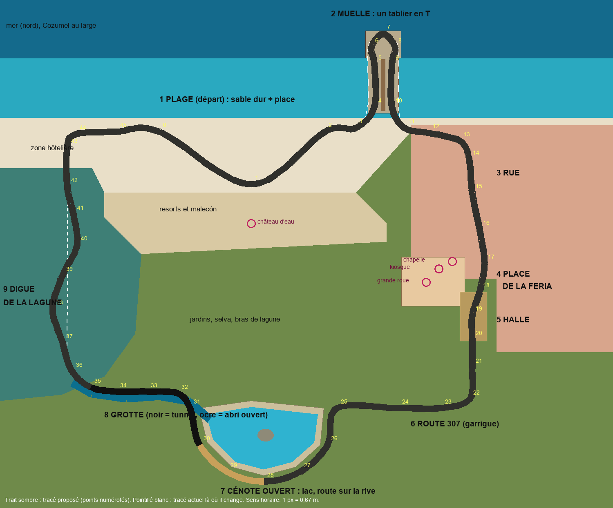
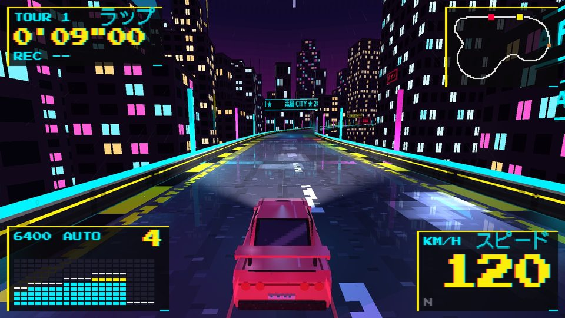
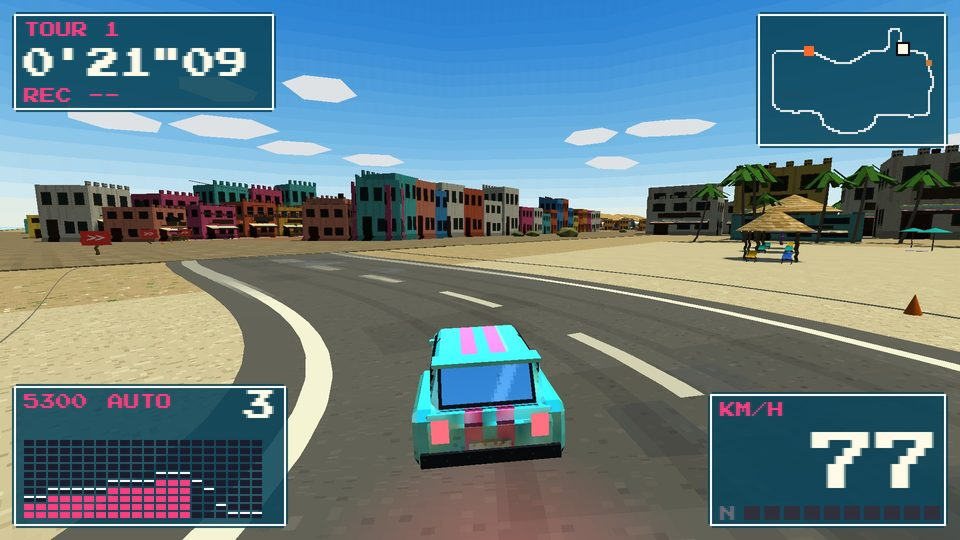
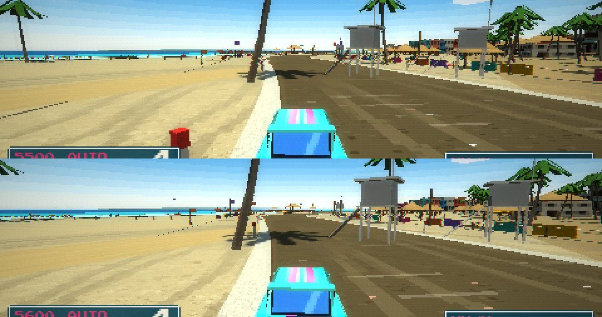
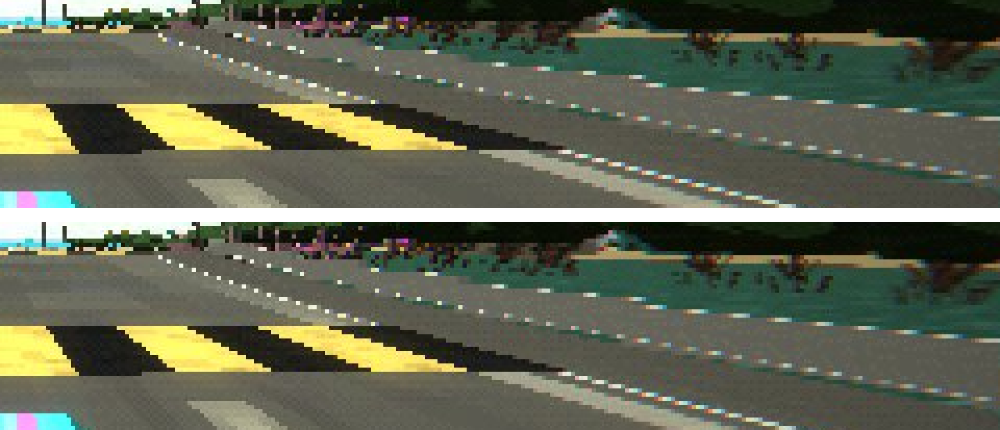
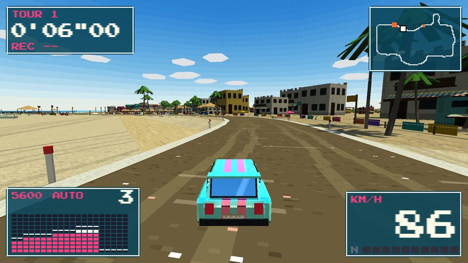
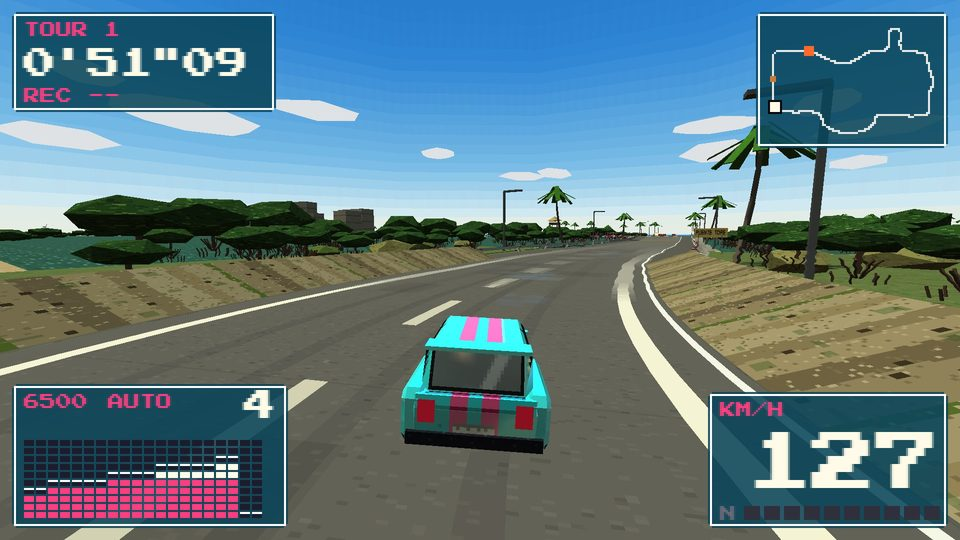
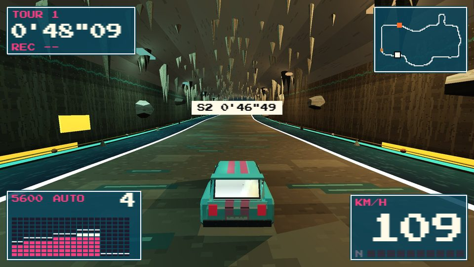
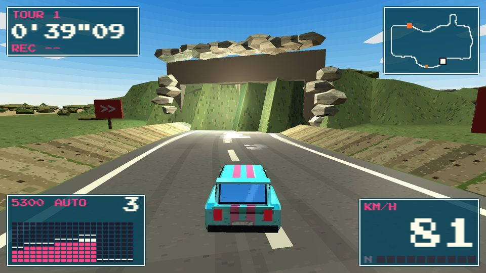

# Proposition de refonte : Playa 307 (carte `plage`)

Étape 1 : rien n'est construit. Chaque point numéroté (DA-, C-, D-, T-, X-, M-) peut être accepté ou refusé seul. La cible est une version **statique** ; ce qui relève d'une phase « vie » est listé à part (V-).

Carte de comparaison : `ville`. Branche : `claude/refonte-plage-943d58`. Captures faites pour cette proposition : un tour de `plage` et un tour de `ville` à pas de 3 s en 1920 × 1080 avec le rendu du jeu à côté, plus des suites d'images consécutives du rendu du jeu, avec et sans `chaleur`.

## Ce que j'ai constaté

**Pourquoi `ville` se lit comme un lieu et `plage` comme une piste décorée.**

1. Dans `ville`, la route a **un bord continu et le même tout le tour** (rail lumineux), et le décor commence au ras de ce bord. Sur `plage`, le bord change de nature sept fois (piquets, corde, garde-corps, rien, glissière…) et le décor commence souvent à 10 ou 30 m.
2. Dans `ville`, le point de fuite est **toujours fermé par quelque chose du même lieu** (une tour, un portique, une enseigne). Sur `plage`, il s'ouvre sur du sable nu, du bitume nu ou un mur de façades sans rapport avec ce qu'on quitte.
3. `ville` tient avec **trois couleurs d'accent** (cyan, magenta, jaune) répétées partout, tunnel compris. `plage` change de famille de couleurs à chaque zone.
4. `ville` n'a qu'un revêtement. `plage` en a six, sans seuil entre eux.

*`plage`, sortie du muelle (idx 356) : bitume nu, sable nu, puis un mur de façades.*

**L'origine de « l'effet de vague ».** Trois sources mesurées, aucune seule n'explique tout ; les trois sont retirées (DA-9, DA-10, M-3).

1. **Des sinusoïdes dessinées dans les textures des grandes surfaces.** `textures-plage.js` trace ses rides de sable, ses ornières de piste, ses parois et ses reflets avec `Math.sin` (lignes 8, 14, 126, 144, 146, 170). Répétées sur des centaines de mètres, elles font de longues bandes ondulées qui glissent sous la voiture. C'est la source la plus visible en mouvement, et la seule commune aux trois autres cartes (strates qui ondulent, bandes, zigzags).

   
   *Deux images consécutives du rendu du jeu sur la plage (idx 108 et 110) : les bandes claires et sombres du sable et de la piste.*

2. **Le mirage `chaleur: 0.35`.** En comparant la même image avec et sans l'option (les captures sont identiques ailleurs), il déplace les lignes de l'écran dans une bande de 17 % de la hauteur sous l'horizon et sur 90 % de la largeur : pas seulement la route, mais les poteaux, la mangrove, l'eau. L'écart est faible sur une image (4 niveaux de gris en moyenne) mais change à chaque image.

   
   *Même image (idx 1103), en haut avec `chaleur`, en bas sans : rail et mangrove bavent d'une ligne sur l'autre.*

3. **Le ciel en éventail.** Le dégradé du ciel a cinq paliers serrés entre 44 % et 50 % de la hauteur, posés sur une sphère à 16 facettes : près de l'horizon, les paliers se cassent en éventail (visible sur toutes les vues de plage et de lagune).

---

## 1. Direction artistique

**DA-1 · Le lieu : un seul bourg, le jour de sa fête.** Playa 307 est une petite station balnéaire inventée de la Riviera Maya, entre Playa del Carmen et Tulum, le 16 juillet à midi, **jour de la Feria del Carmen** (fête patronale réelle de Playa del Carmen : manèges, scène sur la place, procession de la Vierge en mer sur des barques décorées). Tout ce que la route traverse appartient à ce bourg, dans l'ordre où un habitant le décrirait : la plage des hôtels, le muelle, la rue piétonne, la place de la feria, la halle, la sortie du bourg par la route 307, le cénote où le village se baigne, la lagune derrière la zone hôtelière. *Justification : G1 et G3 demandent un lieu qui se prolonge et une fête qui ne s'arrête pas à la rue.*

**DA-2 · Époque : aujourd'hui, rien de maya.** Inchangé (ni pyramide, ni glyphe, ni ruine). *Justification : thème validé par l'auteur dans `SPEC-PLAGE.md`.*

**DA-3 · Heure : midi gardé (11:45), soleil tourné côté terre.** Le soleil reste haut (60° environ) mais passe côté terre (`astre.dir` vers `[-0.25, 0.85, 0.45]`) : les ombres des cocotiers, des palapas et des façades tombent vers la mer, donc **sur la piste**, et rythment le sol. *Justification : le soleil de midi est celui qui entre dans les cénotes (REFS §6) ; c'est aussi la seule carte de midi de la Tournée.*

**DA-4 · Une seule lumière, trois degrés d'ombre, jamais d'interrupteur.** Soleil blanc chaud partout. On ne passe jamais du plein soleil à la pénombre sans au moins 60 m d'**ombre ajourée**, faite par de vraies ombres portées de toits : palapas, papel picado, toit à claire-voie de la halle, abri sous roche. Les trois degrés : plein soleil (plage, muelle, 307, digue), ombre ajourée (rue, place, halle, rive du cénote, abri), pénombre (salle de la grotte). `hemi` remonte de 0,5 à 0,6 pour que l'ombre reste colorée. *Justification : G7, Z7-5, et `ville`, où le tunnel reste dans la famille de la rue.*

**DA-5 · Palette : base claire, trois accents répétés partout.** Base de la fiche mesurée (`REFS-plage.md`) : sable `#E9DFC8`, crème `#EFE3C8`, ocre `#E8B84A`, terre cuite `#E2744F`, verts `#66763F` et `#2F5A34`, turquoises `#4FCBC3` et `#2FB3D0`. Trois accents, ceux des banderoles de la feria, présents dans **chaque** zone : rose bougainvillier `#E8468C`, turquoise `#1FB5A8`, jaune `#F2C230`. Supprimés : les gris neutres des blocs du fond, les façades brun sombre et bleu-vert foncé, le blanc pur. *Justification : G6, Z3-1, et les trois accents de `ville`.*

**DA-6 · Ambiance : une fête de jour, visible à chaque secteur.** En statique, la fête se lit par des objets : banderoles triangulaires sur fils, papel picado, piñatas, ballons, scène et enceintes, manèges à l'arrêt, étals à parasol, barques pavoisées, véhicules garés, peintures murales « FERIA DEL CARMEN ». La dose par secteur est fixée en X-5. *Justification : G3.*

**DA-7 · Architecture de la plage : des resorts de Playa del Carmen.** Volumes bas et étalés (1 à 3 niveaux, 4 à 11 m), crépi crème, ocre ou turquoise, grands toits de palmes à quatre pans, terrasses ouvertes sur poteaux de bois, balcons à garde-corps de bois, piscine turquoise et jardin de palmiers devant, muret bas côté plage. Aucun créneau, aucune façade plane sans débord de toit. *Justification : Z1-2 (« des resorts de Playa del Carmen »). Sources : Mahekal (bungalows de crépi à toit de palmes), The Reef Playacar (murs blancs, toits de palmes).*

*Aujourd'hui : les blocs crénelés le long de la plage (idx 49).*

**DA-8 · Architecture du bourg : la Quinta Avenida.** 1 à 2 niveaux (4 à 8 m), toit plat à acrotère simple, un mur par couleur franche (saumon `#D8715F`, jaune `#E8B84A`, bleu `#3C8DAD`, terre cuite `#E2744F`), rez-de-chaussée ouvert en boutique sous auvent bleu marine ou rayé, terrasses à toit de palmes en avancée, enseignes plates en drapeau, lampadaires noirs de 5 m, grands arbres en fosse. Les créneaux disparaissent. *Justification : G6, Z3-1 ; REFS §3.*

**DA-9 · Ciel et air : `chaleur` à 0, ciel sans éventail.** `chaleur: 0` (le mirage est retiré de la carte). Le dégradé du ciel passe à quatre paliers espacés d'au moins 8 % de la hauteur ; l'horizon est fermé par une rangée de cumulus côté terre et par la brume de mer côté large. *Justification : G4 (sources 2 et 3 de la vague).*

**DA-10 · Règle de texture : plus aucune bande ondulée.** Aucune texture de grande surface ne contient de ligne sinusoïdale ni de rayure périodique dans le sens de la marche. Sable, piste, bitume, roche et eau prennent un grain non directionnel, plus des accidents locaux posés par le décor (traces de pneus, flaques, algues, taches d'ombre). Les planches du muelle gardent leurs joints, mais de largeurs et de teintes inégales. *Justification : G4 (source 1) et G8.*

**Références réelles.** Plage, muelle, Quinta, marché, 307, cénotes souterrains, lagune : fiches de `docs/REFS-plage.md` (sources Commons citées là). Ajouts de cette proposition, listés en fin de document : Feria del Carmen ; cénotes ouverts de la 307 (Azul, Cristalino, Jardín del Edén) ; Casa Cenote (cénote qui débouche dans la mangrove) ; Dos Ojos (bassin au jour et salle sombre du même cénote) ; resorts à toit de palmes.

---

## 2. Circuit

**C-1 · Tracé modifié, pas refait.** Même boucle, même sens (horaire), même ordre des lieux, même longueur à 30 m près (2,6 km), mêmes 46 points : les indices de `tun`, `surf`, `sect` restent lisibles. Cinq endroits changent (C-2 à C-6). *Justification : l'auteur juge la carte « assez bien » ; ses reproches de tracé visent le muelle, l'absence de cénote et la dernière ligne droite.*

| # | Secteur | Points | Longueur | Tracé |
|---|---|---|---|---|
| 1 | Plage et sa place de sable | 43 → 2 | 520 m | gardé |
| 2 | Muelle | 3 → 11 | 330 m | **modifié** (C-2) |
| 3 | Rue | 12 → 17 | 250 m | gardé |
| 4 | Place de la feria | 17 → 18 | 50 m | gardé (décor nouveau) |
| 5 | Halle | 18 → 20 | 80 m | gardé |
| 6 | Route 307 | 21 → 25 | 320 m | gardé en plan, **relief ajouté** (C-3) |
| 7 | Cénote ouvert | 25 → 28 | 200 m | **nouveau secteur** sur le même arc (C-4) |
| 8 | Grotte : abri puis salle | 28 → 35 | 410 m | **modifié** : tunnel raccourci (C-5) |
| 9 | Digue de la lagune | 36 → 42 | 380 m | **modifié** : S et dos d'âne (C-6) |
| 1 bis | Retour à la plage | 43 → 45 | 90 m | gardé |

**C-2 · Muelle : un seul tablier en T, construit pour la route.** Les deux voies se rapprochent (axes à 28 m au lieu de 50 : points 4-5 en x = 501, points 9-10 en x = 529) et roulent sur **un seul tablier de 46 m de large** ; entre elles, une allée centrale de 12 m. Au bout, le tablier s'élargit en tête de T (60 × 50 m) et l'épingle tourne autour de la palapa-bar ronde (rayon 20 m, comme aujourd'hui). Le tablier est à 2,5 m au-dessus de l'eau : rampe de bois montante à l'entrée (point 3), descendante à la sortie (point 11). *Justification : Z2-1 (« une piste, puis un truc au milieu ») : le bar devient le centre du demi-tour, l'allée centrale le milieu du ponton ; Z2-2 pour la hauteur du tablier.*

**C-3 · Route 307 : une crête avant le cénote.** Les points 23, 24 et 25 montent à +1, +3 et +2 m. On franchit la crête au point 24, la route tourne à gauche au point 25 et plonge. *Justification : Z5-1 (« plate ») ; la crête cache le cénote jusqu'au dernier moment.*

**C-4 · Cénote ouvert : la route descend sur la rive du lac.** À partir du point 25, une rampe taillée dans le calcaire descend de +2 m jusqu'à −6 m au point 27. Du point 26 au point 28, la route suit la rive sud-est d'un lac turquoise à ciel ouvert, en long virage à droite de 110 m de rayon : **l'eau est à 3 m de la roue droite, 50 cm sous la route**, la falaise de 7 m à gauche. L'eau ne se roule pas : la rive est fermée par une bordure de roche de 40 cm et une corde à flotteurs. *Justification : G2 et Z6-1, le cœur de la carte selon l'auteur.*

**C-5 · Grotte : 120 m d'abri sous roche, puis une salle plus courte.** Le tunnel du moteur passe de `tun: [26, 35]` (490 m) à `tun: [30, 35]` (290 m). Avant lui, des points 28 à 30, la falaise surplombe la route : toit de roche posé par le décor, ouvert côté lac par quatre piliers. Dans la salle, la route traverse le bras souterrain du lac par un **gué** de 40 m sous le grand puits de lumière (points 32-33, zone `mouille` 0,6 déjà en place) ; `corde: [30, 33]`. *Justification : Z7-4 (pas de point d'eau), Z7-1 (tube uniforme), G7 (entrée en interrupteur).*

**C-6 · Digue de la lagune : un S et un pont en dos d'âne.** La ligne droite de 366 m devient un S de 24 m d'amplitude (points 37 à 41 : x = −8, −24, −8, +16, +10 ; rayons de 65 à 100 m), avec le pont en dos d'âne sur le chenal au point 40 (`sauts` gardé, 1,5 m de relief). C'est le tracé essayé en série 3 (commit d6f11f4), élargi. *Justification : Z8-1 (« dernière ligne droite pas aimée », aucun événement à 190 km/h).*

*Aujourd'hui : la chaussée de la lagune, l'eau loin de la route (idx 1029).*

**C-7 · Plage : la piste et la place gardées, les obstacles regroupés.** La bande de sable roulable de 40 m, la place de sable (rayon 72 m) et la coupe par le sable mou restent. Les 27 obstacles semés deviennent **quatre groupes** qu'on contourne (D-3) ; aucun obstacle entre idx 1250 et idx 80 (grille et 160 premiers mètres). *Justification : la plage large est une demande de l'auteur ; Z1-1 et Z1-3 reprochent les objets semés, pas la largeur.*

**C-8 · Réglages de conduite inchangés.** `W`, `vit`, `grip`, voiture, radios, rivaux : inchangés. `sect`, `amb`, `chaud` et la trace or sont recalés à la construction. *Justification : aucun reproche du cahier sur la conduite.*

**Comment il se joue et se ressent.**

| Secteur | Vitesse | Conduite | Ressenti |
|---|---|---|---|
| Plage | 0 → 160 km/h | à fond ; choix : faire le tour de la place sur le sable dur ou couper dans le sable mou entre les groupes | ouverture maximale, mer à gauche, front d'hôtels à droite |
| Muelle | 90 km/h | **freinage 1**, épingle autour du bar, relance | au-dessus de l'eau, on voit le bourg entier en revenant |
| Rue | 100 → 170 km/h | deux courbes rapides entre les façades, frôlements | couloir d'ombre ajourée, papel picado au-dessus |
| Place et halle | 190 km/h | à fond, dépassement à l'aspiration | la place s'ouvre à droite (grande roue), puis l'ombre de la halle |
| Route 307 | 125 → 160 km/h | **freinage 2** au bout de la halle, topes, crête | plein soleil, mur de selva, calme avant la surprise |
| Cénote ouvert | 115 km/h | **freinage 3** en haut de la rampe, long droit en appui | **moment fort** : on bascule et le lac turquoise apparaît en contrebas |
| Abri et salle | 110 → 185 km/h | appui continu, gué sous le puits, frôler la paroi remplit la nitro | l'ombre gagne peu à peu, puis la salle et son rayon sur l'eau |
| Digue | 180 → 200 km/h | S à peine levé, envol au dos d'âne, dépassements | sortie au jour, eau des deux côtés, la grande roue en face |
| Retour | 125 km/h | **freinage 4**, virage à droite vers la plage | entre deux hôtels, puis toute la plage d'un coup |

---

## 3. Décors généraux

**D-1 · Quatre repères communs au centre de la boucle.** Posés à l'intérieur du tracé, ils se voient depuis chaque secteur, chaque fois sous un autre angle : la **grande roue** de la feria (24 m, en (585, 246)), le **clocher** blanc de la chapelle de la place (14 m), le **château d'eau** peint « PLAYA 307 » derrière les hôtels (18 m, en (300, 150)), une antenne rouge et blanche (30 m). Depuis la plage, ils dépassent des toits de palmes ; depuis le muelle, ils font la silhouette du bourg ; depuis la 307, on les a dans le dos puis à droite ; depuis la digue, on les voit de l'autre côté de l'eau. *Justification : G1 ; c'est ce qui ferme le point de fuite dans `ville`.*

**D-2 · La mer.** Trois bandes parallèles à la plage, sans rayure : vert d'eau `#9FE3D2` sur 15 m, turquoise `#4FCBC3`, bleu profond `#146A8C` au large. Ligne d'écume irrégulière, sable mouillé `#9C8A6A` sur 2 m, laisse de sargasses brun-noir en paquets inégaux. Au large : Cozumel en silhouette, le ferry, une file de barques pavoisées (la procession). *Justification : Z1-4.*

**D-3 · La plage : quatre bandes d'usage et quatre groupes.** De la mer vers la terre : laisse de mer ; **piste de sable dur** ; rangées régulières de palapas et de transats devant chaque hôtel ; **malecón** (promenade dallée à muret bas, cocotiers plantés tous les 12 m, lampadaires), qui suit la courbe de la piste autour de la place ; front continu de trois resorts (DA-7). Dans la place de sable, quatre groupes au lieu d'un semis : le terrain de beach-volley, l'embarcadère des lanchas (six barques pavoisées, tirées sur le sable côté mer), un bosquet de cocotiers, la tour de sauvetage avec son drapeau (une seule, au bord de la mer). *Justification : Z1-1, Z1-2, Z1-3.*

**D-4 · Le muelle.** Un tablier de planches sur pilotis ronds gris-vert à base noire, 2,5 m au-dessus d'une eau claire où l'on voit l'ombre du tablier. Allée centrale : lampadaires, bancs, mâts de banderoles, kiosque du ferry, panneau « MUELLE 307 ». Tête de T : palapa-bar ronde au centre de l'épingle, terrasse, mât à pavillons, barques amarrées en contrebas. Garde-corps de bois continu sur tout le pourtour, sans rupture. *Justification : Z2-1, Z2-2.*

**D-5 · Le bourg : rue, place, halle d'un seul tenant.** Deux rangs de façades de chaque côté de la rue (premier rang au ras de la chaussée, second rang plus haut de 2 à 3 m derrière), sans trou, du pied du muelle jusqu'à la halle. La **place de la feria** (100 × 80 m) s'ouvre à droite de la route entre la rue et la halle : kiosque à musique, chapelle blanche, scène, grande roue et deux manèges derrière, arbres. Côté route, elle est bordée d'une file continue d'étals à bâche. La **halle** est adossée au sud de la place : toit large et bas à deux pans (faîtage à 9 m, rives à 4,5 m), palmes sur charpente de bois, ouverte sur ses quatre côtés. *Justification : J2, J3, Z4-1.*

**D-6 · La route 307 : un mur de selva et des arbres qui dépassent.** Mur continu de selva basse de 4 à 8 m au ras de l'accotement, des deux côtés, percé de clairières (une maison, un enclos de murets). **Derrière, à 30-80 m, des grands arbres qui dépassent** : ceibas et chicozapotes de 14 à 18 m, flamboyants en fleur rouge-orangé (ils fleurissent en juillet). Poteaux électriques de béton et leurs fils d'un seul côté, tout du long. *Justification : Z5-1, Z5-2, Z8-2 (« plus grands arbres plus loin »).*

**D-7 · Le cénote ouvert.** Un cirque d'effondrement de 190 × 110 m, falaises de calcaire clair de 6 à 8 m, en surplomb par endroits, d'où pendent racines et lianes. **Le lac remplit tout le fond**, à −6,5 m ; il est turquoise `#2FB3D0` au soleil, vert `#3FA593` sur les hauts-fonds de la rive, bleu-noir `#0B3F63` sous les surplombs. Au milieu, un îlot de blocs tombés portant un arbre. Sur la rive nord, face à la route : escalier de bois, plongeoir, palapas du balneario en haut de la falaise. **On voit l'eau** : d'en haut dès la crête de la rampe (idx 690 environ), puis sur toute la rive pendant 200 m, puis encore à droite entre les piliers de l'abri. *Justification : G2, Z6-1. Sources : cénotes ouverts de la 307 (Azul : à ciel ouvert, hauts-fonds, 5 m de profondeur ; Cristalino : en forme de C ; Jardín del Edén : roche moussue).*

**D-8 · La grotte : le même lac, sous la roche.** Abri (points 28 à 30) : toit de roche à 8 m, quatre gros piliers dans l'eau côté lac, entre lesquels on voit le cirque au soleil. Salle (points 30 à 35) : 24 m de large, voûte de 9 à 18 m, le **bras souterrain du lac** longe la route à droite, la traverse au gué, puis la suit à gauche jusqu'à la sortie. Un seul grand puits de lumière au-dessus du gué (ellipse cyan sur l'eau, faisceau de racines), deux petits plus loin. *Justification : Z7-1, Z7-3, Z7-4 ; REFS §6 (« un rayon principal par salle »). Source du bassin au jour et de la salle sombre reliés : Dos Ojos.*

*Aujourd'hui : la grotte, un tube marqué comme une route, sans eau (idx 955).*

**D-9 · La lagune : l'eau au pied de la route, des deux côtés.** Digue basse (1 m au-dessus de l'eau), enrochement de 2 m puis l'eau. À l'ouest, la grande lagune jusqu'à un mur de mangrove à 300 m ; à l'est, un bras de 100 à 150 m, puis les jardins des hôtels. Eau vert-gris `#3E7F76` au large, vert clair `#8FCBB8` sur les bords où l'on voit le fond. Palétuviers en massifs de 4 à 8 m au ras de l'enrochement, alternant avec des fenêtres ouvertes de 40 m ; flamants en deux groupes à 25 m de la route. Le chenal sous le pont est **la résurgence du cénote** : son eau turquoise se mêle au vert de la lagune sur 60 m. *Justification : Z8-1 (« l'eau est loin et ne sert à rien »), Z8-2, Z8-3. Source : Casa Cenote, cénote qui débouche dans la mangrove.*

**D-10 · L'horizon et le lointain.** Côté mer : Cozumel et la brume. Côté terre : la canopée plate de la selva, d'où sortent les grands arbres de D-6 et deux antennes ; au-dessus, les cumulus. Côté lagune : le mur de mangrove et, derrière, de grands palmiers isolés. Brouillard clair gardé (`fogD` autour de 220-1900). Aucun bloc gris au fond. *Justification : Z5-1, Z8-2, README point 4.*

**D-12 · Budget de rendu : celui de `ville`.** Le pic de passes de dessin et le temps d'image, mesurés côte à côte au banc rapide, ne dépassent pas ceux de `ville` (350 passes environ) ; les repères lointains et la mangrove éloignée sont exclus des ombres et des reflets. *Justification : la carte actuelle est déjà 15 % au-dessus des références (rapport de série 2).*

**D-11 · Une seule eau, qu'on suit du cénote à la mer.** Le lac du cénote passe sous la roche, traverse la salle, ressort par le chenal, se jette dans la lagune, qui touche la plage. Niveaux : cénote et grotte −6,5 m, chenal −1 m, lagune et mer 0. *Justification : G1 ; c'est le fil qui relie les secteurs 7, 8 et 9.*

---

## 4. Transitions

**T-1 · Une règle de sol : quatre revêtements, chacun attaché à un lieu, chacun avec un seuil.** Sable dur (plage) · dallage rose brique à bandes claires de la Quinta (tout le bourg : parvis du muelle, rue, place, halle) · bitume de la 307 (sortie du bourg, garrigue, digue) · **sascab** blanc compacté (chemin du cénote : rampe, rive, abri, salle). Le tablier du muelle est en planches. Chaque changement se fait sur un seuil bâti (T-3 à T-10). *Justification : « un sol qui participe » (regard sur `ville`), Z2-3, J4, Z1b-1.*

**T-2 · Un fil continu au bord de la route, sur tout le tour.** Une ligne de poteaux portant un fil de banderoles aux trois accents longe la route d'un seul côté sans interruption : mâts de bois sur la plage, lampadaires sur le muelle, façades dans la rue, poteaux électriques sur la 307, piquets du balneario au cénote, guirlande d'ampoules dans la grotte, lampadaires sur la digue. C'est l'équivalent du rail lumineux de `ville`. *Justification : G1, G3.*

**T-3 · Plage → muelle (J1).** Le malecón de la plage se prolonge en estacade : le dallage monte sur une rampe de bois de 30 m, bordée par le kiosque du ferry et les lanchas de l'embarcadère. Le garde-corps du muelle commence sur le sable, 20 m avant l'eau ; le sable recouvre les premières planches.

**T-4 · Muelle → rue (J2).** La rampe de sortie descend sur un parvis dallé, sous une arche de bois « BIENVENIDOS · FERIA DEL CARMEN ». Les premières façades (hôtel d'angle à balcons côté extérieur, terrasse à toit de palmes côté intérieur) commencent **au pied de la rampe** : plus de bitume nu ni de sable entre les deux. Depuis la voie retour du muelle, on voit déjà la rue, ses guirlandes et la grande roue.

**T-5 · Rue → place → halle (J3).** Le rang de façades de gauche continue sans trou jusqu'à la halle. À droite, les façades laissent place à la file d'étals de la place, de même hauteur que les auvents de la rue ; le papel picado continue au-dessus de la route jusqu'au pignon de la halle. Le dallage ne change pas. La frange de hamacs du pignon se voit depuis le milieu de la rue.

**T-6 · Halle → route 307 (J4).** Le toit se termine par un auvent bas de 15 m, puis 80 m de **sortie de bourg** : maisons basses de parpaing peint avec citerne sur le toit, mur peint « FERIA DEL CARMEN », arrêt de colectivo, un flamboyant. Le dallage s'arrête sur un tope ; le bitume commence là, avec le panneau vert « 307 ». La selva se resserre à mesure que les maisons s'espacent.

**T-7 · Route 307 → cénote (J5).** Le cénote s'annonce sur 250 m : panneaux peints à la main (« CENOTE 300 m », « 100 m »), étal de noix de coco, parking de sascab avec trois véhicules garés, arche de bois et guichet sous palapa au point 25. La végétation monte et verdit (ceibas, lianes). Le bitume s'arrête au guichet ; le sascab blanc commence, la rampe plonge.

**T-8 · Cénote → abri → salle (Z6-2).** Pas de bouche ni de linteau : la falaise de gauche avance au-dessus de la route en surplomb de plus en plus large (0 à 16 m sur 60 m), jusqu'à devenir un toit. L'ombre du surplomb est une vraie ombre portée ; le lac reste visible au soleil à droite, entre les piliers. La paroi ne se ferme côté lac qu'au point 30. Le portail plat du moteur est retiré (M-2).

*Aujourd'hui : l'entrée de la grotte, linteau plat et pan vert (idx 745).*

**T-9 · Salle → lagune (J6, Z7-5).** La sortie est une bouche évasée de 14 m de haut, orientée vers la lagune : on voit le jour, l'eau verte et la mangrove dès le gué (M-1). La voûte se perce de deux puits dans les 60 derniers mètres. Dehors, 60 m de demi-ombre : arche de roche restante, grands figuiers dont les racines enjambent le chenal. Le sascab devient bitume au pied de la digue.

**T-10 · Lagune → plage (Z1b-1).** Les 120 derniers mètres de la digue entrent dans la **zone hôtelière** : mur de jardin et portail d'un resort à gauche, beach club à droite, cocotiers alignés. Le sable gagne le bitume en langues de plus en plus larges jusqu'au virage ; le malecón reprend à la sortie du virage. Le château d'eau, vu de loin sur la digue, est alors juste à droite.

---

## 5. Détails de décor

**X-1 · Marquages : seulement là où il y en a en vrai.** 307 et digue : ligne de rive **jaune**, axe discontinu, accotement de gravier blanc ; aucune ligne blanche de rive. Rue, place, halle : aucun marquage, les bandes de pierre claire du dallage guident. Plage : aucun marquage ; la piste se lit par sa teinte et ses traces de pneus posées par le décor. Cénote et grotte : **aucun marquage** ; le sascab blanc tranche sur la roche, bordé de pierres. *Justification : G5, Z7-2, Z5-2.*

**X-2 · Chaque objet tient au sol.** Tout objet posé a un socle ou un pied enterré (dalle, plot, monticule de sable), une ombre de contact, et appartient à un alignement ou à un groupe. Aucun objet isolé à moins de 25 m de la route. Les cônes disparaissent. *Justification : G9, README point 5.*

**X-3 · Panneaux de virage : deux endroits.** Chevrons « >> » seulement à l'épingle du muelle (sur le garde-corps de la tête de T) et au virage de retour vers la plage. Ailleurs, le virage se lit par le décor (façade d'angle, falaise, massif). *Justification : README point 8.*

**X-4 · Bord de route par secteur.** Plage : côté mer, corde sur piquets de bois à flotteurs ; côté terre, muret du malecón. Muelle : garde-corps de bois. Rue : seuils de boutiques, jardinières, bornes. Halle : pieds des poteaux et étals. 307 : accotement de gravier, bornes kilométriques, murets de pierre sèche. Cénote : bordure de roche et corde à flotteurs côté lac, pied de falaise côté terre. Grotte : rangée de pierres, piquets à corde jaune. Digue : glissière basse de béton, enrochement. *Justification : G9.*

**X-5 · La fête, secteur par secteur (statique).**

| Secteur | Signes de fête |
|---|---|
| Plage | mâts à banderoles tout du long, barques pavoisées, scène de plage et enceintes devant l'hôtel central, ballons aux palapas, arche de départ aux couleurs de la feria |
| Muelle | guirlandes entre lampadaires, pavillons en tête de T, bar décoré, piñata sous la palapa |
| Rue | papel picado serré, étals à parasol, enseignes, vélos et mototaxis garés |
| Place | grande roue, deux manèges, scène, kiosque, étals de la feria, ballons |
| Halle | piñatas, hamacs, sombreros, poteries, serapes |
| 307 | banderoles sur les poteaux électriques, murs peints, étal de noix de coco, pick-up garé avec enceintes |
| Cénote | banderoles du balneario, bouées de couleur posées sur l'eau, serviettes et glacières sur la rive nord |
| Grotte | guirlande d'ampoules de couleur le long de la corde, lanternes au gué |
| Digue | banderoles sur le pont, kayaks jaunes tirés sur l'enrochement, portails d'hôtels décorés |

*Justification : G3.*

**X-6 · Plage.** Sargasses en paquets, traces de pneus et de pas, transats et palapas en rangées, douches de plage, panneaux de bois des beach clubs, terrain de volley tracé à la corde. Le portique de départ garde sa forme commune. *Justification : Z1-3, Z1-4.*

**X-7 · Muelle.** Planches inégales, taquets et cordages, bouées de sauvetage sur le garde-corps, pilotis visibles sur les côtés et sous l'allée centrale (grilles), caisses de pêche. *Justification : Z2-2.*

**X-8 · Rue.** Balcons, citernes sur les toits, câbles, bougainvilliers aux angles, bancs, arbres en fosse dont l'ombre tombe sur le dallage. Étals pleins (chapeaux, textiles). *Justification : Z3-1.*

**X-9 · Halle.** Étals serrés sur tréteaux des deux côtés à 1 m de la chaussée : rangées de sombreros, hamacs en rideau au bord du toit, poteries cobalt, serapes aux poteaux, caisses de fruits. Ombre dense (sol sombre), taches de soleil par les jours du toit. *Justification : Z4-1 ; REFS §4.*

**X-10 · Route 307.** Bitume gris usé, rapiécé, topes jaune et noir avec panneau, panneaux verts à lettres blanches, sacs de ciment et pneus peints en bord de maison, agaves, murets effondrés par endroits. *Justification : Z5-2.*

**X-11 · Cénote.** Escalier et plongeoir de bois, cordes à nœuds pendues à un arbre, panneaux peints (« NO BLOQUEADOR »), nénuphars près de la rive, poissons dessinés dans la texture des hauts-fonds, racines qui trempent, strates et mousse sur la falaise. *Justification : Z6-1.*

**X-12 · Grotte.** Stalactites de tailles inégales (rideaux fins, deux massives), plus denses près des parois, quelques colonnes ; parois à grain de roche avec coulées, sans hachure ; sol de sascab avec flaques et petits éboulis au bord ; le puits principal en cône doux à bords flous (`rayonsK` 0,35), qui s'arrête dans une tache cyan sur l'eau. *Justification : Z7-1, Z7-2, Z7-3, G8.*

**X-13 · Digue.** Palétuviers de hauteurs inégales à racines-échasses visibles, tour d'observation et ponton à l'ouest, aigrettes posées, panneau « CUIDADO COCODRILOS », lampadaires blancs d'un seul côté. *Justification : Z8-2.*

---

## Phase « vie » (hors de cette version, noté pour plus tard)

- V-1 · Personnages : baigneurs, vendeurs, clients de la halle, public de la scène, pêcheurs du muelle.
- V-2 · Mouvement : banderoles et papel picado au vent, grande roue qui tourne, barques de la procession qui avancent, ferry.
- V-3 · Animaux animés : pélicans, mouettes, flamants qui marchent, poissons.
- V-4 · Eau : scintillement, écume qui va et vient, gerbes au gué, rides du lac.
- V-5 · Trafic et véhicules en mouvement sur la 307 et la digue.
- V-6 · Son par lieu : scène, marché, écho de la grotte, lagune.

---

## Table de couverture

### Cahier de `plage`

| Problème | Réponse |
|---|---|
| G1 · pas de continuité | DA-1, D-1, D-11, T-1, T-2, T-3 à T-10 |
| G2 · pas de point d'eau du cénote | C-4, C-5, D-7, D-8 |
| G3 · peu de festif, peu de vie | DA-1, DA-6, X-5, T-2 ; personnes et mouvement : phase vie (V-1, V-2) |
| G4 · effet de vague | DA-9 (`chaleur` et ciel), DA-10 (textures), M-3 |
| G5 · marquages partout | X-1 |
| G6 · architecture hors sources | DA-7, DA-8 |
| G7 · éclairage uniforme, contrastes brutaux | DA-3, DA-4, T-8, T-9, M-1 |
| G8 · textures lisses ou répétées | DA-10, X-7, X-10, X-12 |
| G9 · objets posés sans lien | X-2, X-4, D-3 |
| Z1-1 · éléments 3D au milieu dès le départ | C-7, D-3 |
| Z1-2 · bâtiments de droite laids | DA-7, D-3 |
| Z1-3 · objets éparpillés | D-3, X-6 |
| Z1-4 · mer plate, sans laisse de mer | D-2 |
| Z2-1 · pilotis artificiels, « un truc au milieu » | C-2, D-4 |
| Z2-2 · U posé sur l'eau | C-2, D-4, X-7. Le demi-tour reste : une ligne droite vers le large ne permet pas de revenir ; le T le justifie |
| Z2-3 · sortie du ponton sans raccord | T-4 |
| Z3-1 · rue trop uniforme, façades sombres, étals vides | DA-8, X-8 ; passants : V-1 |
| Z4-1 · marché peu marché | D-5, X-9 ; vendeurs : V-1 |
| Z5-1 · garrigue plate, pas de grands arbres | C-3, D-6 |
| Z5-2 · route nue | X-1, X-10 |
| Z6-1 · cénote remplacé par une arche et un panneau | C-4, D-7 ; l'arche de pierre et le panneau disparaissent |
| Z6-2 · texture plaquée à l'entrée de la grotte | T-8, M-2 |
| Z7-1 · intérieur pas travaillé | C-5, D-8, X-12 |
| Z7-2 · marquages dans la grotte | X-1 |
| Z7-3 · puits de lumière artificiels | D-8, X-12 |
| Z7-4 · pas d'eau dans la grotte | C-5, D-8 |
| Z7-5 · sortie noire | T-9, M-1 |
| Z8-1 · dernière ligne droite | C-6, D-9 |
| Z8-2 · pas de grands arbres au loin | D-6, D-9, D-10 |
| Z8-3 · eau de lagune mate et plate | D-9 |
| Z1b-1 · retour plage sans transition | T-10 |
| J1 · plage → ponton | T-3 |
| J2 · ponton → rue | T-4 |
| J3 · rue → marché : un vide | D-5, T-5 |
| J4 · marché → garrigue | T-6 |
| J5 · garrigue → grotte | T-7, T-8 |
| J6 · grotte → lagune | T-9 |

### Regard sur `ville` (fin du cahier)

| Constat | Réponse |
|---|---|
| Densité continue | D-3 à D-9 (décor au ras du bord partout), T-2 |
| Une seule lumière | DA-4 |
| Un sol qui participe | T-1, X-1 |
| Des signes de vie | X-5 en statique ; le reste en phase vie |
| Des éléments posés avec une logique | X-2, X-4 |
| Un identifiant par séquence | D-1 (repères), D-7 (lac), D-8 (gué sous le puits), C-2 (T du muelle) |

### Problèmes communs du `README.md` qui touchent `plage`

| Point | Réponse |
|---|---|
| 1 · effet de vague | « Ce que j'ai constaté », DA-9, DA-10, M-3 |
| 2 · continuité | section 4 |
| 3 · densité sans transition | D-5, T-5 |
| 4 · décor lointain | D-1, D-10 |
| 5 · objets qui flottent | X-2 |
| 6 · texture sur la route à l'entrée de la grotte | T-8, M-2 |
| 8 · panneaux de virage | X-3 |
| 9 · ambiance, lumière en interrupteur | DA-4, DA-6, T-8, T-9 |
| 10 · écarts avec les sources | DA-7, DA-8 |
| 7, 11, 12 | ne visent pas `plage` (murs sans raison, niveaux sans logique, rupteur). D-11 fixe quand même les niveaux d'eau |

---

## Changements moteur partagés (`game.js`)

Aucun changement de `sim.js`. Trois options de `game.js`, **désactivées par défaut** : une carte qui ne les pose pas rend comme avant.

**M-1 · `th.tun.cielJour: 1` : le ciel garde sa couleur sous le tunnel.** Aujourd'hui, sous un tunnel, le ciel prend la couleur du brouillard du tunnel (`skyMat.color…lerp(FOG_IN, lm)`, `game.js` ligne 1933) : par la bouche de sortie et par les puits, on voit du sombre au lieu du jour. Avec l'option, le ciel reste clair. *Effet sur les anciennes cartes : aucun (ville, wangan, paris ne posent pas l'option ; leurs tunnels de nuit ne changent pas).* *Justification : Z7-5, cause relevée en série 3.*

**M-2 · `th.tun.sans: ['portails', 'luminaires']` : ne pas poser les portails ni les luminaires du tunnel.** Le portail est un bloc plat à l'entrée et à la sortie ; la carte le cache aujourd'hui derrière des rochers et un talus, d'où le pan plat de Z6-2. *Effet sur les anciennes cartes : aucun sans l'option.*

**M-3 · `th.cielSeg: 48` : nombre de facettes de la sphère du ciel.** Elle en a 16 (`SphereGeometry(2500, 16, 12)`, ligne 306), ce qui casse les paliers du dégradé en éventail sur un ciel de jour. *Effet sur les anciennes cartes : aucun sans l'option ; le coût est de quelques centaines de sommets.*

Sans M-1 ni M-2, T-8 et T-9 restent faisables mais la sortie restera sombre dans les captures et il faudra continuer à cacher le portail ; sans M-3, DA-9 se limite aux paliers du dégradé.

---

## Sources ajoutées

- Feria del Carmen (dates, place, manèges, procession en mer) : [Riviera Maya News, édition 2025](https://www.rivieramayanews.mx/playa-del-carmen-fair-2025-lineup-dates-and-what-you-need-to-know/), [clôture 2026, procession en mer](https://www.rivieramayanews.mx/playa-del-carmen-closes-feria-del-carmen-2026-with-sea-procession-and-mass/), [Uno TV, 2023, manèges](https://www.unotv.com/turismo/feria-de-playa-del-carmen-2023-los-artistas-que-se-presentaran-gratis/).
- Cénotes ouverts de la 307 (Azul, Cristalino, Jardín del Edén) : [rivieramaya.mx, Cenote Azul](https://rivieramaya.mx/en/blue-cenote-azul/), [A Broken Backpack](https://abrokenbackpack.com/cenotes-playa-del-carmen/), [Everything Playa del Carmen](https://everythingplayadelcarmen.com/playa-del-carmen-cenotes).
- Casa Cenote (débouché dans la mangrove) et Dos Ojos (bassin au jour, salle sombre) : [Lonely Planet, cénotes de Tulum](https://www.lonelyplanet.com/articles/best-cenotes-to-visit-in-tulum), [Santorini Dave](https://santorinidave.com/tulum-cenotes).
- Resorts à toit de palmes : [Nuvo Magazine, Mahekal](https://nuvomagazine.com/?p=51559) ; The Reef Playacar d'après les fiches d'hôtels d'Oyster (oyster.com), lues en résumé de recherche, page exacte non rouverte.
- Place du bourg (kiosque et église du Carmen du Parque Los Fundadores, modèle de la place de D-5) : [Lonely Planet](https://www.lonelyplanet.com/mexico/yucatan-peninsula/playa-del-carmen/attractions/parque-los-fundadores/a/poi-sig/1602248/361697).
- Tout le reste : `docs/REFS-plage.md`.
